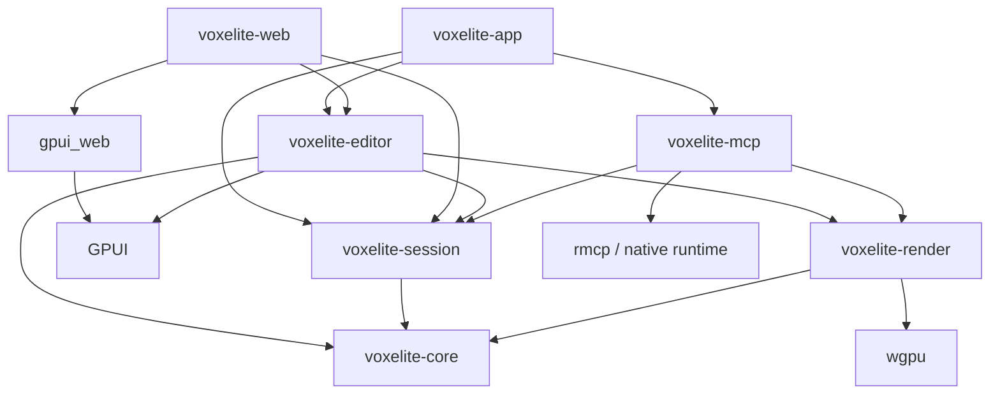

# Voxelite v1 plan

Status: implementation specification; no application code is claimed complete. Facts checked 2026-10-24. Voxelite is the voxel editor built for AI agents, with an excellent human editor and a live view of every agent edit. This is the primary product and marketing position. The MIT-licensed app is all-Rust GPUI with Zed-level native polish: a native macOS application and the same GPUI editor compiled for the browser. The HTML concepts are design artifacts, not the production application stack.

## 1. Product contract

### Goals

- Make agents effective at voxel creation through a rich, versioned MCP API: atomic batches, primitives, explicit coordinates, deterministic diffable files, multi-angle render feedback, structured validation, reversible history and headless/CLI use. Humans can watch builds live, inspect each step and take over with a complete keyboard-first editor. Finish, save and export without an account.
- Ship native macOS and web versions with the same document model, tools, history, renderer, and GPUI views. Web target: `wasm32-unknown-unknown`, `gpui_web`, WebGPU preferred, WebGL2 fallback.
- Let MCP clients create, inspect, edit, and render the document visible in the app. Human and agent edits share validation, revisions, and undo history.
- Preserve editable work in `.voxl`; export `.glb` and PNG. Make bounded documents portable between native and web builds.
- Follow [design/ART-CHECKLIST.md](design/ART-CHECKLIST.md) throughout implementation and review. Ship an art-quality example model, not placeholder cubes.
- Publish source, build instructions, schemas, examples, and release artifacts without personal information. Deploy the web editor and a separate marketing website to Vercel.

### Non-goals

Agent-host integration packages (Cursor plugin, Codex CLI setup, Claude Code/Desktop setup) and repository skills are in scope; the runtime-plugin exclusion below does not apply to them.

Animation/timelines, rigging, sculpting, arbitrary meshes, texture painting, transparent voxel materials, physics, third-party editor runtime plugins, cloud accounts/storage, multi-user collaboration, mobile editing, and native Windows/Linux releases are outside v1. No MagicaVoxel `.vox` import or export. Aseprite informs workflow, not copied code, branding, icons, or artwork. No Electron, JavaScript editor implementation, or alternate web UI.

Application logic, UI, MCP, build orchestration, and website generation are Rust. GPU shaders use WGSL; generated `wasm-bindgen` JavaScript, static HTML/CSS, platform bindings, and deployment configuration are necessary integration artifacts. Do not promise a browser build with literally zero JavaScript.

### Release envelope

- macOS 13+ on Apple silicon; universal arm64/x86_64 release only after both targets pass the same tests. Record any higher minimum imposed by the pinned GPUI release before M1.
- Desktop browser editing at 1024×640 CSS pixels or larger, mouse or trackpad and keyboard. Test current stable Safari, Chromium, and Firefox at release; record exact versions/backend support in the release matrix.
- Shared hard limits: 256 cells per axis, 64 layers, 256 opaque palette slots, 1,048,576 occupied layer-voxels, and 8,192 allocated layer-chunks. Overlapping voxels in different layers count separately. Fail before mutation on limit violations.
- Reference benchmark: an original 128³ scene with 250,000 occupied voxels, eight layers, and no more than 500,000 exposed faces. On an M1/8 GB reference Mac at 1440×900 logical size: p95 orbit frames ≤16.7 ms native/WebGPU and ≤33.3 ms WebGL2; local single-voxel input-to-display p95 ≤50 ms; connected MCP commit-to-display p95 ≤100 ms for batches of 1,000 voxels. Record DPR, browser, build, and GPU with measurements.
- Target ≤256 MiB wasm linear memory and ≤256 MiB tracked GPU allocations on that fixture; no promise that worst-case geometry fits that budget. Pathological inputs must produce bounded work and a recoverable error. Freeze measured limits in M1, then enforce them in core and clients.

## 2. Verified dependencies and early feasibility gates

| Fact verified | Planning consequence | Primary source |
| --- | --- | --- |
| Zed merged “GPUI on the web” on February 26, 2026, PR #50228. | Use upstream `gpui_web`; the merge is not evidence that every browser integration is production-ready. | [Zed PR](https://github.com/zed-industries/zed/pull/50228) |
| Registry metadata reports `gpui-unofficial`, `gpui-platform-gpui-unofficial`, and `gpui-web-gpui-unofficial` at `1.25.3`, Apache-2.0. The distribution mirrors Zed releases and is unofficial. | Initial candidate pins are `=1.25.3` for the entire family. Alias packages to `gpui`, `gpui_platform`, and `gpui_web`; use one compatible family, never mixed official/unofficial types. | [GPUI docs](https://docs.rs/gpui-unofficial/latest/gpui/), [web registry metadata](https://crates.io/api/v1/crates/gpui-web-gpui-unofficial), [platform metadata](https://crates.io/api/v1/crates/gpui-platform-gpui-unofficial) |
| Upstream `gpui_web` defaults to multithreading; `gpui_wgpu` enables `wgpu/webgl` for wasm. | Audit feature unification and runtime backend selection; test the whole editor with WebGPU disabled. Prefer a single-thread web baseline if supported by the selected pin. | [web manifest](https://raw.githubusercontent.com/zed-industries/zed/main/crates/gpui_web/Cargo.toml), [renderer manifest](https://raw.githubusercontent.com/zed-industries/zed/main/crates/gpui_wgpu/Cargo.toml) |
| `wgpu` supports Metal, WebGPU, and WebGL2; it exposes WebGL2-specific downlevel limits. | Select the version compatible with pinned GPUI, not independently the newest version. Avoid compute-only rendering and storage-buffer requirements. | [wgpu](https://docs.rs/wgpu/latest/wgpu/), [limits](https://docs.rs/wgpu/latest/wgpu/struct.Limits.html) |
| `rmcp` is the official Rust MCP SDK; current registry release is `3.7.0`, Apache-2.0, with stdio and Streamable HTTP features. | Candidate pin `=3.7.0`; explicitly enable only required transports. Generate JSON Schemas with `schemars` and also validate ranges in Rust. | [release metadata](https://docs.rs/crate/rmcp/latest), [registry features](https://crates.io/api/v1/crates/rmcp) |
| Vercel accepts prebuilt output; current documentation describes WebSocket support in Functions as beta with connection-duration/reconnect constraints. | Host static editor/site assets on Vercel. Keep the v1 authoritative session local; do not build a cloud daemon dependency or assume Functions cannot support sockets. | [Build Output API](https://vercel.com/docs/build-output-api), [WebSockets](https://vercel.com/kb/guide/do-vercel-serverless-functions-support-websocket-connections) |

These are research results, not a tested lockfile. M0 must compile the selected crate versions, inspect their actual source/licenses/features, record compatible Rust and wasm tooling versions, and commit `Cargo.lock` and `rust-toolchain.toml`. If registry packages are incomplete, pin the entire GPUI family to one audited upstream commit or a narrowly maintained patch fork. Record patches and an upstream removal plan in an ADR. Never silently replace GPUI or omit WebGL2.

M0 must prove: a macOS GPUI window; the same GPUI view in wasm; a depth-tested rotating voxel mesh in its viewport; correct overlapping menus, clipping, scaling, and pointer routing; PNG readback; WebGPU-to-WebGL2 selection for UI and viewport; browser file download; keyboard/text input; system theme changes; and the browser-companion connection path. A failed integration gate blocks dependent UI work.

## 3. Workspace and architecture

| Crate / directory | Responsibility and boundary |
| --- | --- |
| `crates/voxelite-core` | Pure Rust model, sparse chunks, palette/layers, typed commands, validation, history, deterministic serialization, palette import, CPU meshing, GLB encoding. No GPUI, OS handles, GPU, sockets, or Tokio. Compiles natively and to wasm. |
| `crates/voxelite-render` | `wgpu` rendering, cameras, picking transforms, lighting/AO, viewport overlays, offscreen targets, PNG encoding. Consumes immutable core snapshots and dirty chunk sets; never edits documents. |
| `crates/voxelite-session` | Shared command/session facade, revision and event schemas, local authority, remote client, artifact handles. Native feature adds runtime/IPC/WebSocket service; wasm feature uses browser networking and scheduling. Core commands remain platform-neutral. |
| `crates/voxelite-editor` | GPUI views, tool gestures, palette/layer panels, focus/actions, theme tokens, dialogs, accessibility metadata. Uses the session facade rather than changing model memory directly. |
| `crates/voxelite-mcp` | `rmcp` server library and `voxelite-mcp` binary: tool schemas, resource adapters, stdio proxy, optional Streamable HTTP, headless session hosting. Native only; no dependency on editor UI. |
| `crates/voxelite-web` | `cdylib` wasm entry; `gpui_web` initialization, canvas lifetime, browser platform adapter, storage/download bridge. Imports the shared editor root. |
| `crates/voxelite-app` | `voxelite` macOS binary; GPUI platform startup, menus, file associations, native platform adapter, embedded session host/MCP endpoint. |
| `xtask/` | Rust build/package/deploy-output tasks, schema generation, fixture checks, website static generation. |
| `site/`, `web/`, `design/`, `tests/fixtures/` | Separate marketing templates/assets; app bootstrap/config; visual specs/reviews; redistributable deterministic test data. |

Dependency arrows mean “depends on”; platform dependencies are target/feature gated:



The native app normally owns one authoritative session host on a background runtime; GPUI stays on its required UI thread. The stdio MCP binary discovers and proxies to that host. Explicit `voxelite-mcp serve --headless` owns the same engine without a window; the native/web app can attach to it. Never create a second authority merely because discovery times out. Standalone web editing owns an in-process Rust session; pairing transfers a snapshot to a companion-hosted document and then routes all edits through that authority.

`PlatformServices` covers open/save dialogs, byte persistence, clipboard, theme notifications, timing, and opening external links. Native uses OS APIs; web uses Rust `web-sys` bindings. Native worker threads handle meshing/compression; single-thread wasm slices work into ≤8 ms tasks and yields between slices. Large work prepares a private patch and commits atomically. Do not block GPUI or the browser event loop awaiting network/GPU completion.

Supporting dependency candidates: `serde`/`serde_json` for explicit schemas, `uuid` for IDs, `glam` for math, `zip` with a Rust DEFLATE backend, `png` for bounded image decoding/encoding, `proptest`/Criterion for verification, and Tokio plus a Rust HTTP/WebSocket stack behind native session features. Audit licenses, wasm support, default features, and MSRV before pinning. Prefer feature-minimal dependencies; do not pull image formats or native compression libraries into the core unnecessarily.

### Renderer integration decision

Use real 3D mesh rendering with depth testing. GPUI primitives are appropriate for panels, labels, tool cursors, and gizmos, not one UI element per voxel face.

1. **Preferred:** render offscreen with `wgpu` and composite a texture in a custom GPUI viewport element. On macOS `wgpu` uses Metal; prove texture/device ownership, synchronization, color conversion, and lifetime across GPUI's Metal backend. A `wgpu::Texture` is not automatically importable by GPUI.
2. **Fallback integration:** a dedicated clipped Metal-backed child surface on macOS and a positioned WebGPU/WebGL2 canvas on web, driven entirely from Rust. GPUI owns viewport layout and input arbitration. Prove menus/modals paint above the surface, resizing and DPR changes are exact, and hidden windows stop drawing. A child surface that covers menus fails the gate.
3. **Diagnostic only:** CPU readback followed by GPUI image upload. Measure bandwidth/latency; do not accept it as the production viewport unless it meets the same frame budgets. Export readback is a separate, infrequent operation.

M0 records the selected integration and any minimal GPUI patch. There is no approved separate-web-editor fallback.

CPU mesh generation culls internal faces across chunk and layer boundaries; greedy merging may merge only faces with compatible color and AO. Face culling invalidates six neighboring chunks; corner AO also requires edge/corner neighbors, so conservatively invalidate all 26 neighbors. Layer visibility/order changes invalidate affected composite chunks. Render indexed triangles, normals, palette color, depth, and camera-relative top-left key light with subtle voxel-corner AO. Keep a WebGL2 path using vertex/index buffers, uniforms, and simple textures, without compute shaders, storage buffers, or mandatory float render targets. Chunk oversized meshes into supported index/draw limits. Use CPU grid DDA picking; resolve exact boundary ties consistently.

Use sRGB palette input, linear lighting, and one output color conversion. Antialias silhouettes using supported MSAA or a tested postprocess; exports can supersample. Voxel geometry remains deliberately cubic; UI and silhouettes must not show accidental jagged/pixel-stepped edges. GPU loss recreates resources from CPU state without losing edits. Cap generated geometry and allocations; offer a lower preview resolution without changing exported geometry.

## 4. Model and command semantics

### Coordinates, palette, layers, and storage

- Right-handed coordinates, Y up. A voxel at integer `[x,y,z]` occupies `[x,x+1) × [y,y+1) × [z,z+1)`; centers are half-integers. Every region is integer `min` inclusive / `max` exclusive. Bounds have positive extents ≤256; coordinates stay within `[-32768,32768)` to bound arithmetic. Default bounds: `[-32,0,-32]..[32,64,32]`.
- `Document { id: UUID, name, bounds, palette, layers }`. Names are UTF-8, ≤128 bytes, no control characters. IDs are random opaque values, never machine/user identifiers. Each open document has its own monotonically increasing `u64` revision, starting at 0. The session additionally numbers all events with a global sequence. Both are decimal strings over JSON; neither belongs in portable `.voxl` content. An authority epoch distinguishes restarts.
- Palette: stable `u16` slots `1..=256`; `0` means empty, never a color. Slots contain sRGB RGBA8 with alpha 255 and an optional name. Deleting a referenced slot requires an explicit replacement slot and rewrites references atomically; slot reordering is display-only. Stable IDs prevent accidental recoloring.
- Layers: ordered bottom-to-top vector of `{id, name, visible, locked, chunks}`. At least one layer; no transforms or opacity in v1. At a coordinate, the highest visible nonempty layer wins. Hidden layers persist but do not render/export by default. Locked layers render and can be sampled but reject voxel mutations/deletion; explicit unlocking is required.
- Each layer stores `HashMap<ChunkCoord, Chunk>`, with 16³ cells/chunk. Use Euclidean division/remainder for negative coordinates. Local index `x + 16*y + 256*z`; empty chunks are absent. A chunk uses sorted sparse `(u16 local_index, u16 palette_slot)` pairs, promoting to a 4,096-entry `u16` array at 256 occupied cells; demote below 128. These thresholds are runtime details, not file-format rules.
- Editing targets the active visible, unlocked layer. Pick against the visible composite; if an erase/paint/fill hit belongs to another layer, show a non-destructive blocked cursor until the user selects that layer. Picker may sample any visible layer. Place adds the adjacent cell in the active layer; an empty scene uses the floor/work-plane intersection. Reject out-of-bounds edits, never wrap coordinates.

### Commands, transactions, and history

Typed commands include `SetVoxels`, `EraseRegion`, `FloodFill`, `Box`, deterministic primitives, atomic batches, palette/layer operations, and document import. UI gestures and MCP call these same handlers. Validate IDs, bounds, locks, palette references, revisions, and budgets before committing. Each editing gesture or MCP transaction creates exactly one undo item (a batch is one transaction); create/import establish a revision-0 document with empty history, while undo/redo move existing entries between stacks. Repeated coordinates in a patch resolve to their final requested value before mirroring; conflicting mirrored values reject. Failure/cancellation leaves model, revision, and history unchanged. A no-op adds neither a revision nor history. Core rejects voxel edits on hidden or locked target layers regardless of caller; MCP always supplies its own target layer rather than using UI selection.

Flood fill is six-connected within one layer: replace the seed's existing slot, including slot 0 for bounded empty-space fill, with a live nonzero slot. Require the seed inside a finite region contained in document bounds, defaulting to document bounds; cap visited cells at 1,048,576. Box has solid/hollow shape and place/paint/erase mode; paint affects occupied cells only. UI fill/box previews show affected bounds before applying large changes.

Mirror toggles X/Y/Z independently. Mirror plane is encoded by integer `plane2 = 2*p`; reflecting a cell coordinate uses `x' = plane2 - x - 1`. Defaults are the midplanes of the document bounds. Generate all enabled combinations, deduplicate center-plane hits, and reject the entire command if any reflected cell is invalid or the expanded transaction exceeds its budget. Place writes reflected cells; paint skips reflected empty cells; erase clears them. Fill writes its replacement to the reflected changed-cell set, not additional unconstrained flood searches. MCP mirroring is explicit per call, never inherited from another client's UI state.

History stores agent/client origin, tool name, stable entry ID, changed bounds, added/removed/recolored counts, captured revision and reversible before/after patches for voxel, layer, and palette changes, including visibility/locks/order. Undo/redo operate on the shared session timeline; undo may undo an agent's last edit and is labeled accordingly. Both increment revision and emit normal changes. New edits clear redo. Camera, focus, selection, current color/tool, and mirror toggles are client-local preferences, not document history. Bound history at 128 MiB; evict oldest complete entries, disclose the history boundary, and reject a single transaction that cannot fit rather than silently losing undo. Dirty state compares saved content identity, so undo back to saved content clears it. `read_history` exposes retained entries and boundaries to agents. A per-step revert is a new compensating transaction: validate that every affected field still equals the selected entry’s after-state and that current locks allow reversal. Otherwise return `history_conflict` with field/coordinate details; never silently overwrite a later human or agent change. Standard undo/redo still operate on the shared top-of-stack timeline.

## 5. `.voxl` format 1.0

Canonical `.voxl` is UTF-8 JSON, MIME `application/vnd.voxelite.project+json`, with explicit integer coordinates. Direct Git diffs and agent text inspection are required. This supersedes the earlier proposed ZIP/binary container before implementation; runtime chunks are an internal acceleration structure, never the canonical interchange format.

Required top-level fields: `format: "voxelite"`, `version: {major:1,minor:0}`, `required_features: []`, `document: {id,name,bounds}`, `palette: {slots,order}`, and `layers`. Each layer has `id`, `name`, `visible`, `locked`, and `voxels: [[x,y,z,slot], …]`. Slots are unique, live and opaque; coordinates are unique per layer and contained in document bounds. Layer array order remains bottom-to-top. Optional `view` is a portable camera/active-layer hint; invalid hints can be discarded independently. Images are separate PNG exports, not large base64 fields in project diffs.

Example (synthetic IDs; complete one-voxel document):

```json
{
  "document": {
    "bounds": {"max": [32, 64, 32], "min": [-32, 0, -32]},
    "id": "00000000-0000-4000-8000-000000000001",
    "name": "Untitled"
  },
  "format": "voxelite",
  "layers": [{
    "id": "00000000-0000-4000-8000-000000000002",
    "locked": false,
    "name": "Layer 1",
    "visible": true,
    "voxels": [
      [0, 0, 0, 1]
    ]
  }],
  "palette": {"order": [1], "slots": [{"index": 1, "rgba": [128, 128, 128, 255]}]},
  "required_features": [],
  "version": {"major": 1, "minor": 0}
}
```

M1 freezes `spec/voxl/v1/` JSON Schema, canonical-writer specification and golden bytes. Writer uses LF, final newline, two-space object indentation, stable lexicographic field order, ascending palette slot IDs, and lexicographic `(x,y,z)` voxel order. Each voxel tuple occupies its own line; no packing based on runtime chunk thresholds. Preserve explicit palette display order and layer order. Equivalent documents yield byte-identical output across native, wasm and CLI; identity, palette IDs and layer IDs survive save/reload. No wall-clock timestamps, author data, machine names or absolute paths. Camera changes are optional and excluded from content hashes when comparing geometry.

Reader accepts arbitrary JSON field order/whitespace but rejects duplicate object keys, invalid UTF-8, duplicate coordinates/IDs, noninteger coordinates, invalid palette references, unsupported required features and unknown major versions. Bound input to 128 MiB, depth to 32 and allocations to the published core budgets before installing a document. Use streaming/bounded parsing; no arbitrary paths, executable payloads or external asset URLs. An invalid file leaves the current document intact. Negative tests include deeply nested JSON, giant arrays, integer overflow, malformed Unicode and truncated documents.

Unknown optional fields are retained within documented size limits; refuse a lossy save if they cannot be preserved. Major-version migration is an explicit pure function with fixture coverage, preserving the original file. Newer minors require supported `required_features`. Publish schema, format rationale, coordinate/layer semantics, canonicalization rules, migration policy, readable fixtures and a CLI validation example in versioned docs. `voxelite format --check` verifies canonical bytes; `voxelite validate` returns structured errors and a nonzero exit on invalid input. A local binary cache may be rebuilt from the canonical document and must never be needed to exchange it.

Native save writes a sibling temporary file, flushes, then atomically renames; failed saves preserve the prior file. Recovery snapshots go to app storage after a two-second idle debounce, with bounded retention. Browser recovery uses versioned IndexedDB transactions; explicit Save downloads `.voxl` bytes, with File System Access only as an optional supported enhancement. Display quota failures and keep the document dirty. Browser download initiation does not prove the user retained a file. Unsaved close/reload prompts and recovery are tested on both platforms.

## 6. v1 acceptance criteria

Every row is required on native and web unless a platform difference is stated. Test against empty, representative-art, boundary, overlapping-layer, and malformed-input fixtures.

| ID / feature | Concrete acceptance criteria |
| --- | --- |
| F01 Workspace | Viewport dominates the default 1440×900 layout; compact human tools, a prominent agent session dock, palette/layers, restrained command strip and concise status. The chosen concept must show live tool calls, added/removed diff counts, per-step revert, multi-angle render thumbnails and a follow-agent camera toggle. Following is opt-in and stops on manual orbit; session state never obscures the artwork. At 1024×640, panels collapse without obscuring tools. Open/create/save/export are keyboard reachable. |
| F02 Orbit/pan/zoom | RMB drag or Alt+LMB drag orbits; MMB or Space+LMB pans; wheel/pinch zooms toward cursor. Alt+LMB becomes orbit after a 4 CSS-pixel movement threshold; a stationary click is the picker. Trackpad-only workflow works. Clamp pitch/distance, prevent NaNs, maintain cursor capture during drags, and release it on cancel/focus loss. Home frames the visible model; empty model frames bounds. |
| F03 Grid/axes | Antialiased floor at bounds minimum Y, major/minor grid lines, clear origin, and labeled X/Y/Z gizmo. Clicking an axis selects the corresponding orthographic view; return to perspective without changing geometry. Grid/gizmo toggles do not dirty the document or appear in default exports. |
| F04 Place | Click adds one voxel adjacent to hit face or on work plane; drag interpolates a continuous grid stroke with no skipped cells. Preview shows target/mirror cells. Whole stroke is one undo; empty/out-of-bounds/locked cases obey core rules. |
| F05 Erase | Click/drag removes only eligible active-layer cells. No hit is a no-op; hidden/locked/other-layer cells are not removed. One drag is one undo. |
| F06 Paint | Changes palette references on existing active-layer cells, never fills empty space. Stroke interpolation, mirrors, and undo match Place. |
| F07 Fill | Six-connected same-slot component inside finite bounds is replaced. Diagonal-only neighbors remain unchanged; chunk seams work; large fills remain cancellable before commit. Resource-limit failure is atomic. |
| F08 Box | Drag defines footprint on the chosen XY/XZ/YZ work plane; numeric or wheel depth completes integer bounds. Enter commits, Escape cancels. Solid/hollow and place/paint/erase modes produce exact min/max cells, including one-cell-thick boxes. |
| F09 Color picker | `I` selects picker; Alt+click samples without switching tools, with gesture arbitration from F02. Sample the visible voxel's original palette slot, independent of shading. Empty background leaves current color unchanged. |
| F10 Mirror X/Y/Z | Independent toggles, visible plane guides, editable integer/half-integer origins, and all eight symmetry combinations. Center-plane cells change once; one gesture stays one undo; no silent clipping at bounds. |
| F11 Palette | Selected swatch and color value are clear in both themes; create/edit/remove/reorder colors, presets, and import `.hex`, `.gpl`, or PNG. Changing a color updates every referencing voxel. Removal/remap is explicit and undoable. Ship original neutral, warm, and vivid presets with provenance. |
| F12 Palette import | `.hex`: one `RRGGBB`/`#RRGGBB` per nonblank line. `.gpl`: validate `GIMP Palette`, header fields, comments, and 0–255 RGB rows. PNG: ≤4096×4096, ≤8 MiB input; collect unique opaque colors in scanline order, ignore alpha 0, reject partial alpha. Deduplicate exact colors; reject >256 resulting slots with no partial import. Append/replace preview shows remaps and affected voxels. |
| F13 Layers | Create, name, select, duplicate, reorder, delete; show/hide and lock/unlock. Top visible occupied layer wins exactly as specified. Cannot delete last layer; locked deletion requires unlock. Reorder/visibility changes update occlusion and export. Deleting a populated layer is reversible and never styled as a primary action. |
| F14 Undo/redo | Cmd/Ctrl+Z and Shift+Cmd/Ctrl+Z reverse/reapply complete gestures and agent batches, including palette remaps and layer deletion. Ten thousand randomized operations round-trip under property tests. History budget boundaries are explicit. |
| F15 Shortcuts/focus | `B` Place, `E` Erase, `P` Paint, `G` Fill, `U` Box, `I` Picker; `[`/`]` previous/next palette slot; Cmd/Ctrl+N/O/S and Shift+Cmd/Ctrl+S Save As; Cmd/Ctrl+Shift+E Export. Escape cancels previews. F6 cycles focus regions; Tab toggles panels only when viewport-focused, otherwise traverses controls. A keyboard voxel cursor uses arrows for X/Z, PageUp/Down for Y, and Enter to apply the selected single-cell tool; box bounds also accept numeric entry. Tooltips/help list bindings; text fields suppress tool shortcuts; browser-reserved shortcuts have visible menu alternatives. |
| F16 Projects | New/open/save/save-as/recovery round-trip exact voxels, palette, layer order/flags, bounds, and IDs across native/web. Corrupt/newer incompatible files fail safely. Unsaved-state handling never silently discards edits; example project opens directly from the welcome state. |
| F17 GLB export | Emit valid glTF 2.0 binary with visible composite geometry, flat normals, palette colors, right-handed Y-up, and one unit per voxel; remove internal faces. Flatten into one named model node with primitives grouped by palette slot; use linear RGB material factors, metallic 0, roughness 1. No hidden layers, floor, gizmo, or editor lighting baked into geometry. Validate with Khronos validator and inspect in two independent viewers. Document name and scale survive; empty export explains the issue. |
| F18 PNG export | Render selected camera at requested size, up to 4096×4096 when adapter/budgets allow; smaller supported size offered otherwise. Transparent or solid background, no UI, optional grid off by default. Correct alpha edges and orientation, sRGB metadata, no personal metadata. Native save and browser download produce decodable images. |
| F19 Themes/accessibility | Follow live system light/dark changes without restart; optional app override persists locally. Both themes use explicit tokens, readable disabled/selected states, visible focus, keyboard navigation, labeled icons, and non-color status cues. Verify contrast and screen-reader behavior on macOS and the browser; missing GPUI accessibility support is tracked as a release blocker for essential actions. |
| F20 MCP/live sync | Agent creates a model, adds mirrored voxels, edits palette/layers, fills, reads back, and receives PNG; open app updates without reopening. Human Undo reverses the latest agent batch. Stale writes, reconnects, duplicate retries, locks, and disconnect recovery behave as §7. |
| F21 Web parity | Same `.voxl` produces equivalent geometry and appearance under native Metal, browser WebGPU, and forced WebGL2. File import/export, browser storage failure, resize/DPR, theme changes, tab suspension, and device loss pass. Unsupported GPU shows a concise recovery/download message instead of a blank page. |

## 7. MCP contract and live sync

### Spec-first API and naming

Freeze `spec/mcp/v1/` before handlers: tool input/output JSON Schemas, versioned capabilities, error catalog, fixtures, and at least one executable request/result example plus a failure example for **every tool**, including batched and headless workflows. Names use lower snake case with verbs (`fill_box`, `create_shape`, `render_views`, `read_history`); names are stable within API v1. MCP protocol negotiation and the Voxelite API version are separate. `get_capabilities` advertises API/schema versions and supported operations. Additive optional fields are minor changes; breaking names/semantics require a new major with migration notes and supported-version tests.

Generate Rust types, reference tables and docs examples from the reviewed contract; CI checks schema/handler drift, example execution and every-tool coverage. Structured errors include stable `code`, concise `message`, `details` with field paths/coordinates, `retryable`, and current revision when applicable. Never require an agent to parse prose to recover. Capture headless and UI sessions using the same command implementation.

### Wire types and invariants

Use `rmcp` tool input/output schemas, tool descriptions, and MCP resources. Negotiate supported protocol versions; test the chosen SDK's current protocol and `2025-11-25` compatibility. Standard MCP transports are stdio and Streamable HTTP; the app's WebSocket change stream is an internal protocol, not an invented MCP transport. See the [MCP transport specification](https://modelcontextprotocol.io/specification/2025-11-25/basic/transports).

- `Vec3i = [i32,i32,i32]`; `Region = {min:Vec3i,max:Vec3i}`; `Color = [u8,u8,u8,255]`; `Mirror = {axes:["x"|"y"|"z"],plane2:Vec3i}`. Omitted mirror means none. UUIDs and revision strings are validated, not coerced.
- Existing-document calls require `model_id`. Mutations additionally require `expected_revision` and UUID `operation_id`; `create_model`/`import_project` instead allocate a model ID and require only `operation_id`. Session discovery/capabilities and artifact reads need no model ID. `label?` is a ≤80-byte history label. Optional parameters below use `?`; documented defaults are emitted in schemas.
- Mutation result `Change = {model_id:UUID,revision:string,operation_id:UUID,changed_voxels:u32,added:u32,removed:u32,recolored:u32,changed_layers:UUID[],changed_palette_slots:u16[],undo_entry_id?:UUID,warnings:string[]}`. Create/import also return document metadata and generated layer IDs. No-op returns unchanged revision, zero changed voxels, empty change arrays, no history entry.
- Reads return the captured revision. Multi-page reads use an immutable snapshot token, retained for 60 seconds, so concurrent writes cannot mix revisions. `cursor` is opaque, tied to model/revision/query; expired tokens return `snapshot_expired`.
- Runtime limits: 16 MiB encoded tool input, 65,536 explicit voxels per call, 1,048,576 visited/generated cells per fill/box, ≤8 MiB decoded palette/project upload, ≤10,000 returned voxels/page, and bounded queues. Resource limits are published by `get_capabilities`; clients split batches intentionally. Cancellation before commit aborts; cancellation after commit returns/retrieves the recorded result.
- Use copy-on-write chunks for immutable snapshots; retain at most four read snapshots and 64 MiB of uniquely retained chunk data per session. Expire/reject snapshots under pressure with an explicit error. Cap generated artifacts at 16 items / 128 MiB total, stored in private temporary storage on native; release on expiry or session exit. Bound decoded PNG memory as well as compressed bytes.
- Domain failures use MCP tool errors (`isError:true`) with `{code,message,details,current_revision?,retryable}`; invalid JSON-RPC/schema framing uses protocol errors. Codes include `revision_conflict`, `layer_locked`, `layer_hidden`, `out_of_bounds`, `invalid_palette`, `limit_exceeded`, `invalid_format`, `session_unavailable`, `snapshot_expired`, `renderer_unavailable`, `history_conflict`. Never return success for a queued/uncommitted command.
- Read-only tools declare read-only annotations; mutation/destructive/idempotence annotations reflect actual behavior. Annotations do not replace authorization or validation. Resources expose document metadata/palette/layer summaries and generated artifacts; change notifications invalidate subscribed summaries where supported.

### Complete v1 tool list

Common mutation/read fields above are part of every relevant schema even when omitted from table cells. Tools do not accept arbitrary filesystem paths, shell commands, URLs, or remote asset fetches.

| Tool | Additional parameters | Result / semantics |
| --- | --- | --- |
| `get_capabilities` | none | Tool/schema versions, protocol/backends, limits, session ID, renderer availability, supported import/export formats. |
| `list_models` | none | `{models:[{model_id,name,revision,bounds,dirty}],active_model_id?}` for the attached session only. |
| `create_model` | `name`, `bounds?`, `palette?:Color[]`, `activate?:bool=false` | `Change` plus initial unlocked layer and palette metadata; creates a new document, never replaces one. Defaults use §4 bounds and neutral preset. |
| `read_model` | `region?`, `layer_ids?:UUID[]`, `view?:"layers"\|"composite"="layers"`, `include_voxels?:bool=true`, `limit?:u32=1000`, `cursor?` | `{revision,metadata,palette,layers,voxels:[{layer_id,position,slot}],next_cursor?,snapshot_token}`. Explicit layer view includes hidden layers; composite reports visible winners. |
| `set_voxels` | `layer_id`, `voxels:[{position,slot}]`, `mode?:"place"\|"paint"="place"`, `mirror?` | `Change`; nonzero valid slots only. Place overwrites target-layer values; paint skips empty cells. Last duplicate wins before mirroring; conflicting reflected values reject. |
| `erase_region` | `layer_id`, `region`, `mirror?` | `Change`; erase occupied cells within half-open bounds, one atomic undo item. |
| `flood_fill` | `layer_id`, `seed`, `slot`, `region?`, `mirror?` | `Change` plus visited count; six-connected replacement of seed slot. Region defaults to model bounds, visited limit still applies. |
| `fill_box` | `layer_id`, `region`, `shape?:"solid"\|"hollow"="solid"`, `mode?:"place"\|"paint"\|"erase"="place"`, `slot?`, `mirror?` | `Change`; slot required for place/paint and forbidden for erase. |
| `apply_batch` | `operations:[{tool,args}]` | Atomic ordered whitelist of voxel/shape/palette/layer mutations, maximum 256 suboperations under shared aggregate limits. Validate against staged state; reject whole batch with failing operation index. One revision, operation ID and undo entry; no nested batches, history, imports or renders. |
| `create_shape` | `layer_id`, `shape`, `region?`, `endpoints?`, `slot`, `mode?`, `mirror?` | Deterministic solid/hollow box, ellipsoid, cylinder and integer line. Publish exact center sampling, radius/axis/endpoints rules and fixtures; no implicit randomness or floating-point raster ambiguity. |
| `validate_model` | `revision?`, `region?` | `{revision,valid,issues:[{code,path,position?,message}]}` for palette, bounds, layer and format constraints; read-only, no repair hidden in validation. |
| `read_history` | `cursor?`, `limit?:u32=50` | Retained entry IDs, origin, tool, label, revision, bounds, added/removed/recolored counts, undo availability and history boundary. No personal identifiers. |
| `render_views` | `revision?`, `views:[{name,camera}]`, `width?:u32=512`, `height?:u32=512`, `background?` | Up to six named views from one immutable revision, bounded total pixel/artifact budget. Return MCP image content plus per-view revision/hash metadata. Defaults/presets include front, back, sides, top and isometric; never change the human camera without follow opt-in. |
| `get_palette` | none | `{revision,slots:[{index,rgba,name?}],order,presets:[{id,name}]}`. |
| `add_palette_color` | `rgba:Color`, `name?`, `index?:u16` | `Change` plus allocated slot; default is lowest unused slot. |
| `set_palette_color` | `index`, `rgba?:Color`, `name?` | `Change`; recolors every reference; at least one property required. |
| `remove_palette_color` | `index`, `replacement?:u16` | `Change`; referenced slot requires distinct live replacement; reject if locked-layer references would change. |
| `reorder_palette` | `order:u16[]` | `Change`; permutation of all live slots, with no voxel remapping. |
| `import_palette` | `source:{preset_id}\|{format:"hex"\|"gpl"\|"png",data_base64}`, `mode:"append"\|"replace"`, `remap?:[{from,to}]` | `Change` plus imported/skipped slots and source-to-slot map. Replace requires complete mapping for referenced removed slots; no nearest-color guess. Reject indirect locked-layer remaps. |
| `list_layers` | none | `{revision,layers:[{id,name,visible,locked,voxel_count}],order}`. |
| `create_layer` | `name`, `above_layer_id?` | `Change` plus layer ID; default appends at top, visible/unlocked. |
| `update_layer` | `layer_id`, `name?`, `visible?`, `locked?` | `Change`; at least one field. Visibility/name changes are allowed when locked; unlocking must be a separate command from voxel edits. |
| `reorder_layers` | `order:UUID[]` | `Change`; exact permutation, bottom-to-top, geometry unchanged. |
| `duplicate_layer` | `layer_id`, `name?` | `Change` plus new layer ID; source may be locked, copy is unlocked above source; limits checked first. |
| `delete_layer` | `layer_id` | `Change`; reject locked or last layer; undo restores ID, position, metadata, and voxels. |
| `undo` | `entry_id?:UUID` | `Change` plus undone entry label; omitted ID undoes latest entry. Selected entry creates a compensating patch under §4 conflict/lock checks; rejects expired history or conflicting later changes. |
| `redo` | none | `Change` plus redone entry label; rejects revision conflict/empty redo. |
| `render_view` | `revision?`, `camera:{eye:[f32;3],target:[f32;3],up:[f32;3],projection:"perspective"\|"orthographic",fov_y_degrees?:f32,ortho_height?:f32}`, `width?:u32=512`, `height?:u32=512`, `background?:Color\|"transparent"="transparent"`, `grid?:bool=false` | MCP image content `{type:"image",mimeType:"image/png",data:base64}` plus structured `{revision,width,height,sha256}`. Max 1024 per axis / 1,048,576 pixels. Capture immutable snapshot; reject unavailable requested revision, invalid camera, missing GPU, or timeout. |
| `export_glb` | `revision?` | `{revision,artifact_uri,mime_type:"model/gltf-binary",byte_length,sha256}`; visible composite, same implementation as UI. |
| `export_project` | `revision?` | `{revision,artifact_uri,mime_type,byte_length,sha256}` for `.voxl`; exporting does not mark the open document saved. |
| `import_project` | `data_base64`, `activate?:bool=false` | `Change` plus metadata; validated `.voxl`, new document ID to avoid collision; reports source ID. Larger than 8 MiB imports use the app's file-open workflow. |
| `read_artifact` | `artifact_uri`, `offset?:u64=0`, `length?:u32=1048576` | `{data_base64,offset,byte_length,total_length,eof,sha256}`; max 1 MiB/page, session-scoped artifacts expire after 10 minutes. Enables bounded download when a client cannot consume resource links. |

Palette color edits may recolor locked layers, because lock protects voxel membership/references rather than global color definitions; label that effect in the UI. Remapping references is a voxel edit and must respect locks. UI and MCP use the same distinction.

Render/export without `revision` capture the latest committed state; an explicit revision must be current or retained by a live read snapshot. Camera components must be finite, eye distinct from target, and up nonzero/nonparallel; perspective requires FOV in `(1,179)` degrees, orthographic requires positive height. Irrelevant projection fields reject. Near/far planes derive from bounds. Rendering has a 30-second deadline and does not change the editor's camera. Artifact hashes cover the whole file, independent of read offsets.

### Session transport and authority

1. **Native discovery:** app creates a user-private runtime directory (0700) and Unix socket (0600), with random session ID and a versioned discovery record. Validate socket ownership; remove stale records only after verifying the owner process is gone. `voxelite-mcp --stdio --session <id|auto>` connects to the running session; if several exist, require an explicit ID. stdout contains MCP frames only; logs go to stderr. No app present returns `session_unavailable`, with an explicit headless-start instruction.
2. **HTTP option:** a local Rust companion can expose authenticated Streamable HTTP at `/mcp`, bound to loopback only by default. Check Host/Origin and reject unknown origins; require bearer authentication even on localhost. No public listening mode in v1. Read/write/render capabilities are scoped to the paired session. No general disk access is exposed by tools.
3. **App live stream:** native IPC and browser WebSocket `/session` carry a versioned envelope: `Hello{wire_version,session_id,epoch?,last_seq?}`, `Snapshot`, `Command{model_id,operation_id,expected_revision,payload}`, `Committed{seq,model_id,base_revision,revision,patch,origin,operation_id}`, `ModelCreated`, `Rejected`, `ResyncRequired`, and `Heartbeat`. All events include the authority epoch; document events receive global `seq`. Snapshot includes a captured sequence plus per-model metadata, revisions, and paged chunks; edits include changed bounds and palette/layer deltas. Snapshot pages come from one immutable capture, with subsequent events buffered until installation.
4. **Ordering:** one authority serializes all commands. Validate/precompute work against a snapshot, then recheck revision at commit. A stale operation rejects, never last-writer-wins. A UI stroke buffers locally and rebases only after a fresh preview/explicit retry; an agent rereads and retries deliberately. App validates contiguous session sequence and each affected document's base revision. Reconnect requests retained changes by sequence; after a gap, replace the replica from a fresh snapshot and preserve any uncommitted draft separately.
5. **Delivery and retries:** retain ≤1,024 events / 32 MiB of event history and ≤10,000 operation results / 10 minutes. Scope operation IDs to session epoch and authenticated client; compare the complete normalized request. Duplicate operation ID with identical payload returns the recorded result before revision validation; different payload rejects. Unknown outcome after expiry requires reread, never blind replay. Persist committed model/revision plus recent deduplication metadata in recovery storage; fsync/IndexedDB durability status is distinct from in-memory commit. A new authority epoch after crash requires snapshot resync.
6. **Backpressure/lifecycle:** cap each queue at 256 messages / 8 MiB; coalesce invalidations, never silently discard command results. Slow replicas get `ResyncRequired`. Heartbeat every 15 seconds; disconnect after 45 seconds without response. Editing remains local/offline until paired; paired clients freeze writes on disconnect, retain a recovery snapshot, and offer explicit “Continue as copy” with a new document ID. Reconnection does not merge diverged copies.

### Browser MCP constraints and supported path

The web page cannot spawn a Rust process, listen for inbound MCP, or expose its local filesystem. MCP runs in the native companion; the browser is an outbound session client. No agent API keys belong in wasm, Vercel variables shipped to the client, or browser storage. Pairing either attaches to an existing remote model or publishes the local snapshot as a new remote model ID with empty history; retain the local recovery copy until the snapshot and authority acknowledgment arrive. Show the history reset before publishing. The internal paged transfer supports the full document limit independently of the smaller MCP upload limit.

Pairing is an explicit user action: companion issues a single-use, high-entropy, short-lived code; the browser exchanges it for a memory-only session token. WebSocket authentication uses an initial authentication frame (browser WebSocket cannot set arbitrary Authorization headers), with a five-second unauthenticated timeout; do not put tokens in query strings or logs. Allowlist exact editor origins, enforce session scope/expiry, rate limits, and revocation. Vercel preview origins must be explicitly paired, not wildcard-trusted.

M0 tests hosted HTTPS-to-loopback behavior, including mixed-content and browser local-network permissions. Never rely on disabling browser security or installing a root certificate. Where a hosted page cannot reach the companion, the companion serves the exact released static app bundle from loopback, with same-origin session transport; “Open connected editor” launches that URL. This remains the same GPUI wasm app. Hosted editing still works independently; supported hosted-pairing combinations and the local connected fallback are documented accurately. A remote relay/account service is outside v1.

## 8. Visual system and theming

Vercel / Stripe restraint with Zed-level native GPUI construction. Pure black `#000000` dark canvas, panels, titlebars, menus and inputs; pure white `#FFFFFF` equivalents in light mode. No gray wash or gradients on chrome. One restrained accent (gold, violet or teal in the concept studies; choose one for the product); semantic danger and axis colors are restricted to their purpose. The viewport is the hero. Dense tools must still have deliberate grouping and calm panels. No dashboard cards, redundant explanatory copy, emoji controls, pixelated UI edges, or destructive primary buttons.

Initial semantic tokens (verify contrast before freezing):

| Token | Light | Dark | Usage |
| --- | --- | --- | --- |
| `surface.canvas` / `surface.panel` / `surface.raised` | `#FFFFFF` | `#000000` | Canvas, docked panels, titlebar, inputs, menus |
| `surface.hover` | `#F5F5F5` | `#141414` | Transient hover only |
| `surface.selected` | Accent at 5% | Accent at 8% | Selection includes accent edge/check, never color alone |
| `text.primary` | `#333333` | `#DEDEDE` | Main text |
| `text.strong` | `#171717` | `#FAFAFA` | Headings/current item |
| `text.secondary` | `#626262` | `#A1A1A1` | Readable labels/status |
| `border.subtle` | `#E6E6E6` | `#242424` | Decorative 1 px separators; dark range #1F1F1F–#2E2E2E |
| `border.control` | `#8B8B8B` | `#777777` | Essential input boundaries |
| `accent` / `focus.ring` | `#7152B2` | `#B8A4F0` | Initial violet candidate; contrast-checked gold/teal alternatives in concepts |
| `danger` | `#B42336` | `#FF8696` | Error/destructive text only; never primary delete |

Metrics: 4/8 px spacing; pixel-aligned 1 px hairlines; 28–32 px dense controls with ≥32 px primary hit areas; 4 px control radius, 8 px menus; 2 px focus ring. Bundle licensed **Geist / Geist Mono** locally, with native system sans/mono fallbacks and no network font load. 13–14 px labels, 12 px minimum metadata/shortcuts, 14–17 px section/request emphasis; tabular numerals for coordinates/diffs. No opacity-reduced essential text or unlocked icons. Use real macOS traffic lights in GPUI; muted inactive dots in static concepts. Single-row compact titlebars, aligned split panes, deliberate focus routing and OS menus; avoid floating dashboard cards and explanatory navigation lessons. ⌘K is a visible, functional command palette affordance, with shortcut search and complete keyboard navigation.

Create `design/tokens.json` as the production source for generated GPUI Rust constants and site/docs CSS variables; CI rejects divergence. The current concept CSS is the review prototype, not a claim that shared production token generation is implemented. Components, type ramp, icons, borders, spacing, focus, motion and selection states are shared across app, marketing, docs, README screenshots and onboarding. Layout is checked at 1×, 1.5× and 2×; test both themes as first-class designs.

Require ≥4.5:1 normal text contrast and ≥3:1 essential control/focus boundaries in both modes. Test selected/hover/disabled/locked/error states, keyboard focus, and reduced-motion preference. Use concise labels and shortcut tooltips; explain only actionable errors. System theme changes affect chrome/background, not palette values or exported model colors. A finished original sample model uses one top-left key light, soft AO, intentional materials/colors, and a composition worthy of a creative tool.

Round 2 interaction contract: selected tools, mirrors, colors and render cameras have a solid edge or shape cue as well as tint. Follow opt-in and the selected camera stay synchronized; manual orbit clears the preset selection, while framing or selecting a captured view disengages follow. Pause updates the session badge and active call together. Session totals show net applied changes; per-step diffs retain the original operation. Inspectable history exposes the target, coordinate diff, revision and applied/undone state, with neutral Undo/Redo actions. Use `render_views` for batches and label completed captures with their revision separately from the active request. Selection bounds/counts come from the document, never decorative transform fields. Command search keeps typing focus while arrowing through results and has a useful empty state; palette swatches support roving keyboard focus. Shared app/site/docs components inherit these focus, contrast and state conventions. HTML concept fixtures illustrate this contract; production MCP requests/results and native accessibility still require M4/M5 evidence.

## 9. Build, release, and deployment

### Native

- M0 pins Rust/toolchain components and dependency versions after real builds. Use workspace resolver and target-specific features; keep Tokio, native dialogs, sockets, and Apple bindings out of wasm. Commit lockfile; builds use `--locked`.
- `cargo run -p voxelite-app`; `cargo run -p voxelite-mcp -- --stdio --session auto`. Implement these exact entry points and a README smoke workflow.
- `cargo build --locked --release -p voxelite-app -p voxelite-mcp --target aarch64-apple-darwin`; repeat for `x86_64-apple-darwin` when supported. `cargo xtask package-macos` creates `Voxelite.app`, bundles resources/companion, `.voxl` document type, icons, and version/build metadata; `lipo` only for a tested universal release.
- Trusted release job signs nested binaries and bundle with Developer ID, hardened runtime, and minimal entitlements; submits using `xcrun notarytool`, staples, verifies with `codesign`/`spctl`, then packages signed ZIP/DMG. Follow [Apple notarization documentation](https://developer.apple.com/documentation/security/notarizing-macos-software-before-distribution). No signing secrets or identity strings in tracked files; temporary keychain destroyed after job. Test download/quarantine and clean-user launch on an actual Mac.
- Apple signing requires an eligible account/certificate. Prefer organization credentials; certificate publisher metadata may identify its holder. Do not claim a personally issued certificate is anonymous. If organization signing is unavailable, label the artifact unsigned and keep signed public-release completion pending; never instruct users to disable Gatekeeper globally.

### Web application

1. `rustup target add wasm32-unknown-unknown`; `cargo build --locked --release -p voxelite-web --target wasm32-unknown-unknown`. M0 records whether the pinned GPUI build requires nightly/build-std; if so, pin that toolchain and flags rather than claiming stable support.
2. Run a `wasm-bindgen` CLI version matching the crate and `--target web`; package generated JS/wasm, self-hosted fonts, icons, and original sample assets. `cargo xtask build-web` owns this sequence and outputs `dist/app/`. Use `wasm-opt` only if compatibility/snapshots still pass.
3. Audit `cargo tree -e features --target wasm32-unknown-unknown`: disable GPUI web/platform multithreading defaults transitively for the baseline where possible. If threads are mandatory, prove worker startup with atomics/build-std and cross-origin isolation; configure COOP `same-origin` and COEP `require-corp`, same-origin assets, and an explicit unsupported-environment message. Do not merely add headers and assume threads work.
4. Initialize the framework using the selected release's supported web lifecycle; keep the application alive across the async event loop. Rust handles file input, Blob downloads, IndexedDB, resize observer, theme media queries, and session networking. Generated bootstrap is minimal.
5. `cargo xtask package-vercel --project app` emits `.vercel/output/config.json` version 3 and `static/`. Serve `.wasm` as `application/wasm`; hash immutable asset names and cache for one year. HTML/release manifest revalidate. Set CSP to tested same-origin/font/script rules with wasm compilation allowed, explicit paired loopback connection endpoints where supported, and no broad remote-script allowance; include `nosniff` and referrer policy. Preserve real 404s for missing assets.
6. Deploy prebuilt output using pinned Vercel CLI in GitHub Actions: `vercel deploy --prebuilt` for trusted previews; add `--prod` for reviewed release tags. Vercel does not need to compile Rust during deploy. Keep project/org/token values in environment secrets. Node is CLI tooling only. Smoke-test the actual deployment's MIME types, headers, startup, forced WebGL2, file round-trip, and pairing claims.
7. Target compressed initial app assets ≤15 MiB and first editable frame ≤5 seconds on the reference machine at 50 Mbps/50 ms RTT; measure before freezing release budgets. Publish a minimal HTML loading/error shell. No service worker in v1: avoid stale wasm/glue mismatches. Deploy assets atomically, report build ID in diagnostics, and rollback to a known-good deployment if smoke checks fail.

### Separate marketing website, built by Codex

- Deliver `site/` as a separate project and Vercel deployment, not an app welcome screen. Codex implements Rust static generation via `cargo xtask build-site`, semantic HTML/CSS templates, optimized images, and links; no JS framework or app wasm required to read the site.
- Content leads with “The voxel editor built for AI agents.” Lead action: “Connect your agent”; secondary actions: open the human editor / download for macOS. Show a real MCP build progressing in the live GPUI session, multi-angle feedback and undo, followed by the excellent human editing tools. Include polished real editor screenshot in each theme; original voxel art hero; “Open editor” and “Download for macOS”; tools/layers/palette overview; MCP demo with reproducible commands; format support; installation/shortcut links; MIT/source/contribution links; release notes and compatibility limitations. Do not advertise unimplemented features or `.vox`.
- Shared visual tokens and restrained typography; product imagery carries the page. Responsive at 360, 768, and 1440 px; keyboard/focus and reduced-motion support; descriptive alt text, correct headings, social preview, metadata, sitemap, and canonical production URL. No fabricated testimonials, personal biographies, tracking, newsletter, or contact data.
- Showcase: build a gallery viewer shell for accessible, lazy-loaded, interactive/rotating GLB previews using the shared Rust/WebGL renderer; static posters, named orbit controls and reduced-motion defaults work without auto-rotation. Publish creation provenance, reproducible prompt/tool trace, source `.voxl`, downloadable GLB and agent host/API version. Producing the finished gallery pieces is **M8 after v1 works**, not a pre-v1 fixture collection or a claim that concept art was made through MCP.
- Use actual app captures and exports from a committed sample `.voxl`; remove usernames, paths, metadata, and unrelated desktop content. Track artwork/font licenses. Three critique rounds apply to the site independently of the app.
- `cargo xtask package-vercel --project site` emits a separate Build Output API directory; use a distinct Vercel project ID and independent preview/production promotion. Link to the deployed app and GitHub release downloads via reviewed configuration; do not invent domain ownership. Static site must work with JavaScript disabled; target Lighthouse accessibility/SEO ≥95 and performance ≥90 in a documented mobile profile.

### Documentation site and editorial quality

Deliver a separate, versioned documentation site at Vercel/Stripe quality, built from reviewed content with the shared tokens/components. Navigation: **Getting started**, **Human editor**, **Agent integrations**, **MCP API v1 reference**, **CLI/headless**, **`.voxl` format**, **Examples**, **Contributing**, **Changelog**. Every page has a clear task, prerequisites, working examples, expected output, relevant errors, next steps and version applicability. Avoid placeholder pages and marketing filler in reference material.

- Getting started offers “Connect an agent” and “Create by hand”; first useful result within five minutes on a clean machine. Human guide covers tools, layers, palettes, shortcuts, history, saving/export and recovery. MCP guide explains coordinates, batches, primitives, multi-view inspection, locks/revisions and error recovery before linking every tool to generated schema/reference/example pages. CLI covers create/edit/validate/render/export without a window, stdout JSON, stderr diagnostics and exit codes.
- Host installation pages are separate for Cursor, Codex CLI, Claude Code and Claude Desktop. Each includes native vs browser-companion setup, platform prerequisites, exact supported configuration paths, local transport details, verification via capabilities/read/render, uninstall and troubleshooting. Check each host's current supported installation mechanisms at implementation; publish tested versions and fallback manual steps, never promise an unsupported one-click mechanism.
- Documentation shell: left navigation with clear current page, stable heading anchors, right table of contents, local search with ⌘K, version picker retaining the closest equivalent page, copyable code blocks with honest status, dark/light mode and mobile navigation. Static content remains readable with scripts disabled. Keyboard focus, semantic headings, screen-reader labels, contrast, reduced motion and zoom to 200% are release gates.
- Generate API reference from `spec/mcp/v1/`, but hand-edit introductions, real workflows and troubleshooting. CI executes code/tool examples, checks all reference pages against the tool inventory, validates schemas/links and flags generated drift. Every release publishes immutable versioned docs plus a tested latest alias; preserve old links and migration notes.
- Three independent docs critique/fix rounds: information architecture and complete coverage; clean-machine novice/agent-host walkthrough plus keyboard/mobile use; editorial consistency, every-tool examples, accessibility, screenshots and search quality. Maintain a small content style guide: concise imperative headings, consistent terminology, realistic outputs, no personal paths or credentials. Documentation is a launch deliverable, not a README substitute.

### Ready-made skills and agent-host integrations

Ship `skills/` with installable `SKILL.md` packages and small tested prompts for Claude, Cursor, Codex and other compatible hosts. Required guides: core workflow; palette selection and limited color ramps; building from primitives/batches; inspecting front/back/side/top renders; and style guides for isometric props, characters and buildings. Each includes metadata, when to use it, bounded steps, example tool calls, finishing criteria, recovery/undo guidance and expected renders. Store original `.voxl` fixtures with palette/proportion/silhouette criteria. Teach agents to read capabilities, use explicit coordinates and revisions, validate before mutation, inspect multiple angles, correct errors and export the verified result. No hidden dependencies on a human viewport or paid hosted service.

| Host deliverable | Bundle and acceptance |
| --- | --- |
| Cursor plugin | `integrations/cursor/`: supported plugin manifest, MCP configuration, bundled skills and project rules, installation link/button when supported. One-click install is a milestone requirement, verified in a clean supported Cursor release; manual config fallback documented. Capability discovery → primitive batch → three views → undo runs successfully. |
| Codex CLI setup | `integrations/codex/`: versioned MCP config example, skill installation steps and project-scoped `AGENTS.md` guidance. Verify headless and attached native session paths; no real user home paths or tokens in templates. |
| Claude Code | `integrations/claude-code/`: tested MCP registration/configuration, compatible skills and workflow prompts. Verify tool discovery, batch construction, error recovery, render inspection and history. |
| Claude Desktop | `integrations/claude-desktop/`: tested local MCP configuration or supported installer, setup validation and troubleshooting. Explain any host-specific image/skill limitations with a tested alternative. |

Generate the docs skills catalog/install pages from repository metadata; publish per-host copy/install instructions, versions, example prompts and expected outcomes. Validate relative links and package contents in CI. Host-specific packages configure the existing local server; they do not add unrelated execution privileges or overwrite unrelated user configuration. These are integration artifacts around the Rust app, not editor runtime plugins.

### Onboarding and polish across surfaces

The app's empty state offers **Connect agent**, **Open project**, **Start drawing**, with one original sample as an optional learning path. An agent connection flow shows host selection, local connection status, an executable verification step and a live session; it never claims connection before a handshake succeeds. Empty history, no render yet, invalid request, disconnected/reconnecting host, locked layer, rendering failure and unsaved recovery each get a concise actionable state. Keep manual tools reachable while the agent builds; follow-camera is explicit, pause is local-session control, and per-step revert reports conflicts without losing work. The command palette includes all primary actions with shortcuts, search synonyms and focus restoration. Respect IME/text input and full keyboard navigation.

Polish ownership is explicit: one token source across app/site/docs; a component/state inventory with both themes; curated original artwork; consistent copy/keyboard vocabulary; visual diffs and human-scale screenshot inspection; accessibility checks and reference-machine performance evidence. App onboarding and keyboard-only workflows get three critiques before M5 exit. README starts with the agents-first promise, a real live-session screenshot, a short reproducible MCP/CLI example, host setup links, a clear native/web status matrix and human quick start. Do not label unimplemented features shipped. README links docs, skill installs, releases, changelog and contribution paths; examples execute in CI. Site, docs and README images must be updated against the release build, with sanitized metadata.

### Agent demos and benchmarks

Before M6, establish deterministic tasks with original fixtures: small prop from primitives, a character, a cottage, targeted edit/undo, and a bounded large model. Record agent host/model version, skill/API/app version, seed/prompt, tool trace, elapsed time, calls, serialized request size, validation failures/retries, final voxel count and multi-angle results. Separate host/model variance from editor performance. Publish reproducible benchmark scripts/results and concise captioned demo recordings for the site; show tool calls, live view, render checks and recovery. Do not fabricate “AI-made” provenance or speed claims. Final showcase artistry is M8; functional demo evidence is required before launch.

### Release polish, updates and distribution

Public v1 requires signed and notarised macOS builds; unavailable signing credentials block public distribution completion. M5 rehearses clean-machine quarantine launch, `.voxl` association, companion discovery and uninstall. Use a signed update feed and independently signed update artifacts with version/build/channel metadata, digest verification and rollback protection; verify signatures before installation, preserve documents, handle offline/cancel/interrupted updates, and test relaunch/recovery. Show release notes before restart and support a manual update path. Pin and audit the selected updater implementation during M0/M5; do not add a web runtime to the Rust app.

Maintain `CHANGELOG.md` with user-visible changes, API/format compatibility, fixes and migration notes. Release tooling generates notes, versioned docs, checksums/provenance and signed/notarized ZIP/DMG artifacts from one version. Prepare a Homebrew cask with project-owned URLs, exact version/hash, correct architecture/minimum OS, update behavior and install/uninstall audit; validate the cask against the signed release and submit only when artifacts are public. M7 evidence includes Homebrew install/upgrade/uninstall, previous-version auto-update, fresh native install and native/wasm CI for the release commit. CI adds docs build/link/example tests, skill/package validation, token drift and agent benchmark smoke workflows alongside existing Rust/native/wasm jobs.

## 10. Verification and GitHub Actions

### Test layers

| Layer | Required evidence |
| --- | --- |
| Unit | Negative-coordinate chunk math, palette references/remaps, layer composition/locks, DDA hit ties, mirror planes, fill adjacency, box bounds, history grouping, file reader limits, camera/color conversions, import parsers, GLB structure. |
| Property (`proptest`) | Sparse/dense equivalence; serialization round-trip/canonical bytes; apply→undo→redo equality; mirroring twice restores positions; fill never crosses region; hidden-layer noninterference; random UI/MCP command sequences produce identical snapshots. Persist failing seeds. |
| Format/security fuzz | canonical `.voxl` JSON/UTF-8/coordinate arrays, `.hex`/`.gpl`/PNG, MCP args and wire events. Bound allocations/time; truncated/malicious data must return errors, never panic or mutate state. Nightly time-bounded fuzzing and committed regression cases. |
| Render snapshots | Fixed cameras, pinned fonts, palette/lighting/seed, 512² images for art sample, axes, overlaps, chunk seams, both themes, and transparent exports. Compare geometry exactly; pixels use documented per-backend tolerances (initial SSIM ≥0.995 and ≤0.5% pixels beyond 8/255). Inspect diff images before any baseline update; never auto-bless. |
| UI/platform | Keyboard-only new→draw→palette→layer→undo→save→export; text/IME, menus/focus, drag interruption, high DPI, small windows, theme changes, VoiceOver/browser accessibility, file/quota errors, context loss. GPUI harness plus real macOS/browser tests. |
| MCP integration | Real `rmcp` client over stdio and Streamable HTTP; complete tool enumeration/schema checks; create/edit/render against an open session; UI/MCP contention, lock enforcement, revision conflicts, replay, reconnect, queue saturation, token expiry/Origin rejection, malformed requests, headless renderer unavailable. Decode returned PNG and compare captured revision. |
| Browser | `wasm-bindgen-test` plus Rust-driven WebDriver workflows; WebGPU and forced WebGL2 in GPU-capable runners, including entire GPUI chrome. Safari/Firefox cases recorded on real supported systems. Test optional hosted pairing and guaranteed same-origin companion path separately. |
| Performance | Criterion core benchmarks and instrumented rendering/session runs for the reference fixture and adversarial checkerboard/sparse geometry. Measure p50/p95 frame/input/sync latency, load/export time, wasm memory, GPU allocations, and bundle size. No silent skipped GPU tests. |

### CI jobs

Create `.github/workflows/ci.yml`, `visual.yml`, and `release.yml`. Pin third-party actions by commit, minimal `permissions: contents: read`, caches keyed by OS/toolchain/lockfile, and cancellation of superseded PR runs. Native-only feature matrices run on macOS; do not use a blanket incompatible `--all-features` invocation on wasm.

| Trigger / job | Commands or responsibility | Required gate |
| --- | --- | --- |
| Every PR: format/docs | `cargo fmt --all -- --check`; check Markdown links, schemas/fixtures, and generated-file drift. | No changes required after generation. |
| Every PR: core/MCP Linux | `cargo clippy --locked -p voxelite-core -p voxelite-session -p voxelite-mcp --all-targets -- -D warnings`; corresponding tests, format round-trip/property tests, transport integration. Disable optional GPU where unavailable, while testing explicit renderer-unavailable errors. | No warnings/failures. |
| Every PR: macOS | `cargo clippy --locked --workspace --all-targets --exclude voxelite-web -- -D warnings`; `cargo test --locked --workspace --exclude voxelite-web`; release build app+companion for arm64, plus x86_64 build when supported. | Real GPUI build and native unit/UI tests pass. |
| Every PR: wasm | Target-specific clippy for `voxelite-web`; `cargo xtask build-web`; wasm core tests; startup smoke in a browser. Assert native runtime/socket crates are absent from the wasm dependency graph. | Wasm/link/glue artifacts build and execute. |
| Every PR: site/supply chain | `cargo xtask build-site`; internal/external link checks; license/advisory checks with a pinned Rust tool; no secrets/personal metadata in fixtures/artifacts. | Site artifacts valid; third-party notices complete. |
| Visual changes + nightly | GPU-backed macOS/WebGPU/WebGL2 snapshots and performance suite; upload images/diffs/metrics. If hosted runners lack usable GPUs, use isolated trusted runners. | Required before visual PR merge/release; missing hardware is pending, never a pass. |
| Trusted PR previews | Build both Vercel prebuilt projects and deploy previews; smoke-test public URLs/headers. Fork PRs get local artifacts without secrets. | Preview links and check results available for review. |
| Release tag | Rerun gates; sign/notarize/package macOS; checksum/SBOM/provenance; GitHub release artifacts; promote app/site Vercel deployments; deployment smoke/rollback. | All feature rows and stage reviews accepted; credentials available for signed distribution. |

Use `pull_request`, not secret-bearing `pull_request_target` checkout of untrusted changes. Signing/Vercel jobs run only trusted code and protected environments. Keep project service credentials in GitHub/Vercel secrets. Unit tests need no developer machine state, external AI service, or internet. GPU/manual acceptance reports include artifact commit and environment; test results from another build do not satisfy release gates.

## 11. Open-source and repository setup

- Retain root `LICENSE`: MIT, copyright “Voxelite contributors”; add workspace package license/repository metadata. Audit each shipped GPUI/helper dependency rather than treating all Zed code as the same license. Preserve Apache notices and font/art licenses in `THIRD_PARTY_NOTICES.md` and release artifacts.
- `README.md`: product screenshot, supported platforms, native/web quick start, build prerequisites/pins, file formats, keyboard map, MCP connection example, browser companion limitations, test commands, MIT/license links, project status. Avoid absolute developer paths and personal usernames.
- `CONTRIBUTING.md`: architecture/boundaries, setup, commands, feature/bug workflow, tests, small reviewable PRs, fixture creation, visual review evidence, DCO-style signoff policy if adopted, and code/content licensing. Do not require a personal email in public examples.
- `CODE_OF_CONDUCT.md`: Contributor Covenant or equivalent with attribution and actionable reporting via a configured project-owned private moderation channel; no placeholder or personal contact address in a published release. Document response/escalation responsibilities.
- `SECURITY.md`: project-owned private vulnerability reporting and supported versions. `.github/ISSUE_TEMPLATE/bug.yml`, `feature.yml`, and `visual.yml`: app build, platform/backend, minimal reproduction, sanitized fixture/screenshot, expected/actual behavior. PR template includes validation and applicable art-checklist review evidence.
- `docs/`: format schema, MCP schema/examples, architecture ADRs, compatibility matrix, release procedure. `CHANGELOG.md` records user-visible changes. Keep contribution/issue links project-scoped.
- No personal names/emails, home paths, identifying screenshots/EXIF, tokens, signing identities, or analytics IDs in added docs, assets, sample data, logs, or generated artifacts. Use synthetic test identities and project-owned/noreply commit metadata. Public third-party project/source links are provenance, not contributor biographies. Do not rewrite existing history as part of setup.

## 12. Delivery stages and review process

Each stage M0–M8 requires **at least three critique → fix → review rounds**. A round is a recorded review of a concrete artifact followed by fixes and re-evaluation, not three prompts against the same untouched output. Store `design/reviews/Mx-round-{1,2,3}.md` with commit/artifact, screenshots where relevant, findings ranked blocker/major/minor, changes, evidence, and disposition. Codex self-critiques each round; maintainer review accepts the final artifact.

1. **Round 1 — correctness and completeness:** inspect semantics, requirements, failure paths, source facts, platform boundaries, and tests. For visual work, also inspect layout/copy against the art checklist. Fix blockers and missing acceptance cases.
2. **Round 2 — adversarial use and visual critique:** execute a realistic artist/agent workflow, boundary/large inputs, keyboard-only operation, both themes, DPRs, native and web fallback. Compare screenshots at full scale and close-up; critique spacing, hierarchy, jaggies, lighting, clutter, and destructive actions. Implement corrections.
3. **Round 3 — regression and release quality:** rerun impacted checks after fixes, inspect final artifacts and diff images, verify documentation and actual behavior agree, and repeat the full stage exit workflow. No blocker/major issue may remain; minor deferrals need an issue and rationale. New material changes restart affected review evidence.

For architecture-only stages, use executable spikes, diagrams, fixtures, and schema examples as review artifacts. Website rounds cover mobile/desktop, light/dark, copy, accessibility, real imagery, and deployed performance. The minimum is 27 recorded rounds across nine stages, with M8 following v1; repeat rounds until exit criteria hold.

| Stage | Depends on | Deliverables / exit gate |
| --- | --- | --- |
| M0 — Feasibility and pins | None | Build the GPUI native/web/3D integration spike; prove fallback UI+renderer, PNG, browser connection, licensing, toolchain/dependency pins. Choose integration ADR and companion path. Three reviewed rounds; stop on unresolved feasibility blockers. |
| M1 — Core and persistence | M0 | Workspace/core/session contracts; bounded sparse storage, layers/palette, commands/history, `.voxl` 1.0 reader/writer/malformed fixtures, recovery prototype, deterministic CPU meshing. Freeze measured limits; unit/property/format CI green. |
| M2 — Renderer and workspace | M1 | Native and wasm viewport, camera/grid/gizmo/picking, lighting/AO/AA, themes/tokens, panel skeleton, original art sample. Benchmark and render baselines accepted; native/WebGPU/WebGL2 share appearance. |
| M3 — Complete artist workflow | M2 | All editing tools, palette import/presets, layer controls, mirrors, shortcuts, undo/redo, native/web open/save/recovery, GLB/PNG export. F01–F19 end-to-end acceptance; no mocked actions. |
| M4 — MCP and live sync | M1, M2; integrate after M3 | Reviewed versioned spec first; complete tool/resource schemas, examples for every tool, batch/primitives, inspectable history, multi-angle rendering, CLI/headless, stdio/HTTP, native discovery, browser pairing/local served fallback, conflicts/retries/auth, headless rendering, session recovery. F20 and adversarial transport tests pass against actual UI. |
| M5 — Platform hardening | M3, M4 | F21, accessibility/platform edge cases, memory/performance budgets, feature parity, wasm packaging, signed/notarized packaging and auto-update rehearsal, Homebrew cask draft, deployment/rollback previews. CI matrices and security/dependency checks complete. |
| M6 — Public website and OSS | M3 captures, M5 compatibility | Codex builds separate marketing site and Vercel preview; finish full versioned docs site, host install pages, repo skills/plugin bundles, README/contribution/conduct/security/templates/licenses; reproducible agent benchmarks and sanitized demo recordings; site passes its three review rounds and linked workflows work. |
| M7 — Release candidate and v1 | M0–M6 accepted | Fresh-machine native install, real-browser artist+MCP workflow, all three backends, file exchange, export validation, website checks, three final critique/fix rounds, signed/notarized public artifacts (missing credentials keep release pending), tagged source/checksums and Vercel production promotion. |
| M8 — Agent-made showcase | Released working v1 and M4 contracts | Produce 6–9 original creations through actual MCP workflows: isometric props, characters, buildings and a larger scene. Preserve source, prompts, host/API versions, tool traces, multi-angle renders and GLBs. Curate gallery compositions, capture replay/demo videos and benchmark reports; inspect desktop/mobile WebGL performance and reduced-motion/poster fallbacks. Three separate art/site critique rounds before publishing. |

Ordering is dependency-driven; do not spend final UI/site polish before M0 proves the rendering/web path. Estimate dates only after the spike and representative benchmark; track each acceptance row as a milestone issue with test evidence.

## 13. Risks and mitigations

| Risk | Mitigation and decision gate |
| --- | --- |
| `gpui_web` maturity, feature churn, incomplete published family | Pin one audited family and lockfile; keep platform adapter narrow; compile both targets on every PR; maintain minimal documented patches. M0 proves lifecycle, text/IME, themes, accessibility, clipboard, and GPU selection. |
| GPUI is a UI renderer, not a ready-made 3D engine | Custom `wgpu` renderer with tested texture composition or clipped Metal/canvas surface. Validate device sharing, menus, clipping, DPI, readback, and frame budgets before tool development. GPUI voxel primitives are not the production fallback. |
| WebGL2 supported by `wgpu` but GPUI shaders/integration still fail | Force backend in CI and test chrome as well as geometry; use downlevel limits and no compute dependency. Patch the pinned integration if feasible; unresolved failures block the advertised fallback. |
| Wasm memory, sparse/pathological geometry, lack of threads | Fixed document/operation limits, sparse/dense chunks, bounded mesh generation, dirty-chunk work, cooperative scheduling, budget preflight, and recoverable allocation failure. Benchmark checkerboards and sparse worst cases, not only a solid cube. |
| MCP cannot run as a listening native service inside a browser | Local Rust companion owns MCP/authority; browser makes outbound connections. Prove hosted loopback policies; provide the same app bundle from companion origin when blocked. No cloud/session service hidden inside Vercel deployment. |
| Concurrent user/agent edits lose data or duplicate after retry | Single authority, expected revisions, operation IDs, atomic patches/shared history, capped replay, snapshot resync, explicit fork-on-disconnect; integration tests with reordered/disconnected streams. |
| GPU differences break snapshots or exports | Fixed scene/camera/light/color pipeline; backend-specific tolerances with geometry invariants; preserve diff artifacts and require visual inspection. Readback alignment and premultiplied alpha tested explicitly. |
| Project/import corruption or parser resource abuse | Bounded parsers, validated references, fuzz corpus, safe migrations, transactional open/save, native recovery and IndexedDB quota handling. No arbitrary file access or arbitrary paths. |
| Signing, browser permissions, or Vercel features differ from assumptions | Verify current vendor docs/pins at M0 and release; rehearsal on fresh machines and deployed URLs; protected secrets; honest unsigned/unsupported labels and rollback. Keep static hosting independent of server features. |
| Design drifts into generic dashboard or rough voxel demo | Art checklist as acceptance gate; original polished model; strict token/copy discipline; three critique/fix/review rounds per stage in both themes. Block jagged edges, misleading controls, and destructive primary styling. |
| Open-source license/provenance or identity leakage | Audit crate/file licenses, preserve notices, original examples, project-owned contacts, sanitized screenshots/logs, and artifact metadata checks before publication. |

Release is complete only when the specified native and web workflows, MCP editing/rendering, file interoperability, visual reviews, CI, documentation, and separate deployed website all have evidence against the release commit.

## 14. Plan self-review record

- **Pass 1 — architecture and semantics:** separated document revisions from session ordering; defined authority epochs and consistent paged snapshots; clarified browser authority transfer/history reset, create/import history, mirror expansion limits, hidden-layer rules, boundary chunks, and AO neighbor invalidation.
- **Pass 2 — completeness and usability:** added a concrete manifest example, bounded snapshot/artifact retention, render camera validation, keyboard/Alt gesture arbitration, GLB material semantics, and deterministic-preview rules; repaired Markdown enum tables and checked feature coverage, local links, JSON examples, and absence of personal information. These are plan reviews; implementation milestones and runtime tests remain future work.
