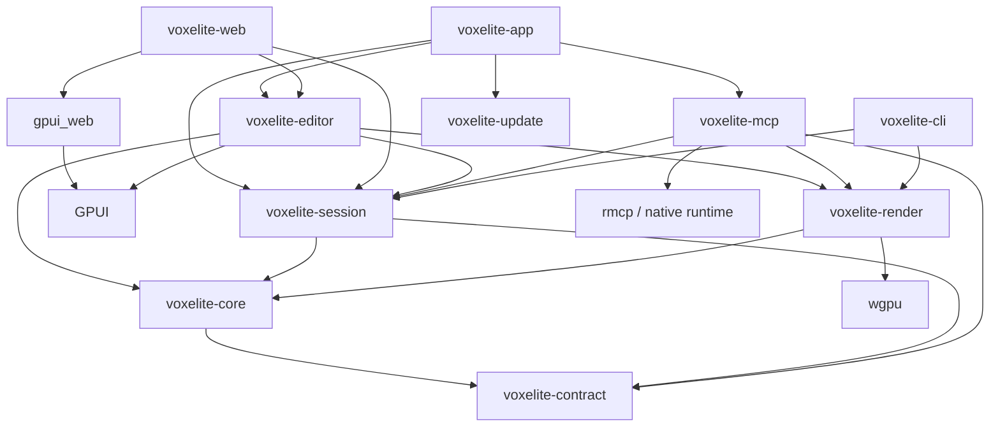

# Voxelite product and delivery plan

Status: revised implementation specification, round 1 of 3; implementation remains pending. Revised 2026-10-25; source research performed 2026-10-24. License: MIT. Product: all-Rust GPUI native macOS editor, the same GPUI editor compiled through `gpui_web` to wasm on Vercel, and a Rust MCP server/CLI.

## Contents

1. [Positioning and product contract](#1-positioning-and-product-contract)
2. [Verified facts and feasibility gates](#2-verified-facts-and-feasibility-gates)
3. [Architecture and boundaries](#3-architecture-and-boundaries)
4. [Model, commands, and history](#4-model-commands-and-history)
5. [Deterministic, diffable .voxl format](#5-deterministic-diffable-voxl-format)
6. [Versioned MCP API and tool catalog](#6-versioned-mcp-api-and-tool-catalog)
7. [CLI, authority, and live sessions](#7-cli-authority-and-live-sessions)
8. [Human editor acceptance](#8-human-editor-acceptance)
9. [Shared design system, theming, and onboarding](#9-shared-design-system-theming-and-onboarding)
10. [Agent skills and host integrations](#10-agent-skills-and-host-integrations)
11. [Professional documentation site](#11-professional-documentation-site)
12. [Marketing, showcase production, and agent evidence](#12-marketing-showcase-production-and-agent-evidence)
13. [Build, distribution, updates, and deployment](#13-build-distribution-updates-and-deployment)
14. [Verification, CI, and performance](#14-verification-ci-and-performance)
15. [Open-source repository and README](#15-open-source-repository-and-readme)
16. [Milestones and requirement traceability](#16-milestones-and-requirement-traceability)
17. [Risks and review discipline](#17-risks-and-review-discipline)

## 1. Positioning and product contract

**Voxelite is THE optimal voxel editor for AI agents, while fully supporting humans with an excellent native creative tool.** This is the product strategy and marketing hook. Agent efficiency is a design input: coordinate-first composition, batch primitives, compact inspection, deterministic text files, visual feedback, useful errors, safe history, and unattended operation. The shared viewport lets humans watch agents build, intervene, and finish the same work by hand.

Public lead: **“The voxel editor built for AI agents.”** Supporting line: “Build through MCP. See every edit live. Shape every detail by hand.” Primary CTA: **Connect your agent**; secondary CTAs: **Download for macOS** and **Open web editor**. README, site, docs, onboarding, and demos use this hierarchy. Publish measured evidence for efficiency; do not imply an unmeasured universal benchmark win.

| Required outcome | Evidence required to ship |
| --- | --- |
| Agent builds useful art without pointer automation | Install a supported host; create, batch shapes, inspect, correct from multiple renders, undo, save `.voxl`, and export GLB entirely through MCP. No per-voxel prompting required. |
| Human watches and takes over | A visible agent activity panel and live viewport show commits, progress, and origin. Human pause, keyboard edits, and undo use the same authority/history. |
| Human-only editing remains excellent | Complete keyboard/mouse/trackpad workflow, command palette, layers, palettes, primitives, mirror, save/recovery, and export; no account or agent needed. |
| Automation is portable and reviewable | Canonical text `.voxl`, spec-first MCP, deterministic CLI recipes, versioned documentation, checked-in skills, and host packages with tested install/uninstall. |
| Release feels finished | Shared app/site/docs design, polished art and screenshots, accessible onboarding, signed/notarized Mac downloads, auto-update, Homebrew cask, changelog, and passing native/wasm CI. |

The product code, UI, MCP server, CLI, updater, build orchestration, site/docs generation, search, and gallery viewer are Rust. WGSL shaders, platform bindings, generated wasm-bindgen JavaScript, HTML/CSS, host manifests, CI/deployment configuration, and the Homebrew Ruby cask are integration artifacts. No Tauri/Electron, JavaScript editor, separate web UI, or claim of literally zero JavaScript.

### Scope and support envelope

- Native macOS 13+ on Apple silicon is the candidate baseline; M0 must verify the pinned GPUI minimum. Intel/universal binaries require the same hardware tests and may follow v1; never advertise untested support. Headless binaries ship for the supported Mac; Linux core/MCP CI is engineering coverage, not a promise of Linux GUI distribution.
- The web editor runs at ≥1024×640 CSS pixels with keyboard and mouse/trackpad. Test stable Safari, Chromium, and Firefox at release, record exact versions and actual WebGPU/WebGL2 support. Both GPUI chrome and 3D viewport must work with WebGPU disabled before advertising fallback support. The companion can serve the exact wasm bundle when hosted-to-local pairing is blocked.
- Shared document limits: ≤256 cells per axis; coordinates in `[-32768,32768)`; ≤64 layers; ≤256 opaque palette slots; ≤1,048,576 occupied layer-voxels; ≤8,192 allocated layer-chunks. Overlaps count separately. Memory/geometry budgets can reject pathological operations before commit; publish the reason and measured limits.
- Native/web share model, tools, history, renderer semantics, and GPUI views. `.voxl`, GLB, and PNG are required. The browser can edit offline after loading; MCP connectivity requires a native local companion. Cloud relays/accounts and embedded model-provider keys are outside v1.
- Animation, rigging, arbitrary mesh editing, transparent voxel materials, texture painting, physics, third-party editor plugins, multi-user collaboration, mobile editing, native Windows/Linux GUI, and MagicaVoxel `.vox` import/export are outside v1. Agent-host plugins are distribution integrations and are included.
- Follow [design/ART-CHECKLIST.md](design/ART-CHECKLIST.md). Its updated pure-black theme and agents-first positioning are binding. Finish the sample art before visual acceptance; produce the full launch showcase only after v1 works (M9).

## 2. Verified facts and feasibility gates

These are vendor/source observations checked on 2026-10-24, not a tested dependency set. Exact pins, features, checksums, licenses, MSRV, and upstream patches go in `docs/architecture/dependencies.md`, `Cargo.lock`, and `rust-toolchain.toml` during M0.

| Verified observation | Decision / remaining uncertainty | Primary source |
| --- | --- | --- |
| Upstream GPUI web PR #50228 merged on 2026-02-26. | Use GPUI + `gpui_web`; basic upstream support does not establish production parity, accessibility, or 3D embedding. | [Upstream PR](https://github.com/zed-industries/zed/pull/50228) |
| `gpui-unofficial` documents 1.25.3, Apache-2.0, upstream provenance, and a maintainer vacancy. | Candidate only. Verify web/platform packages from their actual manifests; this review could not retrieve those registry endpoints. Prefer one audited upstream commit if the distribution is incomplete/unmaintained. Never mix incompatible GPUI families. | [Publisher docs](https://docs.rs/gpui-unofficial/latest/gpui/) |
| `gpui_web` defaults to multithreading and enables a nightly `parking_lot` feature; `gpui_wgpu` enables wasm `wgpu/webgl`. | Compile the actual feature graph. Prove a single-thread baseline or pin nightly/build-std, workers, atomics, COOP/COEP. A feature flag is not a tested renderer. | [Web manifest](https://raw.githubusercontent.com/zed-industries/zed/main/crates/gpui_web/Cargo.toml), [renderer manifest](https://raw.githubusercontent.com/zed-industries/zed/main/crates/gpui_wgpu/Cargo.toml) |
| `wgpu` documents Metal, WebGPU, and WebGL2. | Match GPUI's wgpu version and downlevel limits; do not independently choose the newest release. Headless rendering still needs an adapter. | [wgpu docs](https://docs.rs/wgpu/latest/wgpu/) |
| `rmcp` docs show 3.7.0, official Rust SDK status, stdio and Streamable HTTP features. | Candidate pin `=3.7.0`, subject to M0 advisory/license/build audit. Enable required server/transport features; no OAuth client or sampling dependency for local editing. | [rmcp docs](https://docs.rs/rmcp/latest/rmcp/) |
| Vercel accepts prebuilt output and documents public-beta Functions WebSockets with reconnect/duration constraints. | Three static deployments: app, marketing, docs. Local authority is a product decision; v1 does not depend on a cloud service. | [Build Output API](https://vercel.com/docs/build-output-api), [WebSockets](https://vercel.com/kb/guide/do-vercel-serverless-functions-support-websocket-connections) |
| Cursor plugins can bundle rules, skills, and MCP; MCP deeplinks install MCP configuration separately. | Ship a real Cursor plugin and verified one-click marketplace path; a deeplink alone does not install skills/rules. | [Cursor plugins](https://cursor.com/docs/plugins), [manifest reference](https://cursor.com/docs/reference/plugins) |
| Codex supports MCP configuration, skills, and AGENTS.md; Claude Code and Desktop have separate integration mechanisms. | Maintain host-specific installers and tests, not one generic configuration. See §10 for exact paths and source links. | [Codex MCP](https://developers.openai.com/codex/mcp), [Claude Code MCP](https://code.claude.com/docs/en/mcp), [Desktop local MCP](https://support.anthropic.com/en/articles/10949351-getting-started-with-local-mcp-servers-on-claude-desktop) |
| Apple provides notarization tooling; Homebrew casks declare versioned app/binary artifacts. | Signing, notarization, cask distribution, and updater validation are separate required deliverables. | [Apple workflow](https://developer.apple.com/documentation/security/customizing-the-notarization-workflow), [Cask Cookbook](https://docs.brew.sh/Cask-Cookbook) |

M0 is a blocking executable spike, with artifacts for each gate:

| Gate | Proof / decision |
| --- | --- |
| Same GPUI native/wasm UI | Window/canvas lifecycle, resize/DPR, text/IME, clipboard, menus/modals/focus, light/dark, and keyboard input in both targets. |
| Real 3D composition | Depth-tested voxel mesh, clipping, correct overlays/input routing, color conversion, resize, and PNG readback. Select texture composition or child-surface ADR (§3). |
| Web backend feasibility | Full GPUI chrome + viewport on WebGPU and forced WebGL2, with real browser reports; single-thread or documented thread build. No blank-canvas fallback. |
| Accessible essentials | VoiceOver on Mac and browser accessibility tree expose buttons, inputs, menus, focus, and coordinate editing. Identify and implement any GPUI/DOM accessibility bridge before UI expansion. |
| Agent vertical slice | Draft versioned schemas first; stdio create → primitive batch → validate → four-angle PNG → undo; no app window required; attach a viewport and see the same revision. |
| Local/browser connection | Hosted HTTPS pairing tests and guaranteed same-origin companion-served wasm fallback. No disabled browser security or installed root certificate. |
| Distribution feasibility | Named project release owner, organizational signing credential readiness, signed/notarized hello-world rehearsal, Rust updater proof on a disposable bundle, host plugin packaging spike. |
| Dependency control | Compiled pins, feature/license audit, advisory check, measured baseline and patch ownership. Unresolved gate blocks dependent promises; record a decision, never silently switch UI stacks. |

Recheck vendor behavior at M0 and each release. Mutable `main`/`latest` links are discovery evidence; archive exact commit/manifest references with the final dependency decisions.

## 3. Architecture and boundaries

| Crate / directory | Responsibility and boundary |
| --- | --- |
| `crates/voxelite-core` | Pure Rust model, sparse chunks, palette/layers, typed commands, validation, history, canonical text serialization, primitives/transforms, palette import, CPU meshing, GLB encoding. No GPUI, OS handles, GPU, sockets, or Tokio. The contract crate supplies wire types; core validates domain invariants. Compiles natively and to wasm. |
| `crates/voxelite-render` | `wgpu` rendering, cameras, picking transforms, lighting/AO, viewport overlays, offscreen targets, PNG encoding. Consumes immutable core snapshots and dirty chunk sets; never edits documents. |
| `crates/voxelite-session` | Shared command/session facade, revision and event schemas, local authority, remote client, artifact handles. Native and standalone-web sessions use copy-on-write chunks for immutable snapshots. Native feature adds runtime/IPC/WebSocket service; wasm feature uses browser networking and scheduling. Core commands remain platform-neutral. |
| `crates/voxelite-editor` | GPUI views, tool gestures, palette/layer panels, focus/actions, theme tokens, dialogs, accessibility metadata. Uses the session facade rather than changing model memory directly. |
| `crates/voxelite-mcp` | `rmcp` server library and `voxelite-mcp` binary: tool schemas, resource adapters, stdio proxy, optional Streamable HTTP, headless session hosting. Native only; no dependency on editor UI. |
| `crates/voxelite-web` | `cdylib` wasm entry; `gpui_web` initialization, canvas lifetime, browser platform adapter, storage/download bridge. Imports the shared editor root. |
| `crates/voxelite-app` | `voxelite` macOS binary; GPUI platform startup, menus, file associations, native platform adapter, embedded session host/MCP endpoint. |
| `crates/voxelite-contract` | Versioned request/result/error types and schema fixtures; independent of GPUI. Design spec/examples are reviewed before implementation; generated schemas are compared with approved snapshots. |
| `crates/voxelite-cli` | `voxelite-cli` binary: inspect, validate, apply, canonicalize, render, diff, and export through core/session; filesystem access belongs here, not in MCP tools. |
| `crates/voxelite-update` | Rust updater library and signed helper; authenticated release manifest, bundle validation, staged replacement/recovery. Native only. |
| `crates/voxelite-site-ui` | Small Rust/wasm progressive enhancement for site/docs search, copy controls, theme preference and version selection; semantic HTML remains usable without it. |
| `crates/voxelite-gallery` | Small Rust/wasm GLB viewer for the exported Voxelite subset; WebGL2/WebGPU, orbit controls and accessible HTML controls; does not load the editor. |
| `xtask/` | Rust build/package/deploy-output tasks, schema generation, fixture checks, marketing/docs static generation, search indexing, integration packaging, token generation, and release manifests. |
| `site/`, `docs/`, `skills/`, `integrations/`, `web/`, `design/`, `tests/fixtures/` | Marketing/docs content and templates, portable skills and host adapters, app bootstrap, visual specs/tokens/reviews, deterministic fixtures and benchmark recipes. |

Dependency arrows mean “depends on”; platform dependencies are target/feature gated:



The native app normally owns one authoritative session host on a background runtime; GPUI stays on its required UI thread. The stdio MCP binary discovers and proxies to that host. Explicit `voxelite-mcp --stdio --headless` owns the same engine without a window; the native/web app can attach to it. Never create a second authority merely because discovery times out. Standalone web editing owns an in-process Rust session; pairing transfers a snapshot to a companion-hosted document and then routes all edits through that authority.

`PlatformServices` covers open/save dialogs, byte persistence, clipboard, theme notifications, timing, and opening external links. Native uses OS APIs; web uses Rust `web-sys` bindings. Native worker threads handle meshing/serialization; single-thread wasm slices work into ≤8 ms tasks and yields between slices. Large work prepares a private patch and commits atomically. Do not block GPUI or the browser event loop awaiting network/GPU completion.

Supporting dependency candidates: `serde`/`serde_json` for explicit schemas, `uuid` for IDs, `glam` for math, `png` for bounded image decoding/encoding, `proptest`/Criterion for verification, and Tokio plus a Rust HTTP/WebSocket stack behind native session features. Audit licenses, wasm support, default features, and MSRV before pinning. Prefer feature-minimal dependencies; do not pull image formats or native compression libraries into the core unnecessarily.

### Renderer integration decision

Use real 3D mesh rendering with depth testing. GPUI primitives are appropriate for panels, labels, tool cursors, and gizmos, not one UI element per voxel face.

1. **Preferred:** render offscreen with `wgpu` and composite a texture in a custom GPUI viewport element. On macOS `wgpu` uses Metal; prove texture/device ownership, synchronization, color conversion, and lifetime across GPUI's Metal backend. A `wgpu::Texture` is not automatically importable by GPUI.
2. **Fallback integration:** a dedicated clipped Metal-backed child surface on macOS and a positioned WebGPU/WebGL2 canvas on web, driven entirely from Rust. GPUI owns viewport layout and input arbitration. Prove menus/modals paint above the surface, resizing and DPR changes are exact, and hidden windows stop drawing. A child surface that covers menus fails the gate.
3. **Diagnostic only:** CPU readback followed by GPUI image upload. Measure bandwidth/latency; do not accept it as the production viewport unless it meets the same frame budgets. Export readback is a separate, infrequent operation.

M0 records the selected integration and any minimal GPUI patch. There is no approved separate-web-editor fallback.

CPU mesh generation culls internal faces across chunk and layer boundaries; greedy merging may merge only faces with compatible color and AO. Face culling invalidates six neighboring chunks; corner AO also requires edge/corner neighbors, so conservatively invalidate all 26 neighbors. Layer visibility/order changes invalidate affected composite chunks. Render indexed triangles, normals, palette color, depth, and camera-relative top-left key light with subtle voxel-corner AO. Keep a WebGL2 path using vertex/index buffers, uniforms, and simple textures, without compute shaders, storage buffers, or mandatory float render targets. Chunk oversized meshes into supported index/draw limits. Use CPU grid DDA picking; resolve exact boundary ties consistently.

Use sRGB palette input, linear lighting, and one output color conversion. Antialias silhouettes using supported MSAA or a tested postprocess; exports can supersample. Voxel geometry remains deliberately cubic; UI and silhouettes must not show accidental jagged/pixel-stepped edges. GPU loss recreates resources from CPU state without losing edits. Cap generated geometry and allocations; offer a lower preview resolution without changing exported geometry.

Native CLI/MCP operation requires no GPUI initialization. CPU-only create/edit/validate/save/GLB succeeds without a GPU; image calls return `renderer_unavailable` when no adapter exists. The gallery viewer accepts only bounded Voxelite-exported GLBs, with no external URLs, scripts, textures, animation, or arbitrary asset loading.

## 4. Model, commands, and history

### Coordinates, palette, layers, and storage

- Right-handed coordinates, Y up. A voxel at integer `[x,y,z]` occupies `[x,x+1) × [y,y+1) × [z,z+1)`; centers are half-integers. Every region is integer `min` inclusive / `max` exclusive. Bounds have positive extents ≤256; coordinates stay within `[-32768,32768)` to bound arithmetic. Default bounds: `[-32,0,-32]..[32,64,32]`.
- `Document { id: UUID, name, bounds, palette, layers }`. Names are UTF-8, ≤128 bytes, no control characters. IDs are random opaque values, never machine/user identifiers. Each open document has its own monotonically increasing `u64` revision, starting at 0. The session additionally numbers all events with a global sequence. Both are decimal strings over JSON; neither belongs in portable `.voxl` content. An authority epoch distinguishes restarts.
- Palette: stable `u16` slots `1..=256`; `0` means empty, never a color. Slots contain sRGB RGBA8 with alpha 255 and an optional name. Deleting a referenced slot requires an explicit replacement slot and rewrites references atomically; slot reordering is display-only. Stable IDs prevent accidental recoloring.
- Layers: ordered bottom-to-top vector of `{id, name, visible, locked, chunks}`. At least one layer; no transforms or opacity in v1. At a coordinate, the highest visible nonempty layer wins. Hidden layers persist but do not render/export by default. Locked layers render and can be sampled but reject voxel mutations/deletion; explicit unlocking is required.
- Each layer stores `HashMap<ChunkCoord, Chunk>`, with 16³ cells/chunk. Use Euclidean division/remainder for negative coordinates. Local index `x + 16*y + 256*z`; empty chunks are absent. A chunk uses sorted sparse `(u16 local_index, u16 palette_slot)` pairs, promoting to a 4,096-entry `u16` array at 256 occupied cells; demote below 128. These thresholds are runtime details, not file-format rules.
- Editing targets the active visible, unlocked layer. Pick against the visible composite; if an erase/paint/fill hit belongs to another layer, show a non-destructive blocked cursor until the user selects that layer. Picker may sample any visible layer. Place adds the adjacent cell in the active layer; an empty scene uses the floor/work-plane intersection. Reject out-of-bounds edits, never wrap coordinates.

### Commands, transactions, and history

Typed commands include `SetVoxels`, `EraseRegion`, `FloodFill`, `Primitive`, `TransformRegion`, `Batch`, palette/layer operations, and document import. UI gestures and MCP call these same handlers. Validate IDs, bounds, locks, palette references, revisions, and budgets before committing. Each editing gesture or atomic MCP batch creates exactly one undo item; create/import establish a revision-0 document with empty history, while undo/redo move existing entries between stacks. Repeated coordinates in a patch resolve to their final requested value before mirroring; conflicting mirrored values reject. Failure/cancellation leaves model, revision, and history unchanged. A no-op adds neither a revision nor history. Core rejects voxel edits on hidden or locked target layers regardless of caller; MCP always supplies its own target layer rather than using UI selection.

Flood fill is six-connected within one layer: replace the seed's existing slot, including slot 0 for bounded empty-space fill, with a live nonzero slot. Require the seed inside a finite region contained in document bounds, defaulting to document bounds; cap visited cells at 1,048,576. Box has solid/hollow shape and place/paint/erase mode; paint affects occupied cells only. UI fill/box previews show affected bounds before applying large changes.

Mirror toggles X/Y/Z independently. Mirror plane is encoded by integer `plane2 = 2*p`; reflecting a cell coordinate uses `x' = plane2 - x - 1`. Defaults are the midplanes of the document bounds. Generate all enabled combinations, deduplicate center-plane hits, and reject the entire command if any reflected cell is invalid or the expanded transaction exceeds its budget. Place writes reflected cells; paint skips reflected empty cells; erase clears them. Fill writes its replacement to the reflected changed-cell set, not additional unconstrained flood searches. MCP mirroring is explicit per call, never inherited from another client's UI state.

History stores reversible before/after patches for voxel, layer, and palette changes, including visibility/locks/order. Undo/redo operate on each document's shared human/agent timeline; undo may undo an agent's last edit and is labeled accordingly. Both increment revision and emit normal changes. New edits clear redo. Camera, focus, selection, current color/tool, and mirror toggles are client-local preferences, not document history. Bound history at 32 MiB on web and 128 MiB native; evict oldest complete entries, disclose the history boundary, and reject a single transaction that cannot fit rather than silently losing undo. Dirty state compares saved content identity, so undo back to saved content clears it.

### Agent composition semantics

`Primitive` supports box, ellipsoid (sphere when radii equal), cylinder, and line. Inputs use integers or doubled integers, no natural-language geometry parser. Every shape has `mode: place|paint|erase`, a target layer, optional explicit mirror, and palette slot/name resolution. Names must resolve uniquely at the captured revision; ambiguity returns matching IDs. Place overwrites; paint changes occupied cells only; erase clears. Reject out-of-bounds output atomically; no silent clipping.

| Primitive | Exact occupancy rule |
| --- | --- |
| Box | Half-open integer region; solid includes all cells; hollow includes cells with at least one coordinate on its minimum or maximum-minus-one boundary. |
| Ellipsoid / sphere | Integer `center2` and `radii2` in 1–512, in half-cell units. Centers are bounded to twice the coordinate range; intermediate products use checked i128. Include cell centers where `Σ((2*p+1-center2)/radii2)^2 ≤ 1`; evaluate by widened integer cross multiplication, avoiding float-dependent boundary decisions. Hollow means occupied cells with at least one six-neighbor outside the solid. |
| Cylinder | Axis X/Y/Z; axial half-open integer interval; circular/elliptic cross-section uses the ellipsoid rule on the other two coordinates. Hollow is the six-neighbor shell including caps. |
| Line | Integer endpoints, both included. A specified 3D supercover traversal includes all cells touched by the center-to-center segment, with all tied cells emitted and deduplicated. Radius zero in v1; thicker forms use cylinders. Freeze endpoint/tie fixtures in M1. |

Shape preflight uses the candidate bounding volume and checked arithmetic; ≤1,048,576 generated/visited cells per transaction, including mirror expansion and intermediate batch work. Large documents are built in intentional batches. `Batch` accepts ≤256 ordered subcommands on one model, with no nested batches, I/O, render, history, or cross-document commands. It supports voxel/shape/transform and palette/layer edits; caller-supplied unique UUIDs for newly created layers allow later subcommands to reference them. Validate all commands against a private evolving state; the first failure reports its index and JSON Pointer, and nothing commits. One final patch, revision, event, and undo entry. No-op batches leave revision/history unchanged. `voxelite_operations_validate` performs the identical preflight without mutation and returns predicted work, memory, changed bounds, collisions, and errors.

`TransformRegion` copies or moves occupied source cells from one layer into a destination layer, with integer translation, optional axis reflection, and quarter-turn rotation about integer/half-integer pivots (`pivot2`). Transform cell centers; reject pivots/rotations yielding noninteger cells. Copy reads from an immutable source snapshot; move clears original source cells before applying transformed cells so overlaps behave deterministically. Collision policy is explicit `reject|overwrite|skip`; same-layer move ignores its own removed source cells when checking collisions. Respect locks, visibility, bounds, palette, and history budgets on every affected layer. No floating rotation, scaling, or interpolation in v1.

History entries include stable ID, actor/client, label, operation ID, base/result revision, changed bounds/counts, and reversible patch. `voxelite_history_list` reports cursor/redo state and oldest retained entry. Undo/redo require the expected top entry ID as well as expected revision; they cannot silently undo a human's intervening work. A checkpoint is a labeled cursor in retained history, not a hidden full model copy. Restoring it requires the exact head ID/revision, rejects an evicted or branched-away checkpoint, and commits a new reversible patch restoring its content. It preserves audit events. History/snapshot memory is charged to the aggregate budget (§14); undo never depends on a UI selection. Recovery journals retain bounded history and deduplication state; portable `.voxl` saves content only.

## 5. Deterministic, diffable .voxl format

`.voxl` 1.0 is **plain UTF-8 JSON Lines**, uncompressed by default, MIME `application/vnd.voxelite.project+jsonl`. Every occupied voxel occupies one line, so Git and text-editing agents can review local changes without a custom diff driver. In-memory sparse/dense chunks are an implementation detail. The earlier draft ZIP/binary format never shipped and needs no invented migration. Optional transport compression does not change the saved source format.

| Record order | Required fields and canonical order |
| --- | --- |
| Exactly one header first | `type:"voxl"`, `version:{major:1,minor:0}`, `required_features:[]`, `id`, `name`, `bounds:{min,max}`. |
| Palette records, increasing slot | `type:"palette"`, `slot` (1–256), `rgba:[r,g,b,255]`, optional `name`. |
| Exactly one palette-order record | `type:"palette_order"`, `slots:[...]` permutation of all defined slots. |
| Layer records, increasing UUID text | `type:"layer"`, `id`, `name`, `visible`, `locked`. UUIDs remain stable through saves. |
| Exactly one layer-order record | `type:"layer_order"`, `ids:[...]`, bottom-to-top permutation of layer IDs. Reordering layers changes only this line. |
| Voxel records | `type:"voxel"`, `layer`, `at:[x,y,z]`, `slot`; sort by layer UUID then numeric x, y, z. Empty cells omitted; duplicate coordinates in one layer reject. |

Minimal populated example (synthetic UUIDs):

```jsonl
{"type":"voxl","version":{"major":1,"minor":0},"required_features":[],"id":"00000000-0000-4000-8000-000000000001","name":"Study","bounds":{"min":[-32,0,-32],"max":[32,64,32]}}
{"type":"palette","slot":1,"rgba":[180,140,100,255],"name":"clay"}
{"type":"palette_order","slots":[1]}
{"type":"layer","id":"00000000-0000-4000-8000-000000000002","name":"Base","visible":true,"locked":false}
{"type":"layer_order","ids":["00000000-0000-4000-8000-000000000002"]}
{"type":"voxel","layer":"00000000-0000-4000-8000-000000000002","at":[0,0,0],"slot":1}
```

Canonical output uses these key orders, no insignificant whitespace, LF lines and a final LF, lowercase hyphenated UUIDs, shortest base-10 integers (no `-0`, exponent, or float), UTF-8 characters without unnecessary escapes, and JSON-required escapes only. Names are preserved exactly; no locale-dependent Unicode normalization. Header/metadata use bounded string lengths; key duplicates and nonfinite/fractional numbers reject. Input may use noncanonical record/key order after the header; the reader validates the complete structure then canonicalizes. An extension field `extensions` may appear last in metadata records, with recursively sorted keys; unknown optional data is preserved and charged to limits. Unknown record types or required features reject instead of being silently dropped. Define and freeze this extension rule in the schema before accepting external files.

No timestamps, author identity, machine paths, session revisions, history, UI preferences, camera floats, preview bytes, or generated IDs on save. Thumbnails and view preferences live in local caches keyed by content SHA-256; model exports are separate artifacts. Same model/IDs yield identical bytes on native and wasm. Replayed recipes supply fixed synthetic IDs when byte-for-byte output is required; interactive creation uses random IDs.

Limits: ≤192 MiB input, ≤16 KiB per line, ≤4 MiB metadata/extensions, ≤1,049,000 records, plus the model limits in §1. Stream parse into staged chunks without retaining a second full text buffer; validate references, bounds, layer permutations, counts, checked arithmetic, and memory before installing state. No external URLs, executable data, archive extraction, or arbitrary filesystem paths. Invalid open preserves the current document. Exact file size and live allocations count toward §14; a valid file exceeding a device budget returns `limit_exceeded` with recovery guidance.

Publish `spec/voxl/1.0/` record schemas, ordering/canonicalization rules, coordinate diagrams, empty/populated/malformed fixtures, and normative parsing/serialization examples. Major versions require explicit pure-function migrations that preserve originals. New minor optional extensions round-trip; unknown required semantics return `unsupported_format` with supported versions and migration guidance. CLI `fmt`, `validate`, and semantic `diff` use this same implementation. No automatic lossy downgrade.

Native save streams to a sibling temporary file, flushes/fsyncs, atomically renames, and fsyncs the directory; failure leaves the previous file intact. Recovery uses a two-second idle debounce and a bounded journal. Browser recovery uses versioned IndexedDB transactions; explicit Save downloads `.voxl` bytes, with File System Access only as an optional enhancement. Download initiation is reported honestly and does not prove retained storage. Quota failure keeps the document dirty and offers download. Test close/reload prompts and recovery on both platforms.

Acceptance: native↔wasm exact round-trip; canonical bytes agree for fixed IDs; one voxel color edit changes one voxel line; layer reorder changes one order line; palette recolor changes one palette line; `fmt` is idempotent; malformed/oversized files never partially replace an open model. Benchmark text parsing/size at 1M voxels before freezing the schema; optimize streaming/indexes rather than switching the source format back to binary.

## 6. Versioned MCP API and tool catalog

### Spec before handlers

M1 publishes `spec/mcp/v1/contract.md`, per-tool JSON Schema 2020-12 inputs/outputs, error registry, examples, and a compatibility manifest. Review and freeze names/semantics before handler implementation. `voxelite-contract` implements the approved spec; schema generation must match checked-in snapshots. CI fails on missing/extra tool references, unvalidated examples, or unreviewed breaking changes. Each tool page includes purpose, exact defaults/limits, one complete executable success example, one relevant failure, result schema, side effects/history, and version introduced. CLI recipes and skills call these same operations.

| Version | Policy |
| --- | --- |
| Application SemVer | Identifies binaries, docs, integrations, and release notes; prerelease until gates pass. |
| Voxelite API `1.x` | Consistent `voxelite_<resource>_<verb>` tool names. Additive optional fields/tools only within major. Unknown mutation fields reject; output readers tolerate additive fields. Deprecations get ≥2 minor releases and ≥90 days with migration examples. Breaking changes need a new major and explicit client selection, never silent reinterpretation. |
| MCP protocol | Negotiate supported SDK/client revisions independently of Voxelite API. Test `2025-11-25` compatibility and the selected SDK's supported newer revision; do not call an unverified draft “latest stable.” |
| Session wire `1` / `.voxl` `1.0` | Separate evolution and compatibility tests. No assumption that an app version bump changes either. |

Use stdio and authenticated loopback Streamable HTTP. The WebSocket live-view protocol is internal session transport, not MCP. Follow the [MCP transport](https://modelcontextprotocol.io/specification/2025-11-25/basic/transports) and [tool result](https://modelcontextprotocol.io/specification/2025-11-25/server/tools) contracts. Expose tool annotations accurately; they do not provide authorization. No tools execute shell commands, fetch arbitrary URLs, access arbitrary paths, call a model provider, or depend on UI focus.

### Common types and results

- `Vec3i=[i32,i32,i32]`; regions use integer `min` inclusive / `max` exclusive. Colors are opaque RGBA8; `Mirror={axes:["x","y","z"],plane2:Vec3i}` uses any unique subset of axes and doubled plane positions (§4), omitted means none. `slot` accepts integer 1–256 or a unique palette name. Layers accept UUID or unique name; responses always return canonical IDs. Ambiguity is an error, with candidates. Integer positions and region/shape forms avoid token-heavy mouse simulation.
- Every read of a specific model includes `model_id` (model listing is session-scoped); writes include `model_id`, `expected_revision` (decimal u64 string), UUID `operation_id`, optional `label` ≤80 UTF-8 bytes. Create/import require an operation ID and may supply fixed model/layer UUIDs for reproducible recipes; collision rejects. Reads/exports capture a revision; explicit `revision` must be current or retained by a live snapshot.
- `Change={model_id,revision,operation_id,changed_voxels,changed_bounds?,changed_layers,changed_palette_slots,undo_entry_id?,warnings}`. Return resolved IDs, allocation IDs and occupied totals where relevant. No-op returns the original revision, zero changes, and no undo entry. Every successful result has `api_version`, `ok:true`, and typed `data` in `structuredContent`, plus equivalent text JSON for clients that need it. Domain failures use `isError:true`, `ok:false`, and `error` in the declared output union.
- `error={code,message,path?,command_index?,details,current_revision?,retryable,recovery}`. Codes include `invalid_argument`, `ambiguous_name`, `revision_conflict`, `operation_id_reused`, `layer_locked`, `layer_hidden`, `out_of_bounds`, `invalid_palette`, `limit_exceeded`, `invalid_format`, `unsupported_format`, `history_conflict`, `history_expired`, `session_unavailable`, `snapshot_expired`, `artifact_expired`, `renderer_unavailable`, `cancelled`, and `deadline_exceeded`. Never report queued work as a committed success. JSON-RPC framing/unknown-method errors stay protocol errors.
- Example failure: `{"ok":false,"error":{"code":"out_of_bounds","message":"Voxel is outside model bounds","path":"/operations/1/at","command_index":1,"details":{"at":[256,0,0],"max":[32,64,32]},"retryable":false,"recovery":"Read bounds and correct the second operation; the batch was not applied."}}` (the normal envelope also carries `api_version`). Revision conflict includes both expected/current revisions and guidance to inspect changes before retrying.
- Requests ≤16 MiB encoded; ≤65,536 explicit voxels; ≤256 batch operations; ≤1,048,576 generated/visited cells including intermediate work/mirrors; ≤10,000 voxels per read page. Default read page 1,000. Bounded immutable snapshots survive 60 seconds; four per session with ≤32 MiB uniquely retained chunk data. Cursors bind query/revision and cannot mix pages across snapshots.
- At most eight open models per authority; aggregate memory admission applies before create/import. Artifacts/uploads: ≤16 live items, ≤512 MiB native scratch disk, ten-minute expiry, ≤192 MiB each; upload chunks ≤1 MiB decoded. Inspect actual sizes/hash, exact offset and final length; incomplete uploads are never importable. Failed/expired uploads are deleted. Artifact paths are opaque session-scoped handles; read pages ≤1 MiB. Scratch files are private and never served by arbitrary path.
- Render ≤6 named views per call, ≤1024² pixels each and ≤4,194,304 pixels total including the contact sheet; default four 512² views. One immutable revision, fixed camera presets, shared lighting, image list plus labeled contact sheet. Return camera/bounds/revision/backend/hash, PNG image content (within a 12 MiB result cap), and artifact handles. Larger outputs use artifact pages. Camera parameters follow the explicit rules below; default views need no float inputs. Deadline 30 seconds; cancellation and operation-result lookup distinguish an aborted command from an already committed one.

Named cameras use Y up: front looks from +Z, back from −Z, right from +X, left from −X, top from +Y with −Z as camera-up, and iso from the normalized [1,1,1] direction. All aim at visible-composite bounds center, fit with a 10% margin, and default to orthographic; empty models fit document bounds. Explicit camera is `{eye:[f32;3],target:[f32;3],up:[f32;3],projection:"perspective"|"orthographic",fov_y_degrees?,ortho_height?}`. Components must be finite; eye differs from target; up is nonzero/nonparallel. Perspective FOV is in (1,179); orthographic height is positive; irrelevant fields reject. Derive near/far from bounds. Grid defaults off, background transparent; contact sheets have ≤2048 pixels per axis and count toward output budgets. Rendering never changes a human's camera.

### Complete v1 tool inventory and examples

The example column contains valid JSON **additional arguments**. Prefix `R` merges `{"model_id":"00000000-0000-4000-8000-000000000001"}`. Prefix `W` adds a captured `expected_revision`, a unique deterministic test `operation_id`, and label to R. Prefix `N` adds only an operation ID for new models. `—` adds nothing. This shorthand is only for this plan: M1 fixtures expand it into standalone requests and expected responses with exact IDs/revisions and setup for each example. `Base` and `clay` refer to the §5 fixture; the fill example setup also defines slot 2; handles/entry IDs shown here are obtained from setup calls, never guessed. Every row must have a full executed example in docs and CI.

| Tool | Inputs / result and semantics | Example arguments |
| --- | --- | --- |
| `voxelite_capabilities_get` | No args. API/protocol versions, tool/schema digest, limits, session/epoch, formats, renderer availability, primitive/view presets. | — `{}` |
| `voxelite_model_list` | Attached session only; metadata/revision/bounds/dirty for each model. No filesystem scanning. | — `{}` |
| `voxelite_model_create` | Name, optional bounds/palette/IDs, `activate=false`; new revision-0 model with initial visible unlocked layer; return IDs. | N `{"name":"Lantern","bounds":{"min":[-16,0,-16],"max":[16,32,16]}}` |
| `voxelite_model_read` | Region/layers, `view=layers` or `composite`, `include_voxels=false` by default, page/cursor. Return metadata, palette/layers, bounds, occupied counts and optional sorted voxels from one snapshot. | R `{"region":{"min":[0,0,0],"max":[8,8,8]},"view":"composite","include_voxels":true,"limit":100}` |
| `voxelite_model_validate` | Checks references, geometry bounds, exportability; optional six-connected components/contact-to-floor analysis. Returns findings, counts and actionable positions. Never mutates. | R `{"checks":["integrity","bounds","components","ground_contact"]}` |
| `voxelite_model_import` | `artifact_uri` from completed upload; optional fixed IDs, `activate=false`; bounded text parser, new model, empty history, report source→new IDs. | N `{"artifact_uri":"voxelite://artifact/upload-1","activate":false}` |
| `voxelite_model_export` | Optional revision; canonical `.voxl` artifact with SHA-256/bytes; does not mark an app document saved. | R `{}` |
| `voxelite_voxels_set` | Layer, explicit `[{at,slot}]`, `mode=place` or paint, optional mirror. Last duplicate wins before mirroring; conflicting mirrored values reject. | W `{"layer":"Base","voxels":[{"at":[0,0,0],"slot":"clay"}],"mode":"place"}` |
| `voxelite_region_erase` | Layer, half-open region, optional mirror; one atomic undo item. | W `{"layer":"Base","region":{"min":[0,0,0],"max":[2,2,2]}}` |
| `voxelite_fill_apply` | Layer, seed, slot, optional finite region/mirror; six-connected replacement including empty fill, bounded visits. | W `{"layer":"Base","seed":[0,0,0],"slot":2,"region":{"min":[0,0,0],"max":[8,8,8]}}` |
| `voxelite_primitive_apply` | Layer, shape union (§4), mode/slot/mirror; integer geometry and changed-count result. Docs include all four shapes and hollow modes. | W `{"layer":"Base","shape":{"kind":"ellipsoid","center2":[8,8,8],"radii2":[6,6,6]},"mode":"place","slot":"clay"}` |
| `voxelite_region_transform` | Source/destination layers, region, copy/move, translation, optional rotation/reflection/pivot2, collision policy (§4). | W `{"source_layer":"Base","destination_layer":"Base","region":{"min":[0,0,0],"max":[4,4,4]},"action":"copy","translate":[8,0,0],"collision":"reject"}` |
| `voxelite_batch_apply` | Ordered typed subcommands; one model, one revision/undo/event, whole-batch validation; no nested batch or I/O. | W `{"operations":[{"kind":"primitive","layer":"Base","shape":{"kind":"box","region":{"min":[0,0,0],"max":[8,1,8]}},"slot":1},{"kind":"voxels_set","layer":"Base","voxels":[{"at":[4,1,4],"slot":1}]}]}` |
| `voxelite_operations_validate` | Same operations as batch, optional expected revision, no operation ID/history; predicted changes, work/memory, first failure with command index. | R `{"operations":[{"kind":"primitive","layer":"Base","shape":{"kind":"box","region":{"min":[0,0,0],"max":[8,1,8]}},"slot":1}]}` |
| `voxelite_palette_get` | Slots/order/presets/usage counts at captured revision. | R `{}` |
| `voxelite_palette_edit` | Discriminated `action` is add, set, remove, reorder, or import. Add chooses lowest free slot unless specified; set recolors references; referenced removal needs replacement; imports preset/hex/gpl/png via bounded artifact; replace needs explicit remap. | W `{"action":"add","rgba":[230,170,70,255],"name":"brass"}` |
| `voxelite_layer_list` | Stable IDs, names, flags, voxel counts, bottom-to-top order. | R `{}` |
| `voxelite_layer_edit` | `action` is create, update, duplicate, reorder, or delete; optional supplied new UUID for batch references; exact reorder permutation; no last-layer/locked deletion. Duplicate source may be locked, copy is unlocked. | W `{"action":"create","name":"Details","above_layer":"Base"}` |
| `voxelite_history_list` | Paged entries, head/redo IDs, actor/labels/bounds, retained boundary and checkpoints; default 50, max 200 entries. | R `{"limit":20}` |
| `voxelite_history_undo` | Expected top `entry_id`, plus W revision; reverse exactly one entry; reject intervening edit or empty history. | W `{"entry_id":"00000000-0000-4000-8000-000000000010"}` |
| `voxelite_history_redo` | Expected redo entry ID and W revision; reapply one retained entry. | W `{"entry_id":"00000000-0000-4000-8000-000000000010"}` |
| `voxelite_checkpoint_create` | W expected revision/op ID plus name. Creates a retained-history cursor bookmark, no content revision/undo entry; emits session metadata event. | W `{"name":"Blockout accepted"}` |
| `voxelite_checkpoint_restore` | Checkpoint ID, expected head ID and W; new reversible content patch; fails if cursor evicted/branch no longer retained. | W `{"checkpoint_id":"00000000-0000-4000-8000-000000000020","expected_head_id":"00000000-0000-4000-8000-000000000010"}` |
| `voxelite_render_views` | Optional revision; `views` of iso/front/back/left/right/top or validated explicit camera; dimensions/background/grid. Fit model with fixed margin; camera-independent of UI. Images/contact sheet/artifacts at one revision. | R `{"views":["iso","front","right","back"],"width":512,"height":512,"background":"transparent"}` |
| `voxelite_export_glb` | Optional revision; visible composite, CPU-only geometry, bounded GLB artifact with hash. | R `{}` |
| `voxelite_artifact_upload` | `upload_id?`, offset, base64 bytes, total length/hash on first chunk, `finish`; retry of same chunk is idempotent, mismatch rejects; completion returns artifact URI. | — `{"offset":0,"data_base64":"Cg==","total_length":1,"sha256":"01ba4719c80b6fe911b091a7c05124b64eeece964e09c058ef8f9805daca546b","finish":true}` |
| `voxelite_artifact_read` | URI, offset=0, length≤1 MiB; data/offset/length/eof/whole-file hash. Supports hosts without resource-link reads. | — `{"artifact_uri":"voxelite://artifact/render-1","offset":0,"length":65536}` |
| `voxelite_operation_get` | Operation ID scoped to caller/session epoch; returns committed/rejected/pending/unknown and prior result. An unknown result requires inspection before a new attempt. | — `{"operation_id":"00000000-0000-4000-8000-000000000030"}` |

Palette import follows F12. Palette color changes affect appearances even on locked layers, while reference remapping must respect voxel locks. Layer update can rename/hide/unlock a locked layer; unlocking must be a distinct subcommand before editing. Optional mirror is never inherited from UI state. Resource URIs expose metadata, palette/layers, schema/manual, and generated artifacts; notifications invalidate summaries where supported. Basic host operation cannot depend on subscriptions or resource links.

Contract acceptance: enumerate exactly these 28 tools; execute every generated request and at least one negative fixture per tool over real stdio and HTTP; check output-schema conformance, error paths, no partial mutation, replay semantics, snapshot expiry, and clear unavailable-renderer results. Image-capable host trials must display the returned four views. Adding a tool requires spec, examples, docs, skill relevance, and tests in the same change.

## 7. CLI, authority, and live sessions

### CLI/headless contract

Ship `voxelite-cli` and `voxelite-mcp` inside the signed app and as tested command-line artifacts. The app's “Install command-line tools” action and Homebrew cask create user-selected PATH links without replacing unrelated files. CLI uses filesystem paths explicitly supplied by its caller; MCP remains artifact-based.

| Command | Behavior / acceptance |
| --- | --- |
| `voxelite-cli new --recipe examples/lantern.json --output lantern.voxl` | Fixed IDs/seed in recipe; validates then constructs content without opening a window. |
| `voxelite-cli inspect lantern.voxl --json` | Bounds, counts, palette/layers, content hash, format version. Stable machine-readable output. |
| `voxelite-cli validate lantern.voxl --json` | Full format/model checks; actionable paths/positions and codes, no rewrite. |
| `voxelite-cli apply lantern.voxl --operations details.json --output lantern-v2.voxl` | Same batch validation/history semantics; all-or-nothing output. Separate output by default; explicit `--in-place` for atomic overwrite. |
| `voxelite-cli fmt lantern.voxl --check` | Checks canonical bytes; omit `--check` with explicit output or `--in-place` to canonicalize. |
| `voxelite-cli diff lantern.voxl lantern-v2.voxl --json` | Added/removed/changed cells and metadata, with bounded summaries and optional paged detail. |
| `voxelite-cli render lantern.voxl --views iso,front,right,back --output-dir renders` | Four PNGs, contact sheet, manifest with revision/hash/camera/backend. Requires a usable GPU adapter but no window. |
| `voxelite-cli export lantern.voxl --format glb --output lantern.glb` | Same validated export as app; works without GPU. |
| `voxelite-mcp --stdio --session auto` | Proxy to one running local authority; multiple authorities require explicit ID. No silent empty session. |
| `voxelite-mcp --stdio --headless --workspace ./models` | Explicitly owns a windowless authority; recovery/journal under the chosen workspace. CLI/session management can save models; MCP returns artifacts. |
| `voxelite-cli session list` / `session save --session <id> --model <id> --output model.voxl` | Discover private local sessions; save a captured revision through authenticated local IPC. Explicit paths belong to CLI. |
| `voxelite-cli doctor --json` | Binary/app versions, schema compatibility, host config checks, renderer and connection diagnosis; no tokens/private paths in default report. |

Exit codes: 0 success; 2 syntax/schema/validation; 3 conflict/history mismatch; 4 unavailable session/renderer/platform; 5 I/O/quota; 6 resource budget/deadline; 7 `fmt --check` or diff mismatch; 130 interrupted before commit. JSON success/errors use §6 types; diagnostics go to stderr, data to stdout, and stdio MCP stdout contains protocol frames only. No interactive prompts in headless mode; explicit flags govern overwrites. Document quoting for paths with spaces. Ctrl-C cancels precommit work; a completed commit is returned/queryable before shutdown. No model credentials are required for CLI/contract tests.

Acceptance: replay a checked-in recipe twice to identical `.voxl`/GLB bytes with fixed IDs, inspect/validate it, produce four renders on a GPU runner, export on a CPU-only runner, attach a native/web viewer, save/restart/recover, and prove invalid operations leave files unchanged.

### Session transport and authority

1. **Native discovery:** app creates a user-private runtime directory (0700) and Unix socket (0600), with random session ID and a versioned discovery record. Validate socket ownership; remove stale records only after verifying the owner process is gone. `voxelite-mcp --stdio --session <id|auto>` connects to the running session; if several exist, require an explicit ID. stdout contains MCP frames only; logs go to stderr. No app present returns `session_unavailable`, with an explicit headless-start instruction. Headless stdio mode lives for its owning process/pipe; shutdown flushes the chosen workspace journal, and a new process advertises a new epoch. For a persistent local authority use `voxelite-mcp serve --headless --workspace <dir> --http 127.0.0.1:<port>`; browser and stdio proxies attach to that explicitly selected session.
2. **HTTP option:** a local Rust companion can expose authenticated Streamable HTTP at `/mcp`, bound to loopback only by default. Check Host/Origin and reject unknown origins; require bearer authentication even on localhost. No public listening mode in v1. Read/write/render capabilities are scoped to the paired session. No general disk access is exposed by tools.
3. **App live stream:** native IPC and browser WebSocket `/session` carry a versioned envelope: `Hello{wire_version,session_id,epoch?,last_seq?}`, `Snapshot`, `Command{model_id,operation_id,expected_revision,payload}`, `Committed{seq,model_id,base_revision,revision,patch,origin,operation_id}`, `ModelCreated`, `Rejected`, `ResyncRequired`, and `Heartbeat`. All events include the authority epoch; document events receive global `seq`. Snapshot includes a captured sequence plus per-model metadata, revisions, and paged chunks; edits include changed bounds and palette/layer deltas. Snapshot pages come from one immutable capture, with subsequent events buffered until installation.
4. **Ordering:** one authority serializes all commands. Validate/precompute work against a snapshot, then recheck revision at commit. A stale operation rejects, never last-writer-wins. A UI stroke buffers locally and rebases only after a fresh preview/explicit retry; an agent rereads and retries deliberately. App validates contiguous session sequence and each affected document's base revision. Reconnect requests retained changes by sequence; after a gap, replace the replica from a fresh snapshot and preserve any uncommitted draft separately.
5. **Delivery and retries:** retain ≤1,024 events / 32 MiB of event history and ≤10,000 operation results / 16 MiB / 10 minutes; large results retain metadata/handles rather than image bytes. All event/dedup/queue allocations also count toward §14. Scope operation IDs to session epoch and authenticated client; retain client identity across proxy reconnects through a per-install random capability in the user-private runtime store (never the displayed host name); compare the complete normalized request. Duplicate operation ID with identical payload returns the recorded result before revision validation; different payload rejects. Unknown outcome after expiry requires reread, never blind replay. Persist committed model/revision plus recent deduplication metadata in recovery storage; fsync/IndexedDB durability status is distinct from in-memory commit. A new authority epoch after crash requires snapshot resync.
6. **Backpressure/lifecycle:** cap each queue at 256 messages / 8 MiB; coalesce invalidations, never silently discard command results. Snapshot and large patch payloads use ≤1 MiB pages tied to a capture/commit ID and final hash; replicas stage a full patch and atomically advance revision after its final page. An unpageable/over-budget result triggers resync rather than dropping a commit. Slow replicas get `ResyncRequired`. Heartbeat every 15 seconds; disconnect after 45 seconds without response. Editing remains local/offline until paired; paired clients freeze writes on disconnect, retain a recovery snapshot, and offer explicit “Continue as copy” with a new document ID. Reconnection does not merge diverged copies.

### Browser MCP constraints and supported path

The web page cannot spawn a Rust process, listen for inbound MCP, or expose its local filesystem. MCP runs in the native companion; the browser is an outbound session client. No agent API keys belong in wasm, Vercel variables shipped to the client, or browser storage. Pairing either attaches to an existing remote model or publishes the local snapshot as a new remote model ID with empty history; retain the local recovery copy until the snapshot and authority acknowledgment arrive. Show the history reset before publishing. The internal paged transfer supports the full document limit independently of the paged MCP artifact upload path.

Pairing is an explicit user action: companion issues a single-use, high-entropy, short-lived code; the browser exchanges it for a memory-only session token. WebSocket authentication uses an initial authentication frame (browser WebSocket cannot set arbitrary Authorization headers), with a five-second unauthenticated timeout; do not put tokens in query strings or logs. Allowlist exact editor origins, enforce session scope/expiry, rate limits, and revocation. Vercel preview origins must be explicitly paired, not wildcard-trusted.

M0 tests hosted HTTPS-to-loopback behavior, including mixed-content and browser local-network permissions. Never rely on disabling browser security or installing a root certificate. Where a hosted page cannot reach the companion, the companion serves the exact released static app bundle from loopback, with same-origin session transport; “Open connected editor” launches that URL. This remains the same GPUI wasm app. Hosted editing still works independently; supported hosted-pairing combinations and the local connected fallback are documented accurately. A remote relay/account service is outside v1.

### Live agent activity and human control

The compact activity/session panel is visible whenever an agent is connected. It shows host/client label, connected/building/paused/disconnected state, current operation label, committed revision, changed voxel/bounds summary, and recent labeled history. Progress is nonmodal; viewport previews clearly distinguish pending work from committed geometry. “Frame changes” is optional and never steals a human's camera. Announce commit summaries accessibly with throttling, not every cell.

Pause stops admission of further agent writes at the next transaction boundary; Cancel requests abort of pending precommit work; Disconnect revokes that client's session capability. A completed transaction is still undoable. Human edits remain enabled while agent writes are paused. UI Undo displays the actor/label of the entry it will reverse. Concurrent write conflicts get concise “Model changed; inspect and retry” errors, never hidden overwrites. Long operations prepare privately on workers/sliced wasm tasks, report progress, and keep navigation responsive.

End-to-end gate: agent builds a 1,000-cell batch while a human watches; commit appears within §14 latency; human pauses, changes one cell, and resumes. Stale agent work rejects, reread succeeds, history lists both authors, and agent undo cannot accidentally reverse the human's edit. Restart, epoch change, token expiry, queue pressure, and explicit offline-copy flows all preserve committed content.

## 8. Human editor acceptance

Every row is required on native and web unless a platform difference is stated. Test against empty, representative-art, boundary, overlapping-layer, and malformed-input fixtures.

| ID / feature | Concrete acceptance criteria |
| --- | --- |
| F01 Workspace | Viewport dominates the default 1440×900 layout; compact left tool rail, right palette/layers, restrained top command strip, bottom coordinates/status, and compact visible agent activity/session panel while connected. At 1024×640, panels collapse without obscuring tools. Open/create/save/export are keyboard reachable. |
| F02 Orbit/pan/zoom | RMB drag or Alt+LMB drag orbits; MMB or Space+LMB pans; wheel/pinch zooms toward cursor. Alt+LMB becomes orbit after a 4 CSS-pixel movement threshold; a stationary click is the picker. Trackpad-only workflow works. Clamp pitch/distance, prevent NaNs, maintain cursor capture during drags, and release it on cancel/focus loss. Home frames the visible model; empty model frames bounds. |
| F03 Grid/axes | Antialiased floor at bounds minimum Y, major/minor grid lines, clear origin, and labeled X/Y/Z gizmo. Clicking an axis selects the corresponding orthographic view; return to perspective without changing geometry. Grid/gizmo toggles do not dirty the document or appear in default exports. |
| F04 Place | Click adds one voxel adjacent to hit face or on work plane; drag interpolates a continuous grid stroke with no skipped cells. Preview shows target/mirror cells. Whole stroke is one undo; empty/out-of-bounds/locked cases obey core rules. |
| F05 Erase | Click/drag removes only eligible active-layer cells. No hit is a no-op; hidden/locked/other-layer cells are not removed. One drag is one undo. |
| F06 Paint | Changes palette references on existing active-layer cells, never fills empty space. Stroke interpolation, mirrors, and undo match Place. |
| F07 Fill | Six-connected same-slot component inside finite bounds is replaced. Diagonal-only neighbors remain unchanged; chunk seams work; large fills remain cancellable before commit. Resource-limit failure is atomic. |
| F08 Box | Drag defines footprint on the chosen XY/XZ/YZ work plane; numeric or wheel depth completes integer bounds. Enter commits, Escape cancels. Solid/hollow and place/paint/erase modes produce exact min/max cells, including one-cell-thick boxes. |
| F09 Color picker | `I` selects picker; Alt+click samples without switching tools, with gesture arbitration from F02. Sample the visible voxel's original palette slot, independent of shading. Empty background leaves current color unchanged. |
| F10 Mirror X/Y/Z | Independent toggles, visible plane guides, editable integer/half-integer origins, and all eight symmetry combinations. Center-plane cells change once; one gesture stays one undo; no silent clipping at bounds. |
| F11 Palette | Selected swatch and color value are clear in both themes; create/edit/remove/reorder colors, presets, and import `.hex`, `.gpl`, or PNG. Changing a color updates every referencing voxel. Removal/remap is explicit and undoable. Ship original neutral, warm, and vivid presets with provenance. |
| F12 Palette import | `.hex`: one `RRGGBB`/`#RRGGBB` per nonblank line. `.gpl`: validate `GIMP Palette`, header fields, comments, and 0–255 RGB rows. PNG: ≤4096×4096, ≤8 MiB input; collect unique opaque colors in scanline order, ignore alpha 0, reject partial alpha. Deduplicate exact colors; reject >256 resulting slots with no partial import. Append/replace preview shows remaps and affected voxels. |
| F13 Layers | Create, name, select, duplicate, reorder, delete; show/hide and lock/unlock. Top visible occupied layer wins exactly as specified. Cannot delete last layer; locked deletion requires unlock. Reorder/visibility changes update occlusion and export. Deleting a populated layer is reversible and never styled as a primary action. |
| F14 Undo/redo | Cmd/Ctrl+Z and Shift+Cmd/Ctrl+Z reverse/reapply complete gestures and agent batches, including palette remaps and layer deletion. Ten thousand randomized operations round-trip under property tests. History budget boundaries are explicit. |
| F15 Shortcuts/focus | `B` Place, `E` Erase, `P` Paint, `G` Fill, `U` Box, `I` Picker; `[`/`]` previous/next palette slot; Cmd/Ctrl+N/O/S and Shift+Cmd/Ctrl+S Save As; Cmd/Ctrl+Shift+E Export. Escape cancels previews. F6 cycles focus regions; Tab toggles panels only when viewport-focused, otherwise traverses controls. A keyboard voxel cursor uses arrows for X/Z, PageUp/Down for Y, and Enter to apply the selected single-cell tool; box bounds also accept numeric entry. Tooltips/help list bindings; text fields suppress tool shortcuts; browser-reserved shortcuts have visible menu alternatives. |
| F16 Projects | New/open/save/save-as/recovery round-trip exact voxels, palette, layer order/flags, bounds, and IDs across native/web. Corrupt/newer incompatible files fail safely. Unsaved-state handling never silently discards edits; example project opens directly from the welcome state. |
| F17 GLB export | Emit valid glTF 2.0 binary with visible composite geometry, flat normals, palette colors, right-handed Y-up, and one unit per voxel; remove internal faces. Flatten into one named model node with primitives grouped by palette slot; use linear RGB material factors, metallic 0, roughness 1. No hidden layers, floor, gizmo, or editor lighting baked into geometry. Validate with Khronos validator and inspect in two independent viewers. Document name and scale survive; empty export explains the issue. |
| F18 PNG export | Render selected camera at requested size, up to 4096×4096 when adapter/budgets allow; smaller supported size offered otherwise. Transparent or solid background, no UI, optional grid off by default. Correct alpha edges and orientation, sRGB metadata, no personal metadata. Native save and browser download produce decodable images. |
| F19 Themes/accessibility | Follow live system light/dark changes without restart; optional app override persists locally. Both themes use explicit tokens, readable disabled/selected states, visible focus, keyboard navigation, labeled icons, and non-color status cues. Verify contrast and screen-reader behavior on macOS and the browser; missing GPUI accessibility support is tracked as a release blocker for essential actions. |
| F20 MCP/live sync | Agent creates a model, adds mirrored voxels, edits palette/layers, fills, reads back, and receives PNG; open app updates without reopening. Human Undo reverses the latest agent batch. Stale writes, reconnects, duplicate retries, locks, and disconnect recovery behave as §7. |
| F21 Web parity | Same `.voxl` produces equivalent geometry and appearance under native Metal, browser WebGPU, and forced WebGL2. File import/export, browser storage failure, resize/DPR, theme changes, tab suspension, and device loss pass. Unsupported GPU shows a concise recovery/download message instead of a blank page. |
| F22 Command palette | Cmd/Ctrl+K opens searchable actions with current shortcut and enabled/disabled reason. Search tools, files, views, history, theme, host setup and help. Arrow/Enter/Escape operate it; results update within 50 ms; browser menu fallback exists. The same action registry drives menus/help to prevent drift. |
| F23 Shapes and transforms | Numeric box/ellipsoid/cylinder/line controls share §4 validation. Region selection supports keyboard bounds entry, duplicate/move, quarter-turn rotations and reflection with preview, explicit collision policy, Enter/Escape, and one undo. No destructive change on cancelled preview. |
| F24 Agent activity | §7 panel exposes actual client/operation/commit state, pause/cancel/disconnect, changed bounds and labeled history. Human can inspect and intervene without a camera jump; no fake progress or simulated agent transcript. |
| F25 Onboarding/states | §9 human and agent journeys work from a clean install; welcome, no model/layer/history/results, loading, reconnect, unsupported GPU, quota, recovery and failure states each have an appropriate next action. |

## 9. Shared design system, theming, and onboarding

Vercel/Stripe restraint across app, marketing, docs, README imagery, and installers: **pure black `#000000` dark backgrounds, pure white light backgrounds, crisp hairline borders, Geist/Geist Mono typography, one restrained violet accent.** The viewport and artwork lead; chrome is compact and quiet. Light and dark are both designed explicitly, follow live system preference, and allow a persistent local override. No generic dashboard cards, redundant copy, emoji controls, pixel-stepped UI edges, destructive primary buttons, or placeholder art. See the [art checklist](design/ART-CHECKLIST.md).

`design/tokens.json` is the single source for semantic colors, spacing, type, radius, focus, motion, and elevation. `cargo xtask tokens` generates typed Rust constants and CSS custom properties for app/site/docs/gallery. CI rejects generated drift and unapproved hardcoded chrome colors. A shared action/icon inventory uses licensed vector assets; palette/art colors are intentionally independent. Ship a component/state specimen page and matching GPUI specimen scene; token changes require app, marketing, and docs captures in both themes.

| Token | Dark | Light | Use |
| --- | --- | --- | --- |
| `surface.base` / `surface.canvas` / `surface.panel` | `#000000` | `#FFFFFF` | Root, viewport background, panels, site/docs page backgrounds. |
| `surface.raised` / `surface.hover` | `#0A0A0A` / `#141414` | `#FFFFFF` / `#F5F5F5` | Menus, hover; restrained local elevation only. |
| `border.subtle` / `border.strong` | `#1F1F1F` / `#2E2E2E` | `#E5E5E5` / `#D4D4D4` | Decorative one-pixel hairlines; not sufficient as the only control affordance. |
| `border.control` | `#737373` | `#737373` | Essential interactive outlines, ≥3:1 where needed. |
| `text.primary` / `text.secondary` | `#FAFAFA` / `#A3A3A3` | `#171717` / `#525252` | Primary and supporting text, ≥4.5:1. |
| `text.disabled` | `#737373` | `#737373` | Disabled state only; explain unavailable actions accessibly. |
| `accent` / `focus.ring` | `#A78BFA` | `#6D28D9` | Active control/focus, restrained usage. |
| `text.on_accent` | `#000000` | `#FFFFFF` | Filled accent action. |
| `danger` | `#FCA5A5` | `#B91C1C` | Destructive text/error state with icon/label; never default primary action. |

Geist Sans for app/site/docs and Geist Mono for coordinates, shortcuts, code, and tables; self-host audited font files/license notices, system sans/monospace fallback. Metrics: 4/8 px spacing, 12–13 px app body (11 px nonessential labels), 16 px docs body with 1.6 line-height and ~72-character reading width; tabular numerals. Dense app controls have ≥32 px hit regions; web touch controls target 44 px. Hairlines align to device pixels at 1×/1.5×/2×. Focus rings are 2 px with separation; selected/error states use labels/icons as well as color. Axis colors are semantic exceptions, never extra branding accents.

Lighting is one camera-relative top-left key plus subtle AO; voxel geometry stays cubic but silhouette/UI antialiasing is required. The theme changes chrome/background, not palette data. Palette/human input surfaces cannot become unreadable against pure black. Verify all component states: default/hover/pressed/focused/selected/disabled/loading/empty/error/locked. Reduced motion disables gallery rotation and nonessential UI movement. Prefer 120–180 ms transitions, never animate edit commits so heavily that work becomes hard to inspect.

### First-run and empty-state specification

| State / journey | Concrete behavior and quality gate |
| --- | --- |
| Welcome | Two clear choices: “Build with an agent” and “Create by hand”; open a real example, recent files, and recovery are available. No mandatory account/tour. |
| Agent onboarding | Select Cursor/Codex/Claude Code/Claude Desktop → host-specific install → connection/version/renderer check → copy the small lantern prompt → watch first build → inspect four views → save/export. Show where the local companion is required. |
| Human onboarding | Open sample or blank bounds/palette → place/erase/orbit hints disappear after use → command palette/keyboard help → save/export. A short optional guided exercise is resumable and dismissible. |
| Empty document / palette / layers | Blank viewport shows work plane and next-action hint; no hidden tools. Last-layer protection and available preset colors prevent dead ends. Empty history/search has a useful message, not an empty panel. |
| Loading / busy | Progress names actual work and offers cancel before commit; navigation remains usable. Render/export failure offers retry/lower resolution and preserves the model. |
| Connection/error | Distinguish missing companion, multiple sessions, version mismatch, paused writes, GPU unavailable and denied browser local-network access; link to relevant host help and local connected editor. |
| Recovery / storage | Present recoverable model preview/counts without overwriting an open file; show quota/I/O failures with download/Save As action. Unsaved state remains visible. |

Accessibility is an implementation gate, not a statement of intent. Essential actions have role/name/value/state/focus, visible shortcut hints and keyboard paths; native VoiceOver and browser screen readers must navigate controls and numeric voxel editing. The canvas has a labeled model summary and coordinate/action interface; do not claim to expose a million visual cells as accessibility nodes. Test 200% zoom/text scaling on site/docs, compact app layouts, contrast, focus restoration, text/IME, reduced motion, and keyboard-only end-to-end flows. Automated accessibility checks supplement manual trials.

Before M8, run five fresh-profile onboarding trials (at least two human-only and three agent-host journeys). At least four complete a saved/exported first creation within ten minutes without coaching, and all can identify connection/dirty state and recover from one planned error. Record timings/blockers anonymously, fix critical failures, and repeat affected trials. No fabricated user research.

## 10. Agent skills and host integrations

### Ready-made skills in the repository

`skills/` is the canonical portable source. Each directory has `SKILL.md` with name/description frontmatter, concise instructions, prerequisites/API version, verification and recovery steps; add `references/`, `prompts/`, palette files, and executable JSON recipes only where needed. Generate host bundles and docs from these sources; never maintain divergent copies by hand. Skills teach effective use of available tools and preserve host confirmation policies.

| Required skill directory | Workflow and shipped assets |
| --- | --- |
| `skills/voxelite-workflow/` | Discover capabilities/session → inspect bounds/history → choose checkpoint → validate atomic batches → build → render iso/front/right/back → critique silhouette/occlusion → repair → validate/save/export. Handle conflicts by rereading; never blindly retry unknown outcomes. |
| `skills/voxelite-palettes/` | Choose a restrained palette with material roles/value separation, add named colors once, reuse slots, preview remaps; original neutral/warm/vivid presets plus prompts. |
| `skills/voxelite-primitives/` | Decompose a subject into integer boxes/ellipsoids/cylinders/lines; use batching, symmetry and transforms; fixed coordinate origin/scale; avoid thousands of independent voxel calls. |
| `skills/voxelite-render-review/` | Compare at least four views and a contact sheet at one revision, inspect rear/occluded faces and disconnected components, repair and rerender; store accepted checkpoint. |
| `skills/voxelite-isometric-props/` | 32–64-cell props, readable silhouette/material hierarchy, top-left lighting; lantern/plant/desk recipe and evaluation checklist. |
| `skills/voxelite-characters/` | Proportion grid, deliberate asymmetry, limb/face readability at small scale, separated colors, front/back/side review; original robot recipe. |
| `skills/voxelite-buildings/` | Footprint/floor heights, modular structure, roof silhouette, openings and repeated details; cottage/storefront recipe and cutaway-check workflow. |

Every skill includes copyable prompts adapted for Claude, Cursor, and Codex in `prompts/{claude,cursor,codex}.md`, expected assets, bounds/voxel budget, and an example result. A host-independent starter prompt: “Build a warm brass lantern within 32×32×32 cells using named palette colors and primitive batches. Checkpoint the blockout, inspect iso/front/right/back renders, fix occluded details, validate, and export `.voxl` plus GLB.” Full tool examples live in the generated reference rather than being duplicated in every skill.

Acceptance: schema/frontmatter/link checks; recipe replay; one real run of each style guide; verify all three named hosts can load/invoke the installed skill; logs include tool version/skill commit, errors and four-view review. Publish skill source, a versioned ZIP, install/update/uninstall instructions, prompt examples, and resulting `.voxl`/PNG in docs. Skill files do not embed credentials, personal paths, model-specific hidden assumptions, or unrelated global agent instructions.

### First-class host packages

All host packages use a stable installed binary path, negotiate API capabilities, and check app/MCP/skill compatibility. The app's Integrations screen diagnoses setup, opens the correct install page, and verifies a read-only capabilities call; it never silently overwrites a host's existing configuration. “First-class” means clean-profile install, visible skills/tools, create/render/undo/live-view smoke, reconnect, upgrade and uninstall, all recorded against a host version.

| Host / repository deliverable | Installation and acceptance |
| --- | --- |
| Cursor — `integrations/cursor/` | Actual `.cursor-plugin/plugin.json`, `mcp.json`, bundled generated `skills/`, and `.mdc` rules for coordinates, bounds, checkpoints, batched work and render review. Publish an open-source marketplace plugin and tested **one-click Install** link in app/site/docs. Declare any binary-path variable according to the current manifest. Separately offer the documented MCP-only deeplink and `.cursor/mcp.json` fallback, labeled as MCP-only. Validate plugin manifests and verify one-click installs all promised components after the native binary is installed. Submit for review in M5; marketplace approval is an external launch dependency. |
| Codex CLI — `integrations/codex/` | Document `codex mcp add voxelite -- voxelite-mcp --stdio --session auto` and equivalent `[mcp_servers.voxelite]` entry in `~/.codex/config.toml`. Install generated skills to repository `.agents/skills/` or user `~/.agents/skills/`, with an additive project `AGENTS.md` snippet linking the workflow. Include `codex mcp list`, explicit headless configuration, PATH/sandbox diagnosis, and complete removal instructions. The installer merges/backups owned configuration, never replaces an existing AGENTS.md. |
| Claude Code — `integrations/claude-code/` | Document `claude mcp add --transport stdio voxelite -- voxelite-mcp --stdio --session auto`, project `.mcp.json`, project `.claude/skills/` or personal `~/.claude/skills/`, and a short CLAUDE.md snippet. Provide a plugin bundle for MCP+skills plus manual setup. Verify project trust/tool permission behavior, reconnect, and removal on the supported client version. |
| Claude Desktop — `integrations/claude-desktop/` | Build a versioned `.mcpb` local extension with manifest and signed Rust stdio binary (or validated installed binary selection), supported platform/architecture and checksum. Provide Developer-config JSON fallback with an explicit selected binary path; desktop GUI may not inherit shell PATH. Provide prompts/reference resources and instructions for Desktop's supported skill upload path; do not claim `.claude/skills` automatically loads in Desktop. Test tool images and live native view in the Desktop chat surface separately from Claude Code desktop. |

Vendor basis: [Cursor plugin packaging/install](https://cursor.com/docs/plugins) and [manifest reference](https://cursor.com/docs/reference/plugins); [Codex MCP](https://developers.openai.com/codex/mcp), [skills discovery](https://developers.openai.com/codex/skills), [AGENTS.md](https://developers.openai.com/codex/guides/agents-md); [Claude Code MCP](https://code.claude.com/docs/en/mcp), [skills](https://code.claude.com/docs/en/skills); [Claude Desktop local extensions](https://support.anthropic.com/en/articles/10949351-getting-started-with-local-mcp-servers-on-claude-desktop), [MCPB format](https://github.com/modelcontextprotocol/mcpb/blob/main/README.md). Revalidate exact commands/paths/manifests during packaging; host ecosystems evolve independently of Voxelite.

`voxelite-cli integrate <host> --scope project --dry-run` prints proposed owned files and changes; explicit execution writes them with backups and a manifest of owned entries, and `--uninstall` removes only unchanged owned entries. Cursor production one-click install uses the marketplace, not this fallback. Never silently change global rules or host safety settings. Agent-host cloud sessions cannot reach a user's loopback companion; document local-host requirements and the explicit headless-on-the-same-machine alternative.

Install pages are separate routes: `/v1/install/cursor`, `/v1/install/codex`, `/v1/install/claude-code`, `/v1/install/claude-desktop`. Each has prerequisites, tested versions, GUI and CLI steps where applicable, MCP + skills/rules setup, verification prompt, expected four-view result, troubleshooting, upgrade and uninstall. Minimum gate: each supported host passes the identical lantern workflow on a clean Mac profile without manual JSON repair. Record unavailable host capabilities truthfully; a missing required integration keeps its milestone open.
## 11. Professional documentation site

Deliver a separate Vercel docs deployment from `docs/` using a Rust static generator (`cargo xtask build-docs`). Quality bar: Vercel/Stripe documentation—clear navigation, precise reference pages, readable examples, fast search, excellent typography, predictable anchors and copy buttons. This is a product surface with its own review and release gate, not a folder of implementation notes.

| Section / route family | Required pages and acceptance |
| --- | --- |
| `/v1/getting-started/` | Product concepts, Mac/web installation, first creation by agent, first creation by hand, save/export, local companion diagram, supported platforms. A new user can complete the published tutorial verbatim. |
| `/v1/editor/` | Workspace, viewport/cameras/grid, all tools/primitives/transforms, palette/imports, layers/locks, mirror, history, command palette/shortcuts, accessibility, projects/recovery, GLB/PNG export, performance/limits. Actual captures in both themes. |
| `/v1/agents/` | MCP mental model, authority/revisions, efficient batching, coordinates/names, render-review loop, history/checkpoints, conflicts/retries, cancellation, live human intervention, local/browser/headless modes. |
| `/v1/install/` | Four distinct host install pages from §10, plus manual stdio/HTTP and troubleshooting; visible tested host versions. |
| `/v1/reference/mcp/` | Overview/types/error registry/version policy and one page for each of the 28 tools. Generated parameter/default/limit/result tables and executable request/response/error examples, links to related workflows and schema downloads. |
| `/v1/format/` | Complete `.voxl` 1.0 normative spec, record schemas, canonical ordering, coordinates/limits, extensions/migration policy, examples, validation and semantic diff. Distinguish portable content from local history/view state. |
| `/v1/cli/` | Every subcommand/flag/default, exit codes, JSON output, shell completion/man pages, headless GPU/CPU matrix, scripting/CI recipes and atomic file handling. Generate reference from CLI metadata. |
| `/v1/skills/` and `/v1/examples/` | Every shipped skill/style guide/palette, host install instructions, downloadable versioned pack, prompts, build recipes, `.voxl`/GLB/PNG outputs and multi-angle explanations. |
| `/v1/contributing/` | Build prerequisites/pins, architecture, code/visual conventions, tests/fixtures, schema-first changes, documentation/art contribution, licenses, release/update procedure and project-owned reporting paths. |
| `/v1/troubleshooting/`, `/changelog/`, `/versions/` | Connection/permissions/GPU/quota/corruption errors searchable by code, known limitations, compatibility matrix, release notes, supported versions and migration guides. |

Docs shell: persistent grouped left navigation, current-page highlighting, right-side section TOC on wide screens, breadcrumbs, previous/next, responsive drawer, keyboard search (Cmd/Ctrl+K and visible button), language-tagged code with copy/success state, “Edit this page” source links, schema/source links, and useful 404s. Search indexes headings, prose, API names, error codes and aliases, with a keyboard-operable results list. Rust builds the static search index and small wasm enhancement; content/nav/anchors remain readable without JavaScript or wasm. Do not ship editor wasm to read docs.

Versioning: `/v1/` tracks the maintained v1 line, `/releases/1.0.0/` is an immutable documentation snapshot, `/latest/` redirects to the current stable major, and `/next/` visibly marks unreleased behavior. A version selector preserves equivalent page routes or explains their absence. Pages show app/API/format compatibility, not meaningless “last updated” churn. Keep historical release documentation and release notes online; search filters to the selected version by default. Support the latest stable minor and the previous minor for critical fixes during a stated 90-day transition; longer security policy must be explicit in SECURITY.md.

Polish is enforced by a content template: user task first, prerequisites, concise steps, expected result, one useful screenshot/example, relevant errors and next steps. API pages describe units, half-open bounds, defaults, side effects, history, limits and revision behavior explicitly. Every command and API snippet is a fixture executed against the release candidate; downloads are checksummed; links/anchors/nav/search are checked in CI. No stub pages, TODO copy, empty tool references, or untested snippets at release.

Acceptance: three docs critique/fix rounds across 360/768/1440 px, light/dark, keyboard and screen reader; zero broken internal links, zero serious/critical automated accessibility findings plus manual checks; Lighthouse accessibility/SEO ≥95 and performance ≥90 on a documented mobile profile; p95 local search ≤100 ms for the full index; task trials locate install, a tool error, a format rule and a CLI example in ≤60 seconds. All guides and every tool reference must exist before M8. Documentation owner signs the app/API/docs version matrix on each release.

## 12. Marketing, showcase production, and agent evidence

### Marketing site

`site/` is a separate Rust-generated Vercel project (`cargo xtask build-site`), with the same tokens/fonts and independent deployment from app/docs. Lead with §1 positioning and agent install CTA. Page sequence: agent-created art + live editor hero → “Build through MCP, watch live, refine by hand” evidence → interactive showcase → supported host installation → human editor capabilities → benchmark/demo → download/web/docs/MIT/source. Provide real screenshots in both themes, format/platform limits, release notes, accessibility and source links. No fabricated testimonials, numbers, account requirements, or “AI-generated” claims without provenance.

Navigation includes Showcase, Agents, Docs, Download, Changelog and GitHub. Mobile/desktop layouts at 360/768/1440 px; semantic headings, concise copy, alt text, focus, reduced motion, social cards, sitemap/canonical URLs and real 404s. Native downloads select only tested architectures; use project-owned deployment settings, never invented domain ownership. Essential content and downloads work with JavaScript disabled. No analytics/tracking/newsletter dependency in v1.

### Dedicated post-working-v1 showcase milestone (M9)

Produce the showcase only after M8 proves a fully working v1 candidate. M2/M4 sample art is a feasibility/visual fixture; it does not close the showcase milestone. M9 budgets art direction, agent runs, correction, export, recording and web review as real work.

| Deliverable | Concrete acceptance |
| --- | --- |
| Gallery collection | At least nine original finished pieces: three isometric props, three characters, three buildings/dioramas. At least six built through recorded MCP agent workflows, with at least one attributed run each from Cursor, Codex and Claude. Remaining pieces can demonstrate human editing; label human touch-ups accurately. All final assets authored/edited in Voxelite. |
| Per-piece source package | `showcase/<slug>/model.voxl`, `model.glb`, poster/alt text, four-view PNGs, palette, prompt/recipe, tool/skill/app versions, sanitized command transcript, duration/tool-call statistics, license/provenance and human intervention disclosure. Fixed IDs and a deterministic tool replay reproduce canonical geometry; a fresh model run need not produce identical art. |
| Interactive previews | GLB loaded by small Rust/wasm viewer, WebGL2 baseline with optional WebGPU; drag orbit, zoom, reset, labeled front/side/back/top presets, keyboard arrows and pause/rotate button. Explicit Rotate enables slow turntable; reduced motion disables automatic rotation. Static poster and model download when graphics are unavailable. |
| Viewer resource behavior | Lazy-load viewer/GLB on interaction or near-viewport idle; one active rendering context by default, pause offscreen/background tabs, dispose resources on navigation. Initial gallery thumbnails must not load nine editors/GPUs. Validate every GLB with Khronos tooling and an independent viewer. |
| Visual quality | Intentional silhouette, palette/material separation, small-scale readability, rear/occluded-face checks, no accidental holes/noise, top-left key and soft AO in posters. Art-checklist review with close-up and full-page captures; no placeholder cubes or imported stock artwork presented as Voxelite output. |
| Performance/accessibility | Gallery wasm ≤2 MiB compressed and each optimized GLB target ≤5 MiB; poster responsive variants. Interactive first frame ≤2 s after viewer+model download on reference Mac; ≥30 fps orbit at 1080p for showcase assets. Keyboard/alt-text equivalents and static no-JS pages pass. |

Gallery cards link to case studies with provenance, prompt, rendered angles, “Download .voxl”, “Download GLB”, and “Open in Voxelite.” Open-in-web loads only manifest-listed same-origin assets with size/hash validation; it does not introduce arbitrary remote URL import. Publishing pipeline `cargo xtask showcase check/build` validates licenses, file hashes, format/GLB, posters, missing metadata, transcript redaction and links. A curator role accepts all nine pieces before launch. Site assets use content-hashed caching; website regressions must not invalidate model downloads.

### Agent benchmark and demo recordings

Ship `bench/agents/` prompts, expected geometric invariants, runner instructions, pinned host/model identifiers and settings, tool/skill versions, environment, and JSON results. Six task families: primitive blockout, palette/material revision, symmetry/transform detail, correcting a deliberately occluded error using renders, conflict/history recovery with a human edit, and save/reopen/export integrity. Include prop, character and building subjects. Objective checks cover bounds, counts/materials, connectedness where required, undo correctness, export validity and retained human changes. A published rubric scores silhouette, readability and multi-view consistency separately from correctness.

Run three full-API trials per task on each of Cursor, Codex and Claude Code (54 runs), plus the common integration smoke on Claude Desktop. Record all failures and human interventions; cap each trial at 15 minutes/100 tool calls and disclose timeouts. Publish success rate, median/p95 wall time, calls/retries, input/output tokens when reported by the host (otherwise “unavailable”), and artifact hashes; state network/model latency separately from local tool latency. Baseline comparison uses the same prompt/model and voxel-only API subset versus full primitives/batching/render feedback, with matched limits and 54 additional baseline runs (108 runs total); claim superiority only for measured tasks. Local deterministic replay is CI; paid nondeterministic model runs are a scheduled, credential-controlled release evaluation.

Release target: ≥90% objective completion across the 54 full-API runs; 100% of safety/correctness cases preserve intervening human content and reject invalid atomic writes; every successful art run includes four-view inspection. Report per-host results rather than hiding a poor host behind averages. Visual quality must meet a published ≥4/5 rubric for selected gallery art; benchmark failures stay in the report even if a different run is showcased. Failing targets create fixes and reruns before M10, not edited statistics.

Record at least three real demos: 60–90 s agent build/live human view; 2–3 min render→critique→undo→repair workflow; 60–90 s headless recipe→GLB→gallery walkthrough. Provide downloadable video, poster, captions/transcript and associated `.voxl`/recipe. Show real MCP activity and meaningful human intervention; label sped-up footage and cuts. Strip private paths, account names, tokens and desktop notifications. Publish benchmark methodology/results and demos on the site and link from README/docs. Record only after tools and visual design stabilize.

## 13. Build, distribution, updates, and deployment

### Reproducible builds

- M0 pins Rust/components, one compatible GPUI family, wgpu, rmcp, wasm-bindgen crate/CLI, and build tools; commit lockfile and use `--locked`. Target-gate OS/runtime dependencies; audit wasm feature graph and license notices. `cargo run -p voxelite-app`, `cargo run -p voxelite-mcp -- --stdio --session auto`, and `cargo run -p voxelite-cli -- --help` are documented development entry points.
- Native: build release app, CLI, MCP and updater helper for `aarch64-apple-darwin`; `cargo xtask package-macos` assembles app resources, icons, `.voxl` association, bundle/version metadata and binaries. Build x86_64/universal only after the same tests on Intel hardware. Required platform bindings do not justify replacing the Rust/GPUI app.
- Web: `cargo xtask build-web` builds `wasm32-unknown-unknown`, runs matching `wasm-bindgen --target web`, and produces `dist/app/` with hashed wasm/glue/fonts/assets. If the verified GPUI pin requires nightly/build-std/threads, encode exact flags and worker assets. COOP `same-origin`/COEP `require-corp` only with proven cross-origin isolation; single-thread mode is preferred when feasible. `wasm-opt` is optional and must preserve tests.
- Rust adapters own browser file input/Blob download, IndexedDB, resize/DPR, theme media queries and networking. Loading/error shell remains semantic HTML. No service worker in v1; atomic deployments and build IDs avoid stale wasm/glue mismatches.

### Mandatory signing and notarization

All public v1 Mac app/CLI/MCP/helper binaries are Developer ID signed with hardened runtime and minimal entitlements, submitted using `notarytool`, stapled where supported, packaged, and verified using `codesign` and Gatekeeper assessment. Sign nested code before the outer app; notarize the actual distribution and verify tickets on a clean quarantined download. Follow [Apple's notarization workflow](https://developer.apple.com/documentation/security/customizing-the-notarization-workflow). Test install/launch on the oldest supported OS and current stable macOS.

M0 checks organizational credential ownership/access; M7 rehearses the exact pipeline in protected CI. Secrets live in protected environments; temporary keychains are destroyed. Signing identities/certificates never enter docs or logs. Public certificate publisher metadata is inherent to signing; project-controlled organizational credentials satisfy the no-personal-info requirement. **Missing credentials or failed notarization block public v1.** Unsigned development builds may be labeled for contributors, but cannot satisfy a release gate.

### Rust auto-update

Do not assume a single-executable updater crate safely replaces a macOS `.app`. `voxelite-update` implements a bounded native updater with a separate signed helper, security review and fault-injection tests. M0 must prove the bundle replacement/recovery approach; M7 must prove the complete trusted update chain. No new GUI framework or unsigned shell installer.

| Step | Required behavior |
| --- | --- |
| Discover | Background check at most daily (user can disable), manual “Check for Updates,” stable channel by default and explicit prerelease opt-in. TLS manifest includes app/API versions, minimum OS/arch, bundle size/hash, release-note URL, sequence/expiry and key ID; verify detached Ed25519 signature against embedded project public keys. No telemetry or per-user identifier. |
| Stage | Download to private temporary storage with strict size/timeout/disk checks; verify full hash/signature. Extract only allowed archive entries inside a staging root; reject path escape, unsafe symlinks and extra executables. Do not execute staged content during verification. |
| Authenticate | Verify Apple bundle signature, expected project Team ID/designated requirement, supported architecture/OS, and notarization assessment. Reject tampered payload, wrong publisher, stale/expired manifest and unauthorized downgrade. Keys/rotation/revocation procedures are documented and rehearsed. |
| Install | Show changelog and “Restart to update”; automatic download/install-on-quit can be enabled explicitly. Save/recover dirty work, pause agent admission, drain commits, shut down the host, and let the signed helper replace the bundle on the same volume using a journaled backup/staging rename sequence. No root helper; unwritable installs get actionable manual reinstall instructions. |
| Recover | Keep the previous bundle until the new version launches and passes a health handshake. Power loss at each journal state is recoverable on next launch; failed launch restores the prior valid bundle. Never migrate/save user files irreversibly during update; no automatic document downgrade. |
| Coexist | Homebrew installs retain `auto_updates true` semantics and documented `brew upgrade --cask`; use a shared installer lock and verify installed version before replacement. Host configs point to stable paths; app/MCP protocol mismatch is diagnosed and companion restart is controlled. |

Acceptance: clean N→N+1 update preserves documents/preferences/host configuration, offline/disabled checks are quiet, corrupt signature/hash/publisher fails closed, interrupted download/install recovers, bad launch rolls back, and read-only install does not request privileged execution. Test from a real previous signed candidate, not only mock files. Changelog links and schema compatibility are checked against the installed release. A broken updater blocks public v1; manual download is a recovery path, not the completion criterion.

### Homebrew, release notes, and artifacts

Maintain a project-owned tap (owner/URL selected from actual project configuration) and `Casks/voxelite.rb`; docs show the real `brew install --cask <project-tap>/voxelite` command only after the tap exists. Use versioned HTTPS downloads, exact SHA-256, minimum macOS/architecture, `app` and CLI/MCP `binary` artifacts, `auto_updates true`, and livecheck. `uninstall` removes app/links; destructive removal of user models is never implicit, and `zap` behavior is explicit. Do not require acceptance into the central Homebrew cask repository to ship the project tap. Validate with current Homebrew audit/style and clean install→upgrade→uninstall on supported Macs. [Cask specification](https://docs.brew.sh/Cask-Cookbook).

`CHANGELOG.md` has Unreleased and dated SemVer sections: Added, Changed, Fixed, Security, Breaking/Migration and known limitations as relevant. The updater archive decoder is a narrowly scoped packaging dependency, separate from the text `.voxl` parser. Maintain a project-owned security review before enabling unattended replacement; include its findings in M7 evidence.

A release manifest ties source commit, app/API/format versions, supported OS/arch, download hashes/signatures, schema/skill/host-package digests, docs snapshot, benchmark report and release notes. Publish signed/notarized DMG/ZIP, signed CLI/MCP artifacts, source tag, checksums, SBOM/provenance, schema/skills bundles, and release notes. Project-owned identities only. App What's New, update manifest, GitHub release, cask and site/docs all resolve the same version.

### Vercel deployments and budgets

Three separate projects/output roots: `dist/app`, `dist/site`, `dist/docs`; `cargo xtask package-vercel --project app|site|docs` emits Build Output API version 3. CI builds Rust first, then pinned Vercel CLI deploys prebuilt output; Node is deployment tooling only. Trusted PR previews have real URL smoke tests; forks get downloadable artifacts without secrets. Project/org/token values come from protected configuration, not tracked personal identifiers.

Serve wasm with `application/wasm`; content-hashed assets immutable one year; HTML/version/release manifests revalidate. Test CSP allowing wasm compilation and exact required connections, `nosniff`, referrer policy, real asset 404s, source maps without private paths, and cross-origin isolation when used. Loopback connection permissions remain browser-dependent; same-origin companion editor is the supported fallback (§7). No broad wildcard origin authorization.

App target: compressed initial assets ≤15 MiB and first editable frame ≤5 s on the reference Mac at 50 Mbps/50 ms RTT. Marketing/docs: initial HTML/CSS/enhancement ≤300 KiB compressed excluding fonts/images; initial imagery ≤1 MiB, lazy gallery/video. Target LCP ≤2.5 s, CLS ≤0.1, interactive latency ≤200 ms in the documented profile; Lighthouse performance ≥90/accessibility+SEO ≥95. Publish measurement profiles, not unsupported field-percentile claims.

Deployment order: upload immutable release assets → validate staging URLs/manifests → publish matching docs snapshot/cask → promote app/site/docs → publish update manifest last. Run actual URL checks for headers, app startup, forced fallback, file exchange, links/download hashes, search, gallery and pairing. Keep previous compatible deployments/update manifest; rollback web promotions and stop update rollout on smoke failure. Existing browser sessions keep their build until explicit reload; no model loss on refresh notification.
## 14. Verification, CI, and performance

### Measurable performance envelope

Reference hardware: M1 Mac/8 GB, 1440×900 logical viewport, DPR recorded, release build, no thermal throttling, fixed scene/camera/light. Record OS/browser/GPU/backend/toolchain/build ID, warm-up, samples, median/p95 and peak memory. Measure native Metal, browser WebGPU and forced WebGL2 separately. M0/M2 establish baselines; these are release targets, not achieved measurements. A failed target needs optimization or an explicit reviewed scope/limit change before advertising support.

Fixtures: A = original 128³ art scene, 250k occupied layer-voxels/eight layers/≤500k exposed quads; B = 1M occupied layer-voxels within 256³/≤1.5M admitted exposed quads; C = sparse/checkerboard and max-layer/chunk adversarial cases; D = deterministic nine-piece gallery collection after M9. Repository fixture manifests contain seeds, expected counts, hashes and license/provenance. Do not benchmark only a dense solid cube.

| Operation | Fixture A target | Fixture B / stress target |
| --- | --- | --- |
| Orbit frame p95 | ≤16.7 ms native/WebGPU; ≤33.3 ms WebGL2 | ≤33.3 ms native/WebGPU; ≤50 ms WebGL2 when admitted. |
| Single-cell input→display p95 | ≤50 ms | ≤100 ms; preview cursor remains responsive during background work. |
| Connected MCP 1,000-cell commit→display p95 | ≤100 ms | ≤200 ms on same-machine connection, network latency reported separately. |
| 65,536-cell primitive/batch validate+commit p95 | ≤250 ms native; ≤500 ms web | ≤500 ms native; ≤1 s web. Native/browser main thread never waits for the full task. |
| Cold `.voxl` open / save p95 | ≤2 s / ≤2 s native, ≤3 s / ≤3 s web | ≤5 s / ≤5 s native, ≤8 s / ≤8 s web; include canonical parsing/serialization and file-size report. |
| Four 512² views / GLB export p95 | ≤2 s / ≤3 s native, ≤4 s / ≤5 s web | ≤5 s / ≤8 s native, ≤8 s / ≤12 s web, within output/geometry budgets. |
| Work scheduling/cancellation | Wasm slices ≤8 ms; input tasks not starved | Precommit cancel acknowledged ≤100 ms; no partial mutation. Renderer resources rebuilt after loss. |
| Memory | ≤256 MiB wasm linear and ≤256 MiB total tracked GPU allocations | ≤512 MiB wasm linear; ≤256 MiB tracked GPU; native RSS ≤1 GiB. Browser process/JS/Blob memory reported separately, target ≤1 GiB attributable total including GPU. |

Hard admission is aggregate, not “every independent cache may reach its cap at once.” Web reservations: model/chunks ≤80 MiB, retained history ≤32 MiB, retained snapshots ≤32 MiB, private patch/staging ≤80 MiB, CPU mesh work ≤128 MiB, text parse/download staging ≤64 MiB, remaining runtime/UI/headroom within the 512 MiB cap. Use streaming reads/writes and bounded output chunks; account separately for browser Blob/JS copies. Native history may use 128 MiB within the 1 GiB RSS envelope. Reserve work before mutation and evict only whole expired caches/history entries with disclosed boundaries; if reservation fails, return `limit_exceeded` with requested/available budgets and remedies.

Cap generated visible geometry at 1.5M quads and enforce actual CPU/GPU bytes rather than assuming every vertex layout fits. Use compact vertices and incremental chunk uploads; charge existing plus staged resources during swaps. Checkerboards exceeding the cap retain editable document data and show an explicit bounds/coarse preview with the limitation; they must not hang or silently export simplified geometry. Full-resolution render/GLB requests reject with counts/budgets until reduced or isolated. Ordinary supported A/B fixtures must remain within limits. `wgpu` device loss is recoverable from CPU state; unexpected wasm allocation traps cannot be caught as normal Rust errors, so preallocation/admission and persisted recovery are mandatory. No claim of universal OOM recovery.

### Verification layers

| Layer | Required evidence |
| --- | --- |
| Unit/property | Negative-coordinate chunks, layer/palette semantics, DDA and line ties, mirror planes, shape integer boundaries, transform overlap/collisions, batch rollback, history/checkpoint branches, canonical text bytes, input bounds, camera/color math, GLB structure. 10k randomized apply/undo/redo sequences and persisted failing seeds. |
| Contract/CLI | All 28 tools and every tagged command/action variant validated with success/failure fixtures; exact tool-list/schema/reference coverage; same core outputs via UI/CLI/MCP; stdout discipline/exit codes; CPU-only export and explicit renderer-unavailable behavior. |
| File/fuzz | Streaming JSONL/extension/parser limits, palette PNG/hex/gpl, MCP args/wire, artifact chunks, GLB viewer and updater archive parsing. Bound time/memory; invalid inputs never panic or partially mutate. Nightly bounded fuzzing and permanent regression corpus. |
| Session integration | Real stdio and Streamable HTTP clients, native IPC/web pairing, shared live view, stale revisions, identical retries/different-payload IDs, cancellation timing, unknown outcomes, snapshot expiry, disconnect/resync, authority epoch, backpressure, Origin/auth and capability revocation. |
| Render/visual | Fixed art fixtures/cameras/fonts/lighting at 512²; native/WebGPU/WebGL2; both themes; transparency/AO/chunk seams/DPR/menus. Geometry exact; initial image tolerance SSIM ≥0.995 and ≤0.5% pixels beyond 8/255, calibrated per backend with review. Preserve diffs; never auto-bless. |
| UI/accessibility | Keyboard-only first build/save/export and command palette, numeric shapes/transforms, focus/text/IME/drag cancellation, VoiceOver/browser screen readers, high DPI, reduced motion, live activity controls, quota/device-loss/recovery and onboarding trials. |
| Host/skills | Clean-profile Cursor full-plugin install, Codex setup, Claude Code and Desktop setup; skills invocation, four-view results, live human interruption, upgrade/uninstall. Version-stamped evidence and no hidden config repairs. |
| Site/docs/gallery | Responsive/theme/state screenshots, links/search/version routes/download hashes, no-JS content, accessibility, performance budgets, schema/snippet drift and GLB viewer fallback/keyboard/cleanup. |
| Distribution | Quarantined signed/notarized Mac install/launch; updater N→N+1/tamper/offline/power-loss/rollback; cask audit/install/upgrade/uninstall; release manifest/certificates/checksums; Vercel smoke and rollback. |
| Agent evaluation | Deterministic replay in CI; actual host/model trials and disclosed metrics in M9; preserve failures and sanitized recordings. Model-service absence never prevents ordinary contributor tests. |

### CI and GitHub Actions

Workflows: `ci.yml`, `visual.yml`, `agent-eval.yml`, `release.yml`. Pin actions by commit; minimal permissions; cache by OS/toolchain/lockfile; cancel obsolete PR builds. Use `pull_request`, never secret-bearing `pull_request_target` with untrusted checkout. Protected signing/deploy/paid-model jobs run only trusted code; external contributions get artifacts. Hardware-dependent tests require trusted GPU runners, not silent skips or indefinite “manual later.”

| Trigger / job | Required checks |
| --- | --- |
| Every PR: formatting/contracts/docs | `cargo fmt --all -- --check`; Rust clippy; schema/example/type validation; generated token/tool/CLI docs/host-package drift; Markdown anchors/links; no undocumented tools. |
| Every PR: Linux core/MCP/CLI | Locked builds/tests with native GUI disabled; unit/property/parser/transport/CLI examples; CPU-only GLB and missing-renderer paths; feature-minimal dependency/advisory/license audit. |
| Every PR: macOS | Locked app/MCP/CLI/helper build, applicable workspace clippy/tests, GPUI smoke and native file/session tests. arm64 required; x86_64 only claimed when its build/hardware suite passes. |
| Every PR: wasm | Target-specific clippy; `cargo xtask build-web`; wasm core tests and browser startup; dependency-graph check excludes native runtime/sockets/updater; catch matching glue/wasm errors. |
| Every PR: site/docs/integrations | Build all static outputs and gallery viewer; schema/snippet execution, host manifest/skill lint, font/art licenses, link/search/navigation checks and package hashes. |
| Visual/core-render changes + nightly | GPU native/WebGPU/forced-WebGL2 snapshots and A/B/C performance suite; real Safari/Chromium/Firefox matrix. Include full GPUI chrome, not geometry-only tests. Upload metrics/diffs and report unavailable hardware as pending. |
| Trusted previews | Deploy all three Vercel projects; verify public URLs/headers/404s, app save round-trip, docs search and gallery fallback. Forks get local built artifacts without deploy secrets. |
| Release candidate / release tag | All above plus host clean installs, manual accessibility/onboarding, signing/notarization, update/cask rehearsal, all feature acceptance and milestone review evidence; exact source commit recorded. |
| Scheduled agent evaluation | Protected paid host/model trials on approved fixtures with token/time budgets; publish versioned results and redacted artifacts. No required external model service on normal PRs. |

Release checks cannot be waived by missing hardware/credentials. Record failure/pending honestly and keep the affected milestone open. Once required checks pass, rerun only impacted checks after changes; final release artifacts must match the validated commit/build.

## 15. Open-source repository and README

MIT applies to Voxelite code and original example assets; preserve root LICENSE and project-level “Voxelite contributors” attribution. Audit dependency/file licenses individually—Zed repository licensing is not a blanket license for every component. Preserve Apache/font/art notices and SBOM in `THIRD_PARTY_NOTICES.md` and distributed artifacts. Use project-owned accounts/contacts and synthetic fixtures. Do not add personal names/emails/home directories, identifying captures/EXIF, tokens or signing identity strings.

| Repository surface | Required quality / release gate |
| --- | --- |
| `README.md` | First screen: agent-focused hook, real art/live editor screenshot, Connect your agent / Download / Web / Docs links, MIT/status/platform badges. Then a tested five-minute MCP build, four host links, skill install, short human workflow, limits/formats, architecture/build/test commands, contributing/security/release links. No giant unverified feature list. |
| `CONTRIBUTING.md` | Reproducible pinned setup, architecture boundaries, issue/PR process, spec-first API changes, test/fixture commands, visual evidence, docs/art contribution and license requirements. Linux contributors can test core without pretending the Mac GUI builds there. |
| `CODE_OF_CONDUCT.md` / `SECURITY.md` | Attributed conduct policy, configured project-owned private moderation/security reporting, response ownership and supported release versions. No placeholder personal email at publication. |
| GitHub templates | Bug/feature/visual issue forms and PR checklist require build/backend, sanitized reproduction, expected/actual result and applicable spec/docs/art-checklist evidence. No unnecessary personal information. |
| `CHANGELOG.md`, release guide | User-visible changes, migration/compatibility, signing/update/cask/deploy/rollback runbook; generated release manifest links each artifact to source and docs. |
| `spec/`, `docs/`, `skills/`, `integrations/`, `examples/`, `bench/`, `showcase/` | Versioned source with generated-file ownership and drift checks; reproducible recipes and licenses; no local absolute paths or secrets. |

README polish is tested: links/downloads/badges resolve, screenshot matches the release, quickstart executes in a clean profile, host install pages land at the right version, and keyboard/human use is discoverable. Record desktop/mobile README render reviews as well as raw Markdown. No fake coverage/performance badges. Contributing/security channels must exist before inviting reports.

## 16. Milestones and requirement traceability

Each milestone has one accountable role; a small team can combine roles but cannot skip work. Planning capacity assumption: one Rust/platform engineer, one product/rendering engineer, and shared design/docs/release QA time; this is scope sizing, not a staffing claim. A solo implementation schedules these tracks sequentially. Do not assign calendar dates before M0; then estimate each gate from measured integration work, staff availability, signing/marketplace lead time and a separate hardening reserve. Re-estimate at M3 and M7; track unplanned GPUI patches explicitly. No “few weeks” promise for two graphics platforms, an updater, four host integrations and two publishing sites.

| Milestone / accountable role | Depends on | Deliverables and exit evidence |
| --- | --- | --- |
| M0 — Feasibility / platform lead | None | All §2 spikes, actual pins/licenses, native+wasm 3D/AA/readback/accessibility, WebGL2/thread/loopback evidence, preliminary memory measurements, signing/updater/host packaging feasibility. Stop dependent work on unresolved blockers. |
| M1 — Contracts and core / core lead | M0 | Approved MCP v1 spec/examples before handlers; canonical text `.voxl` 1.0, primitives/transforms/batches, validation/history/checkpoints/recovery model; malformed and canonical-diff fixtures; contract/property CI. |
| M2 — Agent engine and renderer / agent lead | M1 | All 28 MCP tools, CLI/headless, stdio/HTTP, multi-angle images, CPU GLB, baseline rendering/meshing, original small sample; actual create→batch→render→repair→undo→save recipe. Agent loop precedes a complete human UI. |
| M3 — Shared live workspace / platform lead | M2 | Same GPUI viewport/panels native+wasm, exact authority/revision sync, activity/pause/intervention, pairing/fallback, tokens/theme and keyboard/accessibility foundation; three backends and A/B baseline. |
| M4 — Excellent human editor / product lead | M3 | F01–F25 complete, selection/transforms, palette/layers/mirror, command palette/onboarding/empty states, native/web save/recovery/GLB/PNG. Human/agent handoff and keyboard-only acceptance; no mocked actions. |
| M5 — Skills and host integrations / integration lead | M2; final smoke on M4 | All seven skills/prompt variants, Cursor MCP+skills+rules plugin and marketplace submission, Codex config/skills/AGENTS.md, Claude Code/Desktop packages and per-host install guides; clean-profile tests and ownership-safe uninstall. Start external review early. |
| M6 — Docs and marketing foundation / docs-design lead | M1 schemas; M4 captures; M5 install steps | Complete versioned docs/reference/search/snippets; marketing hook/layout/CTAs, gallery viewer and publishing pipeline, shared tokens, polished README and OSS files. Sample art is allowed here; full showcase production waits for M8. |
| M7 — Hardening and release rehearsal / release lead | M3–M6 | A/B/C performance budgets, all CI/browser/GPU/accessibility checks, signed/notarized candidate, verified Rust updater and rollback, Homebrew tap/cask, changelog/version manifest, all three Vercel previews and rollback. No credential-dependent waiver. |
| M8 — Working v1 acceptance / product + release lead | M0–M7 | Fully functional signed/notarized v1 release candidate, all 28-tool and F01–F25 workflows on fresh machines, four-host integration readiness including Cursor full-plugin install, docs/README/onboarding trials, no blocker/major findings. Freeze app behavior for content production. This proves v1 works; it is not completion of the launch showcase. |
| M9 — Showcase and agent evidence / art + agent lead | M8 explicitly | Produce nine original finished pieces (≥6 recorded MCP creations), complete source/GLB/poster/provenance packages, interactive gallery/case studies, 54 full-API and 54 matched baseline benchmark runs with honest report, three captioned demo recordings. Three visual/editorial review rounds; reproduce source geometry. |
| M10 — Public v1 launch / release lead | M8, M9 | Final same-commit release checks, all assets/docs/skills/integrations downloadable, final signed/notarized tag/artifacts, cask/update manifest, Vercel app/site/docs promotion, launch smoke and rollback evidence. Publish truthful measured positioning and retain all versioned artifacts. |

Public v1 is complete only at M10. Showcase work starts after a working v1 exists at M8 and has its own budget/gate at M9; it is neither a prerequisite for proving the engine nor optional marketing debt. App changes discovered during M9 rerun affected M8 gates and update affected captures/recipes. Gallery/benchmark claims always identify their actual build.

| Requirement | Normative sections | Exit milestone |
| --- | --- | --- |
| Agents-first positioning and full human support | §1, §6–10, §12, §15 | M8 functionality, M10 messaging |
| Batch ops, primitives, coordinates, diffable files | §4–6 | M1 spec, M2 executable |
| Multi-angle seeing, history, validation, headless | §4, §6–7, §14 | M2 + M8 host trials |
| Humans watch/intervene; excellent editor | §7–9, F01–F25 | M3–M4, M8 |
| MIT, all-Rust GPUI Mac + gpui_web wasm + Rust MCP | §1–3, §13–15 | M0 feasibility, M7–M10 |
| Shared pure-black Vercel/Stripe theme and tokens | §9, §11–12 | M3 foundation, M6 polish |
| Docs breadth/quality/versioning and every-tool examples | §6, §10–11 | M6, M8 |
| Ready-made skills/palettes/three style guides and host installs | §10 | M5, M8 |
| Showcase/interactive 3D + separate post-working-v1 art milestone | §12 | M9, M10 |
| Agent benchmarks and demo recordings | §12, §14 | M9 |
| Onboarding/empty states/palette/keyboard/accessibility | §8–9 | M4, M8 |
| Large-model performance and native/wasm CI | §14 | M7 |
| Signed/notarized builds, auto-update, cask, changelog | §13 | M7 rehearsal, M10 public |
| App/site/docs/README/release polish | §9, §11–15, §17 | M8–M10 |

All tasks refer to acceptance IDs/sections and attach source/build/environment evidence. Plans, specifications and review counts are not substitutes for runtime proof.

## 17. Risks and review discipline

| Risk | Concrete mitigation / blocking decision |
| --- | --- |
| GPUI web maturity, maintained distribution, accessibility and 3D integration | M0 proves actual pinned code on native+wasm, with a narrow adapter/patch ADR and named patch owner. Maintainer vacancy is supply-chain risk, not a fatal prediction. No replacement framework or silently omitted fallback. |
| Mandatory WebGL2/threads fail for full GPUI | Force the entire UI+viewport path; account for nightly/atomics/COOP/COEP. Fix pinned shaders/backend or record unresolved blocker. wgpu support alone cannot close the gate. |
| Scope overwhelms team | Contracts and early agent loop first; ownership/capacity estimates after spike; docs/integrations early; updater and marketplace critical path visible. Advanced rendering/mobile/cloud remain out of scope. No time estimate based only on file count. |
| Text format size / 1M geometry overwhelms wasm | Stream parse/save, bounded sorted data, aggregate allocations, compact meshes, preflight geometry cap, A/B/C benchmarks and persisted recovery. No binary-format retreat disguised as canonical diffability. |
| Headless GPU unavailable | All edit/validate/save/GLB operations stay CPU-capable. PNG requires a verified adapter; provide clear failure and tested GPU-runner instructions, not fake images. |
| Human/agent conflict and shared history | One authority; expected revisions/entry IDs, labels/checkpoints, idempotent operation IDs, cancellation semantics, explicit pause and replay/resync. Test human interruption and unknown outcomes. |
| Browser cannot connect to local companion | Real hosted permission/mixed-content tests plus same-origin companion-served identical wasm. Accurate supported-browser docs; no root certificates or disabled security. |
| Updater fails authentication or damages installation | Separate signed helper, manifest and Apple verification, no root, staged journaled swap, previous-bundle health rollback, fault injection and security review. Missing evidence blocks release. |
| Signing credentials / Cursor marketplace / host changes delay launch | Begin readiness/submission early; pin host versions, ownership-safe manual paths, explicit external-dependency status. Required signed distribution and full-plugin install are not waived by a fallback. |
| Documentation/skills drift | Spec-first examples → contract validation → generated references/packages → host trials → versioned release manifest. CI rejects missing tools/pages/examples and generated drift. |
| Agent art is inconsistent or benchmark claims misleading | Separate deterministic replay from model runs; publish failures/versions/rubric/interventions; curate ≥9 original pieces only after working v1; preserve raw sanitized evidence. |
| Gallery bloat / graphic inaccessibility | Small lazy viewer, one active context, static posters/captions/keyboard alternatives, reduced motion, no-JS downloads, constrained GLB subset and resource caps. |
| Visual polish collapses into a dashboard/demo | Shared pure-black tokens, real art, component states, native/wasm capture parity, three critique/fix rounds on every visual surface and explicit owner signoff. |
| License/provenance/identity leakage | Project-owned identities, audited third-party notices, original assets, sanitized logs/captures/metadata and release artifact review; no personal data in newly added material. |

Every M0–M10 milestone gets at least three **critique → fix → review** rounds of concrete artifacts, recorded in `design/reviews/Mx-round-{1,2,3}.md`: commit/build/environment, ranked findings, fixes and re-evaluated evidence. Round 1 checks correctness/requirements; round 2 adversarial workflows, performance, accessibility and visual critique; round 3 regressions, docs consistency and final exit workflow. This is at least 33 artifact reviews, not a claim that three passes guarantee quality. Repeat when required; new material changes invalidate affected evidence. A single owner may perform several roles, but review reports must distinguish implementation from independent/manual validation.

App reviews include both themes, small/large windows, 1×/1.5×/2×, real agent panel, camera/UI antialiasing and original art. Marketing/docs/README/gallery reviews include mobile/desktop, typography/copy/links, keyboard/screen reader, reduced motion and actual deployed assets. Release reviews include clean download, notarization, update/cask paths, versioned docs/changelog and rollback. Blocker/major findings must be closed with evidence; minor deferrals need an issue and rationale and cannot waive explicit requirements.

This document defines future implementation work. Round-1 plan critique and changes are recorded in `design/REVISIONS.md`; the unchanged baseline is `design/plan-history/PLAN-v1.md` and this revised plan is snapshotted as `design/plan-history/PLAN-v2.md`. Implementation milestones, runtime results, benchmark scores, showcase artwork, published packages and deployments are not claimed complete by this revision.
