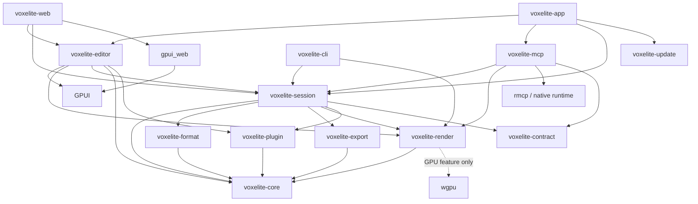

# Voxelite product and delivery plan

Status: merged implementation specification, updated with the 2026-10-25 decisions; implementation remains pending. License: MIT. Product: all-Rust GPUI native macOS editor, the same GPUI editor compiled through `gpui_web` to wasm on Vercel, and a Rust MCP server/CLI. This plan incorporates master product requirements and the detailed plan-rev contracts and reviews. Where they disagree, the newer product requirements and the explicit scope table below govern. Historical source checks remain dated evidence, not newly tested dependencies or a claim that application/release assets exist.

## Contents

1. [Positioning and product contract](#1-positioning-and-product-contract)
2. [Verified facts and feasibility gates](#2-verified-facts-and-feasibility-gates)
3. [Architecture and boundaries](#3-architecture-and-boundaries)
4. [Model, commands, and history](#4-model-commands-and-history)
5. [Deterministic, diffable .voxl format](#5-deterministic-diffable-voxl-format)
6. [Versioned MCP API and tool catalog](#6-versioned-mcp-api-and-tool-catalog)
7. [CLI, authority, and live sessions](#7-cli-authority-and-live-sessions)
8. [Human editor acceptance](#8-human-editor-acceptance)
9. [Shared design system, theming, and onboarding](#9-shared-design-system-theming-and-onboarding)
10. [Agent skills and host integrations](#10-agent-skills-and-host-integrations)
11. [Professional documentation site](#11-professional-documentation-site)
12. [Marketing, showcase production, and agent evidence](#12-marketing-showcase-production-and-agent-evidence)
13. [Build, distribution, updates, and deployment](#13-build-distribution-updates-and-deployment)
14. [Verification, CI, and performance](#14-verification-ci-and-performance)
15. [Open-source repository and README](#15-open-source-repository-and-readme)
16. [Milestones and requirement traceability](#16-milestones-and-requirement-traceability)
17. [Risks and review discipline](#17-risks-and-review-discipline)

## 1. Positioning and product contract

**Voxelite is THE optimal voxel editor for AI agents, while fully supporting humans with an excellent native creative tool.** This is the product strategy and marketing hook. Agent efficiency is a design input: coordinate-first composition, batch primitives, compact inspection, deterministic text files, visual feedback, useful errors, safe history, and unattended operation. The shared viewport lets humans watch agents build, intervene, and finish the same work by hand.

Public lead: **“The voxel editor built for AI agents.”** Supporting line: “Build through MCP. See every edit live. Shape every detail by hand.” Primary CTA: **Connect your agent**; secondary CTAs: **Download for macOS** and **Open web editor**. README, site, docs, onboarding, and demos use this hierarchy. Publish measured evidence for efficiency; do not imply an unmeasured universal benchmark win.

| Required outcome | Evidence required to ship |
| --- | --- |
| Agent builds useful art without pointer automation | Install a supported host; create, batch shapes, inspect, correct from multiple renders, undo, save `.voxl`, and export GLB entirely through MCP. No per-voxel prompting required. |
| Human watches and takes over | A visible agent activity panel and live viewport show commits, progress, and origin. Human pause, keyboard edits, and undo use the same authority/history. |
| Human-only editing remains excellent | Complete keyboard/mouse/trackpad workflow, command palette, layers, palettes, primitives, mirror, save/recovery, and export; no account or agent needed. |
| Automation is portable and reviewable | Canonical text `.voxl`, spec-first MCP, deterministic CLI recipes, versioned documentation, checked-in skills, and host packages with tested install/uninstall. |
| Release feels finished | Shared app/site/docs design, polished art and screenshots, accessible onboarding, signed/notarized Mac downloads, auto-update, Homebrew cask, changelog, and passing native/wasm CI. |

The product code, UI, MCP server, CLI, updater, build orchestration, site/docs generation, search, and gallery viewer are Rust. WGSL shaders, platform bindings, generated wasm-bindgen JavaScript, HTML/CSS, host manifests, CI/deployment configuration, and the Homebrew Ruby cask are integration artifacts. No Tauri/Electron, JavaScript editor, separate web UI, or claim of literally zero JavaScript.

### Scope: v1 vs later

This table is the release boundary agreed on 2026-10-25. v1 is the working product accepted at M8 and publicly released at M10; v1.x follows v1. Historical design studies and plan snapshots remain evidence of their own revisions; they do not override this scope.

| Item | Scope | Required outcome / boundary |
| --- | --- | --- |
| Concept A layout and visual system | v1 | Selected Concept A unified toolbar and docked session/comments/history; modern macOS Sonoma/Sequoia materials with shadcn/Vercel/Stripe component conventions, 6–8 px radii, pure `#000` dark mode, white light mode, Geist/Geist Mono. GPUI implements the production UI. |
| Menu bar | v1 | File, Edit, View, Tools, Layers, Palette, Agent, Extensions, Help, in that order; shared actions, shortcuts, submenus and context menus. |
| Palette system | v1 | User-created palettes plus exact PICO-8, Endesga 32, Sweetie 16, grayscale and original presets; create/rename/edit/reorder/duplicate/delete; `.hex`/`.gpl` import/export and bounded PNG import. |
| Anchored 3D comments | v1 | Voxel/region anchors, threads, replies, resolve/reopen, filters and human/agent attribution; equivalent MCP create/list/read/reply/resolve operations. |
| Scrubbable history and named versions | v1 | Read-only timeline previews with human/agent markers; persistent named save/restore/compare/branch via UI and MCP; explicit restore creates an edit. |
| Open Linux-like plugin core | v1 | Minimal core; nearly everything, including built-in tools, uses the plugin interfaces. Users and agents create runtime tools adding toolbar buttons, menu items and commands; agents register/invoke through MCP, including external API calls. |
| Native script/WASM plugin host foundation | v1 | Native script and WASM host adapters, shared versioned ABI and a tested web-compatible plugin path. Local plugins just run; a lightweight one-time prompt only for network access or files outside the project. |
| Canonical JSON `.voxl`, GLB/PNG, agent engine | v1 | A single UTF-8 JSON project with deterministic voxel lines; CPU render-to-image, shared commands/undo/layers/palette, versioned MCP and GPUI shell in the build order below. |
| Local Share preview | v1 | Concept A popover with Copy, stable `voxelite://share/<id>` identifier, View / Comment / Remix choices and a per-person list backed by the local share backend. Label “Local preview — hosted sharing coming soon”; Save a copy is secondary. No hosted authorization or invitations are implied. |
| Hosted share links: view/comment/remix | v1.x | Requires hosting/persistence and enforced permissions; remix creates independent lineage. Local editing remains account-free. |
| Git integration | v1.x | After v1: repository state, commits and visual diffs alongside local history; canonical files already work with ordinary Git in v1. |
| Real-time collaboration and presence | v2 | Hosted multi-user editing, presence and conflict/recovery contracts; distinct from v1 local human/agent live sessions. |
| CAD-style precision | v2 | Dimensions, measurements, snapping, precision numeric inputs and parametric modelling. Existing integer voxel coordinates and basic shape fields remain v1 editing/API foundations. |
| Editor plugin marketplace | v2 | Discovery, publishing, installation/update distribution after the plugin foundation. Existing agent-host packages and their host marketplace distribution remain separate v1 deliverables. |

### Open core product contract

Voxelite is an open Linux-like system: a tiny MIT-licensed core with nearly everything implemented as replaceable plugins, including its built-in editing tools. Humans and agents can create, swap, fork and extend tools, brushes, palettes, importers/exporters, panels, toolbar buttons, menu items, commands and MCP extensions. This replaces the older runtime-plugin exclusion. Agent-host integration packages (§10) connect external assistants; editor runtime plugins (§3) extend Voxelite itself.

The v1 foundation must demonstrate an agent authoring, registering and invoking a new tool via MCP in a running app, with its toolbar/menu actions appearing immediately. External APIs are supported. Local plugins run without an installation approval ceremony; network access and access outside the project each use a lightweight one-time scoped permission prompt. Built-ins use the same host interface and command validation as contributed tools. Runtime feasibility is an M0 gate, while a public editor plugin marketplace is later work.

### Scope and support envelope

- Native macOS 13+ on Apple silicon is the candidate baseline; M0 must verify the pinned GPUI minimum. Intel/universal binaries require the same hardware tests and may follow v1; never advertise untested support. Headless binaries ship for the supported Mac; Linux core/MCP CI is engineering coverage, not a promise of Linux GUI distribution.
- The web editor runs at ≥1024×640 CSS pixels with keyboard and mouse/trackpad. Test stable Safari, Chromium, and Firefox at release, record exact versions and actual WebGPU/WebGL2 support. Both GPUI chrome and 3D viewport must work with WebGPU disabled before advertising fallback support. The companion can serve the exact wasm bundle when hosted-to-local pairing is blocked.
- Shared document limits: ≤256 cells per axis; coordinates in `[-32768,32768)`; ≤64 layers; ≤256 opaque palette slots; ≤1,048,576 occupied layer-voxels; ≤8,192 allocated layer-chunks. Overlaps count separately. Memory/geometry budgets can reject pathological operations before commit; publish the reason and measured limits.
- Native/web share model, tools, history, renderer semantics, and GPUI views. `.voxl`, GLB, and PNG are required. The browser can edit offline after loading; MCP connectivity requires a native local companion. Cloud relays/accounts and embedded model-provider keys are outside v1.
- Animation timelines (distinct from edit history), rigging, sculpting, arbitrary mesh editing, transparent voxel materials, texture painting, physics, mobile editing, native Windows/Linux GUI, and MagicaVoxel `.vox` import/export are outside v1. Hosted sharing, real-time collaboration/presence, Git integration, CAD precision and the editor plugin marketplace follow the scope table. Runtime plugins and agent-host integration packages are both included in v1.
- Follow [design/ART-CHECKLIST.md](design/ART-CHECKLIST.md). Its updated pure-black theme and agents-first positioning are binding. Finish the sample art before visual acceptance; produce the full launch showcase only after v1 works (M9).

## 2. Verified facts and feasibility gates

These are inherited vendor/source observations recorded by the branch reviews on 2026-10-25, not newly verified facts or a tested dependency set. Exact pins, features, checksums, licenses, MSRV, and upstream patches go in `docs/architecture/dependencies.md`, `Cargo.lock`, and `rust-toolchain.toml` during M0. Registry/API documentation and successfully compiled artifacts are separate evidence.

| Verified observation | Decision / remaining uncertainty | Primary source |
| --- | --- | --- |
| Upstream GPUI web PR #50228 merged on 2026-02-26. | Use GPUI + `gpui_web`; basic upstream support does not establish production parity, accessibility, or 3D embedding. | [Upstream PR](https://github.com/zed-industries/zed/pull/50228) |
| `gpui-unofficial` documents 1.25.3, Apache-2.0, upstream provenance, and a maintainer vacancy. | Candidate only. Verify web/platform packages from their actual manifests; this review could not retrieve those registry endpoints. Prefer one audited upstream commit if the distribution is incomplete/unmaintained. Never mix incompatible GPUI families. | [Publisher docs](https://docs.rs/gpui-unofficial/latest/gpui/) |
| `gpui_web` defaults to multithreading and enables a nightly `parking_lot` feature; `gpui_wgpu` enables wasm `wgpu/webgl`. | Compile the actual feature graph. Prove a single-thread baseline or pin nightly/build-std, workers, atomics, COOP/COEP. A feature flag is not a tested renderer. | [Web manifest](https://raw.githubusercontent.com/zed-industries/zed/main/crates/gpui_web/Cargo.toml), [renderer manifest](https://raw.githubusercontent.com/zed-industries/zed/main/crates/gpui_wgpu/Cargo.toml) |
| `wgpu` documents Metal, WebGPU, and WebGL2. | Match GPUI's wgpu version and downlevel limits; do not independently choose the newest release. GPU acceleration needs an adapter; the required CPU software renderer provides headless render-to-image without one. | [wgpu docs](https://docs.rs/wgpu/latest/wgpu/) |
| `rmcp` API docs show 3.7.0 and stdio/Streamable HTTP; the mutable source endpoint returned 3.1.4 and explicit 3.7.0 retrieval failed in this review. | Treat 3.7.0 as a candidate, not an established lockfile. Resolve registry archive/checksum and build both protocol profiles before pinning; no sampling dependency for local editing. | [rmcp API](https://docs.rs/rmcp/latest/rmcp/), [source endpoint](https://docs.rs/crate/rmcp/latest/source/src/model.rs) |
| MCP publishes a dated 2026-07-28 profile with per-request version metadata and different lifecycle/cancellation rules. | Explicitly support it and 2025-11-25 (§6); application sessions never depend on an MCP initialization handshake or protocol session ID. | [Versioning](https://modelcontextprotocol.io/specification/2026-07-28/basic/versioning), [transports](https://modelcontextprotocol.io/specification/2026-07-28/basic/transports) |
| Vercel accepts prebuilt output and documents public-beta Functions WebSockets with reconnect/duration constraints. | Three static deployments: app, marketing, docs. Local authority is a product decision; v1 does not depend on a cloud service. | [Build Output API](https://vercel.com/docs/build-output-api), [WebSockets](https://vercel.com/kb/guide/do-vercel-serverless-functions-support-websocket-connections) |
| Cursor plugins can bundle rules, skills, and MCP; MCP deeplinks install MCP configuration separately. | Ship a real Cursor plugin and verified one-click marketplace path; a deeplink alone does not install skills/rules. | [Cursor plugins](https://cursor.com/docs/plugins), [manifest reference](https://cursor.com/docs/reference/plugins) |
| Codex supports MCP configuration, skills, and AGENTS.md; Claude Code and Desktop have separate integration mechanisms. | Maintain host-specific installers and tests, not one generic configuration. See §10 for exact paths and source links. | [Codex MCP](https://developers.openai.com/codex/mcp), [Claude Code MCP](https://code.claude.com/docs/en/mcp), [Desktop local MCP](https://support.anthropic.com/en/articles/10949351-getting-started-with-local-mcp-servers-on-claude-desktop) |
| Apple provides notarization tooling; Homebrew casks declare versioned app/binary artifacts. | Signing, notarization, cask distribution, and updater validation are separate required deliverables. | [Apple workflow](https://developer.apple.com/documentation/security/customizing-the-notarization-workflow), [Cask Cookbook](https://docs.brew.sh/Cask-Cookbook) |

M0 is a blocking executable spike, with artifacts for each gate:

| Gate | Proof / decision |
| --- | --- |
| Same GPUI native/wasm UI | Window/canvas lifecycle, resize/DPR, text/IME, clipboard, menus/modals/focus, light/dark, and keyboard input in both targets. |
| Real 3D composition | Depth-tested voxel mesh, clipping, correct overlays/input routing, color conversion, resize, and PNG readback. Select texture composition or child-surface ADR (§3). |
| Web backend feasibility | Full GPUI chrome + viewport on WebGPU and forced WebGL2, with real browser reports; single-thread or documented thread build. No blank-canvas fallback. |
| Accessible essentials | VoiceOver on Mac and browser accessibility tree expose buttons, inputs, menus, focus, and coordinate editing. Identify and implement any GPUI/DOM accessibility bridge before UI expansion. |
| Agent vertical slice | Draft versioned schemas first; stdio create → primitive batch → validate → four-angle CPU PNG → undo, with no GPU or window; attach a viewport and see the same revision. |
| Open plugin core | Prove native script and WASM host adapters, a shared native/web ABI, a built-in tool using it, runtime MCP registration with toolbar/menu contributions, external API access and the one-time permission behavior. |
| Local/browser connection | Hosted HTTPS pairing tests and guaranteed same-origin companion-served wasm fallback. No disabled browser security or installed root certificate. |
| Distribution feasibility | Named project release owner, organizational signing credential readiness, signed/notarized hello-world rehearsal, Rust updater proof on a disposable bundle, host plugin packaging spike. |
| Dependency control | Compiled pins, feature/license audit, advisory check, measured baseline and patch ownership. Unresolved gate blocks dependent promises; record a decision, never silently switch UI stacks. |

Recheck vendor behavior at M0 and each release. Mutable `main`/`latest` links are discovery evidence; archive exact commit/manifest references with the final dependency decisions.

M0 is four bounded decision spikes, each with an explicit plugin/CPU proof: M0a dependency/target build and native script/WASM host ABI; M0b CPU render-to-image plus one GPU voxel viewport with readback and accessible controls; M0c one agent/live-session slice including runtime tool creation; M0d signed disposable bundle/update and host-package feasibility. Budget at most five engineer-days per spike before a written finding, measured result and next decision. This is an investigation budget, not a promise to solve every platform defect within twenty days. Record reproducible commands, source commit, supported OS/browser/backend, failures, patch scope and owner in `design/feasibility/`. Unresolved gates stay open; separately estimate remediation before expanding dependent UI or promising a launch date. Start signing-account and marketplace readiness during M0 even though submission needs a working package later.

## 3. Architecture and boundaries

### v1 implementation build order

Create the Cargo workspace and implement these foundations in this order. M0 uses bounded disposable feasibility spikes; its GPUI proof does not reverse the production build order. Split auxiliary contract/session/CLI/editor/web crates when their boundary is needed, without postponing the seven foundations.

1. **`voxelite-core`** — model, typed commands, validation, undo/history, layers, palette, comments and version semantics; pure Rust, independently testable.
2. **`voxelite-format`** — canonical JSON `.voxl` reader/writer, schema/fixtures, bounded parsing, identity and portable metadata.
3. **`voxelite-export`** — deterministic GLB and PNG encoding. PNG takes bounded RGBA input so the encoder can be tested before rendering exists.
4. **`voxelite-render`** — CPU software renderer for render-to-image, cameras, depth, lighting/AO and multi-angle feedback; GPU viewport acceleration follows behind features.
5. **`voxelite-plugin`** — open host/registration/lifecycle, native script/WASM host foundation, contribution/action registry and built-in tools implemented as plugins.
6. **`voxelite-mcp`** — versioned server over the shared engine, artifacts, comments/versions/history, headless rendering and runtime plugin authoring/registration/invocation.
7. **`voxelite-app`** — GPUI shell consuming the tested engine and plugin contributions; Concept A menus, viewport, palettes, layers, session, comments and history. Reuse shared GPUI views in the wasm entry.

### Crate boundaries

| Crate / directory | Responsibility and boundary |
| --- | --- |
| `crates/voxelite-core` | Pure Rust model, sparse chunks, palette/layers, comments/versions, typed commands, validation, undo/history, primitives/transforms and shared geometry helpers. No file encoding, GPUI, OS handles, GPU, sockets, or Tokio. Domain types live here; external wire adapters map onto them. Compiles natively and to wasm. |
| `crates/voxelite-format` | Canonical JSON `.voxl` parsing/writing, schema/version/migration rules and portable snapshot encoding over core values; no filesystem I/O. |
| `crates/voxelite-export` | Deterministic GLB geometry/material encoding, bounded PNG RGBA encoder and palette `.hex`/`.gpl` interchange; core snapshots in, bytes out; no UI or GPU requirement. |
| `crates/voxelite-plugin` | Versioned host ABI, native script/WASM adapters, built-in tool plugins, lifecycle and toolbar/menu/command contributions. Host capabilities mediate project files, optional network/outside-project access and validated commands; no GPUI dependency. |
| `crates/voxelite-render` | CPU software rasterizer first: immutable core snapshot → bounded RGBA image, cameras/depth/lighting/AO and picking. Feature-gated `wgpu` provides accelerated native/web viewports and offscreen rendering; `voxelite-export` encodes PNG. No GPUI initialization for CPU rendering; never edits documents. |
| `crates/voxelite-session` | Shared command/session facade, plugin host orchestration, revision/event schemas, local authority, remote client, artifact handles, persistence/export adapters. Native and standalone-web sessions use copy-on-write chunks for immutable snapshots. Native feature adds runtime/IPC/WebSocket service; wasm feature uses browser networking and scheduling. Core commands remain platform-neutral. |
| `crates/voxelite-editor` | Shared GPUI views, plugin gesture/action adapters, palette/layer/comment/history panels, focus, theme tokens, dialogs and accessibility metadata. Uses the session facade rather than changing model memory directly. |
| `crates/voxelite-mcp` | `rmcp` server library and `voxelite-mcp` binary: tool schemas, resource adapters, stdio proxy, optional Streamable HTTP, headless session hosting. Native only; no dependency on editor UI. |
| `crates/voxelite-web` | `cdylib` wasm entry; `gpui_web` initialization, canvas lifetime, browser platform adapter, storage/download bridge. Imports the shared editor root. |
| `crates/voxelite-app` | `voxelite` macOS binary; GPUI platform startup, menus, file associations, native platform adapter, embedded session host/MCP endpoint. |
| `crates/voxelite-contract` | Versioned request/result/error types and schema fixtures; independent of GPUI. Design spec/examples are reviewed before implementation; generated schemas are compared with approved snapshots. |
| `crates/voxelite-cli` | `voxelite-cli` binary: inspect, validate, apply, canonicalize, render, diff, and export through core/session; filesystem access belongs here, not in MCP tools. |
| `crates/voxelite-update` | Rust updater library and signed helper; authenticated release manifest, bundle validation, staged replacement/recovery. Native only. |
| `crates/voxelite-site-ui` | Small Rust/wasm progressive enhancement for site/docs search, copy controls, theme preference and version selection; semantic HTML remains usable without it. |
| `crates/voxelite-gallery` | Small Rust/wasm GLB viewer for the exported Voxelite subset; WebGL2/WebGPU, orbit controls and accessible HTML controls; does not load the editor. |
| `xtask/` | Rust build/package/deploy-output tasks, schema generation, fixture checks, marketing/docs static generation, search indexing, integration packaging, token generation, and release manifests. |
| `site/`, `docs/`, `skills/`, `integrations/`, `web/`, `design/`, `tests/fixtures/` | Marketing/docs content and templates, portable skills and host adapters, app bootstrap, visual specs/tokens/reviews, deterministic fixtures and benchmark recipes. |

Dependency arrows mean “depends on”; platform dependencies are target/feature gated:



The native app normally owns one authoritative session host on a background runtime; GPUI stays on its required UI thread. The stdio MCP binary discovers and proxies to that host. Explicit `voxelite-mcp --stdio --headless` owns the same engine without a window; the native/web app can attach to it. Never create a second authority merely because discovery times out. Standalone web editing owns an in-process Rust session; pairing transfers a snapshot to a companion-hosted document and then routes all edits through that authority.

`PlatformServices` covers open/save dialogs, byte persistence, clipboard, theme notifications, timing, and opening external links. Native uses OS APIs; web uses Rust `web-sys` bindings. Native worker threads handle meshing/serialization; single-thread wasm slices work into ≤8 ms tasks and yields between slices. Large work prepares a private patch and commits atomically. Do not block GPUI or the browser event loop awaiting network/GPU completion.

Supporting dependency candidates: `serde`/`serde_json` for explicit schemas, `uuid` for IDs, `glam` for math, `png` for bounded image decoding/encoding, `proptest`/Criterion for verification, and Tokio plus a Rust HTTP/WebSocket stack behind native session features. Audit licenses, wasm support, default features, and MSRV before pinning. Prefer feature-minimal dependencies; do not pull image formats or native compression libraries into the core unnecessarily.

### Plugin host foundation and permissions

The core owns document invariants and transactions; plugins provide product features. Built-in Place/Erase/Paint/Fill/Box/Picker, mirror/shape/transform tools and palette/IO contributions register through the same public interfaces as extensions. The shell projects their declared actions into toolbar buttons, the Tools/Extensions menus, context menus and command search; it never maintains a separate hardcoded built-in tool path. Panel contributions use a bounded declarative view/action interface rather than requiring plugin access to GPUI internals.

Freeze `spec/plugin/v1/`: stable plugin/command IDs, API version, runtime kind (`script` or `wasm`), content hash, input/output schemas, contributed toolbar/menu/panel entries, capabilities, lifecycle and error contracts. M0 selects a Rust-embedded scripting engine and WASM runtime after proving native builds, wasm portability, cancellation and memory accounting. Native ships both adapters; web supports the shared WASM-compatible path and advertises adapter availability honestly. Unsupported runtime-specific plugins show an actionable state; built-in tools and required v1 workflows work on both targets. Product implementation remains Rust/GPUI; user-authored script payloads are extension content.

Humans load/create local plugins through Extensions. Agents upload source/WASM artifacts, register them through MCP, discover their schemas and invoke them immediately; no rebuild or marketplace publication. Registration validates ABI/schemas and namespacing, loads a bounded module and atomically publishes its contributions. Unregister removes actions after draining/cancelling its work. Replacement validates a new content hash before swapping, retains the old registration on failure and never reuses an in-flight operation ID. Loading project data never automatically executes embedded code: `.voxl` is inert JSON; plugin code and grants live in project-local plugin storage separately from the portable document.

Local plugins just run with document-command and project-local file access. Only network access or files outside the project trigger a lightweight one-time prompt, scoped to the plugin/content hash and the requested network destination or outside-project root. Remember that grant; changing scope/code requires a grant for the new scope. Host functions resolve paths/symlinks against those roots and mediate network calls so the native script/WASM foundation can enforce this minimal policy. A headless invocation needing an ungranted capability returns `permission_required` with an owner-UI or CLI grant path; it does not hang or repeatedly prompt. No separate prompt for each local invocation, tool addition or ordinary edit. OS/browser permission prompts are platform constraints, not an additional Voxelite approval workflow.

External API requests use the granted network host capability, bounded responses/timeouts, and credentials stored outside portable project/plugin source. Network effects cannot be undone by model history: finish I/O before preparing a validated document patch, disclose the external effect, and never automatically retry an external request with unknown outcome. Plugin edits go through the same epoch/revision/operation/lock/history rules as UI and MCP. Trap, timeout, cancellation or invalid output before commit leaves the model intact and the host usable. Publish CPU/fuel, memory and output budgets; no raw model-memory access. The v1 fixture is a seeded custom brush plus an external-API example with a local test service: both gain menu/toolbar actions, run through MCP and create one reversible edit.

### Renderer integration decision

Implement bounded CPU software rasterization with depth testing first. It returns deterministic RGBA images for a fixed snapshot/camera/seed and works on native and wasm without a graphics adapter. Feed those pixels to `voxelite-export` for PNG; render contact-sheet views sequentially and charge color/depth/AA buffers to the existing budgets. Then use real GPU 3D mesh rendering with depth testing for the interactive viewport. GPUI primitives are appropriate for panels, labels, tool cursors, and gizmos, not one UI element per voxel face.

1. **Preferred:** render offscreen with `wgpu` and composite a texture in a custom GPUI viewport element. On macOS `wgpu` uses Metal; prove texture/device ownership, synchronization, color conversion, and lifetime across GPUI's Metal backend. A `wgpu::Texture` is not automatically importable by GPUI.
2. **Fallback integration:** a dedicated clipped Metal-backed child surface on macOS and a positioned WebGPU/WebGL2 canvas on web, driven entirely from Rust. GPUI owns viewport layout and input arbitration. Prove menus/modals paint above the surface, resizing and DPR changes are exact, and hidden windows stop drawing. A child surface that covers menus fails the gate.
3. **Diagnostic only:** CPU readback followed by GPUI image upload. Measure bandwidth/latency; do not accept it as the production viewport unless it meets the same frame budgets. Export readback is a separate, infrequent operation.

M0 records the selected integration and any minimal GPUI patch. There is no approved separate-web-editor fallback.

CPU mesh generation culls internal faces across chunk and layer boundaries; greedy merging may merge only faces with compatible color and AO. Face culling invalidates six neighboring chunks; corner AO also requires edge/corner neighbors, so conservatively invalidate all 26 neighbors. Layer visibility/order changes invalidate affected composite chunks. Render indexed triangles, normals, palette color, depth, and camera-relative top-left key light with subtle voxel-corner AO. Keep a WebGL2 path using vertex/index buffers, uniforms, and simple textures, without compute shaders, storage buffers, or mandatory float render targets. Chunk oversized meshes into supported index/draw limits. Use CPU grid DDA picking; resolve exact boundary ties consistently.

Use sRGB palette input, linear lighting, and one output color conversion. Antialias silhouettes using supported MSAA or a tested postprocess; exports can supersample. Voxel geometry remains deliberately cubic; UI and silhouettes must not show accidental jagged/pixel-stepped edges. GPU loss recreates resources from CPU state without losing edits. Cap generated geometry and allocations; offer a lower preview resolution without changing exported geometry.

Native CLI/MCP operation requires no GPUI initialization. Create/edit/validate/save/GLB and PNG render-to-image succeed without a GPU. `backend=auto` may prefer a verified GPU backend but falls back to CPU; `backend=cpu` is always testable. An explicitly requested unavailable GPU returns `renderer_unavailable`; CPU limits/deadlines return the corresponding budget error. CPU/GPU share geometry, cameras, lighting and alpha rules, with separate measured image/performance tolerances. The gallery viewer accepts only bounded Voxelite-exported GLBs, with no external URLs, scripts, textures, animation, or arbitrary asset loading.

## 4. Model, commands, and history

### Coordinates, palette, layers, and storage

- Right-handed coordinates, Y up. A voxel at integer `[x,y,z]` occupies `[x,x+1) × [y,y+1) × [z,z+1)`; centers are half-integers. Every region is integer `min` inclusive / `max` exclusive. Bounds have positive extents ≤256; coordinates stay within `[-32768,32768)` to bound arithmetic. Default bounds: `[-32,0,-32]..[32,64,32]`.
- `Document { id: UUID, name, bounds, palette, layers, comments, versions, lineage? }`. Names are nonempty UTF-8, ≤128 bytes, no control characters. IDs are opaque UUIDs, never machine/user identifiers. Each open document has its own monotonically increasing `u64` revision, starting at 0. The session additionally numbers all events with a global sequence. Both are decimal strings over JSON; neither belongs in portable `.voxl` content. An authority epoch distinguishes restarts; every mutation includes its captured epoch as well as revision. Reject counter overflow without mutation.
- Palette: 1–256 defined stable `u16` slots in `1..=256`; `0` means empty, never a color. Slots contain sRGB RGBA8 with alpha 255 and an optional nonempty name. Deleting a referenced slot requires an explicit replacement slot and rewrites references atomically; last-slot deletion rejects. Slot reordering is display-only. Stable IDs prevent accidental recoloring.
- Layers: ordered bottom-to-top vector of `{id, name, visible, locked, chunks}`. At least one layer; no transforms or opacity in v1. At a coordinate, the highest visible nonempty layer wins. Hidden layers persist but do not render/export by default. Locked layers render and can be sampled but reject voxel mutations/deletion; explicit unlocking is required.
- Each layer stores `HashMap<ChunkCoord, Chunk>`, with 16³ cells/chunk. Use Euclidean division/remainder for negative coordinates. Local index `x + 16*y + 256*z`; empty chunks are absent. A chunk uses sorted sparse `(u16 local_index, u16 palette_slot)` pairs, promoting to a 4,096-entry `u16` array at 256 occupied cells; demote below 128. These thresholds are runtime details, not file-format rules.
- Editing targets the active visible, unlocked layer. Pick against the visible composite; if an erase/paint/fill hit belongs to another layer, show a non-destructive blocked cursor until the user selects that layer. Picker may sample any visible layer. Place adds the adjacent cell in the active layer; an empty scene uses the floor/work-plane intersection. Reject out-of-bounds edits, never wrap coordinates.

### Document identity and lifecycle

Creation defaults to name `Untitled`, §4 default bounds, one `Base` layer, and slot 1 named `clay` with RGBA `[180,140,100,255]`. Caller-supplied document/layer IDs make recipes reproducible; otherwise generate IDs once at creation. At most eight models may be open, subject to aggregate memory admission. The floor of a bound is ≥−32768 and its exclusive maximum may equal 32768.

Ordinary open/import/save preserves document/layer/comment/version IDs, declared format version and inert extension metadata. Opening an already-open ID returns `model_already_open` with the existing revision/hash; it does not replace content. Explicit import `identity="fork"` creates a copy with new document/layer/comment/version IDs (or supplied deterministic replacements), consistently remaps their internal references and reports the mapping; external source lineage remains a reference to the original. Native/web “Save As” changes the file destination while preserving content identity; “Duplicate as new project” forks. External file changes require compare/reload or Save As, never silent overwrite. The UI tracks file path/bookmark separately from the document.

`model_edit` renames or changes bounds in one reversible transaction. Shrinking rejects if any stored voxel, including hidden layers, would be outside; agents must explicitly erase unwanted cells first. `model_close` requires current epoch/revision and `disposition="archive"`: flush content, bounded history and result receipt to native recovery storage before removing it from the open list, notify viewers, release caches and retain an archive ID. It emits a lifecycle event without a content revision/undo item, rejects while uncommitted edits are being prepared, and is not a portable-file save. No MCP discard mode. CLI `session archives` and `session restore --archive <id>` list/restore copies; the UI offers the same archive browser so Desktop users need no shell. Restore preserves IDs/history/content but advances beyond its authority revision high-water mark (at least archived revision plus one), with duplicate-open rejection; explicit CLI/UI archive deletion is separate. Recovery disk budget is 2 GiB per workspace, independent of the 512 MiB scratch cap; refuse archival/commits on exhaustion, never evict the only recovery copy. Keep per-document revision high-water marks for the authority epoch (at most 10,000 issued IDs); create/import cannot reuse a closed ID, only archive restore can reopen it at the next revision. This prevents stale pre-close writes from matching a restored document. Every host must create/export/archive more than eight models sequentially without leaking resources.

### Commands, transactions, and history

Typed commands include `SetVoxels`, `EraseRegion`, `FloodFill`, `Primitive`, `TransformRegion`, `Batch`, palette/layer operations, comment/thread edits, named-version operations, and document import. UI gestures and MCP call these same handlers. Validate IDs, bounds, locks, palette references, revisions, and budgets before committing. Each editing gesture or atomic MCP batch creates exactly one undo item; create/import establish a revision-0 document with empty history, while undo/redo move existing entries between stacks. Repeated coordinates in a patch resolve to their final requested value before mirroring; conflicting mirrored values reject. A known rejection or precommit cancellation leaves model, revision and history unchanged; uncertain storage outcomes follow §7 recovery. A no-op adds neither a revision nor history. Core rejects voxel edits on hidden or locked target layers regardless of caller; MCP always supplies its own target layer rather than using UI selection.

Flood fill is six-connected within one layer: replace the seed's existing slot, including slot 0 for bounded empty-space fill, with a live nonzero slot. Require the seed inside a finite region contained in document bounds, defaulting to document bounds; cap visited cells at 1,048,576. Box has solid/hollow shape and place/paint/erase mode; paint affects occupied cells only. UI fill/box previews show affected bounds before applying large changes.

Mirror toggles X/Y/Z independently. Mirror plane is encoded by integer `plane2 = 2*p`; reflecting a cell coordinate uses `x' = plane2 - x - 1`. Defaults are the midplanes of the document bounds. Generate all enabled combinations, deduplicate center-plane hits, and reject the entire command if any reflected cell is invalid or the expanded transaction exceeds its budget. Place writes reflected cells; paint skips reflected empty cells; erase clears them. Fill writes its replacement to the reflected changed-cell set, not additional unconstrained flood searches. MCP mirroring is explicit per call, never inherited from another client's UI state.

History stores reversible before/after patches for voxel, layer, palette, document metadata, comments and named-version-library changes, including visibility/locks/order. Undo/redo operate on each document's shared human/agent timeline; undo may undo an agent's last edit and is labeled accordingly. Both increment revision and emit normal changes. New edits clear redo. Camera, focus, selection, current color/tool, and mirror toggles are client-local preferences, not document history. Bound history at 32 MiB on web and 128 MiB native; evict oldest complete entries, disclose the history boundary, and reject a single transaction that cannot fit rather than silently losing undo. Dirty state compares saved content identity, so undo back to saved content clears it.

### Agent composition semantics

`Primitive` supports box, ellipsoid (sphere when radii equal), cylinder, and line. Inputs use integers or doubled integers, no natural-language geometry parser. Every shape has `mode: place|paint|erase`, a target layer, optional explicit mirror, and palette slot/name resolution. Names must resolve uniquely at the captured revision; ambiguity returns matching IDs. Place overwrites; paint changes occupied cells only; erase clears. Reject out-of-bounds output atomically; no silent clipping.

| Primitive | Exact occupancy rule |
| --- | --- |
| Box | Half-open integer region; solid includes all cells; hollow includes cells with at least one coordinate on its minimum or maximum-minus-one boundary. |
| Ellipsoid / sphere | Integer `center2` and `radii2` in 1–512, in half-cell units. Centers are bounded to twice the coordinate range; intermediate products use checked i128. Include cell centers where `Σ((2*p+1-center2)/radii2)^2 ≤ 1`; evaluate by widened integer cross multiplication, avoiding float-dependent boundary decisions. Hollow means occupied cells with at least one six-neighbor outside the solid. |
| Cylinder | Axis X/Y/Z; axial half-open integer interval; circular/elliptic cross-section uses the ellipsoid rule on the other two coordinates. Hollow is the six-neighbor shell including caps. |
| Line | Integer endpoints, both included. A specified 3D supercover traversal includes all cells touched by the center-to-center segment, with all tied cells emitted and deduplicated. Radius zero in v1; thicker forms use cylinders. Freeze endpoint/tie fixtures in M1. |

Shape preflight uses the candidate bounding volume and checked arithmetic. A transaction has at most 1,048,576 work units: charge each candidate cell inspected, each additional mirror candidate emitted before deduplication, and each transform destination considered; summed across ordered subcommands, not just final changed cells. Sparse region operations charge stored cells inspected; shapes charge their scanned bounding volume; flood fill charges each distinct visited cell. Report work units separately from changed voxels and frozen estimator version. Large documents are built in intentional batches. `Batch` accepts ≤256 ordered subcommands on one model, with no nested batches, I/O, render, history, lifecycle, or cross-document commands. It supports voxel/shape/transform and literal palette/layer edits; caller-supplied unique UUIDs for newly created layers allow later subcommands to reference them. Decode palette artifacts before batching and use literal add/set/remap commands; `palette_edit action=import` is a standalone operation. Validate all commands against a private evolving state; the first failure reports its index and JSON Pointer, and nothing commits. Reserve worst-case patch/history/memory first. One final patch, revision, event, and undo entry. No-op batches leave revision/history unchanged. `voxelite_operations_validate` performs identical preflight without mutation and returns predicted work, memory, changed bounds, collisions, and errors; it does not reserve a future revision or guarantee a later commit.

`TransformRegion` copies or moves occupied source cells from one layer into a destination layer. Transform doubled cell centers in this order: subtract `pivot2` (default `[0,0,0]`), reflect selected axes, rotate about one named axis by 0/1/2/3 right-handed quarter-turns, add `pivot2`, then add twice the integer translation. Reject results that do not map to integer cell coordinates. Copy reads from an immutable source snapshot. Move validates destinations first, then clears all source cells and writes all destinations atomically. Collision policy is explicit `reject|overwrite|skip`; **skip is allowed only for copy**, so a blocked move cannot erase its source. Same-layer move ignores its own removed source cells when checking collisions; unrelated destination cells still count. Return collision counts/sample coordinates on rejection. Respect locks, visibility, bounds, palette, and history budgets on every affected layer. No floating rotation, scaling, or interpolation in v1.

History entries include stable ID, human/agent actor kind, opaque client ID, tool name, label, operation ID, base/result revision, changed bounds, added/removed/recolored counts, and reversible patch. Display role labels or Calum, never account names/emails. `voxelite_history_list` reports cursor/redo state and oldest retained entry. Undo/redo require the expected top entry ID as well as expected revision; they cannot silently undo a human's intervening work. A checkpoint is a labeled cursor in retained history, not a hidden full model copy. Restoring it requires the exact head ID/revision, rejects an evicted or branched-away checkpoint, and commits a new reversible patch restoring its content. It preserves audit events. History/snapshot memory is charged to the aggregate budget (§14); undo never depends on a UI selection. Recovery journals retain bounded history and deduplication state; portable `.voxl` saves project content including comments and named versions, while raw edit history and temporary checkpoints remain in local recovery storage.

An empty history head is JSON `null`; checkpoints at revision 0 are valid while their cursor is retained. Restoring identical content is a no-op. Checkpoint metadata is bounded to 64 entries per model and evicted with its underlying history, with an expiry event. `changes_list` is a bounded revision-delta journal distinct from the undo stack: include actor, labels, affected metadata, counts and optionally paged before/after voxels for retained changes. If the requested interval is gone, return `changes_expired` and a full-read recovery path. Cancellation is checked during preparation and immediately before durable commit; cancellation after commit returns the committed receipt and never reverses work automatically.

### Scrubbable history, per-step revert and named versions

The timeline reconstructs every retained step from immutable snapshots/patches, including initial state. Human circles and agent diamonds distinguish origins by shape as well as color. Scrubbing, comparing or returning to latest never edits the live document, increments its revision or changes undo/redo. A persistent History preview state disables editing into the preview; live commits continue separately and the return action selects the latest state. Render an immutable captured step and preserve the live camera unless explicitly framing it. Preview reservations share the bounded snapshot pool; an evicted step reports `history_expired` with the retained boundary.

Per-step Revert is a new compensating transaction: require the current epoch/revision and selected entry ID; verify every affected field still equals that entry's after-state and that current locks permit reversal. Otherwise return `history_conflict` with fields/coordinates and change nothing. Unrelated later edits survive. Standard Undo/Redo still require the actual top entry ID. The activity panel exposes original change revision, present revision, applied/undone state and net session counts separately.

Named versions are durable project snapshots, distinct from the bounded temporary checkpoint cursors above. A version has stable UUID, nonempty name ≤128 UTF-8 bytes, optional parent-version ID, actor kind, content hash and an immutable snapshot of document name/bounds, palette, layers and comments. Snapshots never recursively contain versions, raw history, host identities or timestamps. Save creates an undoable library entry; at most 64 named versions and 64 MiB canonical snapshot bytes per document, also subject to aggregate RAM/disk and the 128 MiB project-file cap. Share immutable chunks internally, reserve copy-on-write growth, and reject over-budget save before mutation. Never silently evict a named version when edit history ages out.

List/read/save/restore/compare/branch are available in UI and MCP. Restore requires the expected live epoch/revision/head ID, validates locks and all budgets, then adds one reversible patch restoring snapshot content while retaining the version library/audit trail; restoring identical content is a no-op. Compare reports actual added/removed/recolored cells, palette/layer/comment changes and bounds with a spatial overlay or side-by-side view. Distinguish palette-driven appearance changes from voxel-slot changes. Branch creates an independent revision-0 project, remaps internal IDs and records source document/version lineage without changing the source; it is not a Git branch. Versions/comments survive save/reopen, archival and native/web exchange; scrubbing retained edit history survives local recovery but is not an unbounded portable log.

### 3D comments and palette libraries

Comments are persistent project data, available to humans and agents. A thread has UUID, `anchor` as voxel coordinate or half-open region, optional layer UUID, ordered messages, resolved state and stable message IDs. Message text is plain UTF-8, ≤8 KiB; bound threads to 1,024, messages to 10,000 and aggregate comment data to 4 MiB within project metadata limits. Portable authorship records `human` or `agent`; optional tool provenance is a public plugin/tool ID, not personal identity. Create/reply/resolve/reopen use the same revision, idempotency, undo and durability contracts as geometry edits.

Anchors remain in model space and project through the active camera, with voxel/region outlines and occlusion-aware pins. Opening a pin selects the docked thread; replies do not cover the artwork. Open/resolved filters, keyboard navigation and agent provenance are inspectable without repeated badges. Erased geometry, deleted/hidden layers or bounds changes never silently delete a discussion: derive an orphaned/hidden-anchor state, retain its coordinates and offer explicit reanchor. A version preview shows that snapshot's comments; restoring/branching restores/remaps anchors with it. MCP exposes list/read/create/reply/resolve (including reopen), with paged reads and explicit author kind assigned by the authenticated caller rather than spoofed text.

Palette libraries support create, rename, edit, reorder, duplicate and delete for custom palettes; presets are immutable and duplicated to edit. Include exact PICO-8, Endesga 32 and Sweetie 16 values, a defined 16-step grayscale and original neutral/warm/vivid presets with provenance. Selecting a library palette changes the available swatches without unexpectedly recoloring the model; applying it to document slots requires explicit append/remap preview. Keep active swatches compact and management in a menu/dialog. Preserve exact RGB values and order through `.hex`/`.gpl` export/import; GPL preserves names representable in that format, HEX does not claim to encode names. Duplicate swatches/order survive palette-library interchange; applying them to document slots returns the explicit source-to-slot map. Local libraries persist across launches; the active document palette is portable in `.voxl`.

## 5. Deterministic, diffable .voxl format

Canonical `.voxl` 1.0 is a **single UTF-8 JSON document**, MIME `application/vnd.voxelite.project+json`. This is the master product decision; the earlier ZIP/binary and JSON Lines proposals never shipped and require no invented migrations. Runtime sparse/dense chunks are an internal acceleration structure. Each voxel tuple occupies its own line in canonical output, preserving useful Git diffs and direct agent text inspection.

| Field | Schema / persistence contract |
| --- | --- |
| `format`, `version`, `required_features` | `"voxelite"`, `{major:1,minor:0}`, sorted unique feature strings; reject unsupported required semantics. |
| `document` | Stable UUID, name, half-open integer bounds; opaque IDs survive ordinary saves/imports. |
| `palette` | `slots:[{index,rgba,name?},…]` sorted by slot ID, plus explicit display `order`; unique live slots, opaque colors and full order permutation. |
| `layers` | Bottom-to-top array of `{id,name,visible,locked,voxels:[[x,y,z,slot],…]}`; each layer's voxels sorted numerically by `(x,y,z)`, unique and within bounds. |
| `comments` (optional, default empty) | Threads/anchors/messages from §4, stable IDs, bounded plain text and human/agent roles; no personal account metadata. |
| `versions` (optional, default empty) | Named snapshot records from §4 sorted by UUID, with nonrecursive project snapshots, content hashes and parent references; persist independently of retained edit history. |
| `lineage` (optional) | Source document/version IDs for explicit forks; no host paths, remote credentials or personal data. |
| `view` (optional) | Portable default camera/projection and active-layer hint; invalid hints can be dropped independently. Excluded from semantic content hashes; never implicitly rewritten by ordinary camera navigation. |
| `extensions` and unknown optional fields | Bounded inert metadata preserved by the reader/writer; required semantics must declare a feature. No executable payloads or fetched asset URLs. |

Minimal populated example (synthetic IDs; omitted comments/versions mean empty):

```json
{
  "document": {
    "bounds": {"max": [32, 64, 32], "min": [-32, 0, -32]},
    "id": "00000000-0000-4000-8000-000000000001",
    "name": "Study"
  },
  "format": "voxelite",
  "layers": [{
    "id": "00000000-0000-4000-8000-000000000002",
    "locked": false,
    "name": "Base",
    "visible": true,
    "voxels": [
      [0, 0, 0, 1]
    ]
  }],
  "palette": {"order": [1], "slots": [{"index": 1, "name": "clay", "rgba": [180, 140, 100, 255]}]},
  "required_features": [],
  "version": {"major": 1, "minor": 0}
}
```

M1 freezes `spec/voxl/1.0/` JSON Schema, canonical-writer specification and golden bytes, including the compact illustrative example above as a semantic input fixture and its fully canonical output. Canonical output uses two-space indentation, lexicographic UTF-8 object-key order recursively, LF and a final newline. Expand objects and ordinary arrays by one level per line; keep scalar vectors and each voxel tuple on one line with comma-space separators. Palette slots sort by index; voxel tuples by numeric x/y/z; explicit palette order, layer array order and message order are semantic and preserved. Omit empty optional comments/versions and absent optional fields consistently. Every object/array layout, escaping and optional-default rule is fixture-defined; no dependence on map iteration or runtime chunk thresholds.

Use lowercase hyphenated UUIDs, shortest base-10 integers (no negative zero, exponent or fractional coordinates) and UTF-8 without normalization. Escape quote/backslash with `\"`/`\\`; encode U+0000–001F as lowercase `\u00xx`; do not escape slash or other Unicode. Optional camera numbers are finite IEEE-754 values with a specified shortest-round-trip representation and normalized zero. A field's numeric grammar is explicit; reject overflow, NaN/infinity, unpaired surrogates, malformed UTF-8 and duplicate keys. A semantic project hash covers canonical project content excluding `view`; a version's content hash covers its snapshot without the enclosing version library. Whole-file artifact hashes always cover every byte.

Unknown optional fields and namespaced `extensions` values round-trip with their meaning intact. Their bounded grammar permits null, booleans, signed 64-bit integers, strings, arrays and objects; recursively sort object keys and preserve array order/strings. Maximum extension nesting 16, total JSON depth 32; ≤8 MiB metadata including ≤4 MiB comments and ≤4 MiB other metadata/extensions. Unknown data outside this preservable grammar returns an explicit unsupported-format/limit error before replacing a document, never a lossy save. A newer minor is accepted only when required features are supported and all content can be validated/preserved; reject unknown majors. Version snapshots obey the same preservation rules without recursively embedding version libraries.

The file contains no wall-clock timestamps, personal authors, machine names, absolute paths, session revisions, raw undo log, preview image/base64 blobs or generated-on-save IDs. An explicitly supplied portable view is allowed; local preferences and thumbnails stay outside the file. Comment authorship is a role, and named versions are portable content. Plugin source, network grants and secrets are never embedded/executed by opening a project. Same project/IDs/optional view produce byte-identical output on native, wasm and CLI; explicit forks report every remapped ID.

Input is bounded to 128 MiB, document limits in §1, thread/version limits in §4 and aggregate memory in §14. Stream through bounded buffers into staged chunks; do not retain a second full input tree/text copy. Reject duplicate IDs/coordinates, invalid palette references, incomplete order permutations, invalid bounds, out-of-range integers and unsupported required features before installation. Bound all nested version snapshots and aggregate voxel parsing work by file/memory limits and cancellation; do not apply only the live-model count to nested data. Invalid open leaves the live model and recovery intact. No filesystem extraction or asset fetch occurs during parsing.

Publish schema, canonicalization/coordinate rules, empty/default/populated/comment/version/malformed fixtures, migration policy and executable native/wasm/CLI/MCP examples. Major migrations are explicit pure functions preserving originals; refuse a lossy downgrade. CLI `fmt --check`, `validate` and semantic `diff` use `voxelite-format`. `fmt` is idempotent; identical fixed-ID inputs produce identical bytes. One cell edit changes one voxel tuple line, palette changes affect only that slot, and layer reorder moves deterministic layer blocks without rewriting voxel records. This differs from the former JSON Lines order-record optimization, which is superseded by the JSON object requirement.

Native save streams to a sibling temporary file, flushes/fsyncs, atomically renames, and fsyncs the directory. Before rename, failures leave the previous file intact; after rename, a directory-fsync error means durability is uncertain, so report it and preserve recovery rather than falsely claiming the old file survived. Recheck the destination's recorded identity/hash immediately before overwrite and reject external changes. Native recovery uses the durable journal in §7; background checkpoint compaction has a two-second idle debounce, not a two-second window of acknowledged lost work. Browser recovery uses debounced versioned IndexedDB transactions; explicit Save downloads `.voxl` bytes, with File System Access only as an optional enhancement. Download initiation does not prove retained storage. Quota failure keeps the document dirty and offers download. Test close/reload prompts, external-file conflicts and recovery on both platforms.

Acceptance: native↔wasm↔CLI↔MCP exact round trips, ordinary-open/fork identity cases, comments/named versions surviving reopen, immutable snapshot hashes, inert unknown-field round trips, negative UTF-8/depth/duplicate/reference cases, external overwrite detection and near-limit browser input/output. Benchmark at 1M live voxels plus bounded version metadata before freezing writer fixtures; optimize streaming/indexes without changing the canonical JSON format.

## 6. Versioned MCP API and tool catalog

### Spec before handlers

M1 publishes `spec/mcp/v1/contract.md`, per-tool JSON Schema 2020-12 inputs/outputs, error registry, examples, and a compatibility manifest. Review and freeze names/semantics before handler implementation. `voxelite-contract` implements the approved spec; schema generation must match checked-in snapshots. CI fails on missing/extra tool references, unvalidated examples, or unreviewed breaking changes. Each tool page includes purpose, exact defaults/limits, one complete executable success example, one relevant failure, result schema, side effects/history, and version introduced. CLI recipes and skills call these same operations.

| Version | Policy |
| --- | --- |
| Application SemVer | Identifies binaries, docs, integrations, and release notes; prerelease until gates pass. |
| Voxelite API `1.x` | Consistent `voxelite_<resource>_<verb>` tool names. Additive optional fields/tools only within major. Unknown mutation fields reject; output readers tolerate additive fields. Deprecations get ≥2 minor releases and ≥90 days with migration examples. Breaking changes need a new major and explicit client selection, never silent reinterpretation. |
| MCP protocol | Implement explicit `2025-11-25` and `2026-07-28` profiles independently of Voxelite API. Older initialization and newer per-request versioning are different transport contracts; never infer one from the other or silently downgrade. Unsupported profiles fail with protocol-prescribed errors. |
| Session wire `1` / `.voxl` `1.0` | Separate evolution and compatibility tests. No assumption that an app version bump changes either. |

Use stdio and authenticated loopback Streamable HTTP. The WebSocket live-view protocol is internal session transport, not MCP. Expose tool annotations accurately; they do not provide authorization. Built-in document/artifact tools accept structured data and handles, never arbitrary shell/path/URL requests or UI-focus dependencies. Runtime plugin tools may execute registered scripts/WASM and call external APIs through the scoped host capabilities in §3, including a model provider when configured by the plugin author. Credentials remain outside project data; network/outside-project access follows the one-time permission contract.

| Protocol profile | Required adapter behavior and evidence |
| --- | --- |
| `2025-11-25` | Follow [lifecycle/transport](https://modelcontextprotocol.io/specification/2025-11-25/basic/transports) and [tools](https://modelcontextprotocol.io/specification/2025-11-25/server/tools): initialization/capability negotiation, version headers and cancellation notifications. If HTTP uses a protocol session ID, it is transport state only. Test initialize, list/call, malformed args, cancel and reconnect. |
| `2026-07-28` | Follow [per-request versioning](https://modelcontextprotocol.io/specification/2026-07-28/basic/versioning) and [HTTP binding](https://modelcontextprotocol.io/specification/2026-07-28/basic/transports/streamable-http): required body metadata/headers, no initialization handshake or reliance on protocol session IDs, version-appropriate result/cache fields; HTTP stream closure abandons the request. Test fresh independent calls and disconnect around the commit boundary. |
| Shared Voxelite contract | Stable sorted built-in tool catalog plus namespaced plugin tools advertised with catalog revision/digest; schemas with object roots and bounded local definitions, no fetched external references. Return object-shaped structured results/text for both profiles. Authenticate a Voxelite client and bind one authority independently of MCP connections. `model_id`, epoch, revision and operation ID retain the same application meaning in either profile. |

M0 records which SDK APIs implement these profiles; M1 fixtures freeze both wire forms. All supported host versions record the profile actually used. Required profile support cannot be marked passed because an SDK enum exists. No optional MCP task/sampling feature is necessary for the basic editing loop.

### Common types and results

- `Vec3i=[i32,i32,i32]`; regions use integer `min` inclusive / `max` exclusive. Colors are opaque RGBA8; `Mirror={axes:["x","y","z"],plane2:Vec3i}` uses any unique subset of axes and doubled plane positions (§4), omitted means none. `slot` accepts integer 1–256 or a unique palette name. Layers accept UUID or unique name; responses always return canonical IDs. Ambiguity is an error, with candidates. Integer positions and region/shape forms avoid token-heavy mouse simulation.
- Every read of a specific model includes `model_id` (model listing is authority-scoped); writes include `model_id`, `expected_epoch` (opaque UUID), `expected_revision` (decimal u64 string), UUID `operation_id`, optional `label` ≤80 UTF-8 bytes. Create/import require epoch and operation ID; creation may supply fixed model/layer UUIDs. Import preserves source IDs unless explicitly forked. Reads/exports capture an epoch/revision; explicit `revision` must be current or retained by a live snapshot. Version/preview reads use an explicit `version_id` or `preview_token` instead; these selectors are mutually exclusive with `revision`, and responses distinguish source content from the current live head. Every result identifies the authority/epoch; recipes substitute captured values rather than hardcoding a running epoch.
- `Change={model_id,revision,operation_id,changed_voxels,added,removed,recolored,changed_bounds?,changed_layers,changed_palette_slots,changed_comments?,changed_versions?,undo_entry_id?,durability,warnings}`. Return resolved IDs, allocation IDs and occupied totals where relevant. Lifecycle/artifact/control tools declare their separate result types explicitly; the Change shape is for content edits. `durability=journaled` on native MCP mutation success (§7); it does not mean the user's `.voxl` file was saved. No-op returns original revision, zero changes and no undo entry, but persists its retry receipt. Every successful result has `api_version`, `session_id`, `epoch`, `ok:true`, and typed `data` in `structuredContent`, plus equivalent text JSON for clients that need it. Domain failures use `isError:true`, `ok:false`, and `error` in the declared output union. Both union branches retain the common envelope.
- `error={code,message,path?,command_index?,details,current_revision?,retryable,recovery}`. Codes include `invalid_argument`, `ambiguous_name`, `revision_conflict`, `epoch_conflict`, `operation_id_reused`, `model_already_open`, `model_not_found`, `model_busy`, `layer_locked`, `layer_hidden`, `out_of_bounds`, `invalid_palette`, `limit_exceeded`, `invalid_format`, `unsupported_format`, `history_conflict`, `history_expired`, `changes_expired`, `session_unavailable`, `writes_paused`, `snapshot_expired`, `artifact_expired`, `storage_unavailable`, `outcome_unknown`, `renderer_unavailable`, `cancelled`, `deadline_exceeded`, `comment_not_found`, `version_not_found`, `plugin_not_found`, `plugin_incompatible`, and `permission_required`. Never report queued work as a committed success. JSON-RPC framing/unknown-method errors stay protocol errors. `retryable` never authorizes blind replay of an unknown outcome.
- Example failure: `{"ok":false,"error":{"code":"out_of_bounds","message":"Voxel is outside model bounds","path":"/operations/1/at","command_index":1,"details":{"at":[256,0,0],"max":[32,64,32]},"retryable":false,"recovery":"Read bounds and correct the second operation; the batch was not applied."}}` (the normal envelope also carries API version, authority and epoch). Revision conflict includes both expected/current revisions and guidance to inspect changes before retrying.
- Requests ≤16 MiB encoded; ≤65,536 explicit voxels; ≤256 batch operations; ≤1,048,576 work units as defined in §4; ≤10,000 voxels per read page. Default read page 1,000. Bounded immutable snapshots survive 60 seconds; four per authority with ≤32 MiB uniquely retained chunk data. New reads exceeding this pool reject without evicting a live cursor. Cursors bind query/epoch/revision and cannot mix pages across snapshots.
- At most eight open models per authority; aggregate memory admission applies before create/import. Artifacts/uploads: ≤16 live items, ≤512 MiB native scratch disk, ten-minute expiry, ≤128 MiB each; upload chunks ≤1 MiB decoded. The caller supplies a UUID `upload_id` on the first and every later chunk, so a lost initial reply is retryable. Identical offset/hash/bytes returns the prior acknowledgement; mismatch rejects. Reserve artifact slots/bytes before renders/exports, not after allocating images. Inspect actual sizes/hash, exact offset and final length; incomplete uploads are never importable. Explicit release aborts uploads or deletes completed artifacts; expiry is also enforced. Scratch files are private and handles are opaque and authority/capability-scoped, never arbitrary paths. The owner UI may save an agent artifact; unrelated agent clients cannot read/release it without that capability.
- Render ≤6 named views per call, ≤1024² pixels each and ≤4,194,304 pixels total including the contact sheet; default four 512² views and a 1024² labeled sheet. One immutable revision, fixed camera presets and shared lighting. `image_mode=contact_sheet` by default returns one MCP image plus individual PNG artifact handles and metadata; `individual` or `both` is explicit. Return cameras/bounds/revision/backend/hashes and an explicit version/preview identity when applicable. `backend=auto|cpu|gpu` defaults to auto with CPU fallback; GPU absence alone does not prevent image feedback. The 12 MiB result cap counts the entire encoded JSON/base64 payload, including duplicated text metadata. Preflight dimensions and slots, then reject over-budget encoded output with a smaller-size remedy; never silently omit requested images. Each view renders/readbacks sequentially with reusable targets. Deadline 30 seconds; transport cancellation and operation-result lookup distinguish an aborted mutation from an already committed one.

Named cameras use Y up: front looks from +Z, back from −Z, right from +X, left from −X, top from +Y with −Z as camera-up, and iso from the normalized [1,1,1] direction. All aim at visible-composite bounds center, fit with a 10% margin, and default to orthographic; empty models fit document bounds. Explicit camera is `{eye:[f32;3],target:[f32;3],up:[f32;3],projection:"perspective"|"orthographic",fov_y_degrees?,ortho_height?}`. Components must be finite; eye differs from target; up is nonzero/nonparallel. Perspective FOV is in (1,179); orthographic height is positive; irrelevant fields reject. Derive near/far from bounds. Grid defaults off, background transparent; contact sheets have ≤2048 pixels per axis and count toward output budgets. Rendering never changes a human's camera.

### Complete v1 tool inventory and examples

The merged inventory contains 52 built-in tools: the 33 reviewed tools plus palette export, history preview/revert, six comment tools, six named-version tools and four runtime-plugin tools. Plugin-contributed commands are discovered dynamically through the versioned registry and invoked through the plugin adapter; they do not change this baseline count.

The example column contains valid JSON **additional arguments**. Prefix `R` merges `{"model_id":"00000000-0000-4000-8000-000000000001"}`. Prefix `W` adds captured `expected_epoch`/`expected_revision`, a unique deterministic test `operation_id`, and label to R. Prefix `N` adds epoch/operation ID for new models or authority-scoped plugin registration/lifecycle calls. `—` adds nothing. This shorthand is only for this plan: M1 fixtures expand it into standalone requests and expected responses with exact IDs/revisions and setup for each example. `Base` and `clay` refer to §5; the fill setup also defines slot 2. Handles/entry IDs are obtained from setup calls. Required defaults: shape `hollow=false`, mutation `mode=place`, transform translation `[0,0,0]`; shape slot is required for place/paint and forbidden for erase. All action/shape variants need fixtures, not merely one example of their parent tool.

| Tool | Inputs / result and semantics | Example arguments |
| --- | --- | --- |
| `voxelite_capabilities_get` | No args. API/protocol versions, tool/schema digest, limits, session/epoch, formats, CPU/GPU renderer availability, plugin runtimes/catalog revision, primitive/view presets. | — `{}` |
| `voxelite_model_list` | Attached session only; metadata/revision/bounds/dirty for each model. No filesystem scanning. | — `{}` |
| `voxelite_model_create` | Name, optional bounds/palette/IDs, `activate=false`; new revision-0 model with initial visible unlocked layer; return IDs. | N `{"name":"Lantern","bounds":{"min":[-16,0,-16],"max":[16,32,16]}}` |
| `voxelite_model_edit` | Optional name/bounds, at least one; atomic, undoable; shrinking cannot clip stored cells. | W `{"name":"Brass lantern"}` |
| `voxelite_model_close` | Current revision/epoch, `disposition=archive`; durable native recovery archive before closing, no discard; returns archive receipt. | W `{"disposition":"archive"}` |
| `voxelite_model_read` | Region/layers, `view=layers` or `composite`, `include_voxels=false` by default, page/cursor. Return metadata, palette/layers, bounds, occupied counts and optional sorted voxels from one snapshot. | R `{"region":{"min":[0,0,0],"max":[8,8,8]},"view":"composite","include_voxels":true,"limit":100}` |
| `voxelite_model_validate` | Checks references, geometry bounds, exportability; optional six-connected components/contact-to-floor analysis. Returns findings, counts and actionable positions. Never mutates. | R `{"checks":["integrity","bounds","components","ground_contact"]}` |
| `voxelite_model_import` | Completed upload URI, `identity=preserve` default, `activate=false`; bounded parser, revision 0/empty history, duplicate open IDs reject. Explicit fork reports source→new IDs. | N `{"artifact_uri":"voxelite://artifact/upload-1","identity":"preserve","activate":false}` |
| `voxelite_model_export` | Optional revision; canonical `.voxl` artifact with SHA-256/bytes; does not mark an app document saved. | R `{}` |
| `voxelite_voxels_set` | Layer, explicit `[{at,slot}]`, `mode=place` or paint, optional mirror. Last duplicate wins before mirroring; conflicting mirrored values reject. | W `{"layer":"Base","voxels":[{"at":[0,0,0],"slot":"clay"}],"mode":"place"}` |
| `voxelite_region_erase` | Layer, half-open region, optional mirror; one atomic undo item. | W `{"layer":"Base","region":{"min":[0,0,0],"max":[2,2,2]}}` |
| `voxelite_fill_apply` | Layer, seed, slot, optional finite region/mirror; six-connected replacement including empty fill, bounded visits. | W `{"layer":"Base","seed":[0,0,0],"slot":2,"region":{"min":[0,0,0],"max":[8,8,8]}}` |
| `voxelite_primitive_apply` | Layer, shape union (§4), mode/slot/mirror; integer geometry and changed-count result. Docs include all four shapes and hollow modes. | W `{"layer":"Base","shape":{"kind":"ellipsoid","center2":[8,8,8],"radii2":[6,6,6]},"mode":"place","slot":"clay"}` |
| `voxelite_region_transform` | Source/destination layers, region, copy/move, translation, optional rotation/reflection/pivot2, collision policy (§4). | W `{"source_layer":"Base","destination_layer":"Base","region":{"min":[0,0,0],"max":[4,4,4]},"action":"copy","translate":[8,0,0],"collision":"reject"}` |
| `voxelite_batch_apply` | Ordered typed subcommands; one model, one revision/undo/event, whole-batch validation; no nested batch or I/O. | W `{"operations":[{"kind":"primitive","layer":"Base","shape":{"kind":"box","region":{"min":[0,0,0],"max":[8,1,8]}},"slot":1},{"kind":"voxels_set","layer":"Base","voxels":[{"at":[4,1,4],"slot":1}]}]}` |
| `voxelite_operations_validate` | Same operations as batch, optional expected revision, no operation ID/history; predicted changes, work/memory, first failure with command index. | R `{"operations":[{"kind":"primitive","layer":"Base","shape":{"kind":"box","region":{"min":[0,0,0],"max":[8,1,8]}},"slot":1}]}` |
| `voxelite_palette_get` | Slots/order/exact presets/usage counts and custom library metadata at captured revision. | R `{}` |
| `voxelite_palette_edit` | Discriminated `action` is add, set, remove, reorder, or import. Add chooses lowest free slot unless specified; set recolors references; referenced removal needs replacement; imports preset/hex/gpl/png via bounded artifact; replace needs explicit remap. | W `{"action":"add","rgba":[230,170,70,255],"name":"brass"}` |
| `voxelite_layer_list` | Stable IDs, names, flags, voxel counts, bottom-to-top order. | R `{}` |
| `voxelite_layer_edit` | `action` is create, update, duplicate, reorder, or delete; optional supplied new UUID for batch references; exact reorder permutation; no last-layer/locked deletion. Duplicate source may be locked, copy is unlocked. | W `{"action":"create","name":"Details","above_layer":"Base"}` |
| `voxelite_history_list` | Paged entries, head/redo IDs, actor/labels/bounds, retained boundary, temporary checkpoints and named-version references; default 50, max 200 entries. | R `{"limit":20}` |
| `voxelite_changes_list` | Since revision, captured end revision, metadata summaries or paged voxel deltas; default 50/max 200 changes, ≤10,000 voxel deltas/page; expired interval errors. | R `{"since_revision":"0","include_voxels":false,"limit":20}` |
| `voxelite_history_undo` | Expected top `entry_id`, plus W revision; reverse exactly one entry; reject intervening edit or empty history. | W `{"entry_id":"00000000-0000-4000-8000-000000000010"}` |
| `voxelite_history_redo` | Expected redo entry ID and W revision; reapply one retained entry. | W `{"entry_id":"00000000-0000-4000-8000-000000000010"}` |
| `voxelite_checkpoint_create` | W expected revision/op ID plus name. Creates a retained-history cursor bookmark, no content revision/undo entry; emits session metadata event. | W `{"name":"Blockout accepted"}` |
| `voxelite_checkpoint_restore` | Checkpoint ID, expected head ID and W; new reversible content patch; fails if cursor evicted/branch no longer retained. | W `{"checkpoint_id":"00000000-0000-4000-8000-000000000020","expected_head_id":"00000000-0000-4000-8000-000000000010"}` |
| `voxelite_render_views` | Optional revision; `views` of iso/front/back/left/right/top or validated explicit camera; dimensions/background/grid. Fit model with fixed margin; camera-independent of UI. Images/contact sheet/artifacts at one revision. | R `{"views":["iso","front","right","back"],"width":512,"height":512,"background":"transparent"}` |
| `voxelite_export_glb` | Optional revision; visible composite, CPU-only geometry, bounded GLB artifact with hash. | R `{}` |
| `voxelite_artifact_upload` | Required caller UUID upload ID, offset, base64 bytes, total length/hash on first chunk, `finish`; same-chunk retry is idempotent, mismatch rejects; completion returns URI. | — `{"upload_id":"00000000-0000-4000-8000-000000000040","offset":0,"data_base64":"Cg==","total_length":1,"sha256":"01ba4719c80b6fe911b091a7c05124b64eeece964e09c058ef8f9805daca546b","finish":true}` |
| `voxelite_artifact_read` | URI, offset=0, length≤1 MiB; data/offset/length/eof/whole-file hash. Supports hosts without resource-link reads. | — `{"artifact_uri":"voxelite://artifact/render-1","offset":0,"length":65536}` |
| `voxelite_artifact_release` | Artifact URI or upload ID, exactly one; releases owned scratch data, repeated release returns `released=false`; no document mutation. | — `{"artifact_uri":"voxelite://artifact/render-1"}` |
| `voxelite_operation_get` | Original epoch plus operation ID, scoped to authenticated caller; returns committed/rejected/pending/unknown and prior result, including retained prior-epoch receipts. | — `{"epoch":"00000000-0000-4000-8000-000000000050","operation_id":"00000000-0000-4000-8000-000000000030"}` |
| `voxelite_operation_cancel` | Original epoch/operation ID; caller's pending mutation only. Returns cancellation requested, rejected, or committed receipt; no implicit undo. UI owner can cancel any client through §7 controls. | — `{"epoch":"00000000-0000-4000-8000-000000000050","operation_id":"00000000-0000-4000-8000-000000000030"}` |
| `voxelite_palette_export` | Captured document palette or custom/preset ID, `format=hex` or `gpl`; exact RGB/order, names where representable; returns bounded artifact, no model edit. | R `{"format":"gpl"}` |
| `voxelite_history_preview` | Retained entry ID (null = initial), captures a read-only snapshot token for inspection/render; no live revision/history change; expired entry fails explicitly. | R `{"entry_id":"00000000-0000-4000-8000-000000000010"}` |
| `voxelite_history_revert` | Selected retained entry, W guards; validate after-state/current locks and apply one compensating patch; preserve unrelated later changes or return conflict. | W `{"entry_id":"00000000-0000-4000-8000-000000000010"}` |
| `voxelite_comments_list` | Open/resolved/all filter, optional region, paged stable summaries; default 50/max 200; capture one revision. | R `{"state":"open","limit":20}` |
| `voxelite_comments_read` | Thread ID and message cursor; anchor, resolved/orphan status and role/tool provenance; default 50/max 200 messages. | R `{"thread_id":"00000000-0000-4000-8000-000000000070"}` |
| `voxelite_comments_create` | Voxel/region anchor, optional layer, bounded first message; W; caller-derived actor kind, returned thread/message IDs and Change. | W `{"anchor":{"kind":"voxel","at":[0,0,0]},"text":"Check the silhouette from the back."}` |
| `voxelite_comments_edit` | Thread ID and explicit replacement anchor; one undoable reanchor, including orphan recovery; preserves messages. | W `{"thread_id":"00000000-0000-4000-8000-000000000070","anchor":{"kind":"region","min":[0,0,0],"max":[2,2,2]}}` |
| `voxelite_comments_reply` | Thread ID and bounded plain text; one undoable append, caller-derived actor kind and stable message ID. | W `{"thread_id":"00000000-0000-4000-8000-000000000070","text":"The rear view now reads clearly."}` |
| `voxelite_comments_resolve` | Thread ID and `resolved` boolean; false reopens; idempotent state change, shared history. | W `{"thread_id":"00000000-0000-4000-8000-000000000070","resolved":true}` |
| `voxelite_versions_list` | Named versions, UUID/name/parent/hash/actor kind; default 20/max 64, independent of undo retention. | R `{"limit":20}` |
| `voxelite_versions_read` | Named-version ID, bounded immutable snapshot summary/pages and format/artifact access; never restores live state. | R `{"version_id":"00000000-0000-4000-8000-000000000080","include_voxels":false}` |
| `voxelite_versions_save` | Name, optional parent-version ID and deterministic supplied ID; W; snapshot current content into an undoable persistent version entry after budget reservation. | W `{"name":"Approved blockout"}` |
| `voxelite_versions_restore` | Version ID, expected live head ID (nullable), W; restore as one reversible transaction, retain library/audit, respect locks. | W `{"version_id":"00000000-0000-4000-8000-000000000080","expected_head_id":"00000000-0000-4000-8000-000000000010"}` |
| `voxelite_versions_compare` | Two selectors, each version ID or captured live revision; counts, metadata and paged spatial deltas, no edit; ≤10,000 voxel deltas/page. | R `{"from":{"version_id":"00000000-0000-4000-8000-000000000080"},"to":{"revision":"4"},"limit":100}` |
| `voxelite_versions_branch` | Source version ID, new name, optional deterministic IDs; W guards source, produces independent revision-0 project with lineage and remapping; source unchanged. | W `{"version_id":"00000000-0000-4000-8000-000000000080","name":"Lantern alternative"}` |
| `voxelite_plugins_list` | Authority-scoped registered plugins, runtime/ABI, hash, action schemas, granted scopes and catalog revision; no secrets or personal paths. | — `{}` |
| `voxelite_plugins_register` | Manifest plus bounded uploaded source/WASM artifact; N, optional explicit replacement hash; atomically load and register toolbar/menu/MCP actions. Local registration just runs. | N `{"manifest":{"id":"custom.scatter","api_version":"1.0","runtime":"script","entry":"scatter"},"artifact_uri":"voxelite://artifact/plugin-1"}` |
| `voxelite_plugins_invoke` | Registered plugin/command IDs and schema-validated args; document edits use W and return Change/artifacts, external effects disclosed separately; no hidden automatic retries. | W `{"plugin_id":"custom.scatter","command":"scatter","args":{"seed":7,"slot":1}}` |
| `voxelite_plugins_unregister` | Registered plugin ID and expected content hash; N; drain/cancel pending calls and remove contributed UI/MCP actions atomically. | N `{"plugin_id":"custom.scatter","expected_hash":"aaaaaaaaaaaaaaaaaaaaaaaaaaaaaaaaaaaaaaaaaaaaaaaaaaaaaaaaaaaaaaaa"}` |

Palette import follows F12. Palette color changes affect appearances even on locked layers, while reference remapping must respect voxel locks. Layer update can rename/hide/unlock a locked layer; unlocking must be a distinct subcommand before editing. Optional mirror is never inherited from UI state. Resource URIs expose metadata, palette/layers, schema/manual, and generated artifacts; notifications invalidate summaries where supported. Basic host operation cannot depend on subscriptions or resource links.

### Complete wire example and fixture gate

This standalone `2025-11-25` tool call runs after initialization and fixture setup: §5 model at revision 0, synthetic authority ID ending `0060` and epoch ending `0050`. It changes the fixture voxel from clay to empty. IDs are illustrative fixture values, never deployment configuration.

```json
{"jsonrpc":"2.0","id":1,"method":"tools/call","params":{"name":"voxelite_region_erase","arguments":{"model_id":"00000000-0000-4000-8000-000000000001","expected_epoch":"00000000-0000-4000-8000-000000000050","expected_revision":"0","operation_id":"00000000-0000-4000-8000-000000000030","label":"Remove test cell","layer":"Base","region":{"min":[0,0,0],"max":[1,1,1]}}}}
```

Success envelope (the transport serializer also emits identical structured JSON as a text content block):

```json
{"api_version":"1.0","session_id":"00000000-0000-4000-8000-000000000060","epoch":"00000000-0000-4000-8000-000000000050","ok":true,"data":{"model_id":"00000000-0000-4000-8000-000000000001","revision":"1","operation_id":"00000000-0000-4000-8000-000000000030","changed_voxels":1,"added":0,"removed":1,"recolored":0,"changed_bounds":{"min":[0,0,0],"max":[1,1,1]},"changed_layers":["00000000-0000-4000-8000-000000000002"],"changed_palette_slots":[],"undo_entry_id":"00000000-0000-4000-8000-000000000010","durability":"journaled","warnings":[]}}
```

An otherwise identical new operation with stale revision 0 returns `isError=true` and this envelope, changing nothing; retrying the original operation ID returns its prior success instead:

```json
{"api_version":"1.0","session_id":"00000000-0000-4000-8000-000000000060","epoch":"00000000-0000-4000-8000-000000000050","ok":false,"error":{"code":"revision_conflict","message":"Model changed since revision 0","path":"/expected_revision","details":{"expected_revision":"0","actual_revision":"1"},"current_revision":"1","retryable":false,"recovery":"Read changes since revision 0, then validate a new operation against the current revision."}}
```

Contract acceptance: enumerate these 52 built-in tools plus exactly the namespaced tools from registered plugin manifests; execute every standalone request and at least one negative fixture per tool/action over real stdio and HTTP under both protocol profiles. Check output-schema conformance, error paths, no partial mutation, concurrent duplicate retries, previous-epoch lookup, snapshot expiry, CPU render-without-GPU behavior and explicit unavailable-GPU errors. Four-view inspection must work in each actual host. Also prove comment/reanchor/reply/resolve, nonmutating history scrubs, conflict-aware per-step revert, named save/read/restore/compare/branch after history eviction and reopen, and runtime plugin creation/menu/toolbar/API invocation with one-time grants. Cycle 20 create/build/export/archive operations, release artifacts and recover an archived model. Built-in additions require spec, examples, docs, skill relevance and tests together. Runtime plugins supply their own namespaced schemas and examples; registration changes the catalog digest and emits a tool-list notification where supported, while polling capabilities/list remains sufficient. Built-in tool plugins back the canonical document operations instead of exposing duplicate aliases. Plugin manifests/fixtures cover each script/WASM action and host capability. M1's fixture manifest maps each tool/action to setup, complete wire request, expected success/error and resulting content hash; no handler starts with an unresolved row.

## 7. CLI, authority, and live sessions

### CLI/headless contract

Ship `voxelite-cli` and `voxelite-mcp` inside the signed app and as tested command-line artifacts. The app's “Install command-line tools” action and Homebrew cask create user-selected PATH links without replacing unrelated files. CLI uses filesystem paths explicitly supplied by its caller; built-in MCP file operations remain artifact-based, while runtime plugins use the scoped file/network capabilities in §3.

| Command | Behavior / acceptance |
| --- | --- |
| `voxelite-cli new --recipe examples/lantern.json --output lantern.voxl` | Fixed IDs/seed in recipe; validates then constructs content without opening a window. |
| `voxelite-cli inspect lantern.voxl --json` | Bounds, counts, palette/layers, content hash, format version. Stable machine-readable output. |
| `voxelite-cli validate lantern.voxl --json` | Full format/model checks; actionable paths/positions and codes, no rewrite. |
| `voxelite-cli apply lantern.voxl --operations details.json --output lantern-v2.voxl` | Same batch validation/history semantics; all-or-nothing output. Separate output by default; explicit `--in-place` for atomic overwrite. |
| `voxelite-cli fmt lantern.voxl --check` | Checks canonical bytes; omit `--check` with explicit output or `--in-place` to canonicalize. |
| `voxelite-cli diff lantern.voxl lantern-v2.voxl --json` | Added/removed/changed cells and metadata, with bounded summaries and optional paged detail. |
| `voxelite-cli render lantern.voxl --views iso,front,right,back --output-dir renders` | Four PNGs, contact sheet, manifest with revision/hash/camera/backend. Uses the CPU software renderer without a GPU or window; optional backend selection is explicit. |
| `voxelite-cli export lantern.voxl --format glb --output lantern.glb` | Same validated export as app; works without GPU. |
| `voxelite-mcp --stdio --session auto` | Proxy to one running local authority; multiple authorities require explicit ID. No silent empty session. |
| `voxelite-mcp --stdio --headless --workspace ./models` | Explicitly owns a windowless authority; recovery/journal under the chosen workspace. CLI/session management can save models; MCP returns artifacts. |
| `voxelite-cli session list` / `session save --session <id> --model <id> --output model.voxl` | Discover private local sessions; save a captured revision through authenticated local IPC. Explicit paths belong to CLI. |
| `voxelite-cli session export --session <id> --model <id> --format glb --output model.glb` | Transfer bounded artifact bytes directly over authenticated IPC, verify hash, atomically save without model-visible base64 pages. |
| `voxelite-cli session archives --workspace ./models` / `session restore --session <id> --archive <id>` | List recoverable closed models and restore with preserved IDs; reject an already-open ID, validate before admission. |
| `voxelite-cli doctor --json` | Binary/app versions, schema compatibility, host config checks, renderer and connection diagnosis; no tokens/private paths in default report. |

Exit codes: 0 success; 2 syntax/schema/validation; 3 conflict/history mismatch; 4 unavailable session/renderer/platform; 5 I/O/quota; 6 resource budget/deadline; 7 `fmt --check` or diff mismatch; 130 interrupted before commit. JSON success/errors use §6 types; diagnostics go to stderr, data to stdout, and stdio MCP stdout contains protocol frames only. No interactive prompts in headless mode; explicit flags govern overwrites and one-time plugin capability grants. Unmet plugin scopes return `permission_required` for an owner-mediated grant. Document quoting for paths with spaces. Ctrl-C cancels precommit work; a completed commit is returned/queryable before shutdown. No model credentials are required for CLI/contract tests.

Acceptance: replay a checked-in recipe twice to identical `.voxl`/GLB bytes with fixed IDs, inspect/validate it, produce four renders and GLB on a CPU-only runner, compare optional GPU renders on the supported backend runners, attach a native/web viewer, save/restart/recover, and prove invalid operations leave files unchanged.

Every host quickstart distinguishes **export artifact**, **recovery journal**, and **saved file**. CLI-capable hosts save through `session save/export`; tools never ask an LLM to reconstruct large binary files from base64. Claude Desktop users receive native/web activity-panel artifact cards with filename/type/bytes/hash and a Save As/download action; image previews still arrive in chat. Pure MCP clients can use bounded artifact reads or resource downloads; document host size limits. Export never marks the document saved, and a browser download request is not proof of disk persistence. Gate the lantern tutorial on an actual `.voxl` reopen and GLB file verification on all four hosts.

### Session transport and authority

1. **Native discovery:** app creates a user-private runtime directory (0700) and Unix socket (0600), with random session ID and a versioned discovery record. Validate socket ownership; remove stale records only after verifying the owner process is gone. `voxelite-mcp --stdio --session <id|auto>` connects to the running session; if several exist, require an explicit ID. stdout contains MCP frames only; logs go to stderr. No app present returns `session_unavailable`, with an explicit headless-start instruction. Headless stdio mode lives for its owning process/pipe; shutdown flushes the chosen workspace journal, and a new process advertises a new epoch. For a persistent local authority use `voxelite-mcp serve --headless --workspace <dir> --http 127.0.0.1:<port>`; browser and stdio proxies attach to that explicitly selected session.
2. **HTTP option:** a local Rust companion can expose authenticated Streamable HTTP at `/mcp`, bound to loopback only by default. Check Host/Origin and reject unknown origins; require bearer authentication even on localhost. No public listening mode in v1. Read/write/render capabilities are scoped to the paired session. Built-in document tools expose no general disk access; registered plugin filesystem/network host functions follow §3 scopes.
3. **App live stream:** native IPC and browser WebSocket `/session` carry a versioned envelope: `Hello{wire_version,session_id,epoch?,last_seq?}`, `Snapshot`, `Command{model_id,operation_id,expected_epoch,expected_revision,payload}`, `Committed{seq,model_id,base_revision,revision,patch,origin,operation_id}`, `ModelCreated`, `ModelClosed`, `Rejected`, `ResyncRequired`, and `Heartbeat`. Control requests are `PauseClient`, `ResumeClient`, `CancelOperation`, `RevokeClient`; owner UI capabilities authorize them, never an agent-supplied display name. Sequenced state events include `ClientStateChanged`, `OperationStarted`, `OperationProgress`, `OperationFinished`, `ArtifactReady`, `CheckpointExpired`, `PluginCatalogChanged` and `PluginPermissionRequired`. Comment/version changes are normal revisioned patches; plugin lifecycle/grants are authority metadata events. Coalesce progress to ≤10 Hz and never emit tool-private arguments as UI transcript. All events carry epoch; persisted state transitions receive global `seq`, transient progress uses a separate operation-local counter. Snapshot captures sequence, clients/pause state, per-model metadata/revisions and paged chunks. Buffer subsequent state events until installation.
4. **Ordering:** one authority serializes all commands. Validate/precompute work against a snapshot, then recheck revision at commit. A stale operation rejects, never last-writer-wins. A UI stroke buffers locally and rebases only after a fresh preview/explicit retry; an agent rereads and retries deliberately. App validates contiguous session sequence and each affected document's base revision. Reconnect requests retained changes by sequence; after a gap, replace the replica from a fresh snapshot and preserve any uncommitted draft separately.
5. **Delivery and retries:** retain ≤1,024 events / 32 MiB of event history and ≤10,000 operation results / 16 MiB / 10 minutes; the same retained patches serve `changes_list`, with no duplicate cache. Large results retain metadata/handles rather than images. Reserve `(authority, original_epoch, client_id, operation_id)` before preparation; concurrent identical requests share the pending operation, while different normalized payloads return `operation_id_reused`. Each installed host/profile has a separate private random client capability, retained across proxy reconnects and revocable independently. Return retained matching receipts before revision validation, but reject mutations addressed to an old epoch; old receipts are accessible only through `operation_get`. On restart create a new epoch, preserve recoverable document revisions, and expose prior-epoch receipts with their original identity and retention boundary. Expired/unknown outcomes require reread/content inspection; never silently execute a stale retry. No exactly-once claim beyond retained receipts.
6. **Backpressure/lifecycle:** cap each queue at 256 messages / 8 MiB; coalesce invalidations, never silently discard command results. Snapshot and large patch payloads use ≤1 MiB pages tied to a capture/commit ID and final hash; replicas stage a full patch and atomically advance revision after its final page. An unpageable/over-budget result triggers resync rather than dropping a commit. Slow replicas get `ResyncRequired`. Heartbeat every 15 seconds; disconnect after 45 seconds without response. Editing remains local/offline until paired; paired clients freeze writes on disconnect, retain a recovery snapshot, and offer explicit “Continue as copy” with a new document ID. Reconnection does not merge diverged copies.

7. **Durability and crash boundary:** native authority journals the full reversible patch, resulting revision and retry receipt together, with length/hash framing and a commit marker, then fsyncs before publishing a committed event or MCP success. Preparation and fsync run off the UI thread; the commit queue serializes final revision/pause checks. Recovery discards incomplete trailing transactions and replays complete ones, then compacts via atomic checkpoint replacement. A write/sync failure before a known commit rejects; uncertainty after writing the marker returns `outcome_unknown`, freezes further writes and requires journal recovery plus result lookup. Never report an uncertain disk outcome as a clean rejection or success. Test kill before/after each step, disk-full/permission failure, concurrent duplicates and lost replies. No success precedes durable commit. UI labels pending previews. Standalone browser UI may commit in memory and debounce IndexedDB recovery for two seconds; show `volatile` until completion. It does not expose MCP. Pairing inherits native journaled durability. Explicit file Save remains separate.

### Browser MCP constraints and supported path

The web page cannot spawn a Rust process, listen for inbound MCP, or expose its local filesystem. MCP runs in the native companion; the browser is an outbound session client. No agent API keys belong in wasm, Vercel variables shipped to the client, or browser storage. Pairing either attaches to an existing authority model or publishes the standalone snapshot with preserved IDs, comments/named versions and empty raw edit history. Duplicate IDs offer attach (show differing content hashes) or explicit fork with new IDs; never overwrite implicitly. Retain the standalone recovery copy until durable acknowledgement; show history reset before publishing. The paged transfer supports the full document limit independently of MCP artifact upload.

Pairing is an explicit user action: companion issues a single-use, high-entropy, short-lived code; the browser exchanges it for a memory-only session token. WebSocket authentication uses an initial authentication frame (browser WebSocket cannot set arbitrary Authorization headers), with a five-second unauthenticated timeout; do not put tokens in query strings or logs. Allowlist exact editor origins, enforce session scope/expiry, rate limits, and revocation. Vercel preview origins must be explicitly paired, not wildcard-trusted.

M0 tests hosted HTTPS-to-loopback behavior, including mixed-content and browser local-network permissions. Never rely on disabling browser security or installing a root certificate. Where a hosted page cannot reach the companion, the companion serves the exact released static app bundle from loopback, with same-origin session transport; “Open connected editor” launches that URL. This remains the same GPUI wasm app. Hosted editing still works independently; supported hosted-pairing combinations and the local connected fallback are documented accurately. A remote relay/account service is outside v1.

### Live agent activity and human control

The compact activity/session panel is visible whenever an agent is connected. It shows host/client label, connected/building/paused/disconnected state, current operation label, committed revision, changed voxel/bounds summary, and recent labeled history, per-step revert and immutable multi-angle render thumbnails. Follow-agent camera is opt-in and stops on manual orbit/pan/zoom, framing or choosing a captured view; never treat a host connection as permission to move the camera. Progress is nonmodal; viewport previews clearly distinguish pending work from committed geometry. “Frame changes” is optional and never steals a human's camera. Announce commit summaries accessibly with throttling, not every cell.

Pause is a serialized commit barrier: once acknowledged, no additional write by that client can commit. Reject its queued writes and cancel prepared uncommitted patches with `writes_paused`; a transaction already durably committing finishes before the pause acknowledgement and appears in the panel. Resume admits fresh requests, never resurrects rejected ones. Cancel requests abort of pending precommit work; a late cancel reports the committed receipt. Disconnect revokes only that client's capability and applies the same barrier; pairing again needs authorization. Human edits and reads remain enabled while agent writes are paused. UI Undo displays the actor/label it will reverse; a selected older step uses the conflict-aware Revert action in §4. Concurrent conflicts get concise “Model changed; inspect and retry” errors. Long work reports progress while navigation remains responsive.

End-to-end gate: two agents connect with distinct identities; one builds a 1,000-cell batch while a human watches. Commit appears within §14 latency; human pauses that agent, changes one cell and resumes. Stale work rejects, changes inspection succeeds, history lists origins, and neither agent can cancel the other's operation or accidentally undo the human's edit. Test pause during queued/prepared/durable work, artifact Save As, crash after acknowledged success, old-epoch result lookup, token expiry, queue pressure and explicit offline-copy flows.

## 8. Human editor acceptance

Every row is required on native and web unless a platform difference is stated. Test against empty, representative-art, boundary, overlapping-layer, and malformed-input fixtures.

| ID / feature | Concrete acceptance criteria |
| --- | --- |
| F01 Workspace | Concept A is selected: viewport dominates, menu bar and one unified toolbar, a persistent left rail for Place/Erase/Paint/Fill/Box/Picker and Mirror X/Y/Z, command search, Comments/History actions, compact palette/layers and a docked agent session. Rail controls use Lucide icons, shortcut tooltips and clear active states. Tool selection belongs in the rail and Tools menu; a toolbar dropdown may expose tool options only. Current call precedes recent changes; details, diffs, captures and per-step revert disclose progressively. Sidebar resizes/scrolls and switches Session/Comments/History without covering the artwork. At 1024×640 controls, history exit and keyboard open/create/save/export remain reachable. Local Share preview is required now with the explicit local-only label; hosted sharing and presence remain in their assigned releases. |
| F02 Orbit/pan/zoom | RMB drag or Alt+LMB drag orbits; MMB or Space+LMB pans; wheel/pinch zooms toward cursor. Alt+LMB becomes orbit after a 4 CSS-pixel movement threshold; a stationary click is the picker. Trackpad-only workflow works. Clamp pitch/distance, prevent NaNs, maintain cursor capture during drags, and release it on cancel/focus loss. Home frames the visible model; empty model frames bounds. |
| F03 Grid/axes | Antialiased floor at bounds minimum Y, major/minor grid lines, clear origin, and labeled X/Y/Z gizmo. Clicking an axis selects the corresponding orthographic view; return to perspective without changing geometry. Grid/gizmo toggles do not dirty the document or appear in default exports. |
| F04 Place | Click adds one voxel adjacent to hit face or on work plane; drag interpolates a continuous grid stroke with no skipped cells. Preview shows target/mirror cells. Whole stroke is one undo; empty/out-of-bounds/locked cases obey core rules. |
| F05 Erase | Click/drag removes only eligible active-layer cells. No hit is a no-op; hidden/locked/other-layer cells are not removed. One drag is one undo. |
| F06 Paint | Changes palette references on existing active-layer cells, never fills empty space. Stroke interpolation, mirrors, and undo match Place. |
| F07 Fill | Six-connected same-slot component inside finite bounds is replaced. Diagonal-only neighbors remain unchanged; chunk seams work; large fills remain cancellable before commit. Resource-limit failure is atomic. |
| F08 Box | Drag defines footprint on the chosen XY/XZ/YZ work plane; numeric or wheel depth completes integer bounds. Enter commits, Escape cancels. Solid/hollow and place/paint/erase modes produce exact min/max cells, including one-cell-thick boxes. |
| F09 Color picker | `I` selects picker; Alt+click samples without switching tools, with gesture arbitration from F02. Sample the visible voxel's original palette slot, independent of shading. Empty background leaves current color unchanged. |
| F10 Mirror X/Y/Z | Independent toggles, visible plane guides, editable integer/half-integer origins, and all eight symmetry combinations. Center-plane cells change once; one gesture stays one undo; no silent clipping at bounds. |
| F11 Palette | Selected swatch and color value are clear in both themes; create/edit/remove/reorder colors, presets, and import `.hex`, `.gpl`, or PNG. Changing a color updates every referencing voxel. Removal/remap is explicit and undoable. Support named custom libraries with create/rename/edit/reorder/duplicate/delete and immutable exact PICO-8, Endesga 32, Sweetie 16, grayscale and original neutral/warm/vivid presets with provenance. Duplicate presets to edit; compact swatches and a palette manager follow §4. |
| F12 Palette interchange | `.hex`: one `RRGGBB`/`#RRGGBB` per nonblank line. `.gpl`: validate `GIMP Palette`, header fields, comments, and 0–255 RGB rows. PNG: ≤4096×4096, ≤8 MiB input; collect unique opaque colors in scanline order, ignore alpha 0, reject partial alpha. PNG extraction deduplicates exact colors. Text palette-library import preserves duplicate swatches and order; document application may deduplicate only with an explicit source-to-slot mapping. Reject >256 resulting swatches/slots atomically. Append/replace preview shows remaps and affected voxels. `.hex`/`.gpl` exports reimport exact RGB/order and supported names; changing a library selection never silently recolors geometry. |
| F13 Layers | Create, name, select, duplicate, reorder, delete; show/hide and lock/unlock. Top visible occupied layer wins exactly as specified. Cannot delete last layer; locked deletion requires unlock. Reorder/visibility changes update occlusion and export. Deleting a populated layer is reversible and never styled as a primary action. |
| F14 Undo/redo | Cmd/Ctrl+Z and Shift+Cmd/Ctrl+Z reverse/reapply complete gestures and agent batches, including palette remaps and layer deletion. Ten thousand randomized operations round-trip under property tests. History budget boundaries are explicit; timeline previews and persistent named versions meet F28. |
| F15 Shortcuts/focus | `B` Place, `E` Erase, `P` Paint, `G` Fill, `U` Box, `I` Picker; `[`/`]` previous/next palette slot; Cmd/Ctrl+N/O/S and Shift+Cmd/Ctrl+S Save As; Cmd/Ctrl+Shift+E Export. Escape cancels previews. F6 cycles focus regions; Tab toggles panels only when viewport-focused, otherwise traverses controls. A keyboard voxel cursor uses arrows for X/Z, PageUp/Down for Y, and Enter to apply the selected single-cell tool; box bounds also accept numeric entry. Tooltips/help list bindings; text fields suppress tool shortcuts; browser-reserved shortcuts have visible menu alternatives. |
| F16 Projects | New/open/save/save-as/recovery round-trip exact voxels, palette, layer order/flags, bounds, comments, named versions/lineage and IDs across native/web. Corrupt/newer incompatible files fail safely. Unsaved-state handling never silently discards edits; example project opens directly from the welcome state. |
| F17 GLB export | Emit deterministic glTF 2.0 binary (sorted chunk/face/material order, fixed padding/attribute encoding, no timestamp) with visible composite geometry, flat normals, palette colors, right-handed Y-up, and one unit per voxel; remove internal faces. Flatten into one named model node with primitives grouped by palette slot; use linear RGB material factors, metallic 0, roughness 1. No hidden layers, floor, gizmo, or editor lighting baked into geometry. Validate with Khronos validator and inspect in two independent viewers. Document name and scale survive; empty export explains the issue. |
| F18 PNG export | Render selected camera at requested size, up to 4096×4096 when CPU/GPU memory and work budgets allow; smaller supported size offered otherwise. Transparent or solid background, no UI, optional grid off by default. Correct alpha edges and orientation, sRGB metadata, no personal metadata. Native save and browser download produce decodable images. |
| F19 Themes/accessibility | Follow live system light/dark changes without restart; optional app override persists locally. Both themes use explicit tokens, readable disabled/selected states, visible focus, keyboard navigation, labeled icons, and non-color status cues. Verify contrast and screen-reader behavior on macOS and the browser; missing GPUI accessibility support is tracked as a release blocker for essential actions. |
| F20 MCP/live sync | Agent creates a model, adds mirrored voxels, edits palette/layers, fills, reads back, and receives PNG; open app updates without reopening. Human Undo reverses the latest agent batch. Stale writes, reconnects, duplicate retries, locks, and disconnect recovery behave as §7. |
| F21 Web parity | Same `.voxl` produces equivalent geometry and appearance under native Metal, browser WebGPU, and forced WebGL2. File import/export, browser storage failure, resize/DPR, theme changes, tab suspension, and device loss pass. Unsupported GPU shows a concise recovery/download message instead of a blank page. |
| F22 Command palette | Cmd/Ctrl+K opens searchable actions with current shortcut and enabled/disabled reason. Search built-in/plugin tools, files, views, history/versions, comments, palettes, theme, host setup and help. Arrow/Enter/Escape operate it; results update within 50 ms; browser menu fallback exists. The same action registry drives menus/help to prevent drift. |
| F23 Shapes and transforms | Numeric box/ellipsoid/cylinder/line controls share §4 validation. Region selection supports keyboard bounds entry, duplicate/move, quarter-turn rotations and reflection with preview, explicit collision policy, Enter/Escape, and one undo. No destructive change on cancelled preview. |
| F24 Agent activity | §7 panel exposes actual client/operation/commit state, pause/cancel/disconnect, changed bounds and labeled history. Human can inspect and intervene without a camera jump; no fake progress or simulated agent transcript. |
| F25 Onboarding/states | §9 human and agent journeys work from a clean install; welcome, no model/layer/history/results, loading, reconnect, unsupported GPU, quota, recovery and failure states each have an appropriate next action. |
| F26 Menu bar and contributions | File, Edit, View, Tools, Layers, Palette, Agent, Extensions, Help in that order. Real shortcuts/submenus, checked tool/view states, disabled reasons and viewport/layer/palette context menus. Native and web share the action registry; plugin toolbar/menu entries appear immediately. Arrow keys, Enter/Escape, typeahead and focus restoration work. |
| F27 3D comments | Create voxel/region pins by picking or explicit bounds; projection/occlusion/hidden-orphan anchors, thread replies, resolve/reopen and filters work for humans and MCP agents. Dock threads; preserve content through edits, undo, version restore and file round trips. Test anchor deletion and privacy-safe actor provenance. |
| F28 History and named versions | Scrub initial and retained states with human/agent shape markers, visible preview banner and Return to latest. Live content/revision remains unchanged until explicit restore. Save/list/read/restore/compare/branch named versions; real spatial diff/counts; source unchanged by branching, version content persists after history eviction/reopen. Conflict-aware Revert preserves intervening work. |
| F29 Open plugin core | Built-in tools run through the shared plugin host; humans and MCP agents register a script/WASM tool at runtime with working toolbar/menu/command entries. Verify project-local execution without prompts, one-time network/outside-project prompts, grant reuse, external API call, unregister/replacement, cancellation/trap recovery and one undoable document patch. Required built-ins work native/web. |

## 9. Shared design system, theming, and onboarding

Concept A sets the v1 layout: modern macOS Sonoma/Sequoia vibrancy and unified toolbar, shadcn-style dropdowns/popovers/dialogs and Vercel/Stripe restraint across app, marketing, docs, README imagery and installers. **Pure black `#000000` dark surfaces, pure white light surfaces, crisp hairline borders, Geist/Geist Mono typography and one restrained blue accent** follow the selected concept. The viewport and artwork lead; chrome is compact and quiet. Light and dark are both designed explicitly, follow live system preference, and allow a persistent local override. No generic dashboard cards, redundant copy, emoji controls, pixel-stepped UI edges, destructive primary buttons, or placeholder art. See the [art checklist](design/ART-CHECKLIST.md).

`design/tokens.json` is the single source for semantic colors, spacing, type, radius, focus, motion, and elevation. `cargo xtask tokens` generates typed Rust constants and CSS custom properties for app/site/docs/gallery. CI rejects generated drift and unapproved hardcoded chrome colors. A shared action/icon inventory uses licensed vector assets; palette/art colors are intentionally independent. Ship a component/state specimen page and matching GPUI specimen scene; token changes require app, marketing, and docs captures in both themes.

| Token | Dark | Light | Use |
| --- | --- | --- | --- |
| `surface.base` / `surface.canvas` / `surface.panel` | `#000000` | `#FFFFFF` | Root, viewport background, panels, site/docs page backgrounds. |
| `surface.raised` / `surface.hover` | `#000000` / `#141414` | `#FFFFFF` / `#F5F5F5` | Menus, inputs, titlebar and floating surfaces retain black/white bases; hover is transient. |
| `border.subtle` / `border.strong` | `#1F1F1F` / `#2E2E2E` | `#E5E5E5` / `#D4D4D4` | Decorative one-pixel hairlines; not sufficient as the only control affordance. |
| `border.control` | `#737373` | `#737373` | Essential interactive outlines, ≥3:1 where needed. |
| `text.primary` / `text.secondary` | `#FAFAFA` / `#A3A3A3` | `#171717` / `#525252` | Primary and supporting text, ≥4.5:1. |
| `text.disabled` | `#737373` | `#737373` | Disabled state only; explain unavailable actions accessibly. |
| `accent` / `focus.ring` | `#93C5FD` | `#1D4ED8` | Active control/focus, restrained usage. |
| `text.on_accent` | `#000000` | `#FFFFFF` | Filled accent action. |
| `danger` | `#FCA5A5` | `#B91C1C` | Destructive text/error state with icon/label; never default primary action. |

Geist Sans for app/site/docs and Geist Mono for coordinates, shortcuts, code, and tables; self-host audited font files/license notices, system sans/monospace fallback. Metrics: 4/8 px spacing, 6–8 px control/menu radii, 13–14 px app labels with 12 px minimum metadata/shortcuts, 14–17 px section emphasis, 16 px docs body with 1.6 line-height and ~72-character reading width; tabular numerals. Dense app controls have ≥32 px hit regions; web touch controls target 44 px. Hairlines align to device pixels at 1×/1.5×/2×. Focus rings are 2 px with separation; selected/error states use labels/icons as well as color. Axis colors are semantic exceptions, never extra branding accents.

Lighting is one camera-relative top-left key plus subtle AO; voxel geometry stays cubic but silhouette/UI antialiasing is required. The theme changes chrome/background, not palette data. Palette/human input surfaces cannot become unreadable against pure black. Verify all component states: default/hover/pressed/focused/selected/disabled/loading/empty/error/locked. Reduced motion disables gallery rotation and nonessential UI movement. Prefer 120–180 ms transitions, never animate edit commits so heavily that work becomes hard to inspect.

### Concept A interaction contract

Use real macOS traffic lights and native material integration where available, retaining pure black/white base tokens. Translucent toolbar/sidebar materials are local overlays; contrast and reduced-transparency fallbacks remain explicit. Shadows belong to floating menus/popovers/dialogs and pins, not a stack of permanent cards. The HTML concepts are review artifacts, not the production stack or evidence of connected collaboration.

| Menu | Primary responsibilities |
| --- | --- |
| File | New/open/save/Save As, import/export, recovery and named-version file actions. |
| Edit | Undo/redo, selection/copy/move and conflict-aware step revert. |
| View | Cameras/grid/panels, themes, frame selection and history preview. |
| Tools | Searchable built-in/custom plugin tools, modes and settings. |
| Layers | Layer create/rename/duplicate/reorder/visibility/lock/delete. |
| Palette | Custom/preset library, swatch management, `.hex`/`.gpl` import/export. |
| Agent | Connection/host setup, real session status, follow/pause/cancel/disconnect and render inspection. |
| Extensions | Create/load/register/configure/unregister local tools and inspect their granted scopes; marketplace discovery follows later. |
| Help | Searchable commands/shortcuts, versioned docs, troubleshooting and release information. |

Selected tools, mirrors, swatches and cameras use a solid edge/check/shape in addition to tint. Command search keeps typing focus while arrowing results and has a useful empty state; palettes use roving focus. Pause synchronizes the session badge and active call. Current work precedes chronological recent changes; both completed titles open their diff. Disclose target/coordinates/original revision/applied state on demand. Session totals are net applied changes; individual step counts retain original operations. Hide an undone change's coordinate overlay. Label inclusive voxel extrema **Cells**, keeping API half-open bounds distinct; whole-layer properties are **Layer details**.

Captured render pixels, camera parameters, visible-layer set and source revision stay together. Camera movement, layer visibility and Undo must not silently replace prior evidence: label stale captures **Outdated**, replace only after a successful new render and omit selection/highlight overlays from captures. Show at least three distinct captured thumbnails, with the standard four-view MCP workflow still available. All manual camera operations disengage Follow; selecting a captured view or framing also disengages it. Real zoom controls, grid state, projected orientation gizmo and keyboard orbit/pan/zoom match their affordances and focused-viewport ring.

An MCP connection alone is not a prompt channel. A composer may hold a local draft with Copy, disabled when empty, with selectable-text fallback on clipboard failure. Only expose direct prompt submission when the selected host integration supports and verifies it. Comments dock beside the scene and history uses compact rows/overflow; palette management is a focused sheet/dialog. The local Share preview persists link/access/participant metadata and labels its scope explicitly; hosted links and online presence await v1.x/v2 services; do not show false connected users or working share actions in v1.

### First-run and empty-state specification

| State / journey | Concrete behavior and quality gate |
| --- | --- |
| Welcome | Lead with “Connect agent”, alongside “Open project” and “Start drawing”; a real example, recent files and recovery are available. No mandatory account/tour. |
| Agent onboarding | Select Cursor/Codex/Claude Code/Claude Desktop → host-specific install → connection/version/renderer check → copy the small lantern prompt → watch first build → inspect four views → save/export. Show where the local companion is required. |
| Human onboarding | Open sample or blank bounds/palette → place/erase/orbit hints disappear after use → command palette/keyboard help → save/export. A short optional guided exercise is resumable and dismissible. |
| Empty document / palette / layers | Blank viewport shows work plane and next-action hint; no hidden tools. Last-layer protection and available preset colors prevent dead ends. Empty history/search has a useful message, not an empty panel. |
| Loading / busy | Progress names actual work and offers cancel before commit; navigation remains usable. Render/export failure offers retry/lower resolution and preserves the model. |
| Connection/error | Distinguish missing companion, multiple sessions, version mismatch, paused writes, GPU unavailable and denied browser local-network access; link to relevant host help and local connected editor. |
| Recovery / storage | Present recoverable model preview/counts without overwriting an open file; show quota/I/O failures with download/Save As action. Unsaved state remains visible. |

Accessibility is an implementation gate, not a statement of intent. Essential actions have role/name/value/state/focus, visible shortcut hints and keyboard paths; native VoiceOver and browser screen readers must navigate controls and numeric voxel editing. The canvas has a labeled model summary and coordinate/action interface; do not claim to expose a million visual cells as accessibility nodes. Test 200% zoom/text scaling on site/docs, compact app layouts, contrast, focus restoration, text/IME, reduced motion, and keyboard-only end-to-end flows. Automated accessibility checks supplement manual trials.

Before M8, run at least six fresh-profile onboarding trials: native human-only, standalone-web human-only, Cursor, Codex CLI, Claude Code and Claude Desktop. At least five finish a saved/exported first creation within ten minutes without coaching; every host path must independently complete, reopen the saved file, identify connection/dirty state and recover from one planned error. A failure on a required host cannot be hidden by the overall rate. Record anonymous timings/blockers, fix critical failures and rerun affected journeys. No fabricated user research.

## 10. Agent skills and host integrations

### Ready-made skills in the repository

`skills/` is the canonical portable source. Each directory has `SKILL.md` with name/description frontmatter, concise instructions, prerequisites/API version, verification and recovery steps; add `references/`, `prompts/`, palette files, and executable JSON recipes only where needed. Generate host bundles and docs from these sources; never maintain divergent copies by hand. Skills teach effective use of available tools and preserve host confirmation policies.

| Required skill directory | Workflow and shipped assets |
| --- | --- |
| `skills/voxelite-workflow/` | Discover capabilities/session → inspect bounds/history → save named version (or temporary checkpoint) → validate atomic batches → build → render iso/front/right/back → critique silhouette/occlusion → repair → validate/save/export. Handle conflicts by rereading; never blindly retry unknown outcomes. |
| `skills/voxelite-palettes/` | Choose a restrained palette with material roles/value separation, add named colors once, reuse slots, preview remaps; exact PICO-8/Endesga 32/Sweetie 16 and original neutral/warm/vivid presets, custom libraries, `.hex`/`.gpl` interchange and prompts. |
| `skills/voxelite-primitives/` | Decompose a subject into integer boxes/ellipsoids/cylinders/lines; use batching, symmetry and transforms; fixed coordinate origin/scale; avoid thousands of independent voxel calls. |
| `skills/voxelite-render-review/` | Compare at least four views and a contact sheet at one revision, inspect rear/occluded faces and disconnected components, repair and rerender; save the accepted named version; temporary checkpoints are for short-lived iteration. |
| `skills/voxelite-isometric-props/` | 32–64-cell props, readable silhouette/material hierarchy, top-left lighting; lantern/plant/desk recipe and evaluation checklist. |
| `skills/voxelite-characters/` | Proportion grid, deliberate asymmetry, limb/face readability at small scale, separated colors, front/back/side review; original robot recipe. |
| `skills/voxelite-buildings/` | Footprint/floor heights, modular structure, roof silhouette, openings and repeated details; cottage/storefront recipe and cutaway-check workflow. |

Every skill includes copyable prompts adapted for Claude, Cursor, and Codex in `prompts/{claude,cursor,codex}.md`, expected assets, bounds/voxel budget, and an example result. A host-independent starter prompt: “Build a warm brass lantern within 32×32×32 cells using named palette colors and primitive batches. Save a named blockout version, inspect iso/front/right/back renders, fix occluded details, validate, and export `.voxl` plus GLB.” Full tool examples live in the generated reference rather than being duplicated in every skill.

Acceptance: schema/frontmatter/link checks; recipe replay; one real run of each style guide; verify all three named hosts can load/invoke the installed skill; logs include tool version/skill commit, errors and four-view review. Publish skill source, a versioned ZIP, install/update/uninstall instructions, prompt examples, and resulting `.voxl`/PNG in docs. Skill files do not embed credentials, personal paths, model-specific hidden assumptions, or unrelated global agent instructions.

### First-class host packages

All host packages use a stable installed binary path, negotiate API capabilities, and check app/MCP/skill compatibility. The app's Integrations screen diagnoses setup, opens the correct install page, and verifies a read-only capabilities call; it never silently overwrites a host's existing configuration. “First-class” means clean-profile install, visible skills/tools, create/render/undo/live-view smoke, reconnect, upgrade and uninstall, all recorded against a host version.

| Host / repository deliverable | Installation and acceptance |
| --- | --- |
| Cursor — `integrations/cursor/` | Actual `.cursor-plugin/plugin.json`, root `mcp.json`, generated `skills/`, `rules/*.mdc` and signed bundled `bin/voxelite-mcp`. Resolve command via `${CURSOR_PLUGIN_ROOT}/bin/voxelite-mcp`, not unsupported `${PLUGIN_ROOT}` or GUI shell PATH. Rules cover coordinates, checkpoints, batching and render review. Publish an open-source marketplace plugin with tested **one-click Install** link in app/site/docs. Native app install/launch is an explicit prerequisite; one click installs plugin MCP+skills+rules, subject to host trust prompts. Separately label MCP-only deeplink/`.cursor/mcp.json` fallback. Submit in M5; marketplace approval is an external launch dependency. |
| Codex CLI — `integrations/codex/` | Document `codex mcp add voxelite -- voxelite-mcp --stdio --session auto` and equivalent `[mcp_servers.voxelite]` entry in `~/.codex/config.toml`. Install generated skills to repository `.agents/skills/` or user `~/.agents/skills/`, with an additive project `AGENTS.md` snippet linking the workflow. Include `codex mcp list`, explicit headless configuration, PATH/sandbox diagnosis, and complete removal instructions. The installer merges/backups owned configuration, never replaces an existing AGENTS.md. |
| Claude Code — `integrations/claude-code/` | Document `claude mcp add --scope project --transport stdio voxelite -- voxelite-mcp --stdio --session auto`, which writes project `.mcp.json`; show user/local scope alternatives explicitly. Install project `.claude/skills/` or personal `~/.claude/skills/` plus an additive CLAUDE.md snippet. Ship `.claude-plugin/plugin.json`, `.mcp.json`, skills and bundled signed proxy for plugin installation, alongside manual setup. Verify project trust, permission prompts, reconnect and removal on the recorded client version. |
| Claude Desktop — `integrations/claude-desktop/` | Versioned `.mcpb` with manifest, signed Rust stdio binary, supported platform/architecture and checksum. Developer-config JSON fallback uses an explicit selected binary path. Separately install generated per-skill ZIPs through **Customize → Skills**, with code execution/file creation enabled and organization policy permitting custom skills; link the current host guide. Local `.claude/skills` and installing MCPB do not automatically install account skills. Verify invocation, four-view images, live app and artifact Save As in Desktop Chat; publish copyable prompts for policy-restricted accounts without claiming that prompts equal installed skills. |

Vendor basis: [Cursor plugin packaging/install](https://cursor.com/docs/plugins) and [manifest reference](https://cursor.com/docs/reference/plugins); [Codex MCP](https://learn.chatgpt.com/docs/extend/mcp?surface=cli), [skills discovery](https://learn.chatgpt.com/docs/build-skills), [AGENTS.md](https://learn.chatgpt.com/docs/agent-configuration/agents-md); [Claude Code MCP](https://code.claude.com/docs/en/mcp), [skills](https://code.claude.com/docs/en/skills); [Claude Desktop skills](https://support.claude.com/en/articles/12512180-use-skills-in-claude), [MCPB format](https://github.com/modelcontextprotocol/mcpb/blob/main/README.md). Revalidate exact commands/paths/manifests during packaging; host ecosystems evolve independently of Voxelite.

Bundled proxies and app use the same approved API compatibility manifest; the plugin cannot silently start an empty authority when the app is absent. Default setup launches the app once, runs `capabilities_get`, checks the negotiated profile/renderer, then invokes the installed workflow skill. Explicit headless setup chooses its own workspace and authority. Test paths with spaces, a nonstandard app location, GUI launch without shell PATH, multiple running authorities and upgrade skew. Plugin packaging may use vendor CLIs as tooling; Voxelite runtime binaries remain Rust.

`voxelite-cli integrate <host> --scope project --dry-run` prints proposed owned files and changes; explicit execution writes them with backups and a manifest of owned entries, and `--uninstall` removes only unchanged owned entries. Cursor production one-click install uses the marketplace, not this fallback. Never silently change global rules or host safety settings. Agent-host cloud sessions cannot reach a user's loopback companion; document local-host requirements and the explicit headless-on-the-same-machine alternative.

Install pages are separate routes: `/v1/install/cursor`, `/v1/install/codex`, `/v1/install/claude-code`, `/v1/install/claude-desktop`. Each has prerequisites, tested versions/profile, GUI and CLI steps where applicable, MCP + skills/rules setup, verification prompt, four-view result, saved-file retrieval, troubleshooting, upgrade and uninstall. Minimum gate: each host passes the same lantern workflow on a clean Mac profile without manual JSON repair; app N−1 + plugin N and app N + plugin N−1 follow the compatibility manifest or fail with a tested upgrade remedy. Uninstall removes only owned unchanged entries and offers the original backup if edited. Record unavailable capabilities truthfully; a missing required integration keeps its milestone open.

## 11. Professional documentation site

Deliver a separate Vercel docs deployment from `docs/` using a Rust static generator (`cargo xtask build-docs`). Quality bar: Vercel/Stripe documentation—clear navigation, precise reference pages, readable examples, fast search, excellent typography, predictable anchors and copy buttons. This is a product surface with its own review and release gate, not a folder of implementation notes.

| Section / route family | Required pages and acceptance |
| --- | --- |
| `/v1/getting-started/` | Product concepts, Mac/web installation, first creation by agent, first creation by hand, save/export, local companion diagram, supported platforms. A new user can complete the published tutorial verbatim. |
| `/v1/editor/` | Concept A workspace/menus, viewport/cameras/grid, built-in/custom tools/primitives/transforms, palettes/interchange, layers/locks, mirror, comments, scrubbable history/named versions, command palette/shortcuts, accessibility, projects/recovery, GLB/PNG export, performance/limits. Actual captures in both themes. |
| `/v1/agents/` | MCP mental model, authority/revisions, efficient batching, coordinates/names, render-review loop, history/checkpoints/named versions, anchored comments and runtime tool creation, conflicts/retries, cancellation, live human intervention, local/browser/headless modes. |
| `/v1/install/` | Four distinct host install pages from §10, plus manual stdio/HTTP and troubleshooting; visible tested host versions. |
| `/v1/reference/mcp/` | Overview/types/error registry/version policy and one page for each of the 52 built-in tools plus generated registered-plugin schemas. Generated parameter/default/limit/result tables and executable request/response/error examples, links to related workflows and schema downloads. |
| `/v1/format/` | Complete `.voxl` 1.0 normative single-JSON schema, canonical ordering, coordinates/limits, extensions/migration policy, examples, validation and semantic diff. Distinguish portable comments/versions and optional view hints from local raw history/preferences. |
| `/v1/cli/` | Every subcommand/flag/default, exit codes, JSON output, shell completion/man pages, headless GPU/CPU matrix, scripting/CI recipes and atomic file handling. Generate reference from CLI metadata. |
| `/v1/skills/` and `/v1/examples/` | Every shipped skill/style guide/palette, host install instructions, downloadable versioned pack, prompts, build recipes, `.voxl`/GLB/PNG outputs and multi-angle explanations. |
| `/v1/extensions/` | Open core architecture, built-in tool examples, script/WASM ABI, runtime MCP authoring, toolbar/menu/panel contributions, external APIs, one-time scoped grants, resource budgets and lifecycle; no marketplace prerequisite. |
| `/v1/contributing/` | Build prerequisites/pins, architecture, code/visual conventions, tests/fixtures, schema-first changes, documentation/art contribution, licenses, release/update procedure and project-owned reporting paths. |
| `/v1/troubleshooting/`, `/changelog/`, `/versions/` | Connection/permissions/GPU/quota/corruption errors searchable by code, known limitations, compatibility matrix, release notes, supported versions and migration guides. |

Docs shell: persistent grouped left navigation, current-page highlighting, right-side section TOC on wide screens, breadcrumbs, previous/next, responsive drawer, keyboard search (Cmd/Ctrl+K and visible button), language-tagged code with copy/success state, “Edit this page” source links, schema/source links, and useful 404s. Search indexes headings, prose, API names, error codes and aliases, with a keyboard-operable results list. Rust builds the static search index and small wasm enhancement; content/nav/anchors remain readable without JavaScript or wasm. Do not ship editor wasm to read docs.

Versioning: `/v1/` tracks the maintained v1 line, `/releases/1.0.0/` is an immutable documentation snapshot, `/latest/` redirects to the current stable major, and `/next/` visibly marks unreleased behavior. A version selector preserves equivalent page routes or explains their absence. Pages show app/API/format compatibility, not meaningless “last updated” churn. Keep historical release documentation and release notes online; search filters to the selected version by default. Support the latest stable minor and the previous minor for critical fixes during a stated 90-day transition; longer security policy must be explicit in SECURITY.md.

Polish is enforced by a content template: user task first, prerequisites, concise steps, expected result, one useful screenshot/example, relevant errors and next steps. API pages describe units, half-open bounds, defaults, side effects, history, limits and revision behavior explicitly. Every command and API snippet is a fixture executed against the release candidate; downloads are checksummed; links/anchors/nav/search are checked in CI. No stub pages, TODO copy, empty tool references, or untested snippets at release.

Acceptance: three docs critique/fix rounds across 360/768/1440 px, light/dark, keyboard and screen reader; zero broken internal links, zero serious/critical automated accessibility findings plus manual checks; Lighthouse accessibility/SEO ≥95 and performance ≥90 on a documented mobile profile; p95 local search ≤100 ms for the full index; task trials locate install, a tool error, a format rule and a CLI example in ≤60 seconds. All guides and every tool reference must exist before M8. Documentation owner signs the app/API/docs version matrix on each release.

## 12. Marketing, showcase production, and agent evidence

### Marketing site

`site/` is a separate Rust-generated Vercel project (`cargo xtask build-site`), with the same tokens/fonts and independent deployment from app/docs. Lead with §1 positioning and agent install CTA. Page sequence: agent-created art + live editor hero → “Build through MCP, watch live, refine by hand” evidence → interactive showcase → supported host installation → human editor capabilities → benchmark/demo → download/web/docs/MIT/source. Provide real screenshots in both themes, format/platform limits, release notes, accessibility and source links. No fabricated testimonials, numbers, account requirements, or “AI-generated” claims without provenance.

Navigation includes Showcase, Agents, Docs, Download, Changelog and GitHub. Mobile/desktop layouts at 360/768/1440 px; semantic headings, concise copy, alt text, focus, reduced motion, social cards, sitemap/canonical URLs and real 404s. Native downloads select only tested architectures; use project-owned deployment settings, never invented domain ownership. Essential content and downloads work with JavaScript disabled. No analytics/tracking/newsletter dependency in v1.

### Dedicated post-working-v1 showcase milestone (M9)

Produce the showcase only after M8 proves a fully working v1 candidate. M2/M4 sample art is a feasibility/visual fixture; it does not close the showcase milestone. M9 budgets art direction, agent runs, correction, export, recording and web review as real work.

| Deliverable | Concrete acceptance |
| --- | --- |
| Gallery collection | At least nine original finished pieces: three isometric props, three characters, three buildings/dioramas. At least six built through recorded MCP agent workflows, with at least one attributed run each from Cursor, Codex and Claude. Remaining pieces can demonstrate human editing; label human touch-ups accurately. All final assets authored/edited in Voxelite. |
| Per-piece source package | `showcase/<slug>/model.voxl`, `model.glb`, poster/alt text, four-view PNGs, palette, prompt/recipe, tool/skill/app versions, sanitized command transcript, duration/tool-call statistics, license/provenance and human intervention disclosure. Fixed IDs and a deterministic tool replay reproduce canonical geometry; a fresh model run need not produce identical art. |
| Interactive previews | GLB loaded by small Rust/wasm viewer, WebGL2 baseline with optional WebGPU; drag orbit, zoom, reset, labeled front/side/back/top presets, keyboard arrows and pause/rotate button. Explicit Rotate enables slow turntable; reduced motion disables automatic rotation. Static poster and model download when graphics are unavailable. |
| Viewer resource behavior | Lazy-load viewer/GLB on interaction or near-viewport idle; one active rendering context by default, pause offscreen/background tabs, dispose resources on navigation. Initial gallery thumbnails must not load nine editors/GPUs. Validate every GLB with Khronos tooling and an independent viewer. |
| Visual quality | Intentional silhouette, palette/material separation, small-scale readability, rear/occluded-face checks, no accidental holes/noise, top-left key and soft AO in posters. Art-checklist review with close-up and full-page captures; no placeholder cubes or imported stock artwork presented as Voxelite output. |
| Performance/accessibility | Gallery wasm ≤2 MiB compressed and each optimized GLB target ≤5 MiB; poster responsive variants. Interactive first frame ≤2 s after viewer+model download on reference Mac; ≥30 fps orbit at 1080p for showcase assets. Keyboard/alt-text equivalents and static no-JS pages pass. |

Gallery cards link to case studies with provenance, prompt, rendered angles, “Download .voxl”, “Download GLB”, and “Open in Voxelite.” Build copies approved `.voxl` files and their hash manifest into `dist/app/showcase/<content-hash>/`; marketing links to the app with only a manifest slug/hash. The app resolves that slug against its own same-origin manifest, validates size/hash and stages import; arbitrary URL parameters are rejected. Copies in marketing and app outputs must have identical hashes. Existing dirty documents stay open; import uses preserved IDs or offers an explicit fork on collision. Publishing pipeline `cargo xtask showcase check/build` validates licenses, hashes, format/GLB, posters, metadata, transcript redaction and links. A curator accepts all nine pieces before launch; model downloads retain immutable URLs across site rollbacks.

### Agent benchmark and demo recordings

Ship `bench/agents/` prompts, expected geometric invariants, runner instructions, pinned host/model identifiers and settings, tool/skill versions, environment, and JSON results. Six task families: primitive blockout, palette/material revision, symmetry/transform detail, correcting a deliberately occluded error using renders, conflict/history recovery with a human edit, and save/reopen/export integrity. Include prop, character and building subjects. Objective checks cover bounds, counts/materials, connectedness where required, undo correctness, export validity and retained human changes. A published rubric scores silhouette, readability and multi-view consistency separately from correctness.

Run three full-API trials per task on each of Cursor, Codex and Claude Code (54 runs), plus the common integration smoke on Claude Desktop. Run 54 matched baseline trials with identical host/model/settings, prompt, target geometry, starting file, skill workflow and evaluation rubric. The baseline removes only primitives, region transforms and mixed batches; it retains multi-voxel writes, inspection, four-view renders, validation, history and save/export. Thus visual-repair tasks remain possible and this measures a **composition-tool ablation**, not a competitor ranking. Disclose differing tool documentation and any necessary prompt adaptation; no per-voxel-only artificial handicap.

Preregister the 108-run matrix and budgets in `bench/agents/protocol.md` before scored trials: 15 minutes, 300 calls and 100,000 total tokens when observable per trial, identical for each pair. Keep calls as a measured cost, report cap hits, and do not drop timed-out runs. Pilot on separate subjects; freeze task inputs and rubric before the scored set. Randomize pair order, reset sessions/files between runs and record each attempt. Publish individual samples, paired differences/medians, success counts/denominators, retries, wall time, tool versus model/network latency, token costs when reported (otherwise unavailable), artifact hashes and all human interventions. Do not publish a per-task p95 from three samples; label small-sample findings descriptive and scope claims to measured hosts/tasks. Deterministic replay is CI; paid model runs are protected scheduled release evaluation.

Release target: ≥90% objective completion overall and per host (at least 17/18 per host); 100% of conflict/atomicity cases preserve intervening human content and reject invalid writes. Every successful art run includes four-view inspection. Score visual quality separately; selected gallery art must achieve ≥4/5 on the published rubric, with curator and second reviewer recording reasons. Failed trials stay public even when a different run is showcased. A fix triggers a new versioned affected evaluation set; retain previous sets rather than pooling away failures. The product hook remains agents-first; efficiency claims quote actual measured improvements or honestly report no improvement.

Record at least three real demos: 60–90 s agent build/live human view; 2–3 min render→critique→undo→repair workflow; 60–90 s headless recipe→GLB→gallery walkthrough. Provide downloadable video, poster, captions/transcript and associated `.voxl`/recipe. Show real MCP activity and meaningful human intervention; label sped-up footage and cuts. Strip private paths, account names, tokens and desktop notifications. Publish benchmark methodology/results and demos on the site and link from README/docs. Record only after tools and visual design stabilize.

## 13. Build, distribution, updates, and deployment

### Reproducible builds

Reproducibility means pinned source, lockfile, tools, flags and generated inputs, plus repeatable unsigned artifact contents on the same documented build image. Compare two clean builds after normalizing approved build-path metadata; keep any nondeterministic fields in an explicit report. Developer ID timestamps/notarization tickets are external signing outputs, so do not promise identical signed archives from independent rebuilds. Promotion uses the exact already-validated signed artifact hashes.

- M0 pins Rust/components, one compatible GPUI family, wgpu, rmcp, wasm-bindgen crate/CLI, and build tools; commit lockfile and use `--locked`. Target-gate OS/runtime dependencies; audit wasm feature graph and license notices. `cargo run -p voxelite-app`, `cargo run -p voxelite-mcp -- --stdio --session auto`, and `cargo run -p voxelite-cli -- --help` are documented development entry points.
- Native: build release app, CLI, MCP and updater helper for `aarch64-apple-darwin`; `cargo xtask package-macos` assembles app resources, icons, `.voxl` association, bundle/version metadata and binaries. Build x86_64/universal only after the same tests on Intel hardware. Required platform bindings do not justify replacing the Rust/GPUI app.
- Web: `cargo xtask build-web` builds `wasm32-unknown-unknown`, runs matching `wasm-bindgen --target web`, and produces `dist/app/` with hashed wasm/glue/fonts/assets. If the verified GPUI pin requires nightly/build-std/threads, encode exact flags and worker assets. COOP `same-origin`/COEP `require-corp` only with proven cross-origin isolation; single-thread mode is preferred when feasible. `wasm-opt` is optional and must preserve tests.
- Rust adapters own browser file input/Blob download, IndexedDB, resize/DPR, theme media queries and networking. Loading/error shell remains semantic HTML. No service worker in v1; atomic deployments and build IDs avoid stale wasm/glue mismatches.

### Mandatory signing and notarization

All public v1 Mac app/CLI/MCP/helper binaries are Developer ID signed with hardened runtime and minimal entitlements, submitted using `notarytool`, stapled where supported, packaged, and verified using `codesign` and Gatekeeper assessment. Sign nested code before the outer app; notarize the actual distribution and verify tickets on a clean quarantined download. Follow [Apple's notarization workflow](https://developer.apple.com/documentation/security/customizing-the-notarization-workflow). Test install/launch on the oldest supported OS and current stable macOS.

M0 checks organizational credential ownership/access; M7 rehearses the exact pipeline in protected CI. Private keys, passwords, API keys and credential exports stay secret; temporary keychains are destroyed. Public certificate/publisher metadata is inherent to signing and verification; use project-controlled organizational identity, redact personal workstation/account paths from published logs and never claim certificates themselves are secret. **Missing credentials or failed notarization block public v1.** Unsigned development builds may be labeled for contributors, but cannot satisfy a release gate. Exercise Gatekeeper on both online and offline quarantined app downloads; raw CLI files cannot be stapled like app bundles, so distribute them inside the verified app/archive and document ticket behavior. Verify current tooling against [Apple's notarytool guidance](https://developer.apple.com/documentation/technotes/tn3147-migrating-to-the-latest-notarization-tool).

### Rust auto-update

Do not assume a single-executable updater crate safely replaces a macOS `.app`. `voxelite-update` implements a bounded native updater with a separate signed helper, security review and fault-injection tests. M0 must prove the bundle replacement/recovery approach; M7 must prove the complete trusted update chain. No new GUI framework or unsigned shell installer.

| Step | Required behavior |
| --- | --- |
| Discover | Background check at most daily (user can disable), manual “Check for Updates,” stable channel by default and explicit prerelease opt-in. TLS manifest includes app/API versions, minimum OS/arch, bundle size/hash, release-note URL, sequence/expiry and key ID; verify detached Ed25519 signature against embedded project public keys. No telemetry or per-user identifier. |
| Stage | Download to private temporary storage with strict size/timeout/disk checks; verify full hash/signature. Extract only allowed archive entries inside a staging root; reject path escape, unsafe symlinks and extra executables. Do not execute staged content during verification. |
| Authenticate | Verify Apple bundle signature, expected project Team ID/designated requirement, supported architecture/OS, and notarization assessment. Reject tampered payload, wrong publisher, stale/expired manifest and unauthorized downgrade. Keys/rotation/revocation procedures are documented and rehearsed. |
| Install | Show changelog and “Restart to update”; automatic download/install-on-quit is explicit opt-in. Save/recover dirty work, pause/drain all local authorities using the installation, then stop affected processes. Recheck old-bundle identity and ownership. On supported local APFS, use a proved atomic directory exchange between staged and installed bundles; never remove the installed path before replacement. Rust binds the platform primitive; M0 proves filesystem/signature behavior. Unsupported/unwritable/translocated installs get a relocation or manual reinstall remedy; no root helper. |
| Recover | Keep a signed recovery helper, private fsynced journal and previous bundle outside the bundle being replaced. The app's small Rust launcher checks journal state before starting the engine; both old/new bundles include the compatible launcher contract. A detached helper waits for a version/hash/nonce-bound health handshake. Journal states are prepared/exchanged/healthy/rolled_back; on timeout, helper rolls back atomically. After power loss, the still-valid app path launches recovery first. Verify paths, hashes and publisher before executing any retained helper/bundle. Keep backup until healthy; never irreversibly migrate user files during update. |
| Update owner | Direct-download installs use the tested app updater. Homebrew-managed installs disable self-replacement and show `brew upgrade --cask <project-tap>/voxelite`; the cask writes a project-owned external installation receipt and app checks it. No assumption that Homebrew honors Voxelite locks. Switching owner is explicit reinstall, never a silent preference flip. App/MCP compatibility diagnosis and controlled companion restart apply to either path. |

Acceptance: clean N→N+1 update preserves documents/preferences/host configuration; offline/disabled checks are quiet; corrupt signature/hash/publisher fails closed. Kill helper/engine and simulate power loss at every journal transition, including after exchange but before health acknowledgement; valid app path and next-launch recovery must survive. Bad engine launch rolls back using the preserved helper/launcher. Test rollback without network, insufficient disk, stale install receipt, running headless authority, key rotation, wrong architecture and read-only installation. Test from a real previous signed candidate. Direct-install auto-update and Homebrew install/upgrade are independently required; manual recovery cannot replace either gate. The custom updater is a high-risk workstream with an owned security review and estimate before UI expansion.

### Homebrew, release notes, and artifacts

Maintain a project-owned tap (owner/URL from actual configuration) and `Casks/voxelite.rb`; publish the real `brew install --cask <project-tap>/voxelite` command only after the tap exists. Use versioned HTTPS downloads, exact SHA-256, minimum macOS/architecture, `app` and CLI/MCP `binary` artifacts, installation receipt and livecheck. Omit `auto_updates true` for this managed path because self-replacement is disabled; it is not a lock or updater implementation. `uninstall` removes owned app/links/receipt; it never implicitly deletes models/recovery, and optional `zap` behavior is explicit. The project tap ships independently of central cask acceptance. Validate current audit/style, clean install→upgrade→uninstall, and both upgrade-owner paths. [Cask specification](https://docs.brew.sh/Cask-Cookbook).

`CHANGELOG.md` has Unreleased and dated SemVer sections: Added, Changed, Fixed, Security, Breaking/Migration and known limitations as relevant. The updater archive decoder is a narrowly scoped packaging dependency, separate from the text `.voxl` parser. Maintain a project-owned security review before enabling unattended replacement; include its findings in M7 evidence.

A release manifest ties **product commit**, **content commit**, app/API/format versions, supported OS/arch, binary hashes/signatures, schema/skill/host-package digests, docs snapshot, benchmark report and release notes. M8 validates a working product candidate; M9 can add artwork/docs without rebuilding its binaries. Before public promotion, validate final-version metadata and all actual package bytes in M7/M8 gates again if they changed; a renamed/rebuilt/re-signed binary is a new artifact. Tag the source used for the shipped product and record the separate content commit. Publish signed/notarized DMG/ZIP, CLI/MCP artifacts, checksums, SBOM/provenance, schema/skills bundles and release notes. App What's New, updater, release page, cask and site/docs must resolve the same manifest.

### Vercel deployments and budgets

Three separate projects/output roots: `dist/app`, `dist/site`, `dist/docs`; `cargo xtask package-vercel --project app|site|docs` emits Build Output API version 3. CI builds Rust first, then pinned Vercel CLI deploys prebuilt output; Node is deployment tooling only. Trusted PR previews have real URL smoke tests; forks get downloadable artifacts without secrets. Project/org/token values come from protected configuration, not tracked personal identifiers.

Serve wasm with `application/wasm`; content-hashed assets immutable one year; HTML/version/release manifests revalidate. Test CSP allowing wasm compilation and exact required connections, `nosniff`, referrer policy, real asset 404s, source maps without private paths, and cross-origin isolation when used. Loopback connection permissions remain browser-dependent; same-origin companion editor is the supported fallback (§7). No broad wildcard origin authorization.

App target: compressed initial assets ≤15 MiB and first editable frame ≤5 s on the reference Mac at 50 Mbps/50 ms RTT. Marketing/docs: initial HTML/CSS/enhancement ≤300 KiB compressed excluding fonts/images; initial imagery ≤1 MiB, lazy gallery/video. Target LCP ≤2.5 s, CLS ≤0.1, interactive latency ≤200 ms in the documented profile; Lighthouse performance ≥90/accessibility+SEO ≥95. Publish measurement profiles, not unsupported field-percentile claims.

Three deployments are not one atomic transaction. Publish immutable downloads, product/content manifests, copied app-gallery assets and versioned docs first; smoke their exact URLs/hashes. Then promote app → docs aliases → marketing/download pointers → cask, verifying every step; publish the signed update manifest last. An interrupted rollout leaves old mutable pointers referencing complete old assets. Retain N/N−1 assets and compatibility routes, record all deployment IDs, and exercise a failure at each promotion. Roll back affected pointers and stop updater publication; after publication, issue a higher-sequence signed rollback/hold manifest explicitly authorizing the target version/hash rather than replaying an anti-rollback-protected old manifest. Existing browser sessions retain their build and recovery until explicit reload. No model loss or missing historical downloads during refresh/rollback.

## 14. Verification, CI, and performance

### Measurable performance envelope

Reference hardware: M1 Mac/8 GB, 1440×900 logical viewport, DPR recorded, release build, no thermal throttling, fixed scene/camera/light. Record OS/browser/GPU/backend/toolchain/build ID, warm-up, samples, median/p95 and peak memory. Measure CPU software render-to-image, native Metal, browser WebGPU and forced WebGL2 separately; interactive frame targets apply to the GPU viewports. M0/M2 establish baselines; these are release targets, not achieved measurements. A failed target needs optimization or an explicit reviewed scope/limit change before advertising support.

Measurement protocol: three warm-up iterations, then ≥100 edit/commit samples, ≥300 consecutive orbit frames and ≥30 open/save/render/export samples per fixture/backend. Report nearest-rank p95 and all raw samples, including failures; no discarded slow runs. Cold open starts a fresh process/tab with empty app caches and a local input file; disclose OS file-cache state. Save ends after native fsync/rename or completion of browser serialization/Blob creation, with browser disk-dialog/download time reported separately. Frame timing covers UI plus viewport; input latency ends at the first displayed committed revision. Performance runner uses fixed scripts and captures geometry, actual render resolution, DPR, asset bytes and peak old+staged allocations. Regressions >10% against the last passing build require investigation even when below hard targets.

Fixtures: A = original 128³ art scene, 250k occupied layer-voxels/eight layers/≤500k exposed quads; B = 1M occupied layer-voxels within 256³/≤1.5M admitted exposed quads; C = sparse/checkerboard and max-layer/chunk adversarial cases; D = deterministic nine-piece gallery collection after M9. Repository fixture manifests contain seeds, expected counts, hashes and license/provenance. Do not benchmark only a dense solid cube.

| Operation | Fixture A target | Fixture B / stress target |
| --- | --- | --- |
| Orbit frame p95 | ≤16.7 ms native/WebGPU; ≤33.3 ms WebGL2 | ≤33.3 ms native/WebGPU; ≤50 ms WebGL2 when admitted. |
| Single-cell input→display p95 | ≤50 ms | ≤100 ms; preview cursor remains responsive during background work. |
| Connected MCP 1,000-cell commit→display p95 | ≤100 ms | ≤200 ms on same-machine connection, network latency reported separately. |
| 65,536-cell primitive/batch validate+commit p95 | ≤250 ms native; ≤500 ms web | ≤500 ms native; ≤1 s web. Native/browser main thread never waits for the full task. |
| Cold `.voxl` open / save p95 | ≤2 s / ≤2 s native, ≤3 s / ≤3 s web | ≤5 s / ≤5 s native, ≤8 s / ≤8 s web; include canonical parsing/serialization and file-size report. |
| Four 512² GPU views / GLB export p95 | ≤2 s / ≤3 s native, ≤4 s / ≤5 s web | ≤5 s / ≤8 s native, ≤8 s / ≤12 s web, within output/geometry budgets. |
| Four 512² CPU views p95 | ≤10 s native, ≤20 s wasm, including PNG encoding | ≤25 s within the 30 s MCP deadline; measure separately from GPU timings, reject over-budget work explicitly. |
| Work scheduling/cancellation | Wasm slices ≤8 ms; input tasks not starved | Precommit cancel acknowledged ≤100 ms; no partial mutation. Renderer resources rebuilt after loss. |
| Memory | ≤256 MiB wasm linear and ≤256 MiB total tracked GPU allocations | ≤512 MiB wasm linear; ≤256 MiB tracked GPU; native RSS ≤1 GiB. Browser process/JS/Blob memory reported separately, target ≤1 GiB attributable total including GPU. |

Hard admission is aggregate, not “every independent cache may reach its cap at once.” Web reservations: model/chunks ≤80 MiB, retained history ≤32 MiB, retained snapshots ≤32 MiB, private patch/staging ≤80 MiB, CPU mesh work ≤128 MiB, text parse/download staging ≤64 MiB, remaining runtime/UI/headroom within the 512 MiB cap. Use streaming reads/writes and bounded output chunks; account separately for browser Blob/JS copies. Native history may use 128 MiB within the 1 GiB RSS envelope. Named-version copy-on-write data, comment indexes, plugin runtime heaps/fuel, CPU color/depth/AA buffers and history-preview snapshots consume these same aggregate reservations; their individual ceilings are not additive entitlements. Version snapshots have a separate serialized geometry allowance (§4); all non-voxel metadata remains subject to the §5 metadata cap. Reserve work before mutation and evict only whole expired caches/history entries with disclosed boundaries; if reservation fails, return `limit_exceeded` with requested/available budgets and remedies.

These ceilings cover the whole authority/tab, not each of eight documents. Retained snapshots pin existing chunks until mutations copy them; reserve the newly unique copy bytes before edits. Include event queues/results, input decoder buffers, GPUI/font caches, wasm allocator slack and serialized Blob parts in the accounting report. Stream large browser inputs from `File` slices ≤1 MiB; do not first copy a 128 MiB file into linear memory. Build downloads from bounded chunks while tracking Blob copies separately; maximum supported output must have a measured path or reject before allocation with a smaller/export-via-companion remedy. M7 tests a near-128 MiB valid input and multiple open models, not just fixture B. A/B timings assume one active model with documented background state; aggregate admission is explicit in docs/capabilities.

Cap generated visible geometry at 1.5M quads and enforce actual CPU/GPU bytes rather than assuming every vertex layout fits. Use compact vertices and incremental chunk uploads; charge existing plus staged resources during swaps. Checkerboards exceeding the cap retain editable document data and show an explicit bounds/coarse preview with the limitation; they must not hang or silently export simplified geometry. Full-resolution render/GLB requests reject with counts/budgets until reduced or isolated. Ordinary supported A/B fixtures must remain within limits. `wgpu` device loss is recoverable from CPU state; unexpected wasm allocation traps cannot be caught as normal Rust errors, so preallocation/admission and persisted recovery are mandatory. No claim of universal OOM recovery.

Initial mesh budget: ≤16 bytes/vertex, four vertices/quad and six u16 indices with draws split below 65,536 vertices, yielding ≤76 bytes/quad (114 MB for 1.5M quads, before draw metadata). Chunk-relative integer positions, packed face/AO and palette slots avoid full float normals/colors. Freeze the actual layout after M0 measurement; include CPU/GPU old+new mesh, GPUI textures, depth/MSAA/readback and alignment. Stage dirty chunks incrementally with ≤16 MiB upload staging; do not double the entire large mesh. Reserve render targets before beginning; supersampling and maximum-size PNG may be rejected independently of editable geometry. GLB streams deterministic expanded attributes by chunk/material without holding a second full float mesh. Unsupported allocations return exact requested/available bytes, not an unexplained OOM.

### Verification layers

| Layer | Required evidence |
| --- | --- |
| Unit/property | Negative-coordinate chunks, layer/palette semantics, DDA and line ties, mirror planes, shape integer boundaries, transform overlap/collisions, batch rollback, history/checkpoint branches, read-only scrubbing, conflict-aware revert, comment anchors/orphans, named-version save/restore/compare/branch, canonical JSON bytes, input bounds, camera/color math, CPU rasterization and GLB structure. 10k randomized apply/undo/redo sequences and persisted failing seeds. |
| Contract/CLI | All 52 tools and every tagged command/action variant validated with success/failure fixtures; exact tool-list/schema/reference coverage; same core outputs via UI/CLI/MCP; stdout discipline/exit codes; CPU-only GLB/PNG and four-view feedback with no adapter, plus explicit GPU-only renderer-unavailable behavior. |
| File/fuzz | Streaming canonical JSON/extension/parser limits, palette PNG/hex/gpl, MCP args/wire, artifact chunks, GLB viewer and updater archive parsing. Bound time/memory; invalid inputs never panic or partially mutate. Nightly bounded fuzzing and permanent regression corpus. |
| Plugin host | Built-ins use the public host; human and MCP runtime registration adds toolbar/menu actions; native script/WASM and shared web path pass. Test local no-prompt execution, one-time grants, external APIs, replacement/unregister, trap/fuel/memory limits, cancellation and atomic edits. |
| Session integration | Real stdio and Streamable HTTP clients, native IPC/web pairing, shared live view, stale revisions, identical retries/different-payload IDs, cancellation timing, unknown outcomes, snapshot expiry, disconnect/resync, authority epoch, backpressure, Origin/auth and capability revocation. |
| Render/visual | Fixed art fixtures/cameras/fonts/lighting at 512²; CPU/native/WebGPU/WebGL2; both themes; transparency/AO/chunk seams/DPR/menus. Geometry exact; initial image tolerance SSIM ≥0.995 and ≤0.5% pixels beyond 8/255, calibrated per backend with review. Preserve diffs; never auto-bless. |
| UI/accessibility | Keyboard-only first build/save/export and command palette, numeric shapes/transforms, focus/text/IME/drag cancellation, VoiceOver/browser screen readers, high DPI, reduced motion, live activity controls, all nine menus, custom/preset palettes and interchange, comment pins/threads, history preview/version compare, plugin contributions, quota/device-loss/recovery and onboarding trials. |
| Host/skills | Clean-profile Cursor full-plugin install, Codex setup, Claude Code and Desktop setup; skills invocation, four-view results, live human interruption, upgrade/uninstall. Version-stamped evidence and no hidden config repairs. |
| Site/docs/gallery | Responsive/theme/state screenshots, links/search/version routes/download hashes, no-JS content, accessibility, performance budgets, schema/snippet drift and GLB viewer fallback/keyboard/cleanup. |
| Distribution | Quarantined signed/notarized Mac install/launch; updater N→N+1/tamper/offline/power-loss/rollback; cask audit/install/upgrade/uninstall; release manifest/certificates/checksums; Vercel smoke and rollback. |
| Agent evaluation | Deterministic replay in CI; actual host/model trials and disclosed metrics in M9; preserve failures and sanitized recordings. Model-service absence never prevents ordinary contributor tests. |

### CI and GitHub Actions

Workflows: `ci.yml`, `visual.yml`, `agent-eval.yml`, `release.yml`. Pin actions by commit; minimal permissions; cache by OS/toolchain/lockfile; cancel obsolete PR builds. Use `pull_request`, never secret-bearing `pull_request_target` with untrusted checkout. Protected signing/deploy/paid-model jobs run only trusted code; external contributions get artifacts. Hardware-dependent tests require trusted GPU runners, not silent skips or indefinite “manual later.”

| Trigger / job | Required checks |
| --- | --- |
| Every PR: formatting/contracts/docs | `cargo fmt --all -- --check`; Rust clippy; schema/example/type validation; generated token/tool/CLI docs/host-package drift; Markdown anchors/links; no undocumented tools. |
| Every PR: Linux core/MCP/CLI | Locked builds/tests with native GUI disabled; unit/property/parser/transport/CLI examples; CPU-only GLB/PNG/four-view rendering without a GPU, native script/WASM plugin host, and explicit GPU-only failure paths; feature-minimal dependency/advisory/license audit. |
| Every PR: macOS | Locked app/MCP/CLI/helper build, applicable workspace clippy/tests, GPUI smoke and native file/session tests. arm64 required; x86_64 only claimed when its build/hardware suite passes. |
| Every PR: wasm | Target-specific clippy; `cargo xtask build-web`; wasm core tests and browser startup; dependency-graph check excludes native runtime/sockets/updater; catch matching glue/wasm errors. |
| Every PR: site/docs/integrations | Build all static outputs and gallery viewer; schema/snippet execution, host manifest/skill lint, font/art licenses, link/search/navigation checks and package hashes. |
| Visual/core-render changes + nightly | CPU software and GPU native/WebGPU/forced-WebGL2 snapshots and A/B/C performance suite; real Safari/Chromium/Firefox matrix. Include full GPUI chrome, not geometry-only tests. Upload metrics/diffs and report unavailable hardware as pending. |
| Trusted previews | Deploy all three Vercel projects; verify public URLs/headers/404s, app save round-trip, docs search and gallery fallback. Forks get local built artifacts without deploy secrets. |
| Release candidate / release tag | All above plus host clean installs, manual accessibility/onboarding, signing/notarization, update/cask rehearsal, all feature acceptance and milestone review evidence; exact source commit recorded. |
| Scheduled agent evaluation | Protected paid host/model trials on approved fixtures with token/time budgets; publish versioned results and redacted artifacts. No required external model service on normal PRs. |

Release checks cannot be waived by missing hardware/credentials. Record failure/pending honestly and keep the affected milestone open. Once required checks pass, rerun only impacted checks after changes; final release artifacts must match the validated commit/build.

## 15. Open-source repository and README

MIT applies to Voxelite code and original example assets; preserve root LICENSE and project-level “Voxelite contributors” attribution. Audit dependency/file licenses individually—Zed repository licensing is not a blanket license for every component. Preserve Apache/font/art notices and SBOM in `THIRD_PARTY_NOTICES.md` and distributed artifacts. Use project-owned accounts/contacts and synthetic fixtures. Do not add personal names/emails/home directories, identifying captures/EXIF, tokens or personal signing identity strings; public project publisher metadata follows §13.

| Repository surface | Required quality / release gate |
| --- | --- |
| `README.md` | First screen: agent-focused hook, real art/live editor screenshot, Connect your agent / Download / Web / Docs links, MIT/status/platform badges. Then a tested five-minute MCP build after host setup, four host links, skill install, short human workflow, limits/formats, architecture/build/test commands, contributing/security/release links. No giant unverified feature list. |
| `CONTRIBUTING.md` | Reproducible pinned setup, architecture boundaries, issue/PR process, spec-first API changes, test/fixture commands, visual evidence, docs/art contribution and license requirements. Linux contributors can test core without pretending the Mac GUI builds there. |
| `CODE_OF_CONDUCT.md` / `SECURITY.md` | Attributed conduct policy, configured project-owned private moderation/security reporting, response ownership and supported release versions. No placeholder personal email at publication. |
| GitHub templates | Bug/feature/visual issue forms and PR checklist require build/backend, sanitized reproduction, expected/actual result and applicable spec/docs/art-checklist evidence. No unnecessary personal information. |
| `CHANGELOG.md`, release guide | User-visible changes, migration/compatibility, signing/update/cask/deploy/rollback runbook; generated release manifest links each artifact to source and docs. |
| `spec/`, `docs/`, `skills/`, `integrations/`, `examples/`, `bench/`, `showcase/` | Versioned source with generated-file ownership and drift checks; reproducible recipes and licenses; no local absolute paths or secrets. |

README polish is tested: links/downloads/badges resolve, screenshot matches the release, quickstart executes in a clean profile, host install pages land at the right version, and keyboard/human use is discoverable. Record desktop/mobile README render reviews as well as raw Markdown. No fake coverage/performance badges. Contributing/security channels must exist before inviting reports.

## 16. Milestones and requirement traceability

Each milestone has one accountable role; a small team can combine roles but cannot skip work. Capacity assumption: two implementation engineers (platform/core and editor/rendering), plus explicitly allocated design/docs/art and release QA time; this is a planning assumption, not a staffing claim. A solo implementation schedules those tracks sequentially. M0 produces a work breakdown with low/likely/high engineer-days per gate, role availability, upstream patch scope, signing/marketplace waiting time and a 25% hardening reserve separate from feature estimates. Product/release leads approve that forecast before implementation expands. Re-estimate at M3 and M7 from measured throughput; if shared design/docs/QA time is unavailable, move dates instead of treating that work as free. No “few weeks” promise for two graphics platforms, a custom updater, four integrations and two publishing sites.

| Milestone / accountable role | Depends on | Deliverables and exit evidence |
| --- | --- | --- |
| M0 — Feasibility / platform lead | None | M0a–d decision reports (§2), native script/WASM host and runtime registration proofs, CPU render-to-image without an adapter, compiled pins/licenses, native+wasm 3D/AA/readback/accessibility, WebGL2/thread/loopback evidence, preliminary memory, signing/updater/host packaging proof, funded work breakdown. Stop dependent work on unresolved blockers. |
| M1 — Contracts and core / core lead | M0 | Approved 52-tool and plugin ABI specs, both MCP profiles and complete action examples before handlers; build core → format → export foundations in §3 order. Canonical JSON `.voxl` 1.0, comments/named versions, preserved/forked identity, primitives/transforms/batches, validation/history/checkpoints, lifecycle/recovery/epoch semantics; malformed and canonical-diff fixtures; contract/property CI. |
| M2 — Agent engine and renderer / agent lead | M1 | Build CPU render → plugin → MCP foundations in §3 order. All 52 MCP tools, CLI/headless, both profiles over stdio/HTTP, CPU contact-sheet/individual PNGs and GLB, native script/WASM host, built-in tools as plugins and runtime agent tool creation; bounded artifacts/lifecycle, durable receipts, original sample; create→batch→render→repair→undo→save→reopen→archive. Agent loop precedes full human UI. |
| M3 — Shared live workspace / platform lead | M2 | Build the GPUI app shell after the engine: Concept A viewport, nine-menu bar and plugin-contributed tools/panels native+wasm, exact authority/revision sync, activity/pause/intervention, pairing/fallback, tokens/theme and keyboard/accessibility foundation; three backends and A/B baseline. |
| M4 — Excellent human editor / product lead | M3 | F01–F29 complete, built-in/plugin tools, selection/transforms, full custom/preset palettes and `.hex`/`.gpl` interchange, layers/mirror, anchored comments, scrubbable history/named versions, command palette/onboarding/empty states, native/web save/recovery/GLB/PNG. Human/agent handoff and keyboard-only acceptance; no mocked actions. |
| M5 — Skills and host integrations / integration lead | M2; final smoke on M4 | All seven skills/prompt variants, Cursor MCP+skills+rules plugin and marketplace submission, Codex config/skills/AGENTS.md, Claude Code/Desktop packages and per-host install guides; clean-profile tests and ownership-safe uninstall. Start external review early. |
| M6 — Docs and marketing foundation / docs-design lead | M1 schemas; M4 captures; M5 install steps | Complete versioned docs/reference/search/snippets; marketing hook/layout/CTAs, gallery viewer and publishing pipeline, shared tokens, polished README and OSS files. Sample art is allowed here; full showcase production waits for M8. |
| M7 — Hardening and release rehearsal / release lead | M3–M6 | A/B/C performance budgets, all CI/browser/GPU/accessibility checks, signed/notarized candidate, verified Rust updater and rollback, Homebrew tap/cask, changelog/version manifest, all three Vercel previews and rollback. No credential-dependent waiver. |
| M8 — Working v1 acceptance / product lead | M0–M7 | Signed/notarized working candidate, all 52-tool and F01–F29 workflows, four-host installs/skill invocation/save/reopen, six onboarding journeys, complete docs/README and no functional blocker/major findings. Record product commit/binary hashes. Full Cursor plugin tested via review/development installation; public listing approval may remain an explicit M10 dependency. Freeze behavior for art production. |
| M9 — Showcase and agent evidence / art lead | M8 explicitly | Nine original finished pieces (≥6 recorded MCP creations), source/GLB/poster/provenance packages, gallery/case studies, 54 full-API + 54 matched composition-ablation trials with preregistered protocol, three captioned real demos. Art lead owns delivery; agent lead owns evaluation evidence. Three visual/editorial reviews; reproduce geometry. |
| M10 — Public v1 launch / release lead | M8, M9 | Final signed/notarized artifact checks, separate validated product/content commits in manifest, public Cursor marketplace one-click full-plugin install, all downloads/docs/skills, cask/update manifest, three deployment promotions, actual URL smoke and rollback. Preserve exact artifacts and truthful benchmark claims. |

Public v1 is complete only at M10. Showcase production starts after the working candidate at M8 and has its own M9 budget/gate. App changes discovered during M9 rerun affected M8 checks and captures/recipes. Pure content changes retain the validated product binaries; changed binaries, dependency pins, API, skills or host packages invalidate the corresponding host/benchmark evidence. External approval delays are visible in the dependency log with owner, submission date and next action; they do not prevent useful content work once M8 functionality passes, and never waive M10's required public install path.

| Acceptance ID / requirement | Normative sections | Exit milestone |
| --- | --- | --- |
| A01 Agents-first hook and full human support | §1, §6–10, §12, §15 | M8 functionality, M10 messaging |
| A02 Batches, primitives, coordinates, deterministic diffable files | §4–6 | M1 spec, M2 executable |
| A03 Multi-angle feedback, history, validation, CLI/headless | §4, §6–7, §14 | M2 + M8 host trials |
| A04 Live human view/intervention and excellent editor | §7–9, F01–F29 | M3–M4, M8 |
| A05 MIT, Rust GPUI Mac + gpui_web wasm + Rust MCP | §1–3, §13–15 | M0 feasibility, M7–M10 |
| A06 Pure-black/white Vercel/Stripe theme and shared tokens | §9, §11–12 | M3 foundation, M6 polish |
| A07 Complete professional/versioned docs, every-tool examples | §6, §10–11 | M6, M8 |
| A08 Seven ready-made skills, palettes/styles, four host integrations | §10 | M5, M8; public Cursor one-click M10 |
| A09 Showcase/gallery with interactive 3D, post-working-v1 production | §12 | M9, M10 |
| A10 Agent benchmarks and real demo recordings | §12, §14 | M9 |
| A11 Onboarding/empty states/palette/keyboard/accessibility | §8–9 | M4, M8 |
| A12 Large-model targets and native/wasm CI | §14 | M7 |
| A13 Signed/notarized builds, auto-update, cask, changelog | §13 | M7 rehearsal, M10 public |
| A14 App/site/docs/README/onboarding/release polish | §9, §11–15, §17 | M8–M10 |
| A15 Durable lifecycle, epochs/retries, bounded state and safe transforms | §4–7, §14 | M1 contracts, M2/M3 behavior, M7 crash tests |
| A16 Immutable product/content provenance and coordinated promotion | §12–13 | M7 rehearsal, M10 launch |
| A17 Concept A, nine-menu bar, custom/exact preset palettes and interchange | §1, §8–9, F01/F11–F12/F26 | M3–M4, M8 |
| A18 Human/agent voxel-region comments and durable history/versions | §4–6, §8, F27–F28 | M1 contracts, M2 API, M4 UI, M8 |
| A19 Open plugin core, built-ins, native script/WASM and runtime MCP tools | §1, §3, §6, F29 | M0 proof, M2 host/API, M3–M4 contributions, M8 |
| A20 Ordered Cargo foundations and CPU render-to-image without a GPU | §3, §6–7, §14 | M1–M3, M7 |

Create `design/acceptance.yaml` and a generated evidence index at M0: each A01–A20, F01–F29, tool/action, supported host/backend and milestone gate records accountable role, status (`not_run|passing|failing|blocked`), exact product/content commit, environment, artifact/log hash, reviewed result and related findings. Every row starts `not_run`. CI checks completeness and invalidates affected evidence after changes; M10 requires all required rows passing and no unresolved blocker/major finding. This ledger is the release decision, not a manually checked marketing feature list. Planning review records do not count as runtime evidence.

### Later release gates

These are separate from the v1 M0–M10 gates; the scope table in §1 governs release assignment.

| Release | Deliverable and acceptance |
| --- | --- |
| v1.x — hosted sharing | Define hosting/persistence, link issuance/revocation and server-enforced view/comment/remix permissions before launch. View cannot write; comment can create/reply/resolve within its grant; remix creates an independent project with source lineage and cannot mutate the original. Persist anchored threads and test revoked links, offline failures and artifact access. Static Vercel assets alone do not supply this authority; local editing remains account-free. |
| v1.x — Git integration | After v1, expose repository status, explicit commits and visual/semantic diffs for canonical `.voxl`. Preserve external edits and surface conflicts; do not confuse local named-version branching with Git operations. |
| v2 — collaboration/presence | Multi-user sessions need hosted identity/authorization, presence, concurrent-edit resolution, reconnect/recovery and explicit ownership rules. Local human/agent sessions remain the v1 foundation. |
| v2 — CAD precision | Dimensions/measurements, snapping, precision numeric inputs and parametric constraints with reproducible evaluation; existing integer API coordinates/basic shape fields remain v1. |
| v2 — editor plugin marketplace | Build discovery/publishing/update distribution over the proven open host without changing local execution or the minimal network/outside-project permission policy. Agent-host marketplace packages remain v1 integrations. |

## 17. Risks and review discipline

| Risk | Concrete mitigation / blocking decision |
| --- | --- |
| GPUI web maturity, maintained distribution, accessibility and 3D integration | M0 proves actual pinned code on native+wasm, with a narrow adapter/patch ADR and named patch owner. Maintainer vacancy is supply-chain risk, not a fatal prediction. No replacement framework or silently omitted fallback. |
| Mandatory WebGL2/threads fail for full GPUI | Force the entire UI+viewport path; account for nightly/atomics/COOP/COEP. Fix pinned shaders/backend or record unresolved blocker. wgpu support alone cannot close the gate. |
| Scope overwhelms team | Contracts and early agent loop first; ownership/capacity estimates after spike; docs/integrations early; updater and marketplace critical path visible. Advanced rendering/mobile/cloud remain out of scope. No time estimate based only on file count. |
| Text format size / 1M geometry overwhelms wasm | Stream parse/save, bounded sorted data, aggregate allocations, compact meshes, preflight geometry cap, A/B/C benchmarks and persisted recovery. No binary-format retreat disguised as canonical diffability. |
| Headless GPU unavailable | CPU software rendering and PNG/GLB encoding support the complete agent feedback loop without an adapter. Test on GPU-free runners; accelerated viewports retain separate hardware gates and an explicit GPU-only request can fail clearly. |
| Plugin runtime and extension failures | M0 proves native script/WASM and the web path; built-ins use the same ABI. Bound runtime resources, mediate only network/outside-project grants, isolate failed registration/traps and validate every document patch; no marketplace dependency for local tools. |
| Portable comments/versions exceed budgets or diverge from live state | Bound snapshot/comment data, reserve shared chunks, retain anchors after geometry removal, keep scrubbing read-only and verify restore/branch/file round trips. |
| Human/agent conflict and shared history | One authority; expected revisions/entry IDs, labels/checkpoints, idempotent operation IDs, cancellation semantics, explicit pause and replay/resync. Test human interruption and unknown outcomes. |
| Browser cannot connect to local companion | Real hosted permission/mixed-content tests plus same-origin companion-served identical wasm. Accurate supported-browser docs; no root certificates or disabled security. |
| Updater fails authentication or damages installation | Separate signed helper, manifest and Apple verification, no root, staged journaled swap, previous-bundle health rollback, fault injection and security review. Missing evidence blocks release. |
| Signing credentials / Cursor marketplace / host changes delay launch | Begin readiness/submission early; pin host versions, ownership-safe manual paths, explicit external-dependency status. Required signed distribution and full-plugin install are not waived by a fallback. |
| Documentation/skills drift | Spec-first examples → contract validation → generated references/packages → host trials → versioned release manifest. CI rejects missing tools/pages/examples and generated drift. |
| Agent art is inconsistent or benchmark claims misleading | Separate deterministic replay from model runs; publish failures/versions/rubric/interventions; curate ≥9 original pieces only after working v1; preserve raw sanitized evidence. |
| Gallery bloat / graphic inaccessibility | Small lazy viewer, one active context, static posters/captions/keyboard alternatives, reduced motion, no-JS downloads, constrained GLB subset and resource caps. |
| Visual polish collapses into a dashboard/demo | Shared pure-black tokens, real art, component states, native/wasm capture parity, three critique/fix rounds on every visual surface and explicit owner signoff. |
| License/provenance/identity leakage | Project-owned identities, audited third-party notices, original assets, sanitized logs/captures/metadata and release artifact review; no personal data in newly added material. |

Every M0–M10 milestone gets at least three **critique → fix → review** rounds of concrete artifacts, recorded in `design/reviews/Mx-round-{1,2,3}.md`: commit/build/environment, ranked findings, fixes and re-evaluated evidence. Round 1 checks correctness/requirements; round 2 adversarial workflows, performance, accessibility and visual critique; round 3 regressions, docs consistency and final exit workflow. This is at least 33 artifact reviews, not a claim that three passes guarantee quality. Repeat when required; new material changes invalidate affected evidence. A single owner may perform several roles, but review reports must distinguish implementation from independent/manual validation.

App reviews include both themes, small/large windows, 1×/1.5×/2×, real agent panel, camera/UI antialiasing and original art. Marketing/docs/README/gallery reviews include mobile/desktop, typography/copy/links, keyboard/screen reader, reduced motion and actual deployed assets. Release reviews include clean download, notarization, update/cask paths, versioned docs/changelog and rollback. Blocker/major findings must be closed with evidence; minor deferrals need an issue and rationale and cannot waive explicit requirements.

This document defines future implementation work. The complete master design/product history and plan-rev review history are preserved in [design/REVISIONS.md](design/REVISIONS.md). The three historical plan snapshots remain unchanged: [PLAN-v1.md](design/plan-history/PLAN-v1.md), [PLAN-v2.md](design/plan-history/PLAN-v2.md) and [PLAN-v3.md](design/plan-history/PLAN-v3.md). They record their original review states; this merged specification supersedes their conflicting scope, format and architecture decisions. Implementation, runtime results, benchmark scores, artwork, published packages and deployments are not claimed complete here.
