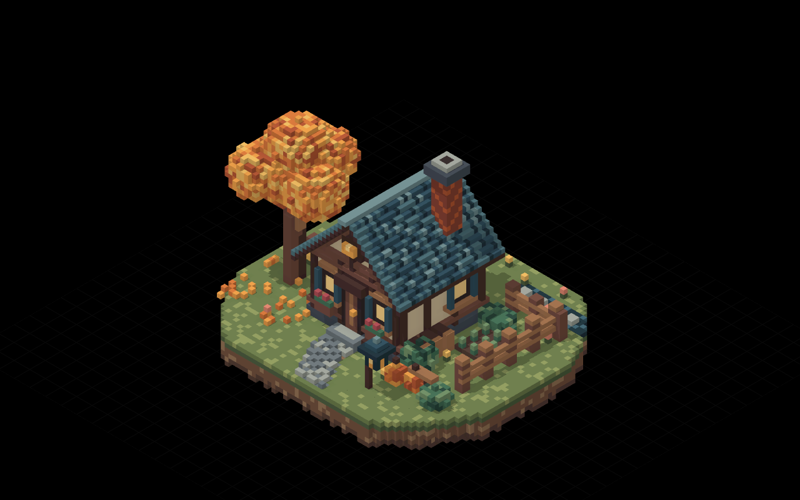
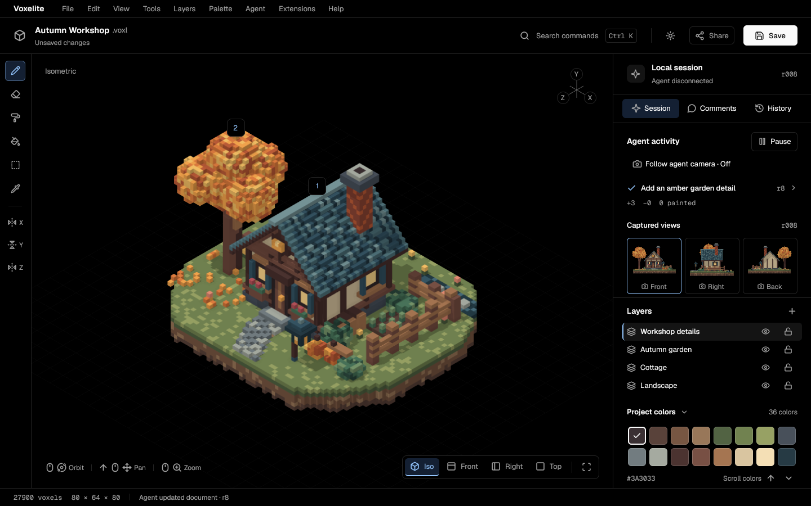
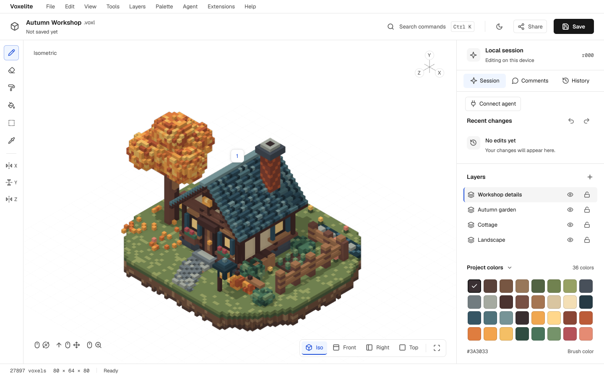

# Quantum

An Aseprite-style 3D voxel editor for people and agents.

Quantum was renamed from Voxelite. Crates, binaries, bundle IDs and the GitHub
repo slug still use `voxelite` until the separate code-wide rename lands; commands
and paths below use their current names.

Quantum is an all-Rust macOS desktop editor built with GPUI. Its
agent-first workflow combines a Model Context Protocol (MCP) server, reusable
skills, render-to-image feedback and live synchronization with a native editor
window. Projects use the versioned `.voxl` format; geometry exports as glTF binary
(`.glb`) and rendered views as `.png`.

The current workspace version is **0.3.1**, from [Cargo.toml](Cargo.toml).

[Website](https://voxelite.worldwidewebb.co/) ·
[User documentation](https://voxelite.worldwidewebb.co/docs/) ·
[Downloads](https://github.com/0x63616c/voxelite/releases)

## Screenshots

Autumn Workshop rendered by the production GPU viewport, from the checked-in
Apple M2 Metal golden set:



Native editor captures showing an agent session in dark mode and the workspace
in light mode. These are real earlier review captures: their toolbar Save/Share
controls and status copy predate the current shell. Current Save actions live in
the File menu, and hosted sharing is not implemented.





## What is implemented

- **Voxel tools:** Place, Erase, Paint, Fill, Box and Color picker, with keyboard
  editing and centered X/Y/Z mirrors. Box commits its two corners as one edit.
- **Viewport:** orbit, pan, zoom, fitted views, an interactive camera orientation
  gizmo and ground grid. The macOS Metal viewport uses exact voxel occupancy
  shadows, ambient occlusion, 4× MSAA and 2× supersampling. CPU rendering supports
  display-free image feedback and exports.
- **Palettes:** project colors, named presets and a local palette manager with
  create/rename/duplicate/delete, swatch editing, ordering, HSB controls, recent
  colors and copy-on-edit for read-only sources. Palette interchange supports
  HEX, GPL and JASC-PAL.
- **Layers and history:** layer creation, selection, visibility and locks;
  shared human/agent undo and redo; history scrubbing, preview playback and
  persistent named versions. Playback inspects snapshots without editing the
  live document.
- **Comments:** voxel and region anchors, numbered viewport pins, replies,
  resolution and reopening, persisted with the project.
- **Built-in plugins:** statically linked tools, mirrors, gizmo/grid, palettes,
  comments, exporters and agent command declarations. The host supports
  disablement, validation and panic isolation. There is no runtime plugin loader
  or user-facing enablement UI yet.
- **Agent integration:** a standalone stdio MCP server, attachment to the live
  native document over a private Unix socket, shared history, an activity feed,
  captured views and pause controls. [Skills](skills/README.md) and
  [host configurations](integrations/README.md) cover repeatable editing and
  visual review workflows.
- **Native shell:** macOS menus, command search, Settings, light/dark/system
  appearance, a fixed-width telemetry bar and shared text fields with natural
  word/line navigation, selection, clipboard, local undo and IME handling.
  Packaged macOS builds integrate Sparkle update checks.

The app opens the bundled Autumn Workshop directly when no file is supplied.
For controls and their generated shortcut table, see the
[native editor guide](crates/voxelite-app/README.md). Roadmap entries and older
reviews can describe earlier stages; they are not a list of shipped features.

## Install

For macOS 13 or later on Apple silicon, download
[`Voxelite.dmg`](https://github.com/0x63616c/voxelite/releases/latest/download/Voxelite.dmg)
from [GitHub Releases](https://github.com/0x63616c/voxelite/releases), open it and
drag `Voxelite.app` into Applications. Consult the selected release's notes for
its signing and installation status. The bundle also contains `voxelite-mcp` at
`/Applications/Voxelite.app/Contents/MacOS/voxelite-mcp`.

Packaged builds include Sparkle and check the
[site-hosted update feed](https://voxelite.worldwidewebb.co/appcast.xml).
Automatic checks are enabled; automatic download/installation is off by default.
Manual checks are available from the application menu and Settings → Updates.
Unbundled `cargo run` builds do not have the bundled updater available.

The [published documentation](https://voxelite.worldwidewebb.co/docs/)
is built in CI from [site sources](site/README.md).
The canonical site URL is defined in
[the site generator](crates/voxelite-site/src/main.rs).

## Build and run

Run commands from the repository root. [rust-toolchain.toml](rust-toolchain.toml)
pins **Rust 1.99.1** with rustfmt and Clippy; the workspace declares Rust **1.99**
as its minimum and uses edition **2024**. Rustup selects the pinned toolchain.

### Native macOS

Install the pinned Rust toolchain and Xcode with its Metal toolchain. The macOS
workflows use Apple silicon and
`DEVELOPER_DIR=/Applications/Xcode-27.0.app/Contents/Developer`; use the appropriate
installed Xcode location locally.

```sh
cargo run -p voxelite-app --bin voxelite
cargo run -p voxelite-app --bin voxelite -- examples/autumn-workshop.voxl
cargo run -p voxelite-app --bin voxelite -- examples/autumn-workshop.voxl --theme light
cargo run -p voxelite-app --bin voxelite -- --theme dark
```

The `native` feature is enabled by default. To test display-independent editor
state without enabling its GPUI dependency:

```sh
cargo test -p voxelite-app --no-default-features
```

To render a PNG without initializing a window or GPU:

```sh
cargo run -p voxelite-app --bin voxelite -- --viewport-png target/viewport.png
```

`VOXELITE_DATA_DIR` overrides the desktop settings, palette library and default
session-socket directory for isolated runs. See the
[native guide](crates/voxelite-app/README.md) for preferences and capture scripts.

### Linux and platform boundaries

Core, format, mesh, export, plugin and MCP code can run on Linux without a
display. The native GPUI app also has an X11/Wayland build; its development
dependencies and Xvfb capture instructions are in the
[native guide](crates/voxelite-app/README.md). Building the full workspace still
requires the native GPUI system libraries even when no window is opened.

The production Metal/IOSurface viewport, AppKit integration, Sparkle, DMG
packaging, signing and notarization require macOS. Linux can exercise the GPU
harness through Vulkan/lavapipe, but those results do not validate Metal pixels
or performance. Linux development support is separate from the distributed
Apple-silicon macOS package.

### Website

```sh
scripts/build-site.sh
python3 -m http.server 8090 --directory site --bind 127.0.0.1
```

The script builds the static website locally; it does not deploy.
See [site/README.md](site/README.md).
Generated site output is ignored by Git. CI builds it on PRs and `main`, and
publishes trusted `main` builds to `site-dist`; commit the sources, not the output.

### MCP and live synchronization

Start a standalone stdio server rooted at the current existing directory:

```sh
cargo run --release --locked -p voxelite-mcp -- --root "$PWD"
```

This process expects MCP messages on stdin. It owns an in-memory session; save
through the document tools before disconnecting. `--help` prints CLI usage and
`--schema` prints the tool catalog. Configure a host using
[integrations/README.md](integrations/README.md), then follow the
[MCP guide](docs/mcp.md) and [skills guide](skills/README.md).

For the live canvas, use the app's Agent connection panel, or start these in
separate terminals with the same unused socket path:

```sh
cargo run -p voxelite-app --bin voxelite -- --session-socket /tmp/voxelite-session.sock
cargo run -p voxelite-mcp -- --connect /tmp/voxelite-session.sock
```

Attachment shares the editor's engine, revision and undo history. The app owns
open/save lifecycle; changes remain in memory until saved there. This is local
human/agent synchronization, not hosted collaboration.

## Repository layout

Each row below is a workspace package. The `crates/plugins/` directory itself is
only a container.

| Crate | Responsibility |
| --- | --- |
| [voxelite-crash](crates/voxelite-crash/) | Opt-in crash/feedback reports, redaction, local panic capture and relay request preparation; no automatic sending. |
| [voxelite-core](crates/voxelite-core/) | Document invariants, voxel storage, palettes/layers, atomic commands, snapshots and undo/redo. |
| [voxelite-format](crates/voxelite-format/) | Canonical, bounded `.voxl` JSON, build-history replay and document-session persistence. |
| [voxelite-mesh](crates/voxelite-mesh/) | Deterministic greedy surface geometry shared by rendering and GLB export. |
| [voxelite-render](crates/voxelite-render/) | Cameras, CPU rasterization, exact shadows and the optional GPU viewport/headless harness interface. |
| [voxelite-plugin-api](crates/voxelite-plugin-api/) | Portable plugin manifests, contributions and capability-scoped behavior contracts. |
| [voxelite-plugin-host](crates/voxelite-plugin-host/) | Registry, enablement, lifecycle, dispatch, fault isolation and conformance checks. |
| [voxelite-ui](crates/voxelite-ui/) | Shared GPUI controls, design tokens, text editing and fixed-width status components. |
| [voxelite-app](crates/voxelite-app/) | Editor state and native GPUI shell; native binary `voxelite`. |
| [voxelite-mcp](crates/voxelite-mcp/) | Standalone MCP authority, stdio transport and live native-session bridge. |
| [voxelite-bench](crates/voxelite-bench/) | Production-GPU performance measurements and golden-image comparisons. |
| [voxelite-site](crates/voxelite-site/) | Static site, MCP reference, Markdown/LLM indexes and integration generation. |
| [voxelite-plugin-tools](crates/plugins/voxelite-plugin-tools/) | Place, Erase, Paint, Fill, Box and Picker behavior through typed command proposals. |
| [voxelite-plugin-mirror](crates/plugins/voxelite-plugin-mirror/) | Centered X/Y/Z transformations of pending tool commands. |
| [voxelite-plugin-gizmo-grid](crates/plugins/voxelite-plugin-gizmo-grid/) | Camera orientation widget, navigation interaction and ground-grid overlays. |
| [voxelite-plugin-palette](crates/plugins/voxelite-plugin-palette/) | Presets, local palette management, portable panel behavior and palette interchange. |
| [voxelite-plugin-comments](crates/plugins/voxelite-plugin-comments/) | Discussion panel, anchor-placement tool and viewport pins. |
| [voxelite-plugin-exporters](crates/plugins/voxelite-plugin-exporters/) | Bounded, deterministic GLB/PNG encoders and registered HEX/GPL export callbacks without filesystem access. |
| [voxelite-plugin-agent](crates/plugins/voxelite-plugin-agent/) | Agent/Extensions command declarations; execution remains in the app. |
| [voxelite-plugin-example](crates/plugins/voxelite-plugin-example/) | Minimal declaration-only plugin template, not linked into the app. |

| Top-level directory | Contents |
| --- | --- |
| [bench/](bench/) | Pinned scenes, machine identity, GPU goldens and performance baselines. |
| [docs/](docs/) | Architecture, implementation guides, performance notes, reviews and retained images. |
| [Art checklist](design/ART-CHECKLIST.md) | Visual direction for app and site work. |
| [examples/](examples/) | Sample `.voxl` projects and Rust scene/history generators. |
| [integrations/](integrations/) | Generated MCP configuration examples for supported agent hosts. |
| [packaging/](packaging/) | macOS bundle metadata, icon, entitlements, public update key and release-note base. |
| [scripts/](scripts/) | Build, packaging, release, validation and capture scripts, plus Python tests. |
| [site/](site/) | Tracked article fragments/assets and ignored website/docs build output. |
| [skills/](skills/) | Portable agent workflows for modeling, palettes, primitives and render review. |
| [spec/](spec/) | `.voxl` and MCP contracts and compatibility fixtures. |
| [vendor/](vendor/) | Pinned GPUI Apple surface-lifetime patch and its upstream notices. |
| [xtask/](xtask/) | Cargo launcher for the independent `bench` and `visual` tools. |

## Architecture

The **core architecture** spans several crates: the engine and document model,
undo, `.voxl` persistence, renderer/camera, and plugin host/registry remain trusted
infrastructure. `voxelite-core` itself is a pure model/transaction crate, not the
application shell. Human tools and MCP edits pass through the same validated
engine; renderers consume immutable snapshots.

Built-in plugins use `voxelite-plugin-api` to return typed commands, portable
views, overlays and encoded bytes. The host validates contributions and handles
enablement and faults. The app registers its required core contribution and the
seven enabled feature plugins in
[core_plugin.rs](crates/voxelite-app/src/core_plugin.rs).
[actions.rs](crates/voxelite-app/src/actions.rs) projects registry metadata into
menus, command search, shortcuts and help; settings read declared contributions.
GPUI layout, focus, platform dialogs and filesystem policy remain host concerns.
See [ADR 0002](docs/adr/0002-built-in-plugin-architecture.md) and
[the plugin guide](crates/plugins/README.md).

The renderer is isolated from the shell and exporters. `voxelite-mesh` supplies
shared geometry; `voxelite-render` exposes cameras, image rendering and optional
GPU entry points, keeping occupancy, traversal, chunk meshes and GPU resources
private. Encoders receive geometry or pixels, and hosts supply render callbacks.
The test `normal_workspace_dependencies_preserve_renderer_boundary` in
[boundary.rs](crates/voxelite-render/tests/boundary.rs) enforces the normal
workspace dependency boundary. [scripts/check-plugin-deps.py](scripts/check-plugin-deps.py)
separately rejects plugin normal/build dependencies on any workspace crate except
`voxelite-plugin-api`, including optional and target-specific dependencies.

The shell shares controls and editing through [voxelite-ui](crates/voxelite-ui/README.md).
Plugins do not depend on GPUI or the UI crate. The
[core architecture notes](docs/architecture/core.md) explain model invariants;
their stage-specific introduction predates the current shell and plugin work.

## Tests and checks

The standard workspace test command is `cargo test --workspace`. The exact
format, lint and test invocations in [CI Linux](.github/workflows/ci-linux.yml) and
[CI macOS](.github/workflows/ci-macos.yml) are:

```sh
cargo fmt --all -- --check
cargo clippy --workspace --locked -- -D warnings
cargo test --workspace --locked --no-fail-fast
python3 -B scripts/check-plugin-deps.py
python3 -B -m unittest discover -s scripts/tests -p 'test_plugin_deps.py'
python3 -B -m unittest discover -s scripts/tests -p 'test_macos_*.py'
```

The Python packaging tests mock macOS tools and run on Linux. Run all script
tests with `python3 -B -m unittest discover -s scripts/tests -p 'test_*.py'`.
Useful focused Rust checks include:

```sh
cargo test -p voxelite-core --locked
cargo test -p voxelite-app --no-default-features --locked
cargo test -p voxelite-ui --locked
cargo test -p voxelite-render --locked --test boundary normal_workspace_dependencies_preserve_renderer_boundary
```

The shortcut table belongs to `crates/voxelite-app/README.md`, not this root file.
After changing command contributions, regenerate it with:

```sh
UPDATE_README=1 cargo test -p voxelite-app --bin voxelite readme_shortcuts_match_registry
```

### Rendering correctness and performance

Read [docs/perf/rendering-harness.md](docs/perf/rendering-harness.md) and
[bench/README.md](bench/README.md) before changing the renderer. Both harnesses
exercise the production GPU viewport at fixed quality; CPU exports are separate.

```sh
cargo xtask --help
cargo xtask visual --determinism
cargo xtask bench --scene autumn --runs 3 --out target/bench/after.json --markdown target/bench/after.md
cargo xtask bench --scene autumn --runs 3 --compare
```

`xtask` builds the harness in release with `--locked`. `--scene` can repeat;
defaults are `autumn`, `terrain1m` and `sponge1m`. `--scene terrain10m` explicitly
enables benchmark-only larger-scene admission. Do not enable that feature in
application builds. Benchmark options also include `--frames`, `--warmup`,
`--width`, `--height` and `--input` for reporting/comparing an existing JSON file.

Authoritative PNGs and matching JSON metadata live in
[bench/golden/apple-m2-metal/](bench/golden/apple-m2-metal/). Their owner is the
Apple M2 Mac mini/Metal machine in [bench/pinned-machine.toml](bench/pinned-machine.toml).
Performance references live in [bench/baseline/](bench/baseline/); the recorded M2
baseline is provisional because it was measured under shared-runner load.

On an unpinned machine, use explicit local references:

```sh
cargo xtask visual --scene autumn --local-baseline
cargo xtask visual --scene autumn --local-baseline --determinism
```

The first run creates an absent local set under `target/golden/`; subsequent runs
compare it. Updating it requires `--local-baseline --rebaseline`. See the harness
guide for Linux Vulkan/lavapipe setup. Local results are not M2 evidence.

Renderer speedups must preserve pixels, render scale, AO, antialiasing and exact
shadows. For an intentional appearance change, review before/after images before
accepting new goldens. On the pinned machine, update references explicitly:

```sh
cargo xtask visual --rebaseline --determinism
cargo xtask bench --runs 3 --update-baseline
```

The performance update cannot combine with `--compare` or `--input`.

[Rendering checks](.github/workflows/render-checks.yml) runs visual comparison
and determinism on matching PR paths, selecting all four scenes. Manual
`rebaseline-visual` and `bench-baseline` dispatches upload reference artifacts
without committing them. Review every changed image/sidecar before adding them.
Manual benchmark comparisons are diagnostic on the shared runner; visual
comparison is a gate. Include matching-machine before/after JSON, comparison
rows, run spread and load in performance PRs.

### Site checks

Generator tests build into temporary directories and need no local site bundle:

```sh
cargo test --locked -p voxelite-site
```

After building the site:

```sh
python3 scripts/check-site.py
python3 scripts/check-macos-appcast.py site/appcast.xml --allow-empty
```

The site checker expects the complete generated site.
It validates links, Markdown exports, discovery metadata and source parity.
With a local site server and Playwright installed, browser checks are available through
`node scripts/check-site-install.mjs` and
`node scripts/capture-site.mjs screenshots/site/final`; follow
[the site guide](site/README.md) for setup.

## Releases and deployment

Follow [docs/releasing-macos.md](docs/releasing-macos.md). Use a focused version
bump PR titled `chore(release): prepare vX.Y.Z` (see [CONTRIBUTING.md](CONTRIBUTING.md)): update
workspace versions and `Cargo.lock`, and synchronize affected download and
compatibility metadata before merging. Tag the approved commit separately.

[Release macOS](.github/workflows/release-macos.yml) accepts stable
`vMAJOR.MINOR.PATCH` tags, either on push or manual dispatch of an existing tag.
It checks out `refs/tags/`, requires the tag to match the app's Cargo version,
builds both binaries, signs and notarizes the app/DMG, then publishes all assets
together. Existing releases are not overwritten.

Signing and notarization secret names are `MACOS_CERTIFICATE_P12_BASE64`,
`MACOS_CERTIFICATE_PASSWORD`, `APPLE_API_KEY_P8_BASE64`, `APPLE_API_KEY_ID` and
`APPLE_API_ISSUER_ID`; `MACOS_SIGNING_IDENTITY` is optional. Sparkle signing uses
`SPARKLE_ED_PRIVATE_KEY`. The committed public key lives in
[packaging/macos/sparkle_public_ed_key.txt](packaging/macos/sparkle_public_ed_key.txt);
an optional `SPARKLE_PUBLIC_ED_KEY` variable must match it. Never put private
keys or credential values in the repository.

[scripts/generate-macos-release-notes.py](scripts/generate-macos-release-notes.py)
combines the packaging notes with non-merge commit subjects since the previous
stable ancestor tag. Write meaningful commit subjects: they become release notes.
[scripts/generate-macos-appcast.sh](scripts/generate-macos-appcast.sh) preserves
prior feed entries and signs the update feed and notes. Published assets include
`Voxelite.dmg`, `Voxelite.dmg.sha256`, `Voxelite.html` and `appcast.xml`.

[Deploy site](.github/workflows/deploy-site.yml) builds and verifies the complete
static site on Ubuntu for PRs and `main`. Successful owner-triggered releases
also trigger it. Trusted `main` runs publish `site-dist` and deploy the built
directory directly with the Vercel CLI using `VERCEL_TOKEN`; pushing the branch
alone does not deploy. The workflow fetches the highest stable signed release
feed and serves its unchanged bytes at the website's `/appcast.xml`. Retry a
failed site deployment rather than replacing published release assets.

## Documentation and contributing

| Read | For |
| --- | --- |
| [docs/](docs/) | Engineering guides and implementation evidence. |
| [Native editor guide](crates/voxelite-app/README.md) | Running the app, controls and platform notes. |
| [MCP guide](docs/mcp.md), [integrations](integrations/README.md), [skills](skills/README.md) | Agent setup and workflows. |
| [Site guide](site/README.md) | Website builds and generated documentation. |
| [Domain glossary](docs/glossary.md) | Shared terminology and proposed architecture seams. |
| [ADRs](docs/adr/), [ADR 0001](docs/adr/0001-record-architecture-decisions.md) | Decisions and the architecture review's recommended order. |
| [Core architecture](docs/architecture/core.md), [built-in plugins](crates/plugins/README.md) | Model invariants and extension boundaries. |
| [Format specification](spec/voxl/1.0/README.md), [MCP contract](spec/mcp/v1/contract.md) | File and protocol contracts. |
| [Product direction](docs/adr/0003-product-direction.md) | Product scope, core and built-in plugin boundaries, and deferred work. |
| [Art checklist](design/ART-CHECKLIST.md), [private archive](https://github.com/0x63616c/quantum-archive) | Visual direction; historical concepts, review captures and design history. |
| [Rendering harness](docs/perf/rendering-harness.md), [release guide](docs/releasing-macos.md) | Pixel/performance gates and distribution. |
| [AGENTS.md](AGENTS.md) | Coding conventions, commands, UI rules and PR workflow. |

Read [AGENTS.md](AGENTS.md) before contributing. Keep PRs focused, include visual
or performance evidence when relevant, and follow the commit identity rules in
AGENTS.md (no tool attribution or co-author trailers).

## License

Quantum is licensed under [MIT](LICENSE). Bundled fonts, icons, Sparkle and the
vendored GPUI code retain their own license notices in their asset/vendor directories.
