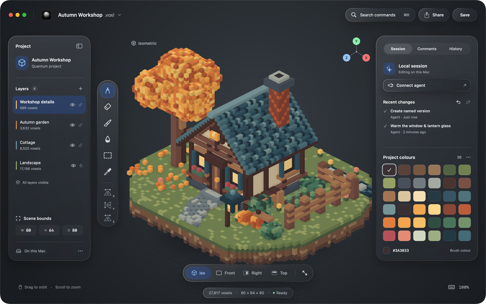
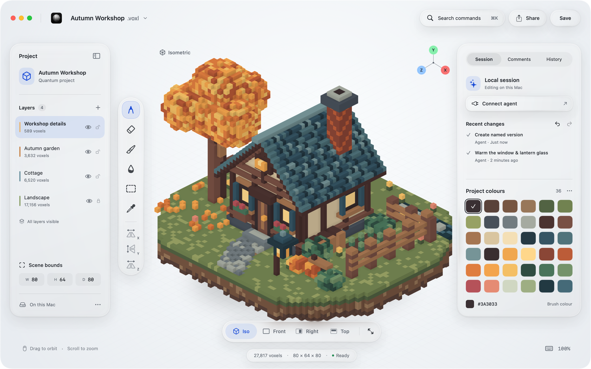
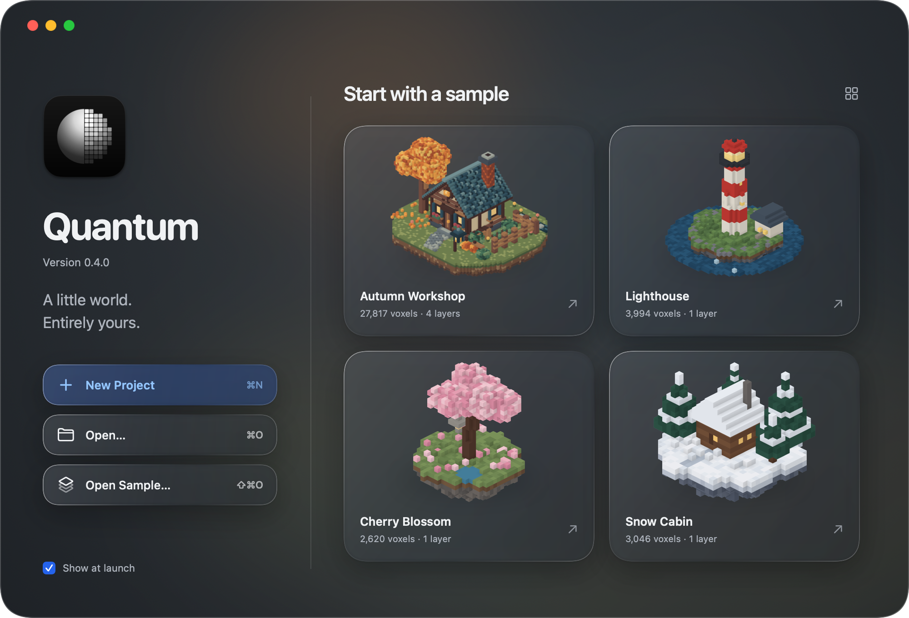
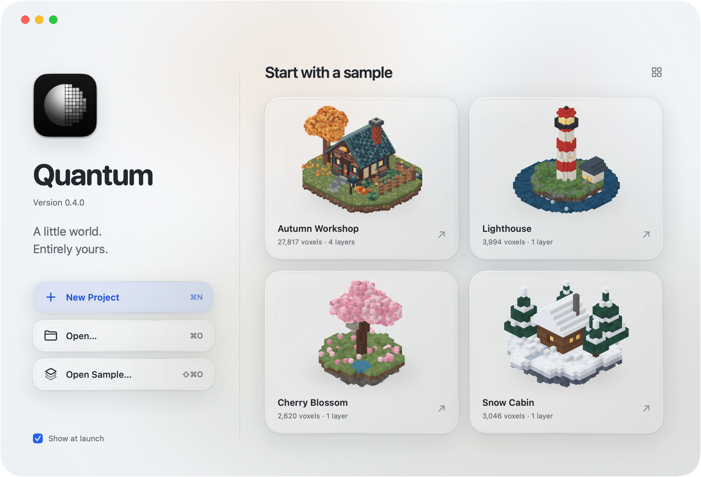

# Quantum · Liquid Glass concept

A native SwiftUI **design study**, tracked in [#224](https://github.com/0x63616c/quantum/issues/224).
The Autumn Workshop editor and sample browser explore a macOS 27 treatment of
Quantum: a full-window voxel scene, floating glass tools and inspector, a layer
sidebar, and a quiet camera capsule. Both dark and light appearances are included.

This is a standalone Swift package. It does not link to the Rust editor, change
its behaviour, or participate in the Cargo workspace (whose members are
`crates/*`, `crates/plugins/*`, and `xtask`). The displayed **Version 0.4.0** is
concept copy, not a change to Quantum's release version.

| Editor · dark | Editor · light |
| --- | --- |
|  |  |

| Welcome · dark | Welcome · light |
| --- | --- |
|  |  |

## Build and view

Use Xcode 27 / Swift 6.4 with the macOS 27 SDK. The deployment target is macOS 15,
so the painted fallback also runs on older Macs. No third-party dependencies.

```sh
cd concepts/swiftui-liquid-glass
export DEVELOPER_DIR=/Applications/Xcode-27.0.app/Contents/Developer
swift build -c release
swift run -c release QuantumGlassApp
```

`QuantumGlassApp` offers Welcome and Editor windows and follows system appearance.
The welcome actions open the Autumn Workshop concept. Tools, layer selection,
inspector tabs, swatches, and the welcome checkbox have local presentation state.
Save, Share, search, agent connection, camera choices, layer visibility and locks
are visual affordances only. There is no file editing, persistence, agent
connection, or export. The artboards intentionally have fixed sizes.

## Render the four screenshots

```sh
swift run -c release QuantumGlassRender screenshots
```

The command takes exactly one output directory, creates it if necessary, and
replaces the four named PNGs atomically. It exits nonzero on a rendering or I/O
failure. Rendering needs a Metal-capable Mac; Linux is not supported.

The committed PNGs were losslessly compressed with Oxipng level 4; decoded RGBA
pixels were verified identical before and after compression. To repeat that
optional size reduction after rendering (Oxipng is not a build dependency):

```sh
oxipng -o 4 --strip safe screenshots/*.png
```

| File | Artboard (points) | PNG (pixels) |
| --- | --- | --- |
| `editor-dark.png`, `editor-light.png` | 1440 × 900 | 2880 × 1800 |
| `welcome-dark.png`, `welcome-light.png` | 1000 × 680 | 2000 × 1360 |

`ImageRenderer` runs on the main actor with `scale = 2`. Each view explicitly
sets its colour scheme. The CLI does not open windows, and draws traffic lights
into the image; the live app leaves room for the native window controls.

In the task's Linux workspace, the external job helper transfers this package,
builds on the Mac, and returns the screenshots:

```sh
/workspace/jobs-owned/glass-concept/mac-build.sh build
/workspace/jobs-owned/glass-concept/mac-build.sh render
```

## Real glass and rendered glass

The `LiquidGlass` modifier has two deliberately separate presentation paths:

* **Live, macOS 26+:** real `.glassEffect(.regular, in:)` with continuous rounded
  rectangles, `GlassEffectContainer(spacing:)` for adjacent toolbar controls, and
  `.buttonStyle(.glass)` with a rounded button border. These APIs compile against
  Xcode 27. Every use is guarded by `if #available(macOS 26, *)`.
* **Snapshots, and live macOS 15:** painted glass. Each surface samples its actual
  location in a shared full-window backdrop image. It applies blur, a restrained
  tint, a slightly magnified edge band, a directional specular rim, a dark inner
  edge, and soft drop shadows. The backdrop remains spatially aligned across
  the floating surfaces. This is an optical approximation, not Apple's material.

The checked-in screenshots use the second path on **macOS 15.6**, built with
**Xcode 27.0 / Swift 6.4**. They do **not** demonstrate the native Liquid Glass
runtime, window-server blur, material motion, or interactive refraction. Live
macOS 26+ appearance still requires review on that OS. Offscreen `ImageRenderer`
cannot faithfully capture those compositor effects, so snapshot mode always
selects the painted path, including on newer systems.

Apple references: [custom Liquid Glass views](https://developer.apple.com/documentation/swiftui/applying-liquid-glass-to-custom-views),
[GlassEffectContainer](https://developer.apple.com/documentation/swiftui/glasseffectcontainer).

## Real sample geometry

`Sources/QuantumGlassUI/Resources/*.json` are trimmed render-only copies of the
repository's four `examples/*.voxl` documents. Document metadata, layers, voxel
coordinates and palette slots are retained; format headers, history, versions
and comments are omitted. These JSON files are **not** saveable `.voxl` projects.
They contain no newly invented scene geometry.

`VoxelScene` composes visible layers, removes interior faces across layer
boundaries, and submits **one merged geometry with one material per scene**.
Local neighbour occupancy supplies vertex ambient occlusion; face directions
supply baked diffuse lighting. `SCNRenderer`, using
`MTLCreateSystemDefaultDevice()`, captures a transparent orthographic image with
4× MSAA. SwiftUI adds the neutral studio background, ground grid and soft contact
shadow. This is a concept renderer, not Quantum's production Metal pipeline or
its visual/performance baseline. It does not change production quality settings.

The Autumn Workshop has 27,817 unique visible voxels. Its per-layer counts total
27,897 because layers overlap. The welcome counts use the unique scene counts.
All four thumbnails are rendered from their own geometry, not cropped UI images.
There is no silent image fallback: Metal/render failures are reported.

The icon is copied unchanged from `packaging/macos/icon-1024.png`. The palette is
read from the actual Autumn Workshop document. Accent colours match
`quantum-ui/src/tokens.rs`: `#2563EB`, with `#93C5FD` dark / `#1D4ED8` light accent
text. Typography uses system SF. Source artwork and sample data retain the
repository's MIT licence.

## Repository integration caveat

The current repository hygiene gate (`cargo xtask check tidy`) has an explicit
root-directory allowlist in `xtask/src/tidy.rs` that does not yet include
`concepts`. It rejects this new directory even though Cargo correctly ignores the
Swift package. The task explicitly limits changes to this concept directory, so
the allowlist is unchanged. A separately authorised `concepts` allowance is
needed before the parent opens a PR that must pass that gate. No Rust build or
runtime code has been changed. PR publication and issue closure belong to the
parent task.
