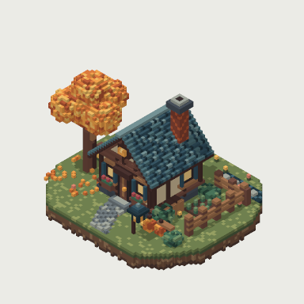
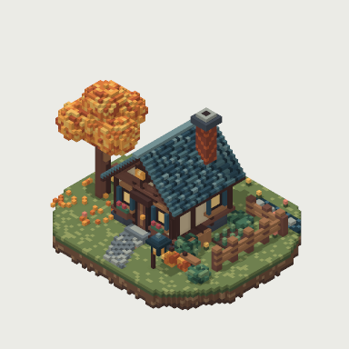
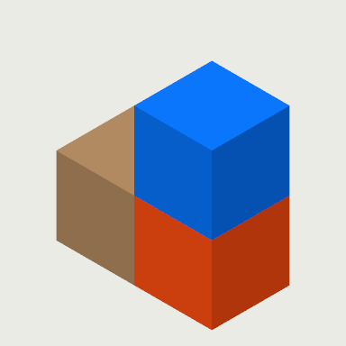
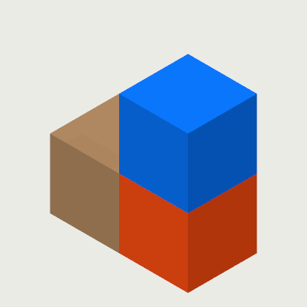
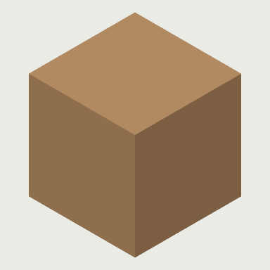

# Ambient occlusion

Voxelite shades contacts between nearby voxels in the viewport. In **Settings →
Viewport / Rendering**, ambient occlusion starts enabled at strength **1.00**,
matching the original renderer exactly. The shared slider spans **0–2** in 0.05
steps: 0 disables AO, 1 is the original look, and 2 doubles its darkening. The
toggle retains the chosen strength; adjusting the slider enables AO for nonzero
values. Turning AO on from zero restores strength 1.

Preferences persist locally and apply live to every viewport, including the CPU
fallback. Like antialiasing, this control lives in Settings rather than adding a
command. It does not change project files, thumbnails or export defaults. MCP
`render` and `export_png` can explicitly pass `ambient_occlusion_strength`.

## CPU before/after comparisons

Each pair uses the same fitted isometric orthographic camera, 384×384 pixels,
2× supersampling, opaque neutral background, directional shadows on and outlines
off. Only AO strength changes. These are CPU rasterizer exports, not screenshots
of the Metal viewport; GPU vertex interpolation and CPU per-pixel sampling retain
their existing differences.

| Model | Strength 0 (off) | Strength 1 (default) |
| --- | --- | --- |
| [Autumn Workshop](../bench/scenes/autumn-workshop.voxl) |  |  |
| [Three-voxel step](../crates/voxelite-export/tests/golden/scene.json) |  |  |
| [Single-voxel control](../spec/voxl/1.0/fixtures/populated.canonical.voxl) |  |  |

The step makes the contact shading easy to inspect. The single-voxel control is
identical in both images: AO does not darken unoccluded surfaces. Every PNG is
under 400 KB. Regenerate using the existing CPU export example:

```sh
cargo run --release --locked -p voxelite-export --example cottage -- --ao-comparisons
```

## Default preservation

The visual harness compared clean pre-change and updated renderer binaries on
Linux/lavapipe at default strength, with fresh-device determinism enabled. All
four Autumn Workshop views (fit, close, orbit90, orbit180) were pixel-identical:
maximum channel delta 0. The existing CPU export PNG and MCP contact-sheet golden
tests also pass unchanged. No files under `bench/golden` were updated. The GPU
test additionally verifies live strength changes without chunk updates and exact
pixel restoration at strength 1. Metal presentation and interactive Settings
validation still require macOS.
