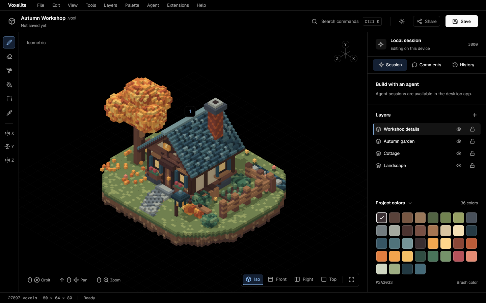
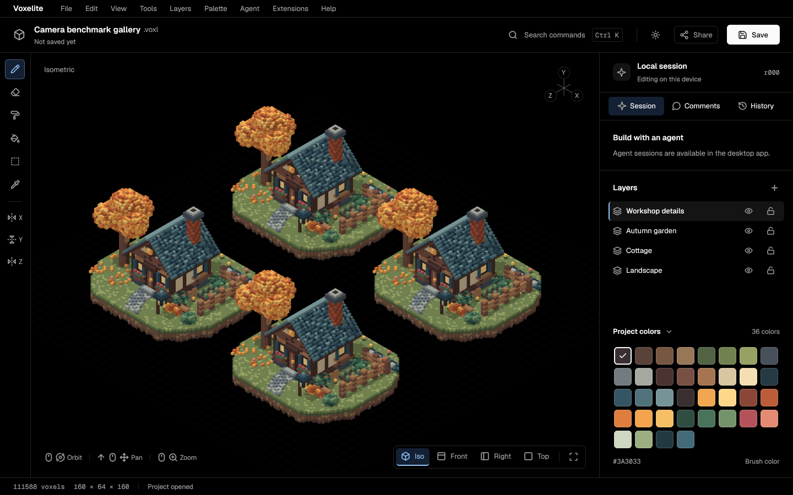

# Camera and placement investigation

**Status: working progress, not a completed performance fix.** The always-on core
edit optimization is committed and tested. A shared, full-quality wgpu viewport
is implemented and verified, but remains **opt-in** because the software-GPU
measurements do not meet 60 FPS or one-frame placement, and camera throughput
regresses relative to the old reduced-quality navigation mode. Do not enable it
by default on the strength of these results.

Open the web build with `?viewport=gpu` (optionally `&backend=webgl` or
`&backend=webgpu`), or run the native application with `VOXELITE_GPU_VIEWPORT=1`.
The GPU path has no interactive downscale, supersampling toggle, shadow toggle,
or idle refinement. The original CPU viewport and its existing adaptive behavior
remain the default as a regression boundary, **not as the owner's requested final
solution**. CPU exports/thumbnails are unchanged. Nothing was pushed, deployed,
or merged.

## Reproduction and measurement limits

See [benchmark instructions](README.md), [driver](../../scripts/bench-camera.mjs)
and [offline analysis](../../scripts/lib/camera-metrics.mjs). The benchmark was
committed before changing the renderer (`69a620f`), and the baseline captured
before implementation builds. It loads the actual `web/dist` GPUI/wasm app,
uses real mouse and wheel events, and emits raw traces, JSON, screenshots and
Markdown. Three independent browser pages per scene; medians of corresponding
metrics, with every run retained.

- Typical: bundled Autumn Workshop, 27,897 layer voxels, including its existing
  named version. Large: four translated copies, 111,588 voxels; comments/versions
  omitted, bounds 160×64×160. These are different editing workloads as well as
  different geometry sizes; version-validation costs must not be inferred from
  voxel count alone. Scene hashes are in each JSON.
- Chromium/SwiftShader **WebGL2**, 1440×900, DPR 1 for before/after comparison.
  Exact browser, launch flags, CPU, commit and wasm hash are recorded. SwiftShader
  is a software GPU. The tests do **not** establish hardware GPU or Mac performance.
  Separate correctness checks passed on SwiftShader WebGPU and native Vulkan
  llvmpipe. No benchmark or compilation was run concurrently with the final
  timed comparison runs.
- Each gesture offers 360 events over six seconds, independent of the page's
  frame rate. Browser coalescing is observable in delivered-event counts. The
  driver waits for acknowledgements and records the additional queue-drain time;
  FPS divides by the **actual** phase duration, not six seconds when draining
  took longer. Trace timestamps preserve the fixed offered-input interval.
- FPS counts changed viewport images, not overlay paints or browser RAF callbacks.
  p50/p95/p99 frame times are intervals between those changed images. Idle does
  not continuously rerender. Presentation is the first RAF after paint submission,
  a proxy, not GPU timestamp queries or physical-display photon latency.
- Camera latency has two measures: delivered input to the next image (which may
  already be in flight), and injection to an image whose render started after
  the corresponding navigation event. Tables use the latter causal measure,
  including dispatch backlog. An intermediate coalesced camera pose need not
  appear. `dispatchDelayMs` separately measures injection to browser handler.
  CPU spans are inclusive; nested spans must not be summed. GPU execution plus
  readback waiting is asynchronous wall time, explicitly outside CPU timings.
  JS↔wasm boundary overhead is **not independently isolated** (`null`, not zero).
- Ten isolated placements wait for their revision to be painted. The series offers
  fifty real clicks along a grid at 30 Hz; the original application does not place
  continuously during a held-left drag. Accepted/visible counts accompany latency.
  Each accepted revision is matched to the first painted revision at least that
  new. This measures visibility by renderer identity, independently checked with
  pixel changes and saved voxel data in the browser acceptance tests. It is not
  an optical measurement of each of fifty individual voxels.
- The initial baseline analysis incorrectly attributed a later unrelated camera
  reset to hover latency. This was corrected by reanalyzing the original traces,
  without changing the captured runs. Hover has no new 3D image and therefore
  null 3D latency; overlay timing is separate. The post-change isolated-click
  settle guard also waits for the successful edit revision, so queued renders
  cannot make subsequent clicks look isolated when they are not.

## Findings and changes

### CPU rasterization is the interactive bottleneck

The lead is confirmed. Both browser and native `EditorView` call
[`voxelite_render::render`](../../crates/voxelite-render/src/raster.rs) for viewport
images. It rebuilds the visible greedy mesh, rasterizes triangles on the CPU,
then shades every covered sample. AO performs eight neighborhood probes per
sample; directional shadow rays traverse up to 768 cells. Idle/edit renders use
2× supersampling in each dimension. Navigation used half-size images with one
sample, plus a 180 ms timer to request full quality again.

Before orbit, median CPU span p50s in milliseconds:

| Scene | Full mesh | Raster geometry | Raster shading | Whole CPU render | UI build | Snapshot clone |
|---|---:|---:|---:|---:|---:|---:|
| Typical | 17.4 | 3.7 | 111.3 | 134.8 | 0.4 | <0.1 |
| Large | 77.3 | 7.0 | 155.8 | 244.2 | 0.3 | <0.1 |

These already include the old lower-quality navigation mode. CPU raster time,
not the Rust UI build, explains the order-of-magnitude gap from a 16.7 ms frame.
The ordinary browser build explicitly passes `false` for threading to
`WebPlatform::new_with_backend` in [web.rs](../../crates/voxelite-app/src/web.rs),
and uses GPUI's single-thread dispatcher (no wasm atomics/worker build). Calling its background executor
does not make this synchronous raster work independent of the browser event loop.
Native runs the raster on its background executor but still waits for the same
expensive image to complete.

The opt-in replacement is [`gpu.rs`](../../crates/voxelite-render/src/gpu.rs):
persistent wgpu resources; device-resolution four-sample MSAA; linear lighting;
baked vertex AO; a 2048² hard-shadow depth pass using the same camera-relative
light direction and diffuse/ambient coefficients; an sRGB resolve and optional
screen-space silhouette/crease outline shader. Editor outlines remain disabled,
matching the existing `RenderOptions::default()`; CPU AO and shadows were on,
**outlines were not**. This is not a claim that an outline pass was previously
an editor bottleneck.

### Camera changes unnecessarily rebuild scene geometry

The CPU renderer calls `greedy_mesh(snapshot)` every render. It also constructs
composite cell maps for mesh/shadow processing. No voxel state changes are needed
for orbit, pan or zoom. There was no existing persistent scene GPU vertex buffer:
the GPU received a newly converted/uploaded raster image instead.

[`ChunkMeshes`](../../crates/voxelite-render/src/chunk_mesh.rs) retains the visible
composite and deterministic per-chunk geometry. Camera changes write uniforms
and submit GPU passes. The acceptance test and timed traces verify **zero mesh
rebuilds and zero vertex upload bytes on camera-only redraws**. GPU-to-CPU image
readback and GPUI texture upload still occur; removing that remaining full-image
transfer is unfinished work, not something this implementation claims to fix.

### Placement blocks on raster completion, with an additional edit-preparation cost

Before isolated clicks, median click-to-visible latency was 1,233 ms (typical)
and 1,788 ms (large). The old `ray()` gate rejects edits while rendering, refining,
or showing an outdated revision. The fifty-click series accepted only 2/50 and
1/50 respectively. Reporting latency without these counts would conceal lost input.

The core already used immutable `Arc` chunks and copy-on-write snapshots; it was
**not** deep-copying all voxel arrays on every camera event or edit. However,
`Engine::prepare` rescanned all layer voxels and revalidated/rehashed unchanged
named versions. Its comparison also assembled a coordinate set for the entire
changed layer. This explains the typical scene's higher edit CPU cost despite
its smaller geometry: it retains a named version that the generated gallery lacks.

The always-enabled core fix adds immutable-chunk-aware validation and exact cell
comparison. Bounds/palette changes still validate all relevant cells. Changed
versions still receive full hash, reference, cycle and byte-budget checks.
Nothing mutates a retained snapshot; transaction preparation, no-op detection,
receipt contents, history budgets and undo/redo semantics remain intact.

On the GPU path, edits update only changed composite cells and chunks intersecting
their two-cell AO/culling halo, including diagonal and negative-coordinate seams.
Palette, layer order and visibility changes invalidate the composite. Empty chunks
remove buffers; buffers with sufficient capacity are reused. The shadow pass still
sees the complete updated scene, so distant shadows remain correct. New mesh
admission is bounded before the next chunk is retained.

GPU clicks are allowed during a pending **same-camera** edit render. They use the
camera of the frame actually painted, and the current engine state; camera or
size changes still prevent picking through a stale view. Completed intermediate
edit frames can be displayed so continuous edits do not starve the viewport.
Document replacement/history-preview generations reject stale results. All fifty
series inputs must be counted even if the scene cannot display fifty separate
frames on the measured backend.

### It is both slow frames and queued input, with different evidence by gesture

Orbit/pan are primarily slow viewport frames. Before orbit, p50 frame intervals
were 179/244 ms and input-to-next-image p50 was 240/248 ms, while delivered-event
dispatch p95 was only 18/17 ms (typical/large). Many offered mouse moves were
coalesced by the browser while the app could not keep up.

**Wheel input also develops a large backlog.** Six seconds of offered zoom input
took median 23.92/21.06 seconds to finish dispatching. Injection-to-handler p95
was **19.92/16.94 seconds**, much larger than the delivered-input-to-next-image
p95 of 1.24/1.35 seconds. The smaller latter metric must not be described as total
user-perceived zoom latency. CPU blocking and browser/compositor acknowledgement
queues both participate; this harness does not separately attribute their queues.

The first GPU prototype exposed an additional queue problem: camera input
repainted the entire GPUI shell while a viewport image was still in flight. The
[retained intermediate three-run results](experiments/uncoalesced/camera-after.json)
show typical orbit at 0.33 FPS, with about 44 UI builds for only two changed
viewport images in six seconds. Those UI builds were cheap on the CPU but queued
more compositor work on the software GPU. Suppressing redundant camera-only
notifications while a GPU frame is pending raised the typical six-second probe
to 2.65 FPS and reduced mean GPU execution/readback wait from about 2,610 ms to
354 ms, with identical rendering settings. Final three-run results below include
this correction. Hover and independent UI actions still repaint normally; an
attempt to suppress pointer-edit notifications did not improve the series and
was discarded. This is evidence about GPU queue pressure, not a claim that
sub-millisecond Rust UI construction dominated the original raster path.

The old code coalesced render requests behind one in-flight task, so “no coalescing
at all” is false. It still initiated work from input handlers and created an idle
refinement timer per navigation event. The GPU branch updates camera state and a
pending flag, then submits at most one latest-state render from GPUI's frame tick,
with one in-flight image and no quality/refinement timers. It does not rewrite
GPUI's browser event dispatcher, and does not claim to eliminate all wheel backlog.

### The blue preview really is a cheap overlay

The viewport canvas paints the existing image, then a `PathBuilder::stroke(1.4)`
wire box. Hover updates call bounded voxel DDA and notify the UI, but do not request
a scene render. The six-second hover traces contain **no mesh or raster calls and
no new 3D images**. Typical UI-build p50 is 0.4 ms and picking is below 0.1 ms.
This supports the owner's observation that the preview can move cheaply while
camera movement/placing blocks waits on full rendering.

The software compositor in this environment also limits overlay throughput
(about 5.5/5.3 paints per second before); these runs do not reproduce the owner's
fast hardware overlay FPS. The CPU-work contrast is independently visible in
both source and traces and should not be inflated into a 60 FPS overlay claim.

### Other hypotheses

Picking is a bounded grid DDA using chunk lookups, not a loop over every voxel;
measured p95 is around 0.1 ms. UI builds are sub-millisecond and camera changes
create no history transaction. Snapshot-clone timing is negligible. DPR is fixed
at 1 for comparison; the old path capped the viewport at 1024 logical pixels,
while the GPU path uses actual physical size (1032×772 here) and keeps the same
quality at DPR 2. High-DPI GPU cost still needs hardware validation. CPU shadow
traversal/AO and supersampling are confirmed costs, not assumed postprocessing
features. GPUI image-upload spans measure CPU submission, not asynchronous GPU
completion; their small values do not exonerate the compositor.

## Recorded results

The final GPU runs use commit `6d498a3`; the original baseline uses `69a620f`. All comparisons below use the same scenes and SwiftShader WebGL2 configuration. [Before JSON](camera-before.json), [GPU after JSON](camera-after.json), [default control JSON](camera-default-after.json); all raw traces are adjacent.

| Scene | Gesture | Before FPS | GPU FPS | Before frame p50 / p95 / p99 ms | GPU frame p50 / p95 / p99 ms |
|---|---|---:|---:|---|---|
| typical | orbit | 4.65 | 2.66 | 178.8 / 340.7 / 351.7 | 347.8 / 355.9 / 355.9 |
| typical | pan | 3.29 | 2.66 | 241.3 / 404.9 / 454.7 | 335.9 / 371.9 / 371.9 |
| typical | zoom | 2.38 | 2.83 | 197.1 / 1163.2 / 1303.2 | 324.5 / 352.8 / 352.8 |
| large | orbit | 3.62 | 2.33 | 243.6 / 525.8 / 554.0 | 403.8 / 436.1 / 436.1 |
| large | pan | 4.03 | 2.33 | 214.3 / 402.5 / 406.3 | 384.0 / 412.1 / 412.1 |
| large | zoom | 2.45 | 2.49 | 204.0 / 1315.6 / 1550.4 | 379.5 / 419.9 / 419.9 |

Causal camera latency includes the injection queue and waits for an image whose render started after the navigation event. It excludes images that were already in flight when input arrived. The earlier next-image proxy remains available separately in JSON.

| Scene | Gesture | Before causal p50 / p95 ms | GPU causal p50 / p95 ms | Before / GPU queue-drain ms beyond the 6 s input interval |
|---|---|---|---|---|
| typical | orbit | 502.0 / 845.5 | 549.5 / 766.7 | 54.2 / 15.2 |
| typical | pan | 618.9 / 1149.9 | 551.6 / 764.5 | 81.0 / 17.3 |
| typical | zoom | 11215.0 / 20175.4 | 534.7 / 711.8 | 17920.1 / 15.1 |
| large | orbit | 574.5 / 1156.3 | 642.5 / 877.6 | 225.1 / 17.2 |
| large | pan | 646.2 / 886.7 | 628.4 / 897.5 | 198.7 / 17.3 |
| large | zoom | 9035.3 / 18047.9 | 617.5 / 785.5 | 15062.9 / 16.1 |

| Scene | Placement | Before visible p50 / p95 ms | GPU visible p50 / p95 ms | Before accepted / attempted | GPU accepted / attempted | Before / GPU series total ms |
|---|---|---|---|---:|---:|---|
| typical | single | 1233.4 / 1279.7 | 368.4 / 406.8 | 10/10 | 10/10 | — |
| typical | series | 1288.2 / 1288.2 | 4792.7 / 5525.7 | 2/50 | 50/50 | 2627.2 / 5989.9 |
| large | single | 1788.1 / 1846.3 | 437.6 / 455.8 | 10/10 | 10/10 | — |
| large | series | 1810.7 / 1810.7 | 5116.1 / 5857.5 | 1/50 | 50/50 | 1810.7 / 6422.2 |

Series total is first dispatched click to the last accepted revision being visible; the 400 ms settle delay is excluded. The baseline did **not complete fifty placements**. Its apparently shorter total is for only one or two accepted edits. Tail quantiles of those tiny accepted samples are not robust. The GPU retains all fifty but still has multi-second series latency; this requirement is **not solved**.

| Scene | Before / GPU edit CPU p50 ms | Before / GPU edit remesh p50 ms | GPU updated chunks p50 | GPU camera submission CPU p50 ms | GPU camera execution + readback mean ms |
|---|---|---|---:|---:|---:|
| typical | 19.7 / 0.9 | 15.9 / 11.4 | 4 | 0.7 | 342.5 |
| large | 3.5 / 2.9 | 80.6 / 5.0 | 2 | 1.0 | 409.7 |

Camera-only GPU mesh calls and vertex upload bytes are zero on every measured orbit/pan/zoom run. Image conversion, GPUI upload submission, UI, picking, and all inclusive CPU-span distributions are retained per frame in JSON.

The default CPU viewport control retains its original raster and navigation behavior; the follow-up notification change applies only to the GPU branch. These control measurements are from the core-optimized `f62c9bc` build:

| Scene | Before / default-after orbit FPS | Before / default-after isolated click p50 ms | Before / default-after edit CPU p50 ms |
|---|---|---|---|
| typical | 4.65 / 3.12 | 1233.4 / 1268.0 | 19.7 / 0.8 |
| large | 3.62 / 3.65 | 1788.1 / 1840.4 | 3.5 / 2.8 |

The default control does not demonstrate a camera improvement: typical FPS was lower in this run set despite the retained camera/raster code; large FPS was similar. The benchmark samples different coalesced poses and shares host scheduling/software-GPU resources, so do not claim statistical equivalence or a camera speedup for the default path. The demonstrated improvements are reduced core edit preparation, zero camera remeshing in the GPU branch, full-quality GPU images, reduced wheel backlog, and retained rapid clicks. **Neither target—60 FPS or one-frame placement—has been met.**

## Visual comparison

Initial fitted, dark-theme screenshots of the same scenes. The CPU images are
fully refined idle output. GPU images use the same quality during motion and idle.

| Scene | Before: CPU | After: opt-in GPU |
|---|---|---|
| Typical |  |  |
| Large |  |  |

The silhouette, material slots, orthographic projection, light direction and
layout closely correspond, but **GPU images are not pixel-identical to CPU**:
MSAA sample locations differ from a 2×2 regular supersample grid; vertex AO is
interpolated instead of evaluating eight probes at every fragment; finite shadow
mapping uses a normal bias instead of exact voxel DDA; GPU linear intermediates
are RGBA8 and floating-point precision differs. These can change contact shading,
shadow edges and very dark tones. The GPU viewport is also 1032 pixels wide here,
versus the old 1024 cap. No “pixel-identical final idle” claim is made for this
new renderer; the owner's final direction allowed documented close matching.

The default CPU viewport's captured dark idle screenshots are pixel-identical to
the baseline for **both scenes**, verified by decoding the PNGs and comparing all
RGB pixels. The GPU flag has not changed that default output.
[Pixel comparison results](visual-comparison.json) also record GPU differences;
the aggregate error includes background and is not a perceptual acceptance gate.

[Native Linux GPU capture](camera-native-gpu.png) exercises the same shaders and
chunk renderer through wgpu Vulkan. CPU export/thumbnail code has no shading
change; its existing deterministic render tests pass.

## Shared native path, verification and self-review

Both native `main.rs` and browser `lib.rs` include the same `ui.rs`. The opt-in
native request runs the same `gpu::Viewport` on a background executor, choosing
wgpu Metal on macOS and Vulkan/GL on Linux. Browser futures stay on the browser
loop; WebGL fence/readback completion is polled asynchronously without spinning.
The native Mac integration is wired, **not built or exercised on this Linux host**.

Validation completed:

- `cargo test --workspace`: all 114 tests passed, plus doc tests.
- `cargo test -p voxelite-core -p voxelite-render -p voxelite-app --no-default-features`:
  passed, retaining the display-free library path.
- `cargo clippy -p voxelite-core -p voxelite-render -p voxelite-app --all-targets -- -D warnings`:
  passed.
- `VOXELITE_PERF=1 bash scripts/build-web.sh`: normal web build workflow, rebuilt
  for the recorded after wasm hash.
- `bash scripts/build-web.sh`: ordinary production build passed after measurement;
  the local `web/dist` now contains this build without performance instrumentation.
- `node scripts/check-gpu-viewport.mjs`: WebGL2 and WebGPU passed actual pixel
  changes, voxel counts, pixel-identical undo/redo, camera mesh/upload reuse and
  resize. [Machine-readable results](gpu-verification.json).
- Native app built and ran with `VOXELITE_GPU_VIEWPORT=1` under Xvfb, rendered via
  Vulkan llvmpipe, captured above, and exited cleanly. Xvfb logged missing xinput
  devices and an unused EGL initialization failure before Vulkan succeeded.

The self-review found and fixed: WebGL fences that were polled only once and could
leave readback pending indefinitely; a picking race where an accepted but not yet
painted camera could be used for clicks; partial mesh admission on limit failure;
and benchmark settling/hover-attribution mistakes. It also verified generation/size
rejection and diagonal AO invalidation. Validation errors/device loss now
route to the full-quality CPU fallback and preserve the previous good image on
failure. Regression tests compare incremental meshes with fresh rebuilds across
negative seams, placement, erase, undo, redo, visibility and palette changes, and
compare chunk diffs with an independent full-cell scan.

## Remaining work and effort estimate

This is not ready to become the default viewport. Remaining acceptance gates:

1. **Remove readback and duplicate compositor upload (3–5 engineering days).** Add
   a GPUI external GPU texture/custom render element or maintain a narrow GPUI
   patch. On web/Linux, share its wgpu device/queue and composite the viewport
   texture directly with proper clipping, ordering, lifetime and alpha handling.
   The pinned GPUI API exposes `paint_image` portably and `paint_surface` only for
   Apple CVPixelBuffer; it has no portable external-wgpu-texture element. On Mac,
   integrate a Metal-compatible shared surface or custom pass, with explicit
   synchronization and lifetime ownership. Avoid replacing the UI with a second
   canvas that would hide selection, comments or menus.
2. **Measure GPU passes and optimize the measured bottleneck (1–2 days).** GPU
   timestamp queries where supported, compositor traces, shadow-pass reuse for
   pan/zoom when light/content are unchanged, and frustum/draw-batch work if
   necessary. The current wait span combines execution, scheduling and readback;
   it does not prove transfer alone accounts for the entire delay. Full resolution,
   4× MSAA, AO and shadows must remain enabled throughout.
3. **Hardware performance and image gates (2–3 days).** Run this benchmark on a
   real WebGPU/WebGL2 GPU and an Apple Silicon Mac/Metal, including DPR 2, resize,
   device/context loss, large mixed-layer edits and sustained input. Require big
   scene camera ≥60 FPS and placement visible within a display frame with all
   fifty edits retained. Review side-by-side front/top/orbit images and improve
   shadow bias/AO interpolation/color precision where needed. Investigate GPUI's
   input acknowledgement backlog separately if it remains after GPU integration.
4. **Default rollout and legacy viewport removal (about 1 day).** Only after those
   gates pass, enable the GPU path normally, remove the old interactive CPU
   downscale/refinement path, keep CPU raster exclusively for exports/thumbnails
   and an explicit unsupported-device fallback, and rerun all behavior tests.

Estimated remaining work: **7–11 engineering days**, including native compositor
integration and hardware verification, not a promise that software SwiftShader
will reach hardware frame rates. Until then the opt-in flag contains the measured
regression and the report preserves the failed target honestly.
